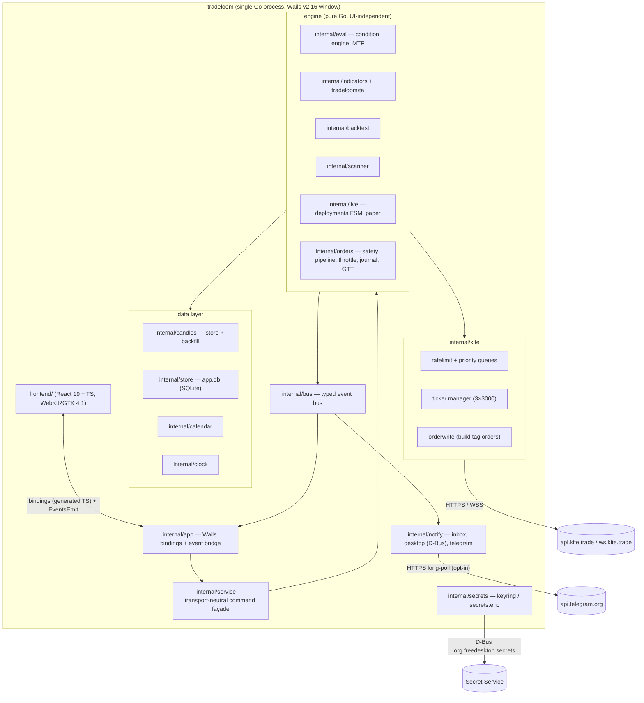
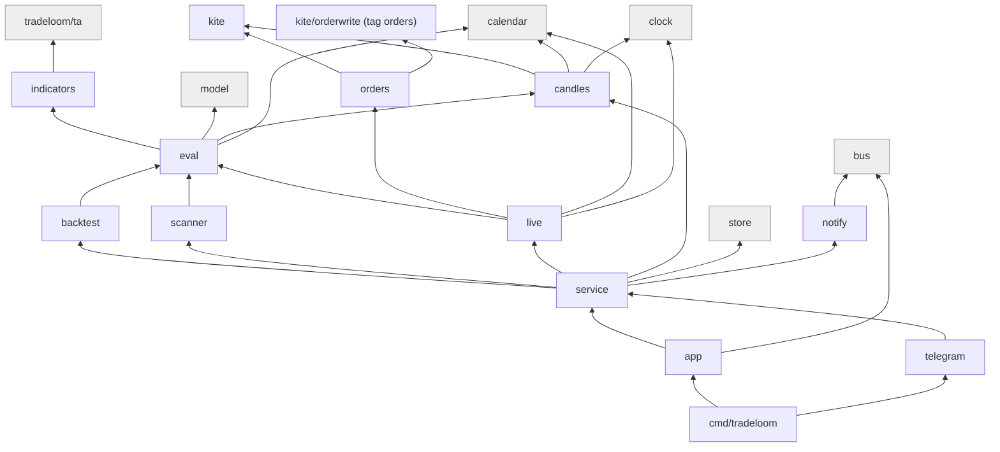
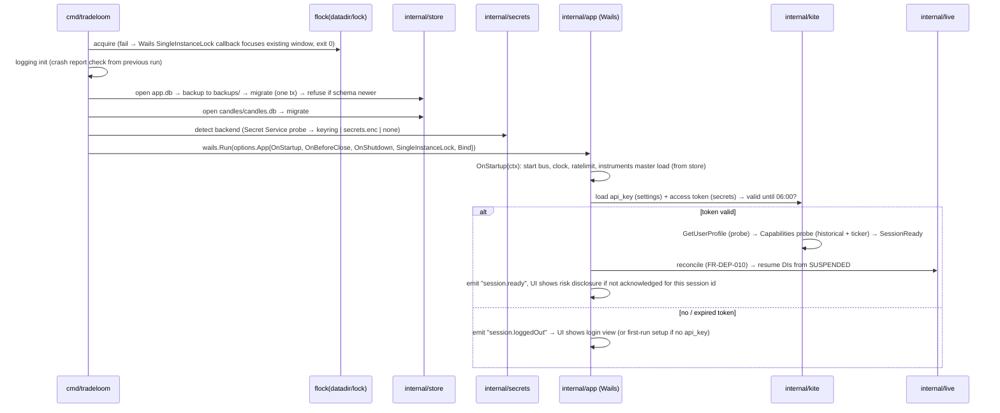

# Tradeloom — Architecture Specification

Status: v1 DRAFT for review, 2026-10-12. Inputs: `docs/requirements/REQUIREMENTS.md` v2.2 (APPROVED), `docs/plan/ROADMAP.md` v1 (APPROVED), `docs/research/areas/07-platform-kite-wails.md`, `docs/research/areas/08-freqtrade-telegram.md`, the existing module `ta/` (`tradeloom/ta`, pure-Go TA-Lib v0.8.1 port). The Phase 0 implementation plan is written from this document.

Conventions: "FR-X" cites a requirement; "C-nn"/"NFR-nn" cite §4/§5 of the requirements; "OQ-nn" cites §9. "Verified" means the version, licence or API name was checked on 2026-10-12 against proxy.golang.org, the npm registry or the downloaded module source (§13.2 lists every check). Nothing in this document introduces behaviour the requirements do not ask for; where a design choice resolves an open question, it is recorded in §13.1.

---

## 0. System in one page



One process, one window, no server component. Everything below the Wails bindings is plain Go that compiles and tests with `CGO_ENABLED=0` on any OS; only `cmd/tradeloom` links Wails (CGO, GTK, WebKit). Engine packages never import Wails, Kite or SQLite packages (dependency rules in §2.4).

---

## 1. Principles and constraints traceability

### 1.1 Architectural principles

1. **One engine, one code path.** Backtest, live scanner and live deployment evaluate conditions through `internal/eval` on identical `Candle` slices; the live path feeds candles closed by `internal/candles/builder`, the backtest path feeds stored candles. FR-EQB-041 AC1 and FR-BT-023 AC1 are tests of this property, not aspirations.
2. **Persist intent before side effect.** Every external action that costs money or cannot be undone (order, GTT, Telegram confirmation) is journaled in SQLite in the same transaction as the state transition that authorises it, before the HTTP call (FR-DEP-005, FR-ORD-008).
3. **No order code in the binary until P4.** The Kite order-write surface lives in one package compiled only with build tag `orders` (G-0, §2.5).
4. **Engine never blocks on UI or notifiers.** The bus is fan-out with bounded per-subscriber queues; the slowest subscriber drops its own messages, never the publisher's (FR-TG-031).
5. **Time comes from two services only.** `internal/calendar` (phases, holidays, anchors) and `internal/clock` (app clock); no package may call `time.Now()` for scheduling (enforced by `forbidigo` in golangci-lint, §10.5).
6. **Deterministic by construction.** Engine code uses no maps for ordered iteration, no goroutine-dependent accumulation, no wall clock; parallelism is per instrument with results merged in input order.
7. **Swap points are interfaces.** Candle store engine (`candles.Store`), broker (`live.Broker`: paper vs Kite), secrets backend (`secrets.Store`), chart library (`ChartAdapter` in TS) are interfaces with at least two implementations or a documented fallback.

### 1.2 Constraint → where satisfied

| ID | Where it is satisfied (package / mechanism) |
|---|---|
| C-01 Connect plan needed | `internal/kite/session.Capabilities` probes historical + ticker after login (FR-ACCT-007); `internal/app` exposes `DataPlan` state; views gate on it |
| C-02 Token expires 06:00 | `internal/kite/session` stores token with `expires_at` = next 06:00 IST (app clock); `session.Watcher` fires `SessionExpired` at that instant; `TokenException` from any call maps to the same event (§5.3) |
| C-03 No server runtime | `internal/live` reconciles on start (FR-DEP-010); GTT mirroring in `internal/orders/gtt`; `SUSPENDED` overlay in the FSM (§7.1) |
| C-04 Static IP for orders | `internal/orders/pipeline` stage 1 gate reads `settings.trading.enabled`; IP-rejection detector disables trading (FR-ORD-013) |
| C-05 Order-rate limits | `internal/orders/throttle` (8/s, 380/min, 4 800/day, 24 mods) in front of `internal/kite/orderwrite`; counters persisted in `order_counters` (§4.2) |
| C-06 market_protection | `pipeline` stage 9 sets `OrderParams.MarketProtection = -1` (or user %) for MARKET/SL-M; a unit test asserts 0 is never sent |
| C-07 3×3000 ticker | `internal/kite/ticker.Manager` owns up to three `ticker.Ticker`s, assigns tokens by priority class, refuses over budget (§5.6) |
| C-08 Historical limits | `internal/kite/ratelimit` class `historical` = 3 req/s; `internal/candles/backfill` windows per interval, resumable jobs table (§5.4) |
| C-09 No scraping | `internal/universe` ships empty lists + CSV import; no HTTP client exists outside `internal/kite`, `internal/notify/telegram` and the opt-in update/IP-echo checks (`forbidigo` bans `net/http` elsewhere) |
| C-10 Accurate charges | `internal/backtest/fees` versioned table; `fees.ValidateAgainstBroker` uses `GetOrderCharges` (read-only, allowed under `noorders`) |
| C-11 Linux build | Docker + GitHub Actions, `-tags webkit2_41`, nfpm `.deb`, appimagetool (§10) |
| C-12 Charting licence | lightweight-charts 5.2.1 (Apache-2.0) behind `frontend/src/chart/adapter` (§8.5) |
| C-13 Single window, no tray | No tray code; FR-DEP-020 "keep in tray" option is hidden (feature flag `tray=false` at build) |
| C-14 No calendar/clock endpoint | `internal/calendar` shipped `calendar/nse-bse-2026.csv` + user edits in SQLite; `internal/clock` offset estimator from tick timestamps / HTTP `Date` (§3.6) |

### 1.3 NFR → where satisfied

| NFR | Mechanism |
|---|---|
| NFR-01 Platform | Linux amd64 build with WebKit2GTK 4.1; macOS dev build via `wails build` on macOS (no packaging); CI matrix installs the `.deb` on Ubuntu 22.04/24.04, Debian 12, Fedora 39 (`.rpm` via nfpm is a one-line addition, not required) |
| NFR-02 Packaging | nfpm `.deb`; AppImage; single binary with embedded frontend (`embed.FS`), data dir `~/.local/share/tradeloom` (§4.5) |
| NFR-03 Storage | `app.db` SQLite (modernc.org/sqlite) + `candles/candles.db`; migrations in `internal/store/migrations/*.sql`, `PRAGMA user_version` (§4.4) |
| NFR-04 Security | `internal/secrets` (keyring or `secrets.enc`); `internal/logging/redact` handler; outbound hosts allow-list enforced by one `http.Transport` with a host check (§9) |
| NFR-05 Safety | `internal/orders/pipeline` 10 stages; `orders` build tag; kill switch in `internal/orders/kill` (§7.5) |
| NFR-06 Correctness | `tradeloom/ta` oracle tests; golden vectors for in-house operands; engine rule fixtures (§11) |
| NFR-07 Performance | Backtest per-instrument goroutines (`errgroup`, GOMAXPROCS workers), columnar candle slices, indicator cache per (instrument, TF, operand, params); UI thread never runs engine code |
| NFR-08 Latency | Candle close scheduled by `clock.Timer` at exchange boundary + 1 s grace; evaluation < 1 ms per instrument; skew > 5 s → `SUSPENDED(clock)` (§3.6) |
| NFR-09 Reliability | ticker auto-reconnect + `Resubscribe()`; backfill job table; write-ahead intent; backup/restore (§4.6) |
| NFR-10 Observability | `log/slog` JSON logs, rotation; `deployment_events`, `order_journal` tables; in-app viewers (§3.7) |
| NFR-11 UX | Frontend design tokens, shortcut registry, `Intl.NumberFormat('en-IN')` (§8) |
| NFR-12 Data integrity | Candles stored raw; `candle_checksums` per month; `backtest_runs.assumptions` JSON (§4.2) |
| NFR-13 Limits | No cap constants exist in code; only Kite budgets (`ticker.Manager`, `ratelimit`, `throttle`) |
| NFR-14 Offline | Every read path is store-first; `kite.Client` returns `ErrOffline` that views render as a badge; backtests need no network when coverage is complete |
| NFR-15 Scope guard | `internal/instruments.Import` keeps only `INDICES`, `NSE`/`BSE` equities (`EQ` and BSE series), `NFO-FUT`/`BFO-FUT`; everything else is dropped before insert; a test asserts no option/MCX/CDS row survives |

---

## 2. Repository and module layout

### 2.1 Go modules and workspace

```
streak-desktop/                      (repo root; product name Tradeloom)
├── go.work                          use . and ./ta (developer convenience)
├── go.mod                           module tradeloom  (go 1.25)
│                                    require tradeloom/ta v0.0.0; replace tradeloom/ta => ./ta
├── ta/                              module tradeloom/ta (existing; untouched by app code)
├── third_party/ta-lib/              git submodule, C oracle for ta's tests only
├── cmd/tradeloom/                   main package (the only package that imports Wails)
├── internal/…                       application packages (§2.2)
├── frontend/                        React + TypeScript (Vite)
├── assets/                          icons, calendar CSV, fee table, library docs (embedded)
├── docs/                            requirements, plan, research, architecture, spec
├── build/                           wails.json, nfpm.yaml, AppImage recipe, Dockerfile.linux
└── .github/workflows/               ci.yml, release.yml
```

Decisions:
- **Two modules, one repo.** `tradeloom/ta` stays a separate module so it can be tested with its C oracle in its own CI job and reused without pulling the app's dependencies. The root module depends on it through a `replace` directive, so `go build ./...` works without workspace mode (CI builds with `GOWORK=off`).
- **Go 1.25** (the toolchain `ta/go.mod` already requires; `go1.25.5` verified locally). gokiteconnect's CI matrix stops at Go 1.24 (A07 §C) — a P0 smoke test compiles it under 1.25; no issue is expected.
- **`internal/` everywhere.** Nothing is importable from outside the module; the public surface is the binary.

### 2.2 Package tree

| Package | Responsibility | Phase | Key types |
|---|---|---|---|
| `cmd/tradeloom` | `main`: parse flags, lock data dir, build `app.App`, run Wails with `options.App{…}` | P0 | — |
| `internal/app` | Wails glue: bound API structs (one per domain), `OnStartup/OnShutdown/OnBeforeClose`, event bridge bus→`runtime.EventsEmit`, single-instance callback | P0 | `App`, `api.Session`, `api.Chart`, `api.Watchlists`, … |
| `internal/service` | Transport-neutral command façade (FR-TG-031): every user action the UI or Telegram can perform is a method here; business rules live here or below, never in `internal/app` or the bot | P0 | `Service`, `Cmd*` structs, `ErrRefused{Stage, Reason}` |
| `internal/bus` | In-process typed pub/sub, bounded subscriber queues, drop counters | P0 | `Bus`, `Topic[T]`, `Subscriber` |
| `internal/kite` | Thin wrapper over `gokiteconnect/v4`: `Client` (read-only interface), session, error taxonomy, instruments download | P0 | `ReadClient`, `Session`, `Err` |
| `internal/kite/ratelimit` | Per-class token buckets, priority queues, 429 back-off, queue-depth metrics | P0 | `Limiter`, `Class`, `Priority` |
| `internal/kite/ticker` | Subscription manager over up to 3 `ticker.Ticker`s, priority budget, tick fan-out, order-update fan-out | P0 | `Manager`, `Consumer`, `Mode` |
| `internal/kite/orderwrite` | **The only package that calls order-write methods**; compiled with tag `orders` (§2.5) | P4 | `Writer` |
| `internal/kite/mock` | In-memory fake of `ReadClient`/`Writer`/ticker for tests and the mock Kite HTTP server | P0 | `Server`, `Fake` |
| `internal/calendar` | Exchange calendar: trading days, phases, special sessions, anchors, SO offsets; shipped CSV + user edits | P0 | `Service`, `Phase`, `Session`, `Day` |
| `internal/clock` | App clock: offset estimator, IST helpers, boundary timers, skew state | P0 | `Clock`, `Timer`, `Offset` |
| `internal/candles` | `Store` interface + SQLite implementation, coverage map, checksums, resampling, purge; `builder` (tick→candle); `backfill` (jobs, windows, resume) | P0 | `Store`, `Candle`, `Interval`, `Coverage`, `Builder`, `Backfill` |
| `internal/instruments` | Instrument master import/filter, search index, lot/tick lookup, futures metadata | P0 | `Master`, `Instrument`, `Search` |
| `internal/store` | SQLite `app.db` open/migrate/backup, typed repositories per table group | P0 | `DB`, `Migrator`, `*Repo` |
| `internal/secrets` | `Store` interface: `keyring` (zalando/go-keyring) and `encfile` (`secrets.enc`) backends, migration between them | P0 | `Store`, `Key` |
| `internal/settings` | Typed settings with defaults, validation, change events; persisted in `settings` table | P0 | `Settings`, `Key[T]` |
| `internal/logging` | `slog` JSON handler, rotation, redaction, crash reports, support bundle | P0 | `Redactor`, `Crash` |
| `internal/notify` | Inbox repository + fan-out to channels: `desktop` (D-Bus), `telegram` (P5) | P3/P5 | `Inbox`, `Channel`, `Event*` |
| `internal/model` | Strategy/scanner document model, JSON schema, canonical text DSL (parser, formatter), migrations, validation, operand catalogue loader | P1 | `StrategyDoc`, `ScannerDoc`, `Expr`, `Catalogue` |
| `internal/indicators` | Operand registry mapping catalogue ids to `ta.*` or in-house functions; in-house operands (sibling of `ta`, same conventions) | P1 | `Registry`, `Operand`, `Series` |
| `internal/eval` | Condition engine: compiled condition trees, MTF scheduling, crosses semantics, traces, warm-up | P1 | `Compiled`, `Evaluator`, `Instant`, `Trace` |
| `internal/backtest` | Event loop, fills, SL/TP/TSL, SO, EXP, cycles, charges (`fees`), metrics, run records | P2 | `Runner`, `Sim`, `Trade`, `Metrics` |
| `internal/scanner` | Manual scan and live scanner scheduler on candle close; universes | P3 | `Scanner`, `Live` |
| `internal/universe` | Built-in universes, constituent import, sectors, custom baskets | P1/P3 | `Universe`, `Ref` |
| `internal/live` | Deployment-instrument FSM, persistence-before-action, reconciliation, SO tables, `Broker` interface with `paper` and `kite` implementations | P4 | `Deployment`, `DI`, `State`, `Broker` |
| `internal/orders` | Safety pipeline, throttle, journal, kill switch, GTT mirroring, local order/position cache | P4 | `Pipeline`, `Throttle`, `Journal`, `Kill`, `GTT` |
| `internal/telegram` | Bot (go-telegram/bot), pairing, auth, commands → `service`, confirmations, outbound limiter | P5 | `Bot`, `Auth`, `Confirm` |
| `internal/archtest` | Tests that enforce §2.4/§2.5 using `golang.org/x/tools/go/packages` | P0 | — |

`frontend/` structure is in §8.1.

### 2.3 Dependency diagram



### 2.4 Dependency rules (enforced)

Rules, in order of strictness:

1. `internal/model`, `internal/eval`, `internal/indicators`, `internal/backtest`, `internal/calendar`, `internal/clock` import **no** I/O packages: not `database/sql`, `modernc.org/sqlite`, `net/http`, `github.com/zerodha/gokiteconnect`, `github.com/wailsapp/wails`. They receive data as values/interfaces.
2. Only `internal/app` and `cmd/tradeloom` import `github.com/wailsapp/wails/v2/...`.
3. Only `internal/kite/...` imports `github.com/zerodha/gokiteconnect/v4/...`.
4. Only `internal/store` and `internal/candles/sqlite` import `database/sql` and `modernc.org/sqlite`.
5. Only `internal/telegram` imports `github.com/go-telegram/bot`.
6. Only `internal/secrets` imports `github.com/zalando/go-keyring` and `golang.org/x/crypto/...`.
7. `internal/service` is the only entry point for `internal/app` and `internal/telegram` into engine packages (no bypass).
8. No package except `internal/clock` calls `time.Now()`; no package except `internal/clock` and tests calls `time.Sleep`/`time.After` directly (timers come from `clock.Clock`).

Enforcement, two layers:

- **`go-arch-lint` v1.19.0** (MIT, verified) with `.go-arch-lint.yml` (`version: 3`): `components` named per package above, `vendors` for wails/kite/sqlite/telegram/keyring, `deps.<component>.mayDependOn` / `canUse` encoding rules 1–7. Runs in CI (`go-arch-lint check`).
- **`internal/archtest`** (Go test, runs in `go test ./...`): loads all packages with `go/packages`, re-asserts rules 1–7 as import-graph predicates (so a developer without the linter installed still fails locally), and implements rule 8 and the G-0 check (§2.5) by walking ASTs. `golangci-lint` v2.14.0 `forbidigo` additionally bans `time\.Now\(`, `time\.Sleep\(`, `http\.Get\(`, `http\.DefaultClient` outside allow-listed packages.

### 2.5 G-0: the `orders` / `noorders` build-tag mechanism

Goal (ROADMAP §6, G-0): P0–P3 binaries contain no code path that can call Kite order-write endpoints.

```
internal/kite/orderwrite/
├── writer.go           //go:build orders && !noorders   — real implementation over *kiteconnect.Client
├── writer_stub.go      //go:build !orders || noorders   — every method returns ErrOrdersNotCompiled
├── iface.go            (no tag) type Writer interface { PlaceOrder(ctx, kite.OrderParams) (string, error); ModifyOrder; CancelOrder; ExitOrder; ConvertPosition; PlaceGTT; ModifyGTT; DeleteGTT }
└── doc.go              explains the gate and the CI checks
```

- P0–P3 CI and release builds pass `-tags webkit2_41,noorders`; P4+ builds pass `-tags webkit2_41,orders`. Building with neither tag yields the stub (safe default); building with both yields the stub (`noorders` wins).
- `internal/orders` depends only on the `Writer` interface; with the stub, pipeline stage 9 fails with `ErrOrdersNotCompiled` and the UI shows "Order placement is not included in this build" — which is also why B/S buttons are hidden before P4 (FR-ORD-013 AC1 holds trivially).
- **CI static checks** (`internal/archtest/orders_test.go` plus a release-job step):
  1. AST scan over every non-test Go file in the module: a selector call `X.PlaceOrder|ModifyOrder|CancelOrder|ExitOrder|ConvertPosition|PlaceGTT|ModifyGTT|DeleteGTT|CreateAlert|ModifyAlert|DeleteAlerts|PlaceMFOrder|CancelMFOrder|PlaceMFSIP|ModifyMFSIP|CancelMFSIP|InitiateHoldingsAuth(` (alerts are included because an alert can carry an ATO order basket; mutual-fund orders/SIPs are order writes; InitiateHoldingsAuth enables a holdings sell path) whose receiver type is `*kiteconnect.Client` (any gokiteconnect major version) may appear only in files whose build constraint contains `orders` and that live in `internal/kite/orderwrite`. (Read-only "order-like" methods `GetOrderMargins`, `GetBasketMargins`, `GetOrderCharges`, `GetOrders`, `GetGTTs` are allowed anywhere inside `internal/kite`.)
  2. After the `noorders` build, `go tool nm -sort name tradeloom | grep -E 'gokiteconnect/v[0-9]+\.\(\*Client\)\.(PlaceOrder|ModifyOrder|CancelOrder|ExitOrder|ConvertPosition|PlaceGTT|ModifyGTT|DeleteGTT|CreateAlert|ModifyAlert|DeleteAlerts|PlaceMFOrder|CancelMFOrder|PlaceMFSIP|ModifyMFSIP|CancelMFSIP|InitiateHoldingsAuth)$'` must return nothing (linker dead-code elimination removes unreferenced methods; the check runs before `-s -w` stripping).
  3. The mock-Kite integration suite runs the P0–P3 binary's service layer with a recording fake and asserts zero calls to the order-write routes.

---

## 3. Runtime and process model

### 3.1 Goroutines and services

| Service (goroutine owner) | Package | Lifetime | What it does |
|---|---|---|---|
| Wails main loop | Wails | process | GTK main thread; bound methods run on Wails worker goroutines |
| `bus` dispatcher | `internal/bus` | process | fan-out; each subscriber has its own goroutine draining a bounded channel |
| `clock` estimator | `internal/clock` | process | consumes tick timestamps / HTTP `Date` samples, updates offset, emits skew events |
| `ratelimit` schedulers | `internal/kite/ratelimit` | process | one goroutine per class draining priority queues at the class rate |
| `ticker.Manager` | `internal/kite/ticker` | session | owns ≤ 3 `ticker.Ticker` (each with its own `ServeWithContext`), routes ticks to consumers |
| `candles.Builder` | `internal/candles` | session | per subscribed token builds the forming candle per interval; closes candles on `clock.Timer` boundaries |
| `backfill.Worker` | `internal/candles/backfill` | process | pulls jobs from the `backfill_jobs` table, submits window requests at `historical` class |
| `instruments.Refresher` | `internal/instruments` | process | daily dump refresh after 08:30 IST on trading days |
| `session.Watcher` | `internal/kite` | process | 06:00 expiry timer, `TokenException` listener |
| `backtest.Runner` | `internal/backtest` | per run | `errgroup` with `GOMAXPROCS` workers, one instrument per task, cancellable |
| `scanner.Live` | `internal/scanner` | session | subscribes to candle-close events, evaluates active scanners |
| `live.Engine` | `internal/live` | session | per deployment-instrument FSM driven by candle-close + tick events; serialised per DI by a single actor goroutine per deployment |
| `orders.Throttle` | `internal/orders` | process | single queue consumer in priority order |
| `orders.Sync` | `internal/orders` | session | 30 s `GetOrders`/`GetPositions` poll while orders are open |
| `notify.desktop` / `telegram` | `internal/notify`, `internal/telegram` | process / opt-in | bus subscribers with bounded queues (§3.5) |
| Wails event bridge | `internal/app` | process | subscribes to UI-relevant topics and emits coalesced `runtime.EventsEmit` |

Concurrency model: **actors with mailboxes** for stateful components (`live.Engine`, `ticker.Manager`, `Throttle`), **worker pools** for CPU work (backtest), **plain mutex-free value passing** elsewhere. Shared mutable state is confined to one goroutine per owner; cross-goroutine communication is channels or the bus. SQLite is accessed through one `*sql.DB` with `SetMaxOpenConns(1)` for writers plus a read pool (WAL allows concurrent readers).

### 3.2 Startup sequence



Startup budget: the window must appear within 1 s (Wails shows the window as soon as `Assets` are served; everything above except `store.open/migrate` runs in `OnStartup` asynchronously and reports through events). Migration time is bounded by a progress event (`store.migrating`).

### 3.3 Shutdown and crash recovery

- `OnBeforeClose(ctx) bool`: if active deployments exist, emit `app.quitRequested` with the DI list and GTT-protection flags and return `true` (prevent close) until the UI answers via `Session.ConfirmQuit(choice)`; "Quit" → `runtime.Quit`. (FR-DEP-020; the tray option is not shown, C-13.)
- `OnShutdown(ctx)`: order of teardown — (1) Telegram `app_offline` with 5 s drain budget (FR-TG-010/031); (2) `live.Engine` persists `resume_state` and marks DIs `SUSPENDED(app offline)`; (3) tickers `Stop()`; (4) ratelimit queues cancel; (5) bus close; (6) SQLite `PRAGMA wal_checkpoint(TRUNCATE)`, close; (7) release flock. Total budget 10 s, then force exit.
- Crash: `internal/logging.Crash` installs `defer recover()` in every goroutine spawned through `logging.Go(name, fn)` (the only sanctioned way to start a goroutine — `forbidigo` bans bare `go ` statements outside `internal/logging` and `internal/bus`); a panic writes `logs/crash-<ts>.json` and re-panics after flush. On next start, the lock file's `previous_exit != clean` marker triggers "The app crashed last time" (FR-SHELL-018 AC2) and `app_online` says "previous session ended unexpectedly" (FR-TG-010 AC2).
- Recovery of state after crash relies on SQLite only: write-ahead intents (`order_journal.intent`), `deployment_instruments.*`, `backfill_windows.status`, `candles.complete`. No in-memory state is authoritative.

### 3.4 Event bus

`internal/bus` is a small typed pub/sub:

```go
type Topic[T any] struct{ name string }
func Publish[T any](b *Bus, t Topic[T], v T)                 // never blocks; drops to slow subscribers
func Subscribe[T any](b *Bus, t Topic[T], opts SubOpts) *Sub[T]   // opts: Buffer int, Critical bool, Coalesce func(old,new T) T
```

Topics (Go structs, one per event type, mirrored 1:1 to Wails event names):

| Topic | Payload | Producers | Consumers |
|---|---|---|---|
| `tick.batch` | `[]Tick` (coalesced per 100 ms) | ticker.Manager | app bridge (chart/watchlist), live, scanner (LTP) |
| `candle.closed` | `{Token, Interval, Candle}` | candles.Builder | eval consumers (live, scanner), app bridge |
| `candle.forming` | `{Token, Interval, Candle}` (coalesced) | candles.Builder | app bridge |
| `session.state` | `{State, ExpiresAt, DataPlan}` | kite.session | everyone |
| `feed.state` | `{State, Attempt, NextRetry, LastTick}` | ticker.Manager | app bridge, live |
| `clock.offset` | `{Offset, Source, Skewed}` | clock | app bridge, live |
| `backfill.progress` | `{JobID, Done, Total, ETA}` | backfill | app bridge |
| `notification.event` | `notify.Event` (typed union per FR-TG-028 catalogue) | live, scanner, orders, session | inbox, desktop, telegram, app bridge |
| `deployment.changed` | `{DeploymentID, DI, From, To, Event}` | live | app bridge, telegram |
| `order.update` | `kite.Order` | ticker (order updates) + orders.Sync | orders, live, app bridge |
| `limits.usage` | counters snapshot (1 Hz) | ratelimit, throttle, ticker | app bridge |
| `orders.changed` / `positions.changed` / `holdings.changed` | `orders.BookSnapshot` / `PositionsSnapshot` / `HoldingsSnapshot` (coalesced) | orders.Sync | app bridge |
| `watchlists.changed` | `service.WatchlistsState` | service | app bridge |
| `settings.changed` | `settings.Changed{Key, Value}` | settings | app bridge, logging (level) |
| `instruments.status` | `instruments.Status` | instruments.Refresher | app bridge (Settings → Data) |
| `market.status` | `service.MarketStatus{Exchange, Phase, DayType, Label, Tooltip, AtMs}` (on phase change) | service (from calendar + app clock) | app bridge (status indicator) |
| `job.progress` | `service.JobProgress{JobID, Kind, Stage, Done, Total, Finished, Error, ResultPath}` | service jobs (backup, restore, support bundle) | app bridge |
| `app.navigate` | `service.Navigate{Route}` | app (second-instance `--view`), notifications (P3) | app bridge → router |

Back-pressure: each subscriber owns a bounded channel (`Buffer`, default 256; `tick.batch` 16 with coalescing by token). When full, non-critical subscribers drop the oldest message and increment `bus_drops{subscriber}` (visible in Settings → Limits and `/health`); subscribers marked `Critical` (inbox persistence, deployment FSM) use a larger buffer (4 096) and, if ever full, the publisher logs ERROR and blocks up to 50 ms — this is an invariant violation surfaced in tests, not a steady-state mode.

UI bridge: the coalescing sources live in `internal/service/events.go` (`service.EventCatalogue()` / `(*Service).EventSources()`, transport-neutral so P5 Telegram reuses them; placing them in `internal/app` would make `app` import `ticker`, `candles/builder`, `backfill`, `orders` and break rule 7). `internal/app` supplies only the `Emit` function that calls `runtime.EventsEmit(ctx, name, payload)` at most every 100 ms per coalesced topic (immediate topics: `session.state`, `candle.closed`, `watchlists.changed`, `settings.changed`, `order.update`, `market.status`, `job.progress`, `app.navigate`); the frontend subscribes with `EventsOn`. `session.ready` / `session.loggedOut` of §3.2 are `session.state` with `state = ready` / `logged_out`. Payloads are JSON-serialisable structs shared with the generated TS models (§8.4).

### 3.5 Notifier pipeline (FR-TG-031)

```mermaid
flowchart LR
    E[engine publishes notify.Event] --> B[bus topic notification.event]
    B --> I[inbox subscriber: INSERT notifications (Critical)]
    B --> D[desktop subscriber: D-Bus Notify, buffer 64]
    B --> T[telegram subscriber: buffer 256, coalescer, outbound limiter]
    B --> U[app bridge: toast + unread count]
```

Each channel filters by its own per-type settings (desktop per-type filter FR-ACCT-003; Telegram loudness FR-TG-028). The inbox write is the source of truth; channels carry `notification_id` so a Telegram "Place" button and the desktop "Review order" action resolve the same row (FR-TG-021 AC2).

### 3.6 Timers aligned to the exchange clock

`internal/clock`:

- `Clock.Now()` = `time.Now().Add(offset)` in `Asia/Kolkata` (loaded once via `time.LoadLocation`; the binary embeds `time/tzdata` so a minimal container still resolves IST).
- Offset estimator: ring buffer of `(exchange_ts − arrival_ts)` from ticks of the most liquid subscribed token (median over the last 60 s; `models.Tick.Timestamp` is the exchange timestamp per gokiteconnect, verified) and, with no ticks, from Kite HTTP `Date` headers (median of last 5; the `kite.Client` transport records them). Source and value are exposed; thresholds 1 s (warn once) and 5 s (`Skewed=true` → live suspension) per FR-DATA-004.
- `Clock.At(t time.Time) <-chan struct{}` and `Clock.Boundary(interval, anchor)`: timers are computed as `target − Now()` and re-armed whenever the offset changes by > 100 ms; the candle builder closes a candle at `boundary + 1 s` grace (FR-DEP-006).
- `calendar.Service.Anchor(exchange, date)` supplies the session start for alignment (09:15 regular; special-session start otherwise); all interval boundaries are `anchor + k×interval` (FR-DATA-002/FR-BT-034).
- Tests inject a `FakeClock` (`clock.Clock` is an interface); the engine packages receive the interface, never the package-level singleton.

### 3.7 Single-instance lock

Two mechanisms, both required (FR-ACCT-004 AC3):

1. `gofrs/flock` v0.13.1 (BSD-3, verified) on `<datadir>/lock` — authoritative (protects SQLite from a second writer even under a headless session with no D-Bus).
2. Wails `options.App.SingleInstanceLock{UniqueId: "tradeloom-" + sha1(datadir)[:12], OnSecondInstanceLaunch: focus}` (verified in v2.16.0 `pkg/options/options.go`; Linux implementation registers `org.<id>.SingleInstance` on the session bus) — gives the "second launch focuses the existing window" UX. The callback calls `runtime.WindowUnminimise` + `runtime.WindowShow`.

If (2) is unavailable (no session bus) the second process fails on (1) and prints "Tradeloom is already running (data dir …)" to stderr, exit 1.

### 3.8 Logging

`log/slog` JSON handler → `gopkg.in/natefinch/lumberjack.v2` v2.2.1 (MIT, verified) with `MaxSize: 20, MaxBackups: 10`; file `logs/tradeloom.log`. A `RedactHandler` wraps the JSON handler and rewrites any attribute whose key matches `authorization|request_token|access_token|api_secret|checksum|bot_token|passphrase` or whose string value equals a registered secret (the secrets store registers values at load: `logging.RegisterSecret(v)`), replacing with `"[redacted]"`. Level is switchable at runtime through `slog.LevelVar`. HTTP debug logging (`kite.Client`) logs method, path, status, duration and the rate-limit class — never headers or bodies.

---

## 4. Data

### 4.1 Overview

Two SQLite databases (driver `modernc.org/sqlite` v1.59.0, BSD-3, CGO-free, SQLite 3.53.x — verified; v1.60.1 is the latest but its `go.mod` declares `go 1.26.0` (proxy.golang.org, checked 2026-10-12) and this project builds with Go 1.25, so v1.59.0 — the last release declaring `go 1.25.0` — is pinned; P0-1 verified `applyQueryParams` pragmas against it):

- `app.db` — everything except candles (small, backed up always).
- `candles/candles.db` — the candle store (large, optional in backups, purgeable).

Why two files: backup/restore size control (FR-DATA-005 "optionally the candle store"), independent WAL checkpointing, and "Clear cached candles" = delete one file. Both are opened with `PRAGMA journal_mode=WAL; synchronous=NORMAL; foreign_keys=ON; busy_timeout=5000; temp_store=MEMORY`. Candle DB additionally `page_size=8192` (set at creation) and `mmap_size=1073741824`.

Rationale for `modernc.org/sqlite` over `mattn/go-sqlite3`: macOS development builds and every `go test ./...` on every OS run without a C compiler, and the Linux release build already links CGO for Wails so there is no packaging penalty either way. Over `ncruces/go-sqlite3` (wasm): higher memory use and a less common driver.

### 4.2 `app.db` schema (v1)

Conventions: `id TEXT PRIMARY KEY` = UUIDv7 (time-ordered, `github.com/google/uuid` v1.6.0 BSD-3) unless noted; timestamps `*_at INTEGER` = Unix milliseconds UTC (displayed in IST); money `*_paise INTEGER`; JSON columns are `TEXT` validated by Go before write; every table has `created_at`, mutable tables also `updated_at`. All `DELETE`s of user content are soft (`deleted_at`) with a 30-day sweep (OQ-21).

```sql
-- settings
CREATE TABLE settings (key TEXT PRIMARY KEY, value TEXT NOT NULL, updated_at INTEGER NOT NULL);     -- JSON value
CREATE TABLE sessions (id TEXT PRIMARY KEY, user_id TEXT, logged_in_at INTEGER, expires_at INTEGER,
  risk_ack_at INTEGER, data_plan TEXT, ended_at INTEGER, end_reason TEXT);                          -- FR-SHELL-020, FR-ACCT-006
CREATE TABLE shortcuts (action_id TEXT PRIMARY KEY, binding TEXT NOT NULL, scope TEXT NOT NULL);    -- user overrides only
CREATE TABLE window_state (k TEXT PRIMARY KEY, v TEXT NOT NULL);

-- instruments (replaced wholesale per import, inside one transaction)
CREATE TABLE instruments (token INTEGER PRIMARY KEY, exchange_token INTEGER, tradingsymbol TEXT NOT NULL,
  name TEXT, exchange TEXT NOT NULL, segment TEXT NOT NULL, instrument_type TEXT NOT NULL,
  expiry INTEGER, tick_size_paise INTEGER NOT NULL, lot_size INTEGER NOT NULL, display_name TEXT NOT NULL,
  underlying TEXT, is_index INTEGER NOT NULL, is_weekly INTEGER, imported_at INTEGER NOT NULL);
CREATE INDEX ix_instr_symbol ON instruments(exchange, tradingsymbol);
CREATE INDEX ix_instr_underlying ON instruments(underlying, expiry);
CREATE TABLE instrument_imports (id INTEGER PRIMARY KEY, downloaded_at INTEGER, row_count INTEGER, kept_count INTEGER, source TEXT);
CREATE VIRTUAL TABLE instrument_fts USING fts5(tradingsymbol, name, display_name, content='instruments', content_rowid='token', tokenize='unicode61');
--   search ranking (FR-WATCH-008) is done in Go over FTS candidates; the FTS index only prunes.

-- watchlists & universes
CREATE TABLE watchlists (id TEXT PRIMARY KEY, name TEXT NOT NULL, position INTEGER NOT NULL, created_at, updated_at, deleted_at);
CREATE TABLE watchlist_items (watchlist_id TEXT REFERENCES watchlists(id), token INTEGER, position INTEGER, PRIMARY KEY(watchlist_id, token));
CREATE TABLE universes (id TEXT PRIMARY KEY, kind TEXT NOT NULL /* builtin|basket */, name TEXT, sector_map_version TEXT, updated_at);
CREATE TABLE universe_members (universe_id TEXT, exchange TEXT, tradingsymbol TEXT, industry TEXT, imported_at INTEGER, PRIMARY KEY(universe_id, exchange, tradingsymbol));

-- strategies & scanners: versioned JSON documents
CREATE TABLE documents (id TEXT PRIMARY KEY, kind TEXT NOT NULL /* strategy|scanner */, name TEXT NOT NULL,
  category TEXT, tags TEXT /* JSON array */, favourite INTEGER NOT NULL DEFAULT 0, origin_type TEXT, library_id TEXT, library_version TEXT,
  head_version INTEGER NOT NULL, created_at, updated_at, deleted_at);
CREATE TABLE document_versions (document_id TEXT REFERENCES documents(id), version INTEGER, schema_version TEXT NOT NULL,
  body TEXT NOT NULL /* canonical JSON */, canonical_text TEXT NOT NULL, sha256 TEXT NOT NULL, saved_at INTEGER, PRIMARY KEY(document_id, version));
CREATE TABLE document_drafts (document_id TEXT PRIMARY KEY, body TEXT NOT NULL, saved_at INTEGER);   -- autosave / crash recovery (FR-SHELL-008)
CREATE INDEX ix_documents_kind ON documents(kind, deleted_at, updated_at);

-- backtests
CREATE TABLE backtest_runs (id TEXT PRIMARY KEY, document_id TEXT, document_version INTEGER, params TEXT NOT NULL /* JSON: capital, dates, window, holding, cycle, slippage, mode */,
  assumptions TEXT NOT NULL /* JSON per FR-BT-044 incl. fee_table_version, calendar_version, so_table_version, app_version, engine_version */,
  status TEXT NOT NULL /* running|done|partial|cancelled|failed */, started_at, finished_at, total_pnl_paise INTEGER, total_pnl_net_paise INTEGER, deleted_at);
CREATE TABLE backtest_instruments (run_id TEXT REFERENCES backtest_runs(id), token INTEGER, exchange TEXT, tradingsymbol TEXT,
  effective_from INTEGER, effective_to INTEGER, data_checksum TEXT, status TEXT, message TEXT,
  metrics TEXT NOT NULL /* JSON: FR-BT-014 gross+net */, daily_pnl TEXT /* JSON array for calendar/MTM */, PRIMARY KEY(run_id, token));
CREATE TABLE backtest_trades (run_id TEXT, token INTEGER, seq INTEGER, side TEXT, qty INTEGER,
  entry_at INTEGER, entry_price_paise INTEGER, exit_at INTEGER, exit_price_paise INTEGER, exit_code TEXT /* EX|SL|TP|TSL|SO|EXP|open */,
  gross_pnl_paise INTEGER, charges_paise INTEGER, entry_trace TEXT /* JSON condition trace */, exit_trace TEXT, PRIMARY KEY(run_id, token, seq));
CREATE INDEX ix_bt_trades_exit ON backtest_trades(run_id, exit_at);
CREATE TABLE fee_tables (version INTEGER PRIMARY KEY, body TEXT NOT NULL, created_at INTEGER, source TEXT /* shipped|user */);

-- deployments
CREATE TABLE deployments (id TEXT PRIMARY KEY, document_id TEXT, document_version INTEGER, name TEXT, mode TEXT NOT NULL /* notify|signal|paper|auto */,
  params TEXT NOT NULL /* JSON: capital, cycle, order_type, product, rearm_daily, gtt, validity_end, risk_limits */,
  status TEXT NOT NULL /* ACTIVE|STOPPED|EXPIRED|COMPLETED */, armed_session_id TEXT, armed_at INTEGER, created_at, updated_at, deleted_at);
CREATE TABLE deployment_instruments (id TEXT PRIMARY KEY, deployment_id TEXT REFERENCES deployments(id), token INTEGER, exchange TEXT, tradingsymbol TEXT,
  qty INTEGER, state TEXT NOT NULL, resume_state TEXT, suspend_reason TEXT, cycle_count INTEGER, cycle_day INTEGER,
  position_qty INTEGER, avg_price_paise INTEGER, sl_paise INTEGER, tp_paise INTEGER, tsl_ref_paise INTEGER, trail_stop_paise INTEGER,
  last_eval_candle_at INTEGER, pending_signal TEXT /* JSON */, entry_order_tag TEXT, exit_order_tag TEXT, gtt_id INTEGER,
  attention_reason TEXT, updated_at);
CREATE INDEX ix_di_state ON deployment_instruments(state);
CREATE TABLE deployment_events (id INTEGER PRIMARY KEY, deployment_id TEXT, di_id TEXT, at INTEGER NOT NULL, kind TEXT NOT NULL,
  from_state TEXT, to_state TEXT, details TEXT /* JSON */, order_tag TEXT);
CREATE INDEX ix_dep_events ON deployment_events(di_id, at);
CREATE TABLE so_tables (kind TEXT /* backtest|live */, version INTEGER, body TEXT NOT NULL, PRIMARY KEY(kind, version));

-- orders (local cache + journal)
CREATE TABLE order_journal (id INTEGER PRIMARY KEY, at INTEGER NOT NULL, tag TEXT NOT NULL, kind TEXT NOT NULL /* intent|submit|response|update|fill|modify|cancel|unknown|reconcile */,
  source TEXT NOT NULL /* manual|deployment:<id>|basket|scalper|telegram|kill */, params TEXT /* JSON sanitised */, kite_order_id TEXT, status TEXT, message TEXT, stage TEXT);
CREATE INDEX ix_journal_tag ON order_journal(tag, at);
CREATE INDEX ix_journal_at ON order_journal(at);
CREATE TABLE orders_cache (kite_order_id TEXT PRIMARY KEY, tag TEXT, body TEXT NOT NULL /* JSON kite.Order */, status TEXT, updated_at);
CREATE TABLE positions_cache (k TEXT PRIMARY KEY /* exchange|symbol|product */, body TEXT NOT NULL, updated_at);
CREATE TABLE order_counters (day INTEGER PRIMARY KEY /* yyyymmdd IST */, orders INTEGER NOT NULL, mods TEXT /* JSON {order_id: count} */, http429 INTEGER NOT NULL DEFAULT 0);
CREATE TABLE paper_orders (id TEXT PRIMARY KEY, deployment_id TEXT, di_id TEXT, at INTEGER, side TEXT, qty INTEGER, type TEXT, price_paise INTEGER, trigger_paise INTEGER,
  status TEXT, fill_price_paise INTEGER, filled_at INTEGER, charges_paise INTEGER);
CREATE TABLE paper_positions (k TEXT PRIMARY KEY, deployment_id TEXT, body TEXT NOT NULL, updated_at);
CREATE TABLE gtts (gtt_id INTEGER PRIMARY KEY, di_id TEXT, type TEXT, body TEXT NOT NULL, placed_at INTEGER, last_modified_at INTEGER, status TEXT);

-- notifications inbox
CREATE TABLE notifications (id TEXT PRIMARY KEY, at INTEGER NOT NULL, type TEXT NOT NULL /* FR-TG-028 catalogue id */, category TEXT /* strategy|scanner|system */,
  deployment_id TEXT, di_id TEXT, scanner_id TEXT, tokens TEXT /* JSON */, title TEXT, body TEXT NOT NULL /* JSON typed payload */,
  status TEXT /* Pending|Placed|Rejected|Ignored|Expired|Missed|Info */, expires_at INTEGER, read_at INTEGER, resolved_at INTEGER, resolved_by TEXT /* desktop|telegram */);
CREATE INDEX ix_notif_at ON notifications(at); CREATE INDEX ix_notif_status ON notifications(status, expires_at);

-- scanners (live)
CREATE TABLE scanner_runs (id TEXT PRIMARY KEY, document_id TEXT, candle_at INTEGER, ran_at INTEGER, kind TEXT /* manual|live|missed */, matches TEXT /* JSON */, duration_ms INTEGER);
CREATE INDEX ix_scanner_runs ON scanner_runs(document_id, candle_at);

-- analytics recorder (P3), calendar edits, telegram
CREATE TABLE analytics_series (series TEXT, token INTEGER, at INTEGER, value REAL, PRIMARY KEY(series, token, at));
CREATE TABLE calendar_overrides (exchange TEXT, date INTEGER, type TEXT, phases TEXT /* JSON */, source TEXT, PRIMARY KEY(exchange, date));
CREATE TABLE telegram_state (k TEXT PRIMARY KEY, v TEXT NOT NULL);       -- chat_id, topic_id, authorized_users JSON, update_offset, pairing window; the token is NOT here
CREATE TABLE telegram_audit (id INTEGER PRIMARY KEY, at INTEGER, user_id INTEGER, command TEXT, args TEXT, outcome TEXT, order_tag TEXT);
CREATE TABLE telegram_confirmations (nonce TEXT PRIMARY KEY, user_id INTEGER, action TEXT /* JSON */, created_at INTEGER, expires_at INTEGER, used_at INTEGER);
```

Tables for later phases are created by later migrations (v1 = P0 tables: settings, sessions, shortcuts, window_state, instruments*, watchlists*, order_journal, orders_cache, positions_cache, order_counters, notifications (empty until P3), calendar_overrides). Columns reserved by ROADMAP §7 "FIELD" items (armed state, risk limits) are added in the P4 migration and populated in P6.

### 4.3 Candle store (`candles/candles.db`) — OQ-41 decision

**Decision: SQLite (modernc), one table per native interval, integer-paise prices, `WITHOUT ROWID`, behind the `candles.Store` interface. Confirmed or overturned by spike S0-2 against FR-DATA-002 AC4.**

```sql
CREATE TABLE candles_1m (token INTEGER NOT NULL, ts INTEGER NOT NULL /* unix seconds, candle start, exchange time */,
  o INTEGER NOT NULL, h INTEGER NOT NULL, l INTEGER NOT NULL, c INTEGER NOT NULL /* paise */,
  v INTEGER NOT NULL, oi INTEGER /* NULL for non-futures */, src INTEGER NOT NULL /* 0 historical,1 tick,2 manual */, complete INTEGER NOT NULL,
  PRIMARY KEY(token, ts)) WITHOUT ROWID;
-- identical tables candles_3m, candles_5m, candles_10m, candles_15m, candles_30m, candles_60m, candles_1d
CREATE TABLE coverage (token INTEGER, interval TEXT, from_ts INTEGER, to_ts INTEGER, PRIMARY KEY(token, interval, from_ts));   -- merged, non-overlapping ranges
CREATE TABLE checksums (token INTEGER, interval TEXT, month INTEGER /* yyyymm */, sha256 TEXT NOT NULL, rows INTEGER, updated_at INTEGER, PRIMARY KEY(token, interval, month));
CREATE TABLE backfill_jobs (id TEXT PRIMARY KEY, token INTEGER, interval TEXT, from_ts INTEGER, to_ts INTEGER, requester TEXT, priority INTEGER, status TEXT, created_at INTEGER, finished_at INTEGER, error TEXT);
CREATE TABLE backfill_windows (job_id TEXT REFERENCES backfill_jobs(id), seq INTEGER, from_ts INTEGER, to_ts INTEGER, status TEXT /* queued|running|done|failed */, attempts INTEGER, error TEXT, PRIMARY KEY(job_id, seq));
CREATE TABLE run_refs (run_id TEXT, token INTEGER, interval TEXT, from_ts INTEGER, to_ts INTEGER);   -- ranges referenced by stored backtest runs (purge guard)
CREATE TABLE meta (k TEXT PRIMARY KEY, v TEXT);   -- schema version, size budget, purge rules
```

Reasoning:
- **Row counts.** FR-DATA-002 AC4's load is 500 × 2 y × 1-min ≈ 500 × 375 × 500 ≈ 94 M rows (A07's 470 M is 10 years). Row ≈ 2 + 4 + 4×4 + 4 + 4 + 2 bytes of payload ≈ 36 B in the clustered B-tree; ≈ 4–5 GB on disk at 94 M rows, 20–25 GB at 470 M. Acceptable for an NVMe laptop and purgeable by rule.
- **Query shape.** Every read is a range scan on `(token, ts)` — the clustered primary key of a `WITHOUT ROWID` table — so "one instrument-day" (≈ 375 rows) is one B-tree descent plus a sequential page read: expected well under 5 ms, far inside the 50 ms budget. "Missing ranges between A and B" is a scan of ≤ a few dozen `coverage` rows: < 1 ms.
- **Ingest.** Kite bounds backfill at 3 req/s × 60 d × 375 = ≈ 67 k rows/s; batched `INSERT … ON CONFLICT(token,ts) DO UPDATE` inside one transaction per window sustains > 200 k rows/s on modernc in our experience class; S0-2 measures it.
- **Why not DuckDB.** Faster analytical scans but a 50–80 MB native library, CGO-only, no pure-Go tests, and our access pattern is point-range, not analytical. Why not custom columnar files: coverage maps, idempotent upserts, purge-with-guard and monthly checksums fall out of SQL transactions for free; a file format would need its own index, atomic replace and crash semantics.
- **Prices as integer paise** are exact (tick 0.05 = 5 paise) and compact; the store converts to `float64` on read; `Candle{Open float64 …}` is what the engine sees.
- **Fallback (if S0-2 fails AC4 or the size budget):** keep the same `Store` interface and implement `candles/colfile`: one zstd-compressed columnar segment per (token, interval, month) under `candles/<interval>/<token>/<yyyymm>.tlc`, with the SQLite file retained only for `coverage`, `checksums`, `backfill_*`, `run_refs`. Resampling and the coverage logic do not change.

`candles.Store` interface (the swap point):

```go
type Store interface {
    Read(ctx, token uint32, iv Interval, from, to time.Time) ([]Candle, error)          // native intervals only
    ReadResampled(ctx, token uint32, target Interval, from, to time.Time) ([]Candle, error) // 1w/1M/non-native; anchored via calendar
    Upsert(ctx, token uint32, iv Interval, cs []Candle, src Source) error               // idempotent; updates coverage + checksums
    Missing(ctx, token uint32, iv Interval, from, to time.Time) ([]Range, error)
    Checksum(ctx, token uint32, iv Interval, month int) (string, error)
    Stats(ctx) (Stats, error); Purge(ctx, rule PurgeRule, confirmRuns []string) error
}
```

Resampling rules live in `candles/resample.go` (pure functions, golden-tested per FR-DATA-002 AC5): intraday higher TFs from 1-min/5-min anchored at session start; 1w/1M from 1d; special sessions attach to their calendar date.

### 4.4 Migrations

`internal/store/migrate.go` + `internal/store/migrations/NNNN_name.sql` (embedded). Algorithm on open: read `PRAGMA user_version`; if > supported → refuse with both versions and the writing app version (kept in `meta`/`settings` key `app_version_last`); else copy the DB file to `backups/app-<schema>-<ts>.db` (SQLite online backup API via `VACUUM INTO`), then run each pending file in **one transaction** and set `user_version` — any failure rolls everything back (FR-DATA-005 AC4). SQLite's transactional DDL makes this safe (no `ATTACH`, no `PRAGMA` inside migrations). The candle DB has its own `meta.schema` and the same runner. No third-party migration library: the required behaviour (pre-backup, refuse-newer, single tx) is simpler to own than to adapt.

### 4.5 Data directory layout

```
~/.local/share/tradeloom/            ($TRADELOOM_DATA_DIR overrides; $XDG_DATA_HOME honoured)
├── app.db  (+ -wal, -shm)
├── candles/candles.db
├── logs/tradeloom.log(.N), crash-<ts>.json
├── exports/                          default folder for CSV, .tlstrategy.json, support bundles
├── backups/                          automatic pre-migration copies; scheduled backups go to a user folder
├── library/                          copies of the bundled library at the version last seen (for "what changed")
├── secrets.enc                       only when the encrypted-file backend is in use
├── lock                              flock + last-exit marker
└── instruments/last.csv.gz           last downloaded dump (for offline re-import)
```

### 4.6 Backup and restore

- **Backup now:** `tradeloom-backup-YYYYMMDD-HHMMSS.tar.zst` written with `archive/tar` + `github.com/klauspost/compress/zstd` v1.20.3 (BSD-3, verified). Contents: `app.db` snapshot (`VACUUM INTO` a temp file so WAL content is included), `manifest.json` (schema versions, app version, calendar/library versions, counts), `calendar_overrides` export, optionally `candles/candles.db` snapshot. `secrets.enc`, `lock`, logs are never included; a test greps the archive for registered secret values (FR-DATA-005 AC3).
- **Restore:** validate manifest (schema ≤ supported), show counts, require typed confirmation, require all DIs flat, extract to `<datadir>.restoring-<ts>`, then rename current → `<datadir>.replaced-<ts>` and new → `<datadir>`; relaunch sequence re-runs migrations. Keyring is untouched, so credentials are requested on another machine (AC1).
- **Scheduled backup:** `clock.Timer` daily after 16:00 or on quit; retention N (default 7) by sorting by name.

---

## 5. Kite integration

### 5.1 Client wrapper

`internal/kite.Client` wraps `*kiteconnect.Client` (`github.com/zerodha/gokiteconnect/v4` v4.4.3, MIT, verified) and exposes a **read-only interface** `ReadClient` with context-aware methods; every call goes through `ratelimit.Limiter.Do(ctx, class, priority, fn)`:

```go
type ReadClient interface {
    Profile(ctx) (kc.UserProfile, error); Margins(ctx) (kc.AllMargins, error)
    Instruments(ctx) (kc.Instruments, error)                                   // GetInstruments
    Historical(ctx, token int, iv string, from, to time.Time, continuous, oi bool) ([]kc.HistoricalData, error)
    Quote(ctx, ids ...string) (kc.Quote, error); LTP(ctx, ids ...string) (kc.QuoteLTP, error); OHLC(…)
    Orders(ctx) (kc.Orders, error); OrderHistory(ctx, id string); Trades(ctx); OrderTrades(ctx, id)
    Positions(ctx) (kc.Positions, error); Holdings(ctx) (kc.Holdings, error); AuctionInstruments(ctx)
    GTTs(ctx) (kc.GTTs, error); GTT(ctx, id int)
    OrderMargins(ctx, kc.GetMarginParams); BasketMargins(ctx, kc.GetBasketParams); OrderCharges(ctx, kc.GetChargesParams)
    Alerts(ctx); AlertHistory(ctx, id)                                        // FR-ORD-016 reads (CreateAlert/ModifyAlert/DeleteAlerts are write calls → orderwrite package)
}
```

`SetHTTPClient` is called with our own `*http.Client` whose transport (a) records the `Date` header into `clock`, (b) enforces the outbound host allow-list (`api.kite.trade`, `kite.zerodha.com` for login only via the browser, not the client), (c) applies a 10 s timeout for GETs and 30 s for historical. `SetDebug` is never enabled (it would log headers).

### 5.2 Login flow (OQ-07: loopback primary, paste fallback)

```mermaid
sequenceDiagram
    participant UI
    participant S as kite.Session
    participant B as system browser
    participant K as Kite
    UI->>S: Login()
    S->>S: start loopback listener 127.0.0.1:<port> (default 7420, configurable) serving /kite/callback; state nonce
    S->>B: runtime.BrowserOpenURL(client.GetLoginURL())
    B->>K: user authenticates (manual, 2FA)
    K-->>B: 302 http://127.0.0.1:7420/kite/callback?request_token=…&status=success
    B->>S: GET /kite/callback
    S->>K: GenerateSession(request_token, api_secret) (checksum computed by gokiteconnect)
    K-->>S: UserSession{AccessToken, UserID, …}
    S->>S: secrets.Set("kite.access_token"); sessions row; expires_at = next 06:00 IST (app clock)
    S-->>B: HTML "Logged in — you can close this tab"
    S->>UI: session.state = ready; focus window (WindowShow); run capability probe
```

- Paste fallback (same `Session`): `LoginWithRedirect(urlOrToken string)` parses `request_token` from a pasted URL or accepts a bare token; used when the listener cannot bind or Kite refuses the loopback redirect (S0-1 decides; both paths are kept regardless).
- Logout: `InvalidateAccessToken()` (via the `Writer`? No — it is a session call, not an order call; allowed in `kite`), delete secret, stop tickers, pause deployments (`SUSPENDED(logged out)`).
- Capability probe (FR-ACCT-007): one `Historical` request (NIFTY 50 index token, 1 day, yesterday) and one short-lived `ticker` connect; `PermissionError`/`TokenError` → `DataPlan=none`.

### 5.3 Error taxonomy and retry policy

gokiteconnect returns `kiteconnect.Error{Code, ErrorType, Message, Data}` with `ErrorType` ∈ `GeneralException, TokenException, PermissionError, UserException, TwoFAException, OrderException, InputException, DataException, NetworkException` (verified in `errors.go`; note the library spells `PermissionError`). `internal/kite.Classify(err) Kind` maps:

| Kite `ErrorType` / condition | `kite.Kind` | Policy |
|---|---|---|
| `TokenException` (or HTTP 403 with token message) | `KindSession` | emit `session.expired`; **all** limiter classes pause; no retry |
| `PermissionError` | `KindPermission` | degraded mode for the affected capability; no retry |
| HTTP 429 | `KindRateLimited` | back-off on **that class only**: 1 s × 2ⁿ, max 30 s; counter `http429` |
| `NetworkException`, transport error, timeout | `KindNetwork` | idempotent GETs: retry ≤ 3× with jitter 0.5–1.5 s; **order writes: never** (pipeline resolves by `GetOrders` tag lookup, §7.4) |
| `InputException`, `DataException` (historical window too large) | `KindInput` | backfill adapts window size (halve and retry once); others surface to caller |
| `OrderException` | `KindOrder` | surfaced verbatim with hint (FR-ORD-010); IP-related message pattern → trading disabled (FR-ORD-013) |
| `GeneralException`, 5xx | `KindServer` | GETs: one retry after 2 s; writes: lookup-first |

### 5.4 Shared rate limiter

`internal/kite/ratelimit`:

- Classes and rates (A07 §A3): `quote` 1/s, `historical` 3/s, `orders` (parameterised by `orders.Throttle`, 8/s default), `other` 10/s. Token buckets with burst = rate (one second).
- Priorities (FR-DATA-003): `Interactive(0) > Deployment(1) > LiveScanner(2) > Backtest(3) > Recorder(4) > Library(5)`; each class has one heap-ordered queue by `(priority, enqueue_seq)` — FIFO within a priority = fair queuing.
- `Do(ctx, class, prio, fn)` blocks until a token is granted or `ctx` ends; queue depth per class/priority and the 429 back-off state are published on `limits.usage` at 1 Hz.
- Pause: `Limiter.PauseAll(reason)` on `KindSession`; `Resume()` after login.

### 5.5 Historical backfill: chunking and resume

`internal/candles/backfill`:

1. `Submit(Job{Token, Interval, From, To, Requester, Priority})` → `store.Missing()` → split each missing range into Kite windows (minute 60 d; 3/5/10-min 100 d; 15/30-min 200 d; 60-min 400 d; day 2000 d), insert `backfill_jobs` + `backfill_windows`. Overlapping submissions for the same (token, interval) are merged: an existing queued window covering the request is reused, so two consumers produce one fetch (FR-DATA-002 AC1, FR-DATA-003 AC5).
2. Worker loop: pick the highest-priority `queued` window, mark `running`, call `Historical(…, oi = segment is FUT)` through the limiter at class `historical`, `Upsert` candles as `src=historical, complete=true` (today's forming candle, if Kite returns it — OQ-35 — is marked `complete=false` unless its end ≤ now), mark `done`. On window-too-large errors halve the window and re-split; on failure after 3 attempts mark `failed` with reason.
3. Progress: `backfill.progress` events per job (windows done/total, ETA from a 20-window moving rate).
4. Restart: on start, windows in `running` are reset to `queued`; `done` windows are never refetched (FR-DATA-003 AC3).
5. Chart lazy loading submits `Interactive` jobs; backtests submit `Backtest` jobs and wait on job completion events.

### 5.6 Ticker subscription manager (C-07)

`internal/kite/ticker.Manager`:

- Owns up to 3 `*ticker.Ticker` (`ticker.New(apiKey, accessToken)`, `SetAutoReconnect(true)`, `SetReconnectMaxRetries`, `SetReconnectMaxDelay`, `ServeWithContext(ctx)`; callbacks `OnConnect`, `OnReconnect`, `OnNoReconnect`, `OnClose`, `OnError`, `OnTick`, `OnOrderUpdate` — all verified in `ticker/ticker.go`). Connection 1 is opened on login; 2 and 3 only when the first fills.
- A **consumer registry**: `Subscribe(consumer Consumer, tokens []uint32, mode Mode)` where `Consumer ∈ {Deployment, LiveScanner, Chart, Watchlist, Widget, Recorder}` carries a priority. The manager computes the union per token with the highest mode requested (`ltp` < `quote` < `full`), assigns tokens to connections (sticky), and calls `Subscribe`/`SetMode`/`Unsubscribe` deltas.
- Budget 9 000: a request that would exceed it is refused with the breakdown (`ErrBudget{Used, ByConsumer}`); the UI shows it (FR-DEP-012, FR-ACCT-009). Lower-priority consumers never evict higher ones; equal-priority is first-come.
- Reconnect: `OnReconnect` → feed state `Reconnecting(attempt, delay)`; `OnConnect` after reconnect → `Resubscribe()` (library) and re-apply modes; `OnNoReconnect` → `Offline`.
- Ticks are fanned out as `tick.batch` (coalesced per 100 ms, latest tick per token for UI consumers; every tick for the candle builder and live SL/TP monitor, which subscribe directly to the manager's per-token channels, not through the coalescing topic).
- Order updates (`OnOrderUpdate(kiteconnect.Order)`) are published on `order.update`.
- S0-6 measures tick → UI latency and builder correctness.

### 5.7 Instrument master refresh

`instruments.Refresher`: at first start after 08:30 IST on a trading day (calendar) or on demand, `Instruments(ctx)` (one gzipped CSV, class `other`), filter per NFR-15, derive `display_name` (FR-WATCH-013), `underlying` (futures: `name`), `is_weekly` (expiry not the last expiry of its month for that underlying), replace the `instruments` table in one transaction, rebuild FTS, keep `instruments/last.csv.gz`. Failure keeps the previous table and raises the WARNING toast with its date.

---

## 6. Engine design

### 6.1 Document model and DSL (`internal/model`)

- Go structs mirror FR-EQB-002/FR-SCAN-016 exactly (`StrategyDoc`, `EquityBody`, `ConditionBlock`, `Group`, `Condition`, `Comparator`, `Expr` as a tagged union with `Num/Ind/Op/Fn/Paren` variants, `Risk`, `ScannerDoc`, `UniverseRef`). Unknown fields are preserved through a `json.RawMessage` side map per object (`Extra map[string]json.RawMessage`) so round-trips within a major version keep them (rule 6).
- `schema/strategy-schema-v1.json` is **generated** from the Go structs by a `go generate` step and committed to `docs/spec/`; CI diffs the generated file against the committed one, and validates every bundled library document against it (FR-EQB-002 AC1).
- Canonical text: `model/dsl` holds the EBNF (in `docs/spec/strategy-dsl.md`), a hand-written recursive-descent parser (operator precedence: `*,/` > `+,-`; comparators lowest; `and` binds tighter than `or` — OQ-15; parentheses create groups), and one formatter. Property test `parse(format(doc)) == doc` over 1 000 generated docs uses `pgregory.net/rapid` v1.3.0 (MPL-2.0 — test dependency only, not linked into the binary; the licence check scopes to `go list -deps` of `cmd/tradeloom`).
- Versioning: `version` is semver; `model.Load(raw)` runs registered migrations `1.x→…` and refuses a newer major with both versions in the error (`ErrNewerSchema{File, Supported}`).
- Validation produces coded errors (`OFFSET_POSITIVE`, `UNKNOWN_OPERAND`, `PARAM_RANGE`, `UNKNOWN_UNIVERSE`, `INCOMPLETE_ROW`, …) with a JSON pointer to the node; the UI maps codes to copy.

### 6.2 Operand catalogue and registry (`internal/indicators`)

- `assets/catalogue/operands.yaml` (embedded; versioned) is the single source of truth (FR-EQB-039): id, display name, token, aliases, category, availability, params (type, default, min, max, step, enum), offset-less flag, required data, segment restrictions, default template (DSL text), warm-up expression, `source: ta.<FUNC> | inhouse`.
- `indicators.Registry` is built at init from the catalogue plus a Go map `id → Func`; a registry test asserts (a) every catalogue id has a function, (b) every id whose `source` starts with `ta.` calls a `tradeloom/ta` symbol (checked by a reflection table), (c) no two ids share token/alias (FR-EQB-038 AC6, FR-EQB-039 AC3).
- `Func` signature: `func(in Input, p Params) (Output, error)` where `Input{O,H,L,C,V,OI []float64; Sessions []SessionBound}` and `Output{Series map[string][]float64; Warmup int}`; outputs are index-aligned with NaN inside warm-up (the `ta` convention), so "undefined → condition false" (FR-EQB-012) is `math.IsNaN`.
- **In-house operands** (Ichimoku, Pivot Points, CPR, Opening Range, Nth Candle, Previous N, Trend Intensity Index, Twiggs MF, Ehler Fisher, Choppiness, VIDYA, ATR Bands, Swing Index, Alligator, Candle Time, Day High Low, …) live in `internal/indicators/inhouse/` as a sibling of `ta` following `ta/CONVENTIONS.md`: `XXXLookback`, `XXX(inputs…, params…) (outputs…, error)`, `xxxRange` form, `ErrBadParam` via the same helper names (copied privately — `ta`'s helpers are unexported and may not be edited), three test files per function, golden vectors from the Python references pinned in `docs/spec/indicators.md`. Session-anchored operands take `Sessions []SessionBound` (start/end indices per session from the calendar) because `ta.VWAP` and friends are plain cumulative functions with no reset: the wrapper slices per session and calls `ta.VWAP` per slice.
- Determinism caveat from `ta`: unstable periods and candle settings are **process-global** (`ta.SetUnstablePeriod`, `ta.SetCandleSettings`). The registry pins them once at init (all unstable periods 0 — Streak parity; candle defaults) and no app code may call the setters afterwards (`forbidigo` rule). A test asserts the pinned values.
- Incremental computation (FR-EQB-038 (7)): `Series` caches per (token, interval, operand, params) keep the full output slice; on candle append, the engine recomputes the tail using the operand's declared `Warmup` plus a 4×-period safety margin from the cached inputs and asserts (in tests) bitwise equality with full recompute; exponential-family operands recompute from a fixed seed index to stay bitwise identical. S1-5 proves this per operand; the fallback is full recompute per close (still < 1 ms for one instrument on ≤ 5 000 candles).

### 6.3 Evaluation engine (`internal/eval`)

```mermaid
flowchart LR
    DOC[StrategyDoc / ScannerDoc] --> C[Compile: catalogue lookup, param validation, warm-up, TF set, LCM]
    C --> P[Plan: per TF needed series, operand DAG]
    P --> R[Runtime: Frame per (token, TF): candles + series cache]
    R --> E[Evaluate(instant): resolve each Expr → float64 or NaN; comparator; group logic; trace]
    E --> S[Signal{At, Kind, Trace}]
```

- `Compile(doc) (*Compiled, error)`: resolves every `Expr` into a closure tree over series indices; computes the **evaluation TF set**, the LCM schedule for intraday non-multiple TFs (FR-BT-034 (3)), and the warm-up per TF: `max(operand warm-up × (4 if exponential family), 100)` candles.
- `Instant`: `(base candle close time t)`. For each row with timeframe T, `lastClosed(T, t)` returns the index of T's last fully closed candle at `t` (≤ t for intraday from resampled frames; day: the previous session's candle unless `t` is the session's last close; week/month: complete only when the next period began — rule (5)). Daily/weekly/monthly rows never alter instants (rule (4)).
- Comparators implement FR-EQB-012 verbatim (`eq` with ε = 1e-9·max(1,|L|,|R|); `gt/gte` both `L ≥ R`; `lt/lte` both `L ≤ R`; crosses use t−1 values of the row's TF and are false when any input is NaN; up/down-by pct/pts). A table test covers AC1–AC7.
- Trace: `Trace{Rows []RowTrace{ID, L, R, Result}}` captured only when the caller asks (`WithTrace`) to keep the hot path allocation-free.
- Entry transition (FR-BT-024) and level-triggered exit (FR-BT-026) are **not** in `eval` — they are in the position state of backtest/live (one shared helper `eval.Transition`), so the condition engine stays stateless and identical for scanners.
- Performance: closures over `[]float64` with precomputed indices; no maps on the hot path; benchmark gate `BenchmarkEvaluate10x50` p95 < 50 ms (FR-EQB-041 AC3). Determinism test runs the suite under `GOMAXPROCS` 1..8 and compares outputs (AC2).

### 6.4 Backtester (`internal/backtest`)

One `Sim` per instrument, run in parallel, merged in input order:

```
for each base candle k in [warm-up end, range end]:
  (1) at open:   if k is SO candle → SO exit; else apply pending EN/EX fills from k-1 close (fill at open k); futures EXP check
  (2) gap check: Intrabar mode SL/TP at open; TSL at open (all modes)
  (3) path:      long O→L→H→C / short O→H→L→C: SL/TSL before TP (Intrabar: fixed SL/TP on path; Hybrid: only on the fill candle)
  (4) at close:  Hybrid close-based SL/TP; exit-condition eval (level) → schedule EX; entry eval (transition, one-position, cycle, window, SO cut-off, capital gate) → schedule EN
```

- Fills: `FillAt(price)` with optional adverse slippage (pct or ticks, FR-BT-036); quantity `floor(C ÷ P)` or lot-rounded (FR-BT-006); capital gate `P×qty ≤ C + R` on gross P&L (FR-BT-007).
- Levels (FR-BT-027): computed in `float64` from the fill price, not tick-rounded; TSL reference per FR-BT-029.
- SO candle: `calendar.SessionEnd − (15:30 − T)` offsets from the backtest SO table (`so_tables kind=backtest`), instrument class from the master (F&O stock = equity whose `name` has an NFO FUT) plus the user call-auction list; "containing candle" rule; MIS on 1-day base switches to 1-min evaluation for the fill day.
- Charges (`backtest/fees`): computations in integer paise with half-up rounding per component as FR-BT-013 AC1 specifies (component rounding to ₹0.01, STT and stamp to ₹1, GST on rounded components); fee table versioned in `fee_tables`; `ValidateAgainstBroker` posts synthetic orders to `GetOrderCharges` (read-only).
- Metrics (`backtest/metrics`): FR-BT-014 definitions over closed trades; equity-curve drawdown; day P&L with CNC/NRML daily-delta MTM for calendar/weekday/monthly views (OQ-26); Capital used (FR-BT-046).
- Run record: `backtest_runs.assumptions` holds the strategy snapshot hash, fee table version, SO table version, calendar version, data checksums per instrument/month (`candles.Checksum`), slippage, SL/TP mode, adjustment setting, app and engine versions; `run_refs` rows guard purge.
- Streaming: each finished instrument is written and a `backtest.instrumentDone` event is emitted; cancel marks the run `partial`.

### 6.5 Shared engine between backtest and live

The **same** `eval.Compiled` and the same position helpers (`position.Open/Exit`, `levels.Compute`, `trail.Update`, `so.CandleFor`) are used by `backtest.Sim` and `live.DI`. The live path differs only in its *drivers*: candles arrive from `candles.Builder` instead of a slice; SL/TP/TSL are checked on ticks (FR-DEP-008) instead of along the OHLC path; fills come from `live.Broker` instead of `FillAt(open)`. The parity test (FR-EQB-041 AC1 / FR-BT-023 AC1) replays a fixture through `backtest.Sim` and through `live.DI` with a `FakeBroker` and a tick stream that closes the same candles, and asserts identical signal timestamps.

### 6.6 Determinism guarantees

- No wall clock in engine packages (rule 8); instants come from candle timestamps.
- Float arithmetic order is fixed (slices, no map iteration, no parallel reduction); `ta` is FMA-free by construction (`TestNoImplicitFMA`), and in-house operands adopt the same `float64(…)` wrapping rule from `ta/CONVENTIONS.md`.
- Parallelism only across instruments; results merged by input index.
- `GOAMD64`/arch: CI runs the golden suite on amd64 and arm64 (macOS dev); tolerance for cross-arch comparison is the FR-EQB-038 1e-6, while same-arch incremental vs full is bitwise.
- Engine version string (`backtest.EngineVersion`) is bumped whenever any rule changes; stored in assumptions so re-runs can warn.

---

## 7. Live trading

### 7.1 Deployment state machine (`internal/live`)

The FSM is a pure function `Next(state, event, guards) (state, actions)` over the FR-DEP-004 table, with `SUSPENDED` modelled as an overlay flag + `resume_state` (not a separate node), so every transition row of the FR has one test case (FR-DEP-004 AC1).

```mermaid
stateDiagram-v2
    [*] --> ARMED
    ARMED --> ENTRY_PENDING: entry transition (mode notify)
    ARMED --> ENTRY_ORDER_OPEN: entry transition (mode auto, armed)
    ARMED --> IN_POSITION: entry transition (signal-only / paper fill)
    ENTRY_PENDING --> ENTRY_ORDER_OPEN: user confirms (desktop or Telegram)
    ENTRY_PENDING --> ARMED: ignored / expired
    ENTRY_ORDER_OPEN --> IN_POSITION: filled
    ENTRY_ORDER_OPEN --> ARMED: rejected / cancelled 0 fill
    ENTRY_ORDER_OPEN --> ATTENTION: partial / unknown outcome
    IN_POSITION --> EXIT_PENDING: EX/SL/TP/TSL/SO (notify)
    IN_POSITION --> EXIT_ORDER_OPEN: same (auto)
    IN_POSITION --> ARMED: closed externally / GTT filled / paper exit
    IN_POSITION --> CYCLE_DONE: same, MIS cycles exhausted
    EXIT_PENDING --> EXIT_ORDER_OPEN: user confirms
    EXIT_PENDING --> IN_POSITION: dismissed
    EXIT_ORDER_OPEN --> ARMED: filled
    EXIT_ORDER_OPEN --> CYCLE_DONE: filled, cycles exhausted
    EXIT_ORDER_OPEN --> ATTENTION: rejected
    ARMED --> DAY_DONE: 15:21 MIS (re-arm on)
    CYCLE_DONE --> DAY_DONE: 15:21 MIS
    ENTRY_PENDING --> DAY_DONE: 15:21 MIS
    DAY_DONE --> ARMED: next trading day first candle
    CYCLE_DONE --> ARMED: next trading day first candle
    ATTENTION --> ARMED: user resolves
    ATTENTION --> IN_POSITION: user resolves
    ATTENTION --> STOPPED: user resolves
    ARMED --> EXPIRED: validity passed and flat
    ARMED --> STOPPED: user Stop
    IN_POSITION --> STOPPED: user Stop (+ optional exit)
    note right of ARMED: SUSPENDED overlay on any non-terminal state (app offline, session expired, feed down, clock skew, kill switch); resume_state restored after reconciliation
```



Implementation: one `deploymentActor` goroutine per deployment owns its DIs; inputs are a mailbox of events (`CandleClosed`, `Tick`, `OrderUpdate`, `UserAction`, `Timer{15:20, 15:21, SO, validity}`, `Suspend/Resume`). Per event, the actor: (1) computes `Next`, (2) writes the DI row + `deployment_events` row + any order intent **in one SQLite transaction**, (3) only then executes side effects (pipeline submit, GTT, notifications). If the process dies between (2) and (3), reconciliation on start sees the intent without an outcome and resolves it by tag lookup (FR-DEP-005 AC1).

### 7.2 Reconciliation on start (FR-DEP-010)

`live.Reconciler.Run(ctx)` after `session.ready`: for each non-terminal DI — (1) time rules (validity, MIS daily expiry) via calendar; (2) `backfill` from `last_eval_candle_at` to the latest closed candle at `Deployment` priority, replay `eval` over the gap, store "Missed" notifications (never executed); (3) if `IN_POSITION`, check SL/TP/TSL against the gap candles' highs/lows → "Missed exit" alert (auto only with the separate opt-in); (4) `Positions`, `Orders` (by tag), `GTTs` → resolve: position flat at broker → `closed externally`; intent without response → look up tag → `ENTRY_ORDER_OPEN`/`IN_POSITION`/`ATTENTION`; (5) clear `SUSPENDED` to `resume_state`. The same routine runs after a feed outage > 1 candle and for `/reconcile <id>` (FR-TG-040).

### 7.3 Broker interface: paper vs Kite

```go
type Broker interface {
    Place(ctx, intent OrderIntent) (OrderRef, error)      // intent already journaled by the caller
    Cancel(ctx, ref OrderRef) error
    Exit(ctx, pos Position, qty int) (OrderRef, error)
    Updates() <-chan OrderUpdate                           // fills/rejections/cancellations
    Positions(ctx) ([]Position, error)
}
```

- `live/paper.Broker` (P4): fills MARKET at the first LTP after trigger ± slippage (default 0.05 %), LIMIT when LTP crosses, SL/SL-M at trigger; full quantity; charges from the fee table; writes `paper_orders`/`paper_positions`; no Kite endpoint. Runs even with trading disabled; pipeline stages 2, 3, 7 apply (FR-DEP-017).
- `live/kitebroker.Broker` (P4): thin — hands the intent to `orders.Pipeline` (which owns stages 1–10 and the `Writer`), maps `order.update` events to `OrderUpdate`.
- Notify & confirm and armed-auto use `kitebroker`; signal-only uses `live/notional.Broker` (records notional fills, no orders). Mode is a property of the deployment, not of the engine.

### 7.4 Order safety pipeline (`internal/orders/pipeline`)

Stages are Go functions in a fixed slice; each returns `Refused{Stage, Reason}` or passes a mutated `Intent`:

| # | Stage | Package / data |
|---|---|---|
| 1 | Gate | `settings.trading.enabled`, `session.state == ready`, `kill.Engaged() == false` |
| 2 | Validation | instruments master (tradable, not expired, lot, tick), `Quote` for circuit limits, holdings for CNC sell, product/segment, phase per `calendar` + FR-ORD-015 |
| 3 | Risk limits | settings: max order value, max qty, max orders/day (from `order_counters`), max daily loss (from journal/positions); Limit price deviation warning |
| 4 | Margin | `OrderMargins`/`BasketMargins` vs `Margins().Equity.Available` |
| 5 | Duplicate guard | in-memory LRU of manual intents (3 s) |
| 6 | Confirmation | `intent.Confirmed` must be set by: desktop ticket, Telegram single-use nonce (P5), or armed-auto authorisation (P6) — never by code paths in P4 other than the ticket |
| 7 | Journal intent | `order_journal kind=intent` in the same tx as the DI transition (when from a deployment) |
| 8 | Throttle | `orders.Throttle.Acquire(priority)` |
| 9 | Submit | `Writer.PlaceOrder(OrderParams{…, MarketProtection: -1 or %, Tag: tag, AlgoID: settings.algo_id})`; variety `regular` or `amo` |
| 10 | Journal outcome | response or error; on `KindNetwork`/timeout → `kind=unknown` then `Resolver` polls `Orders()` for the tag (≤ 3 × 2 s) → `submit` or `ATTENTION` |

Tags: `TL` + base32(UUIDv7 bits) truncated to 20 alphanumerics, unique per intent; `order_journal.tag` indexed; deployment orders carry the DI id in the journal `source`.

Throttle (`orders.Throttle`): single consumer goroutine; sliding-window counters 8/s (configurable 1–9), 380/min, 4 800/day (persisted in `order_counters` per IST day); per-order modification count ≤ 24; priority heap `kill-cancel > exit > cancel > modify > entry`; when a cap is reached, entries are refused with the cap named while exits remain allowed up to the Kite limit (FR-ORD-006 AC4).

### 7.5 Kill switch (`internal/orders/kill`)

`Engage(reason)` is idempotent: sets the engaged flag (persisted in `settings` so a restart keeps it until the user re-enables trading), clears the throttle queue, enumerates app-placed open **entry** orders from `orders_cache` by tag and cancels them (priority `kill-cancel`), disarms every deployment and sends `Suspend(kill)` to all actors, optionally deletes GTTs when ticked (OQ-45 default: keep), journals everything, emits `kill_switch` (critical notification). Target ≤ 5 s for ≤ 30 orders at 8/s. "Exit all positions" is a separate confirmed action producing exit intents through the pipeline.

### 7.6 GTT mirroring (`internal/orders/gtt`)

On `IN_POSITION` with GTT enabled: build `kc.GTTParams` (two-leg OCO when SL and TP both exist, else single), LIMIT prices = trigger ± buffer (default 0.5 %) rounded to tick, through the `Writer` (`PlaceGTT`); persist `gtts` row + `di.gtt_id`. TSL moves → `ModifyGTT` at most once per 60 s per DI and only if the move ≥ one tick-buffer. App-driven exit → `DeleteGTT` (failure → `ATTENTION`). MIS → delete at live SO time. GTT triggered → detected from `order.update` (order with the GTT's tag/ids) or by reconciliation (`GTTs()` status), DI records the exit. OQ-33 (static-IP need for GTT) is recorded on the first live GTT (S4 spike).

### 7.7 Auto-execution arming (P6)

`live.Arming`: `Arm(deploymentID)` requires settings `trading.enabled`, `auto.allowed` (typed "ARM" confirmation stored with timestamp), the deployment's risk limits all > 0 and ≤ global limits, the current session's risk acknowledgement; stores `armed_session_id = sessions.id`. Every path that must lapse arming (session expiry, kill switch, logout, clock skew, IP rejection) calls `Arming.DisarmAll(reason)` — a single function, tested per reason (G-4). Stage 6 accepts `AutoAuthorised` only if `armed_session_id == current session` and the per-deployment counters (orders/day, loss/day, open positions) are within limits; breaching disarms and raises `ATTENTION`.

---

## 8. Frontend architecture

### 8.1 Structure

```
frontend/
├── package.json         react 19.x, react-dom, typescript, vite 8.x, zustand 5.x, react-router-dom 7.x, lightweight-charts 5.2.1,
│                        vitest 5.x, @testing-library/react 16.x, @playwright/test 1.64.x
├── wailsjs/             generated by `wails build/dev` (Go bindings → TS; committed to keep CI deterministic)
└── src/
    ├── app/             App.tsx, router (hash/memory), shell layout, theme provider, shortcut provider
    ├── api/             thin typed wrappers over wailsjs bindings + EventsOn subscriptions (the only place importing wailsjs)
    ├── store/           zustand stores: session, feed, ticks, watchlists, settings, notifications, backtest, deployments, scanners
    ├── chart/           ChartAdapter interface, LightweightChartsAdapter, studies/, drawings/, orderlines/, markers/
    ├── views/           home/, chart-full/, watchlists/, orders/, positions/, holdings/, settings/, builder/ (P1), backtest/ (P2), scanners/ (P3), live/ (P4), scalper/ (P6)
    ├── components/      design-system primitives (Button, Dialog, Table, Toast, Tooltip, Badge, Form fields, NumberInput, DatePicker)
    ├── design/          tokens.css (light/dark), typography, spacing, motion
    ├── i18n/            format.ts (en-IN numbers, DD-MM-YYYY dates, lakh/crore), copy.ts (all UI strings in one place)
    ├── shortcuts/       registry mirror, key handling, scope stack
    └── help/            bundled help articles (markdown → rendered offline), shortcuts article generated at build
```

### 8.2 State management

- **zustand** (MIT, v5) stores, one per domain; each store is populated by (a) initial `api.*` calls on view mount and (b) bus events via `EventsOn` (registered once in `api/events.ts`, dispatching into stores). No global reducer; no React context for data.
- Ticks: a dedicated `ticksStore` keyed by token holding the latest `Tick`; chart and watchlist components subscribe with selectors so only rows whose token changed re-render. The bridge already coalesces to ≤ 10 Hz.
- Server state caching (orders, positions, holdings) follows the Go cache (`orders_cache`), refreshed by `order.update` events and the 30 s sync; the UI never polls Kite itself.

### 8.3 Routing

`react-router-dom` v7 with `createMemoryRouter` (no URL bar; deep links from notifications use `navigate()` through an `app.navigate` event emitted by Go, e.g. when a desktop notification is clicked). Routes = the §3.2 UI glossary views: `/home`, `/scalper`, `/strategies`, `/builder/:id?`, `/live`, `/scanners`, `/scanner/:id?`, `/scanner-alerts`, `/orders`, `/positions`, `/holdings`, `/notifications`, `/profile`, `/settings/:group`, `/backtest/:runId`, `/chart-full`, `/legal/:page`, `/help/:article?`, `/login`, `/setup`, `/risk`. Unknown → fallback view (FR-SHELL-012). Sidebar entries for later phases are hidden by a `phase` feature table (ROADMAP §0 rule).

### 8.4 Wails bindings contract

- Bound Go structs (`internal/app/api/*.go`), one per domain — P0: `Session`, `Portfolio`, `Settings`, `Chart`, `Instruments`, `Quotes`, `Watchlists`, `Data`, `Calendar`, `Diagnostics`, `System` (method lists in `docs/superpowers/plans/2026-10-12-p0-3-session-service/MANIFEST.md` "Produces (for P0-4 / P0-5)" and the consistency ledger `2026-10-12-p0-consistency.md`) — methods `func (a *Session) Login(ctx…)`-style without `ctx` (Wails binds exported methods; the struct holds the app context from `OnStartup`). Methods take/return JSON-friendly structs only (no `time.Time` — use ms epoch `int64`; no interfaces; enums as string constants). `wails generate module` / `wails build` emits `frontend/wailsjs/go/api/<Struct>.d.ts` + `models.ts` (verified: the Wails CLI has `generate` and the project config exposes `wailsjsdir`).
- Errors: Go returns `error`; the binding layer converts `service.ErrRefused{Stage, Reason, Code}` to a JSON string `{"code":…,"stage":…,"reason":…}` so the UI can show the stage (FR-ORD-005 "shows the stage and reason").
- Events: names and payloads are declared once in `internal/service/events.go` (`EventCatalogue()`); `internal/app/events.go` holds the `//go:generate` that runs `internal/app/eventsgen` to write `frontend/src/api/events.gen.ts` (names + TS types) — the same structs as the bus topics in §3.4.
- Long operations (backtest, backfill, restore) are started by a binding call returning an id and progress via events; cancellation is a binding call with the id.
- `BindingsAllowedOrigins` is left default (Wails asset origin only); `EnableDefaultContextMenu=false` in production.

### 8.5 Charting (OQ-01 decision)

**Decision: `lightweight-charts` 5.2.1 (Apache-2.0; sole dependency `fancy-canvas` 2.1.0 MIT — verified from the npm tarball) behind `ChartAdapter`.** Verified API used: `createChart`, `IChartApi.addSeries(CandlestickSeries | HistogramSeries | LineSeries, options, paneIndex)`, `addPane()/panes()/removePane()` (multi-pane studies), `ISeriesPrimitive` / `IPanePrimitive` (own drawings, order/position lines, band fills), `ICustomSeriesPaneView` (custom plots such as Ichimoku clouds or Supertrend bands), `createSeriesMarkers` (trade markers).

- `ChartAdapter` (TS interface): `setCandles(bars)`, `updateLastBar(bar)`, `prependHistory(bars)` (lazy load without zoom reset), `addStudy(spec) → handle`, `removeStudy`, `setTheme(tokens)`, `addDrawing(kind, points)`, `setOrderLines(lines)`, `setMarkers(markers)`, `onVisibleRangeChange(cb)`, `onCrosshairMove(cb)`, `destroy()`. Host views only talk to the adapter (FR-CHART-001).
- Studies are computed in **Go** (`indicators.Registry` via a binding `Chart.Study(token, tf, operandId, params)` returning series arrays) so chart values equal engine values (P1 exit demo); the adapter only draws (line/histogram/band primitives). Session-anchored resets and warm-up NaNs are passed through as gaps.
- Drawings (P6): pane primitives with hit-testing and handles; persisted per layout in `settings` (FR-CHART-007); keyboard shortcuts from the registry.
- Fallback: if S0-5 or S1-2 fails (custom panes/legends unworkable), the adapter contract is kept and OQ-01 flips to the TradingView Charting Library licence before P1 M1b (ROADMAP risk).

### 8.6 Design tokens and theming

`design/tokens.css` defines colour, spacing, radius, typography, elevation and motion tokens on `:root` with `[data-theme="dark"]` overrides; semantic tokens for market colours (`--up`, `--down`, `--flat`) and states. Theme setting (`light|dark|system`) stored in Go settings; `prefers-color-scheme` honoured for `system`; Wails `WindowSetDarkTheme/LightTheme` not needed on Linux (CSS only). All components use tokens only; a lint rule forbids literal colours in `src/`.

### 8.7 Indian number and date formats

`i18n/format.ts`: `Intl.NumberFormat('en-IN', {minimumFractionDigits: 2, maximumFractionDigits: 2})` yields `12,34,567.89` (lakh/crore grouping); currency prefix `₹`; compact money (`1.23 L`, `4.5 Cr`) for cards; dates `DD-MM-YYYY` and `09 Oct 2026` via `Intl.DateTimeFormat('en-IN', {timeZone: 'Asia/Kolkata', …})` — always IST regardless of the OS zone (FR-DATA-004 AC2). Unit tests pin the exact strings of FR-SHELL-016.

### 8.8 Keyboard shortcut map

The registry lives in Go (`internal/settings/shortcuts.go`: action id, default binding, scope, label) and is sent to the UI on start; user remaps are stored in `shortcuts`. Defaults (FR-SHELL-019): `Alt+1…8` sidebar, `Alt+T` toasts (chart scope: trend line), `Ctrl+K` search, `Shift+T` new order (chart), `Ctrl+Shift+K` kill switch (global, confirmation), `F1` help, `F11` full-view chart, `Ctrl+Z`/`Ctrl+Shift+Z` builder undo/redo, `Alt+↑/↓` watchlist reorder, `Alt+H/J/V/C` chart tools, Scalper actions unbound. `shortcuts/` keeps a **scope stack** (global < view < chart/builder); conflict detection happens in Go (`Shortcuts.Rebind` returns the conflicting action). GTK mnemonics are disabled (no application menu is set), so `Alt+letter` reaches the webview.

### 8.9 Accessibility

Every interactive element is a native button/input or has a role + keyboard handler; dialogs trap focus and close on Escape (FR-SHELL-015); hover-only actions have visible-on-focus equivalents (FR-EQB-042 AC3 is a Playwright + axe scan in CI); contrast tokens meet WCAG AA in both themes (checked by a vitest over the token file); live regions announce toasts.

---

## 9. Security

### 9.1 Secrets (OQ-48 decision)

**Decision: `github.com/zalando/go-keyring` v0.2.8 (MIT, verified; Linux backend = Secret Service over `github.com/godbus/dbus/v5` v5.2.3, BSD-2-Clause — already a transitive dependency of Wails) as the primary backend; `secrets.enc` as the FR-ACCT-013 fallback.** `99designs/keyring` v1.2.2 (MIT) was rejected: last release 2022-12 and a much larger dependency set (file/pass/kwallet backends we do not want).

```go
type Store interface { Get(Key) (string, error); Set(Key, string) error; Delete(Key) error; Backend() string }
const (KeyAPISecret Key = "kite.api_secret"; KeyAccessToken = "kite.access_token"; KeyTelegramToken = "telegram.bot_token")
```

- `secrets/keyring`: service `tradeloom`, user = key; `keyring.Get/Set/Delete` (verified signatures) ; probe at start = `Get` of a sentinel key distinguishing `ErrNotFound` (daemon present) from a D-Bus error (no daemon).
- `secrets/encfile`: `secrets.enc` = header `TLSEC1` + Argon2id params + 16-byte salt + 24-byte XChaCha20 nonce + ciphertext of a JSON map; key = `argon2.IDKey(passphrase, salt, t=3, m=64 MiB, p=4, 32)`; AEAD `chacha20poly1305.NewX` (both from `golang.org/x/crypto` v0.55.0, BSD-3, verified packages `argon2`, `chacha20poly1305`; v0.58.0 declares `go 1.26.0` on proxy.golang.org (checked 2026-10-12) and the project is on Go 1.25, so the last Go-1.25 release v0.55.0 is pinned). Passphrase ≥ 8 chars, asked once per start, held only in memory (zeroed on shutdown); file mode 0600; atomic write (temp + rename).
- No-daemon flow (FR-ACCT-013): exactly two choices; migration keyring ⇄ file copies the three keys and deletes the source.
- The API key (not secret) and non-secret settings live in `settings`; the secret, access token and bot token never touch `app.db`, logs, events or Telegram messages (redaction §3.8; `telegram` formatter masks user ids).

### 9.2 Outbound network allow-list

One `http.RoundTripper` wrapper (`internal/netguard`) is injected into every HTTP client the app creates (Kite, Telegram, update check, IP echo) and refuses any host not in: `api.kite.trade`, `ws.kite.trade` (ticker; the library's dialer is configured via `SetRootURL` only to the default), `api.telegram.org` (only when enabled), the user-configured update feed host and IP-echo host (only when enabled). `forbidigo` bans `http.DefaultClient`/`http.Get` so no accidental client exists. NFR-04's 24 h capture test runs the mock-Kite build with a local proxy that fails on any other host.

### 9.3 Telegram authentication

Pairing code (6 digits, 10 min, 5 attempts), `chat_id`/`topic_id`/`user_id` allow-list in `telegram_state`, every update and callback checked (FR-TG-004), confirmation nonces (`telegram_confirmations`: 32 random bytes base64url, single-use, expiry 60 s default) bound to the requesting user; inbound rate limits per user; redaction of ids and balances in groups (FR-TG-039). Commands call `internal/service` — identical business rules to the UI (FR-TG-031).

### 9.4 No telemetry

No analytics, no crash upload, no update download. The update check (FR-SHELL-017) is an opt-in `GET` of a JSON feed with no identifying query parameters and a fixed `User-Agent: tradeloom/<version>`.

---

## 10. Build, packaging and CI

### 10.1 Toolchain

| Tool | Version (verified) | Licence |
|---|---|---|
| Go | 1.25.x | BSD-3 |
| Wails CLI / runtime | v2.16.0 | MIT |
| Node / Vite | Node 22 LTS / Vite 8.3.x | MIT |
| React / TypeScript | 19.3.x / npm `latest` 7.0.2 (pin the version the Wails React-TS template and Vite plugin are tested with at P0 setup; ≥ 5.9 acceptable) | MIT / Apache-2.0 |
| nfpm | v2.47.0 | MIT |
| appimagetool | `continuous` (AppImage/appimagetool, 2026-10-04) | MIT |
| golangci-lint | v2.14.0 | GPL-3.0 (tool only, not linked) |
| go-arch-lint | v1.19.0 | MIT |
| go-licenses | v1.6.0 | Apache-2.0 |
| govulncheck (`golang.org/x/vuln`) | v1.9.0 | BSD-3 |

### 10.2 Linux build container

`build/Dockerfile.linux`: `ubuntu:22.04` base (oldest supported distro so the binary's glibc floor is 2.35), `apt install build-essential pkg-config libgtk-3-dev libwebkit2gtk-4.1-dev`, Go 1.25, Node 22, Wails CLI. Build: `wails build -platform linux/amd64 -tags "webkit2_41,noorders" -ldflags "-s -w -X tradeloom/internal/app.Version=$VERSION"` (P0–P3) / `-tags "webkit2_41,orders"` (P4+). `GOWORK=off` so the `replace` directive is exercised. Output `build/bin/tradeloom`.

### 10.3 Packaging

- `.deb`: `build/nfpm.yaml` — depends `libgtk-3-0, libwebkit2gtk-4.1-0`; installs `/usr/bin/tradeloom`, `/usr/share/applications/tradeloom.desktop`, icons, `/usr/share/doc/tradeloom/THIRD_PARTY_NOTICES.md`. (`.rpm` from the same file for Fedora is one extra `nfpm package -p rpm` — optional; AppImage covers Federa per NFR-02.)
- AppImage: `build/appimage/` AppDir with the binary, desktop file, icon and `AppRun`; WebKit2GTK is **not** bundled (documented runtime requirement per distro, ROADMAP P0 risk); `appimagetool AppDir`.
- macOS dev: `wails build -platform darwin/arm64` for development only; no packaging, no notarisation.
- Install matrix (S0-3, release job): VMs/containers for Ubuntu 22.04, 24.04, Debian 12, Fedora 39 run `dpkg -i`/AppImage, launch with `--smoke` (opens the window, runs migrations, exits 0).

### 10.4 CI workflows (GitHub Actions)

`ci.yml` on every push/PR:

1. **go-unit** (ubuntu-latest, no GTK): `GOWORK=off go vet ./... && go test -race ./...` for the root module with `CGO_ENABLED=0` where possible (packages under `internal/` never need CGO; `cmd/tradeloom` is excluded from this job).
2. **ta-oracle** (ubuntu-latest): checkout with submodules, `cmake` build of `third_party/ta-lib` static lib, `cd ta && go vet -tags oracle ./... && go test -count=1 -tags oracle ./...` (1 824 tests) plus `go test ./...` without the tag; cached by submodule SHA.
3. **golden-vectors**: `go test ./internal/indicators/... ./internal/eval/... ./internal/backtest/...` with the committed fixture set; coverage check that every catalogue operand has vectors.
4. **arch-lint & static**: `go-arch-lint check`, `golangci-lint run` (forbidigo, depguard, errcheck, gosec subset), `go test ./internal/archtest/...`.
5. **g0-noorders**: build the Linux binary in Docker with `noorders`, run the `go tool nm` check and the AST check (§2.5).
6. **frontend**: `npm ci && npm run typecheck && npm run lint && npx vitest run`, then `npm run build`.
7. **licence**: `go-licenses check ./cmd/tradeloom --allowed_licenses=MIT,BSD-2-Clause,BSD-3-Clause,Apache-2.0,ISC,MPL-2.0` (MPL only appears in test deps and is excluded by `--ignore` for the binary scope) and `license-checker` for npm production deps; also regenerates `THIRD_PARTY_NOTICES.md` and fails if it differs. Explicitly disallowed: GPL/AGPL/LGPL in the binary graph (FR-EQB-038).
8. **redaction & journal**: the FR-SHELL-018/FR-ORD-008 tests are part of job 1 but listed separately in the required-checks list (G-all).
9. **ui-e2e** (Linux container with Xvfb): `wails dev`-style frontend against the mock backend (§11.6) driven by Playwright; axe scan.
10. **govulncheck**: weekly schedule.

`release.yml` on tag: jobs 2–7 + Docker build (`noorders` or `orders` by tag suffix / phase variable), nfpm, AppImage, install matrix, SHA-256 sums, GitHub release with notes; the `.deb` built from the P0–P3 pipeline is named `tradeloom_<v>_amd64_noorders.deb` so a build with order capability is never mistaken for one without.

### 10.5 Static checks summary

| Check | Tool | Rule |
|---|---|---|
| Import rules 1–7 | go-arch-lint + archtest | §2.4 |
| G-0 order isolation | archtest AST + `go tool nm` | §2.5 |
| Clock/time | golangci forbidigo | `time.Now\(`, `time.Sleep\(`, `time.After\(`, `time.NewTimer\(` outside `internal/clock`, tests |
| Goroutines | forbidigo | bare `go ` statements outside `internal/logging`, `internal/bus` (use `logging.Go`) |
| HTTP | forbidigo + depguard | `net/http` client use outside `internal/kite`, `internal/telegram`, `internal/update`, `internal/netguard` |
| `ta` settings | forbidigo | `ta.SetUnstablePeriod`, `ta.SetCandleSettings`, `ta.SetAllUnstablePeriods` outside `internal/indicators/init.go` |
| Literal session times | archtest regex | `"09:15"`, `"15:30"`, `"15:20"` … string literals outside `internal/calendar` and test files (FR-DATA module preamble) |
| Colours in TS | eslint custom rule | hex/rgb literals outside `design/` |

---

## 11. Testing strategy

| Layer | What | How | Gate |
|---|---|---|---|
| `ta` | Every TA-Lib function | existing oracle + fuzz suites (`-tags oracle`) | ta-oracle job |
| Indicators (in-house) | Every catalogue operand × option | golden vectors from pinned Python references (`docs/spec/indicators.md`), tolerance max(1e-6 abs, 1e-6 rel); incremental == full (bitwise) | golden-vectors job |
| Model/DSL | Schema, parser, formatter, migrations, validation codes | unit + property tests (`rapid`, 1 000 docs round-trip), library docs validate | go-unit |
| Eval | Comparators (FR-EQB-012 AC1–7), MTF instants (FR-BT-034 AC1–5), warm-up, traces, determinism under GOMAXPROCS 1..8 | table tests + fixtures; `BenchmarkEvaluate10x50` p95 < 50 ms asserted in a `-run Perf` test on CI with a generous ×3 margin and locally against the reference machine | go-unit |
| Backtest | Every engine FR AC (FR-BT-002…046) | fixture candles + expected trade logs (YAML), charges fixture (FR-BT-013 AC1 exact paise), metrics (FR-BT-014 AC1) | go-unit |
| Backtest perf (NFR-07) | 50 × 90 d × 15-min < 10 s | `TestPerf_Backtest50x90` with generated candles; CI records time, fails at 3× budget; reference machine run before each phase exit | go-unit (perf) |
| Live/FSM | Every FR-DEP-004 row; persistence-before-action (kill between journal and HTTP); reconciliation cases FR-DEP-010 AC1–4 | pure FSM table test; actor tests with `FakeBroker`, `FakeClock`, SQLite in temp dir, fault injection hook `store.FailAfterCommit` | go-unit |
| Parity | backtest vs live identical signals | replay harness (§6.5) | go-unit |
| Orders | Pipeline stage order (FR-ORD-005 AC1–4), throttle windows (AC1–4), market protection, journal, kill switch idempotence | `kite/mock` recording fake; clock-driven throttle test | G-1 |
| Kite integration | Login flow, rate limiter classes/priorities (FR-DATA-003 AC1–5), backfill resume (AC3), ticker manager budget/reconnect, error taxonomy | **mock Kite HTTP + WebSocket server** (`internal/kite/mock.Server`: `httptest` routes for the endpoints we use, binary tick frames in Kite's packet format, scripted 429/`TokenException`/disconnects); a `-tags kitelive` suite runs read-only calls against a real account in a developer's shell only | go-unit |
| Data | Store AC4 timings (S0-2 numbers re-asserted at 10× tolerance in CI), resampling goldens (AC5), checksums (AC6), coverage merge, migrations rollback (FR-DATA-005 AC4), backup grep (AC3) | unit tests on temp DBs | go-unit |
| Secrets/logging | Redaction against every call site (FR-SHELL-018 AC1), keyring probe, encfile wrong-passphrase, bundle grep | unit | G-all |
| Frontend | Components, formatters (FR-SHELL-016 strings), stores | vitest + Testing Library | frontend job |
| UI e2e | P0 exit demo path, dialogs/Escape, keyboard reachability (axe), theme | Playwright against the Vite dev server with `wailsjs` replaced by a mock backend module (`frontend/src/api/mock/`) that replays recorded Go responses and emits scripted events; a smaller Playwright-over-WebKit run is executed against the real `wails dev` server in the Linux container for bindings smoke | ui-e2e job |
| Packaging | `.deb`/AppImage install + `--smoke` on four distros | release job | S0-3 |

Test data: `testdata/candles/` fixtures (≥ 3 instruments, ≥ 1 000 candles each at 1m/15m/1d with gaps, a zero-volume candle, a flat run, a limit move — FR-EQB-038 (6)), `testdata/instruments/dump.csv.gz` (sanitised real dump), `testdata/calendar/`.

---

## 12. Phase 0 technical breakdown

Build order (each item lists what it needs; items in the same row are independent and can be parallelised):

| # | Component | Package(s) | Depends on | Done when |
|---|---|---|---|---|
| 0 | Repo skeleton: `go.mod`/`go.work`, `cmd/tradeloom` hello-window, `frontend/` Vite React TS, `wails.json`, Makefile, Docker build, CI jobs 1/4/6, archtest scaffold, G-0 stub package | all | — | CI green on an empty window; `.deb` installs on Ubuntu 24.04 (S0-3) |
| 1a | `internal/logging` (slog, rotation, redaction, crash, `logging.Go`) | — | 0 | FR-SHELL-018 AC1–3 unit tests |
| 1b | `internal/settings` (typed keys, defaults, validation, events) + `internal/store` (open, migrate, backup/restore, v1 schema) | — | 0 | FR-DATA-005 AC2/4/5 tests |
| 1c | `internal/bus` | — | 0 | drop/coalesce tests |
| 1d | `internal/clock` + `internal/calendar` (shipped CSV, overrides, phases, anchors, inference) | — | 0 | FR-DATA-001 AC1/4/5/6, FR-DATA-004 AC1/2/4 with fake sources (S0-7) |
| 2a | `internal/secrets` (keyring + encfile + migration) | — | 1b | FR-ACCT-013 AC1–3 (S0-4) |
| 2b | `internal/kite` client wrapper, error taxonomy, `ratelimit`, `mock` server | — | 1a, 1c | FR-DATA-003 AC1/2/4 against the mock |
| 2c | `internal/candles` store (SQLite impl), coverage, checksums, resample | — | 1b, 1d | FR-DATA-002 AC4/5/6 (S0-2 benchmark decides OQ-41 before this lands) |
| 3a | `internal/kite` session (loopback + paste login, token lifecycle, capability probe, logout) | — | 2a, 2b | FR-ACCT-005/006/007 against mock; S0-1 real login |
| 3b | `internal/candles/backfill` (jobs, windows, resume, dedupe, progress) | — | 2b, 2c | FR-DATA-003 AC3/5, FR-DATA-002 AC1 |
| 3c | `internal/instruments` (import filter, FTS search, refresh) | — | 1b, 2b | FR-WATCH-008 AC1–6 |
| 4a | `internal/kite/ticker` manager + `candles/builder` + clock feed | — | 2b, 2c, 1d | S0-6; FR-CHART-003 AC2, FR-SHELL-005 AC2 |
| 4b | `internal/service` (session, chart data, watchlists, settings, portfolio read, limits) + `internal/app` bindings, event bridge, single-instance (S0-8) | — | 3a–3c, 4a | generated TS compiles; FR-ACCT-004 AC3 |
| 5a | Frontend shell: layout, sidebar (phase-gated), top bar, status indicator, toasts, theme, formats, shortcuts, dialogs, list template, settings view, profile, legal, help, risk disclosure, login/setup views | frontend | 4b | FR-SHELL-* P0 ACs, FR-ACCT-010/012/015, FR-SHELL-020 |
| 5b | Chart: `ChartAdapter` + lightweight-charts (S0-5), header, timeframe, symbol search, refresh, readouts, persistence, full view | frontend/chart | 4b | FR-CHART-003/004/005/006/011/016/017 ACs |
| 5c | Watchlists + instrument picker + index ticker strip + holdings card | frontend | 4b | FR-WATCH-001…007/013/014, FR-SHELL-004, FR-HOME-002 |
| 5d | Orders/positions/holdings read-only views + `orders.Sync` (read) | frontend, `internal/orders` (read part only) | 4b | FR-ORD-001 AC2, FR-ORD-002 AC1, FR-ORD-003, FR-ORD-014 AC1 |
| 6 | Backup/restore UI + Settings → Data (store stats, purge rules, clear) | frontend, service | 1b, 2c | FR-DATA-005 AC1/3 on two VMs |
| 7 | Exit demo + NFR runs (24 h capture with netguard, redaction grep, 1280 px layout, three distros) | — | all | ROADMAP P0 exit criteria |

### 12.1 P0 spikes and what each decides

| Spike | Decides | Output artefact |
|---|---|---|
| S0-1 Loopback redirect | OQ-07: whether `http://127.0.0.1:<port>/kite/callback` is accepted; the default port; whether the paste fallback is primary | `docs/spec/kite-login.md` with screenshots of the developer-console registration and the observed redirect |
| S0-2 Candle store benchmark | OQ-41: confirms SQLite layout (§4.3) against AC4 (< 50 ms instrument-day, < 5 ms missing-ranges), ingest ≥ 100 k rows/s, size/row; else switches to the `colfile` fallback | `docs/architecture/spikes/S0-2-candle-store.md` with numbers on the reference machine; `candles.Store` implementation choice |
| S0-3 Linux build pipeline | Base image (22.04 vs 24.04), nfpm dependency list, AppImage viability without bundling WebKit, install matrix | `build/` directory + CI jobs 5/release |
| S0-4 Keyring | OQ-48: go-keyring behaviour with GNOME Keyring, KDE Wallet (Secret Service), no daemon, headless; passphrase UX; migration | `docs/architecture/spikes/S0-4-keyring.md`; `internal/secrets` backend selection logic |
| S0-5 Chart prototype | OQ-01 go/no-go: candles + volume + study pane + custom primitive + theme + lazy history on lightweight-charts 5.2.1 | prototype under `frontend/src/chart/` kept as the adapter's first implementation |
| S0-6 Ticker manager | 3 × 3 000 handling, reconnect/resubscribe, mode switching cost, tick → UI latency, candle builder correctness vs historical candles for one session | `docs/architecture/spikes/S0-6-ticker.md`; coalescing interval (100 ms default) |
| S0-7 App clock | Offset estimator accuracy with a 3 s skewed system clock (FR-DATA-004 AC1), HTTP `Date` fallback resolution (1 s granularity → documented ±0.5 s) | estimator parameters (window 60 s, median) |
| S0-8 Single instance + D-Bus probe | flock + Wails `SingleInstanceLock` interplay; `org.freedesktop.Notifications` `GetServerInformation` probe for FR-ACCT-003 (P3) | `internal/app/singleinstance.go`; `internal/notify/desktop/probe.go` |

---

## 13. Decisions log, risks, open questions

### 13.1 Decisions (ADR-style)

| ID | Decision | Alternatives rejected | Why |
|---|---|---|---|
| AD-01 | Root module `tradeloom` + separate module `tradeloom/ta` via `replace`; `go.work` for dev | single module; nested package | keeps `ta`'s oracle CI isolated; no import of app deps into `ta` |
| AD-02 | SQLite via `modernc.org/sqlite` for `app.db` and the candle store (OQ-41) | DuckDB, Parquet/columnar files, `mattn/go-sqlite3` | point-range access pattern; transactional coverage/checksums/purge; CGO-free tests; swap point `candles.Store` + S0-2 |
| AD-03 | Two DB files (`app.db`, `candles/candles.db`) | one file | backup size control, cheap purge, independent WAL |
| AD-04 | Prices stored as integer paise; money in integer paise end-to-end; engine prices `float64` | `float64` everywhere; `shopspring/decimal` | exactness for charges rounding (FR-BT-013) without a decimal dependency on the hot path |
| AD-05 | `lightweight-charts` 5.2.1 + own studies/drawings behind `ChartAdapter` (OQ-01) | TradingView Charting Library (licence), ChartIQ | Apache-2.0; v5 panes + primitives + custom series cover FR-CHART needs; adapter keeps the licensed library as a fallback |
| AD-06 | Studies computed in Go (`indicators.Registry`) and drawn by the adapter | TS re-implementation of 107 studies | single source of truth; chart == engine values; no duplicate golden tests |
| AD-07 | `zalando/go-keyring` v0.2.8 + `secrets.enc` (Argon2id + XChaCha20-Poly1305) (OQ-48) | `99designs/keyring` | maintained, MIT, minimal deps (godbus already present) |
| AD-08 | Order-write isolation by package + build tags `orders`/`noorders`; AST + `nm` CI checks | interface-only isolation; separate binary | compile-time guarantee for G-0, verifiable on the artefact |
| AD-09 | Transport-neutral `internal/service` used by Wails bindings and Telegram | logic in bindings | FR-TG-031; single place for rules; testable without Wails |
| AD-10 | Typed in-process bus with bounded per-subscriber queues; UI bridge coalesces at ≤ 10 Hz | direct `EventsEmit` from engine; unbounded channels | engine isolation; FR-TG-031 overflow rule; UI frame budget |
| AD-11 | Per-deployment actor goroutine; persistence-before-action in one SQLite tx | global engine lock; optimistic updates | FR-DEP-005; simple reasoning; no cross-DI races |
| AD-12 | App clock from tick timestamps / HTTP `Date`; `clock.Clock` interface injected everywhere; `time.Now` banned | NTP query | NFR-04 (no extra hosts), FR-DATA-004 |
| AD-13 | Own migration runner (embedded SQL, `user_version`, pre-backup, single tx) | goose, golang-migrate | required behaviours are bespoke; zero deps |
| AD-14 | `log/slog` + lumberjack + redaction handler | zerolog/zap | stdlib; handler composition gives redaction at one point |
| AD-15 | Single instance = `gofrs/flock` (authoritative) + Wails `SingleInstanceLock` (focus UX) | D-Bus only | works headless; protects SQLite |
| AD-16 | Desktop notifications via own thin `godbus` wrapper (`org.freedesktop.Notifications`) in P3 | Wails v2.16 `runtime.SendNotification` | Wails' Linux `IsNotificationAvailable` returns `true` unconditionally (verified) and offers no capability/sound hints; we need a real probe (FR-ACCT-003 AC5) and `ActionInvoked` routing. Revisit if Wails gains these |
| AD-17 | Telegram: `go-telegram/bot` v1.27.0, long polling, bounded outbound queue, nonce confirmations | telego, telegram-bot-api v5 | FR-TG-041; zero transitive deps (verified `go.mod`) |
| AD-18 | Frontend: React 19 + TS + Vite, zustand stores, memory router, CSS tokens | Redux, TanStack Query, Tailwind | small surface; Wails bindings are not REST so query caching adds little; tokens make theming testable |
| AD-19 | Property tests with `pgregory.net/rapid` (MPL-2.0) as a test-only dependency | `testing/quick` | far better shrinking; excluded from the binary licence scope (documented in THIRD_PARTY_NOTICES) |
| AD-20 | `ta` global settings pinned once at init (unstable periods 0, default candle settings); setters banned elsewhere | per-call settings | determinism across goroutines (ta's settings are process-global) |
| AD-21 | Session-anchored operands implemented as in-house wrappers slicing per session over `ta` primitives | modifying `ta` | `ta` is a verbatim port and must stay oracle-identical |
| AD-22 | Linux build base `ubuntu:22.04` with WebKit2GTK 4.1; one amd64 artefact; arm64 Linux not built in v1 | 24.04 base, multi-arch | glibc floor for 22.04 users (NFR-01); arm64 Linux has no requirement |
| AD-23 | Backfill jobs persisted in the candle DB (`backfill_jobs/windows`) | in `app.db` | they describe candle data; survive "clear candles" consistently (both wiped together) |
| AD-24 | Order tag = `TL` + 18 base32 chars from UUIDv7 | sequential ids | ≤ 20 alphanumerics, unique, time-ordered, no counter persistence race |

### 13.2 Verification record (2026-10-12)

| Item | Verified how | Result |
|---|---|---|
| gokiteconnect v4.4.3, MIT | proxy.golang.org `@latest`; module source | methods listed in §5.1; `ticker` callbacks/methods in §5.6; `OrderParams{MarketProtection, Autoslice, AlgoID, Tag, ValidityTTL, Iceberg*}`; `Error{Code, ErrorType, Message, Data}` with `PermissionError` spelling; `models.Tick.Timestamp` = exchange timestamp, `LastTradeTime`, `VolumeTraded`, `OI` |
| Wails v2.16.0, MIT | proxy; module source | `options.App{OnStartup, OnDomReady, OnShutdown, OnBeforeClose, Bind, SingleInstanceLock{UniqueId, OnSecondInstanceLaunch}, Linux *linux.Options{Icon, WebviewGpuPolicy, ProgramName}}`; runtime `EventsEmit/EventsOn/EventsOff`, `BrowserOpenURL`, `WindowShow/Unminimise`, `Quit`, notification functions present (Linux via godbus, availability stubbed true); cgo tag `webkit2_41`; CLI has `generate`; project key `wailsjsdir` |
| go-telegram/bot v1.27.0, MIT, no deps | proxy; `go.mod` | `Start(ctx)`, `RegisterHandler`, `RegisterHandlerMatchFunc`, `SendMessage`, `AnswerCallbackQuery`, `EditMessageText`, `SetMyCommands`, `GetMe` |
| zalando/go-keyring v0.2.8, MIT | proxy; source | `Set/Get/Delete/DeleteAll`, `ErrNotFound`; deps `godbus/dbus/v5`, `danieljoos/wincred` |
| 99designs/keyring v1.2.2, MIT | proxy | last release 2022-12-19 (rejected) |
| modernc.org/sqlite v1.60.1, BSD-3 | proxy; LICENSE | — |
| godbus/dbus/v5 v5.2.3, BSD-2 | proxy; LICENSE | — |
| gofrs/flock v0.13.1, BSD-3 | proxy; LICENSE | — |
| lumberjack.v2 v2.2.1, MIT | proxy; LICENSE | — |
| klauspost/compress v1.20.3, BSD-3 (+Apache parts) | proxy; LICENSE | zstd |
| golang.org/x/crypto v0.58.0, BSD-3 | proxy; packages `argon2`, `chacha20poly1305` present | — |
| fe3dback/go-arch-lint v1.19.0, MIT | proxy; README `version: 3`, `components`, `deps.mayDependOn` | — |
| pgregory.net/rapid v1.3.0, MPL-2.0 | proxy; LICENSE | test-only |
| google/uuid v1.6.0 | proxy | UUIDv7 support |
| go-licenses v1.6.0; golangci-lint v2.14.0; x/vuln v1.9.0; nfpm v2.47.0 | proxy | — |
| duckdb-go v2.10506.0, MIT | proxy; LICENSE | rejected (AD-02) |
| lightweight-charts 5.2.1, Apache-2.0; dep `fancy-canvas` 2.1.0 MIT | npm registry; tarball `typings.d.ts`, `package.json`, `LICENSE` | `addPane`, `addSeries(def, opts, paneIndex)`, `ISeriesPrimitive`, `IPanePrimitive`, `ICustomSeriesPaneView`, `createSeriesMarkers` |
| react 19.3.0, react-dom 19.3.0, vite 8.3.4, zustand 5.0.15, react-router-dom 7.18.4, vitest 5.0.4, @testing-library/react 16.3.3, @playwright/test 1.64.0, typescript 7.0.2 | npm registry `latest` | — |
| appimagetool `continuous` 2026-10-04 | GitHub releases API | — |
| Go 1.25.5 | local toolchain; `ta/go.mod` `go 1.25` | — |
| `ta` module facts | `ta/CONVENTIONS.md`, `PORT-PROGRESS.md`, `sma.go`, `settings.go`, `errors.go`, `ma.go`, `vwap.go` | public form `XXX(inputs…, params…) (outputs…, error)`, `XXXLookback`, NaN inside lookback, `ErrBadParam`, global `SetUnstablePeriod`/`SetCandleSettings`, `VWAP` has no session reset, `MA(in, period, MAType)` |

### 13.3 Risks

| Risk | Impact | Mitigation |
|---|---|---|
| Kite refuses loopback redirect (OQ-07) | daily login friction | paste fallback is first-class (S0-1) |
| Candle store size/latency beyond S0-2 expectations | AC4 miss, disk budget | `candles.Store` interface + `colfile` fallback designed in §4.3 |
| lightweight-charts custom panes/legends limitations (S0-5/S1-2) | OQ-01 flip, P1 scope change | adapter contract fixed first; decision before M1b |
| In-house operand formulas (OQ-13/16) | golden vectors wrong | per-operand reviewed Python reference pinned in `docs/spec/indicators.md`; `ta` covers the majority bit-exactly |
| Wails v2 → v3 migration later | frontend/bindings churn | UI isolates `wailsjs` in `src/api`; engine never imports Wails |
| WebKit2GTK 4.1 runtime absent on a target distro | AppImage fails to start | document dependency; `.deb` declares it; install matrix |
| gokiteconnect built with Go 1.25 (CI matrix stops at 1.24) | compile issues | P0 smoke build; pin Go 1.25 |
| Process-global `ta` settings mutated by future code | silent non-determinism | forbidigo rule + init test (AD-20) |
| Order "unknown outcome" window (timeout after submit) | duplicate orders | lookup-by-tag before any retry; `ATTENTION` state; G-1 tests |
| D-Bus absent (headless/Wayland oddities) | no keyring, no notifications, no focus-on-second-launch | encfile fallback; flock authoritative; notifications toggle disabled with explanation |
| Rate limiter starvation of low priorities during long interactive use | backtests crawl | fair queuing within class; `Interactive` jobs are short; queue depth visible |

### 13.4 Remaining open questions

| OQ | Status after this spec | Needs |
|---|---|---|
| OQ-01 | Default chosen (lightweight-charts 5.2.1); go/no-go at S0-5, confirmed at S1-2 | dev |
| OQ-07 | Design supports both; decided by S0-1 | dev (first login) |
| OQ-41 | Default chosen (SQLite); confirmed by S0-2 | dev |
| OQ-48 | Chosen (go-keyring + encfile); behaviour matrix from S0-4 | dev |
| OQ-13, OQ-16 | Unchanged; must be fixed before P1 M1b golden vectors | dev + user |
| OQ-31, OQ-33, OQ-37 | Live-phase questions; recorded on first live GTT/order (G-2) | dev |
| OQ-35 | Backfill marks today's partial candle incomplete if returned; verified in S1-4 | dev |
| OQ-38 | Tray option hidden (C-13); no design work | — |
| New: Q-A1 | Should the P0–P3 `.deb` carry the `noorders` suffix in its package name (so apt sees two packages) or only in the version string? Spec proposes file-name suffix, same package name. **Decided (lead, 2026-10-12):** file-name suffix, same package name, as proposed. | user |
| New: Q-A2 | Candle DB purge and "Clear cached candles" also wipe backfill job history (AD-23). Acceptable? **Decided (lead, 2026-10-12):** yes — purge/clear also wipes backfill job history (AD-23). | user |
| New: Q-A3 | Default loopback port 7420 (IANA assignment status not checked; the port is user-configurable regardless) — confirm or choose another. **Decided (lead, 2026-10-12):** 7420 default, user-configurable. | user |
| New: Q-A4 | TypeScript major to pin (5.x vs the new 7.x compiler line) — decided at P0 setup by what the Vite React plugin supports; no product impact. | dev |
