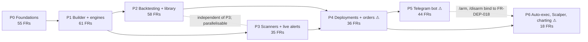

# Tradeloom — Phase-wise Delivery Roadmap

Status: v1, 2026-10-12. Input: `docs/requirements/REQUIREMENTS.md` v2.1 (§1 scope, §4 C-01…C-14, §5 NFR-01…15, §6 **307 in-scope FRs**, §9 OQ-01…49). Context: `docs/research/FEATURES.md` module map.
Companion script: `docs/plan/verify_roadmap.py` (its output is pasted in Appendix B). This document does not change REQUIREMENTS.md; where it names a default for an open question it repeats the "Default taken" column of §9.

## 0. How to read this roadmap

- Seven phases **P0–P6**. Every one of the 307 §6 FRs is assigned to exactly one phase (Appendix A, machine-checked). Each phase ends in a usable, demonstrable increment that is installed from the `.deb`/AppImage built by CI and exercised against a real Kite account.
- Ordering is by **dependency first, value second**: data layer → builder/engine → backtest → scanners (first live evaluation, no orders) → deployments and orders (first live money) → Telegram → auto-execution/Scalper/advanced charting. P2 and P3 only depend on P1 and may be built in parallel or in either order (§2).
- An FR is *done* in its phase when all its acceptance criteria pass, **except** where §7 declares an intentional forward reference; then the named AC is re-verified in the later phase and listed there under "Exit criteria".
- **Phase-gated UI rule.** FR-SHELL-013 forbids "coming soon" placeholders, so sidebar entries, settings groups, header buttons and tabs whose FR is scheduled later are *hidden* (not disabled) until that phase. Consequence: FR-SHELL-002 AC1 (8 entries), FR-ACCT-012 AC4 (every setting in one group) and FR-HOME-001 AC3 (six areas) are first fully satisfied in P6/P4 and are re-run there.
- Marks in the FR lists: **[E]** = FR headed "Enhancement (beyond Streak)" or any FR of module TG; **[e]** = FR that contains a separable enhancement clause (§6.0a). §5 collects them per phase.
- **Live-money.** Phases marked ⚠ contain FRs that call Kite order-write endpoints (`PlaceOrder`, `ModifyOrder`, `CancelOrder`, `ConvertPosition`, `PlaceGTT`/`ModifyGTT`/`DeleteGTT`). P0–P3 builds are compiled with the build tag `noorders`, which excludes the order-write client entirely, so no order can be sent before P4 (§6 lists the gates).
- Within a phase, FRs are implemented Core → Important → Nice-to-have (the §6 "Priority hint"). Each phase lists the Nice-to-have FRs that may slip to the next phase *without breaking the exit demo* ("Deferrable"); slipping requires updating Appendix A and re-running the script.
- Spike timeboxes are in working days; they are investigations, not estimates of feature effort. No phase durations are given here (they belong to the planning spreadsheet once team size is known).

## 1. Phase overview

| Phase | Name | FRs | What the user can do at the end | Live money |
|---|---|---|---|---|
| P0 | Foundations: install, connect, see the market | 55 | Install from .deb/AppImage, register Kite credentials, log in daily, see live charts, ticker, watchlists, read-only holdings/positions/orders, settings, logs, backup/restore | No (`noorders`) |
| P1 | Strategy builder, indicator engine, condition engine | 61 | Build/validate/save/export strategies (Basic + Advanced, MTF), all ~100 operands and 107 chart studies computed by the verified Go engine, Technicals tab, My Strategies | No |
| P2 | Backtesting, results and the strategy library | 58 | Run reproducible backtests of any length with full metrics, charges, trade log, markers; browse the strategy library with local summaries; Home Live Backtest widget | No |
| P3 | Scanners, universes, scanner library and live alerts | 35 | Build/run scanners on universes, baskets, watchlists; live alerts at candle close with OS notifications and inbox; scanner library; Live Scanners widget; Advance/Decline | No (live evaluation, no orders) |
| P4 | Live deployments, order safety and GTT-protected exits ⚠ | 36 | Deploy in Notify & confirm / Signal-only / Paper; confirm orders in the review-mode ticket through the safety pipeline; GTT mirroring; reconciliation; kill switch; trading enablement with static IP | **Yes** — first order placement |
| P5 | Telegram bot ⚠ | 44 | Two-way bot: status/account/performance, signal Place/Skip, remote exit/cancel/pause/kill with single-use confirmations, notification levels, offline behaviour, audit | **Yes** — remote confirmations |
| P6 | Armed auto-execution, Scalper, advanced charting, release polish ⚠ | 18 | Opt-in auto-execution with risk limits; Scalper (flip, basket, one-click, depth, presets); drawings, order lines, chart settings; tours; update check; Kite price alerts | **Yes** — automatic and one-click orders |
| | **Total** | **307** | | |

## 2. Dependency graph



Hard edges (solid): P1 needs the P0 chart component, instrument master, candle store, backfill, calendar and settings; P2 needs the P1 model, catalogue, indicator and evaluation engines; P3 needs the P1 condition editor, evaluation engine and universes; P4 needs the P2 execution panel and fee table plus the P3 notification channels and inbox; P5 and P6 need the P4 order pipeline, state machine and kill switch. Dotted edges are soft: P6 can start before P5 finishes; P2 and P3 are independent of each other.

## 3. Phases

---

### P0 — Foundations: install, connect, see the market (55 FRs)

**Goal.** The user installs Tradeloom on Ubuntu/Debian/Fedora, registers their own Kite Connect app, logs in daily through the loopback redirect and gets a live dashboard: index ticker, status indicator, candlestick chart of any NSE/BSE/NFO-FUT/BFO-FUT instrument with live bars, watchlists with live prices, read-only holdings/positions/order book, settings, structured logs and backup/restore. Nothing can be built or traded yet; with a Personal-plan key the same build demonstrates the degraded "orders and portfolio only" mode.

**FRs by module**
**SHELL** (16)

- FR-SHELL-001 Application window layout
- FR-SHELL-002 Sidebar navigation
- FR-SHELL-004 Index ticker strip
- FR-SHELL-005 Connection, session and market status indicator
- FR-SHELL-006 Top-bar quick links
- FR-SHELL-009 Toast notifications
- FR-SHELL-010 Profile menu
- FR-SHELL-011 Light/dark theme
- FR-SHELL-012 Unknown-view fallback
- FR-SHELL-013 Contextual help and tooltips
- FR-SHELL-014 List-page template and empty states
- FR-SHELL-015 Keyboard access and dialog dismissal
- FR-SHELL-016 Number, currency and date formatting
- FR-SHELL-018 Application logging and diagnostics
- FR-SHELL-019 Global keyboard shortcuts and window state
- FR-SHELL-020 Risk-disclosure acknowledgement per session

**HOME** (2)

- FR-HOME-001 Dashboard layout
- FR-HOME-002 Holdings summary card

**CHART** (9)

- FR-CHART-001 Chart component and embedding contexts
- FR-CHART-002 Chart header bar
- FR-CHART-003 Chart data loading and live bar updates
- FR-CHART-004 Timeframe selector
- FR-CHART-005 Chart symbol search (single-select)
- FR-CHART-006 Refresh chart data
- FR-CHART-011 In-chart readouts, scales and navigation
- FR-CHART-016 Chart symbol and timeframe persistence
- FR-CHART-017 Full-view chart

**WATCH** (10)

- FR-WATCH-001 Watchlist panel and multiple lists
- FR-WATCH-002 Create and rename watchlist
- FR-WATCH-003 Delete watchlist
- FR-WATCH-004 Inline search and add to watchlist
- FR-WATCH-005 Instrument row
- FR-WATCH-006 Watchlist live price subscription
- FR-WATCH-007 Instrument picker dialog (multi-select)
- FR-WATCH-008 Instrument master and search engine
- FR-WATCH-013 Instrument display naming
- FR-WATCH-014 Consistent exchange tagging

**ACCT** (9)

- FR-ACCT-001 Profile view
- FR-ACCT-004 Log out
- FR-ACCT-005 Kite API credentials setup
- FR-ACCT-006 Daily Kite login and session lifecycle
- FR-ACCT-007 Plan capability detection and degraded mode
- FR-ACCT-010 Built-in help
- FR-ACCT-012 Settings view
- FR-ACCT-013 Secret storage fallback
- FR-ACCT-015 Legal text pages (terms of use, privacy notice)

**DATA** (5)

- FR-DATA-001 Market calendar and session model
- FR-DATA-002 Candle store
- FR-DATA-003 Kite client, shared rate limiter and backfill service
- FR-DATA-004 Time synchronisation and clock integrity
- FR-DATA-005 Backup, restore and data directory

**ORD** (4)

- FR-ORD-001 Order book
- FR-ORD-002 Positions
- FR-ORD-003 Holdings
- FR-ORD-014 Order and position state synchronisation

**Engineering deliverables that carry no FR id (needed by every later phase):** repository skeleton (Go module, Wails v2, React/TS + Vite), CI on Linux (Docker build with WebKit2GTK 4.1, `.deb` via nfpm, AppImage via appimagetool, `go test`, golden-fixture runner, licence check, static check that the `noorders` tag excludes the order-write client), SQLite `app.db` schema v1 with the migration framework of FR-DATA-005, the subscription manager with priority classes (C-07; consumed by FR-WATCH-006, FR-SHELL-004), the Kite client/rate limiter (FR-DATA-003), the event bus skeleton, the Go indicator package scaffold (empty; filled in P1), the architecture spec recording OQ-01/OQ-41/OQ-48 decisions.

**Dependencies on earlier phases.** None. External: a Kite Connect app registered by the user (C-01); Connect plan for data features; a second Linux VM for the backup/restore and packaging checks.

**Open questions to resolve before/during P0 (default if unanswered)**
- OQ-07 loopback redirect accepted by Kite? — default loopback primary + paste fallback (FR-ACCT-006). Resolved by S0-1 on the first login.
- OQ-41 candle store engine — default SQLite first; decided by S0-2 against FR-DATA-002 AC4.
- OQ-48 Go keyring library and no-daemon behaviour — default: a maintained MIT/BSD Secret-Service library chosen in S0-4; FR-ACCT-013 fallback.
- OQ-01 chart library — default open library (lightweight-charts) + own studies/drawings. Decided in P0 (S0-5) because FR-CHART-001's adapter is built here and the consequence (own 107 studies in P1, own drawing layer in P6) sizes those phases.
- OQ-06 BSE coverage — default all BSE equities (FR-WATCH-008).
- OQ-08 calendar maintenance — default shipped list + CSV import + manual edit (FR-DATA-001).
- OQ-23 default chart timeframe — default 1 Hour, user setting.
- OQ-04 holdings card headline — default overall P&L, T1 included, collateral excluded (FR-HOME-002).
- OQ-39 distribution legality — default personal use only; no distribution work in any phase.

**Technical spikes (timeboxed)**
| Id | Spike | Timebox |
|---|---|---|
| S0-1 | Kite loopback redirect: register `http://127.0.0.1:<port>/kite/callback` on a test app, complete one login; keep the paste fallback regardless of the result (OQ-07) | 0.5 d |
| S0-2 | Candle store benchmark: synthetic 500 instruments × 2 years × 1-minute (≈ 470 M rows, A07 §D) into SQLite (WAL, per-interval table, covering index + coverage map table) vs DuckDB/Parquet; measure FR-DATA-002 AC4 (instrument-day < 50 ms, missing-ranges < 5 ms), ingest rate, disk size, resample-on-read cost (OQ-41) | 3 d |
| S0-3 | Linux build pipeline: Wails v2 + WebKit2GTK 4.1 in Docker (Ubuntu 22.04 base), nfpm `.deb`, appimagetool AppImage, install tests on Ubuntu 22.04/24.04, Debian 12, Fedora 39 VMs (C-11, NFR-01/02) | 2 d |
| S0-4 | Keyring: evaluate MIT/BSD Secret-Service libraries for Go, behaviour without a daemon and under a headless session, migration keyring ⇄ encrypted file (OQ-48, FR-ACCT-013) | 1 d |
| S0-5 | Chart library prototype on the FR-CHART-001 adapter: candlesticks + volume pane + one separate study pane + one custom primitive overlay + theme switch + lazy history loading; go/no-go for OQ-01 before P1 starts | 3 d |
| S0-6 | Ticker and subscription manager: gokiteconnect ticker with 3 connections × 3,000 tokens, reconnect/resubscribe, mode switching, priority classes; measure tick → UI latency and candle-builder correctness | 2 d |
| S0-7 | App clock: offset from tick `exchange_timestamp` vs HTTP `Date` header on a system clock skewed by 3 s; verify FR-DATA-004 AC1 | 1 d |
| S0-8 | Single-instance lock per data directory (FR-ACCT-004) and a D-Bus `org.freedesktop.Notifications` availability probe (prepares FR-ACCT-003 in P3) | 0.5 d |

**Exit criteria**
- *Demo (clean Ubuntu 24.04 VM, Connect-plan key):* install the `.deb` → first-run setup (FR-ACCT-005) → "Log in with Kite" completes in the browser via loopback (FR-ACCT-006) → risk disclosure (FR-SHELL-020) → Home shows NIFTY 50 at 1 Hour with live bars, three ticker pills and a green "Live" indicator → search and chart `RELIANCE` and `NIFTY OCT FUT` → add both to a watchlist and watch ticks → open Holdings, Positions and Order Book (populated from the account) → disconnect the network: amber "Reconnecting", reconnect restores all subscriptions → toggle dark theme → Settings → Data shows candle store size → Backup now → Restore on a second VM: watchlists and settings present, keyring empty, credentials requested → grep the data directory and logs for the API secret and access token: no match. *Second demo with a Personal-plan key:* status "No data plan", chart shows the data-plan message, Holdings loads (FR-ACCT-007 AC1).
- *Acceptance criteria that must pass:* FR-ACCT-005 AC1–3; FR-ACCT-006 AC1–5; FR-ACCT-007 AC1–3; FR-ACCT-013 AC1–3; FR-ACCT-004 AC1/3; FR-SHELL-001 AC2–4; FR-SHELL-004 AC1–5; FR-SHELL-005 AC1–5; FR-SHELL-009 AC1–3/5; FR-SHELL-011 AC1–3; FR-SHELL-015 AC2–3; FR-SHELL-016 AC1–2; FR-SHELL-018 AC1–4; FR-SHELL-019 AC1–3; FR-SHELL-020 AC1/3; FR-CHART-003 AC1–5; FR-CHART-004 AC1; FR-CHART-005 AC1–5; FR-CHART-006 AC1–3; FR-CHART-011 AC1–4; FR-CHART-016 AC1–2; FR-CHART-017 AC3; FR-WATCH-001 AC1–5; FR-WATCH-004 AC1–3; FR-WATCH-005 AC1/3/4; FR-WATCH-006 AC1–3; FR-WATCH-007 AC3–5; FR-WATCH-008 AC1–6; FR-WATCH-013 AC1–3; FR-WATCH-014 AC1–2; FR-DATA-001 AC1/4/5/6; FR-DATA-002 AC1/2/4/5/6; FR-DATA-003 AC1–5; FR-DATA-004 AC1/2/4; FR-DATA-005 AC1–5; FR-HOME-002 AC1–4; FR-ORD-001 AC2; FR-ORD-002 AC1; FR-ORD-003 AC1–2; FR-ORD-014 AC1.
- *NFRs:* NFR-01 (three distros), NFR-02 (both packages), NFR-03 (schema + migrations), NFR-04 (24 h network capture shows Kite only; redaction tests), NFR-09 (reconnect + resubscribe), NFR-11 (≥ 1280 px, keyboard, theme, Indian formats), NFR-15 (option/MCX/currency rows absent from the instrument master).
- *Deferrable (Nice-to-have):* FR-SHELL-012.

**Risks.** Kite may refuse the loopback redirect (paste fallback keeps login working). The store engine decision is hard to reverse at scale (mitigated by the single Go interface of FR-DATA-002 and the S0-2 benchmark). WebKit2GTK cannot be bundled into the AppImage (document the system dependency per distro). First chart load of a long history is bounded by 3 req/s (lazy loading with progress). If S0-5 fails, OQ-01 must flip to the licensed Charting Library before P1, which changes the shape of FR-CHART-008/009/010/014/015 work.

---

### P1 — Strategy builder, indicator engine and condition engine (61 FRs)

**Goal.** The user builds, validates, saves, exports and imports equity/futures strategies in Basic and Advanced mode with the complete operand catalogue and per-condition timeframes; every operand and all 107 chart studies are computed by the Go indicator engine (go-talib where TA-Lib covers it, in-house otherwise) and proven by golden vectors; the shared condition evaluation engine with the single MTF definition exists and exposes condition traces; the Technicals tab works; My Strategies manages the library of own strategies. There is no backtest or deployment yet.

**FRs by module**
**SHELL** (1)

- FR-SHELL-008 Unsaved-change guard

**CHART** (3)

- FR-CHART-007 Save and clear chart layout
- FR-CHART-008 Indicators dialog
- FR-CHART-009 Study configuration and pane controls

**ANLY** (6)

- FR-ANLY-001 Analytics tab bar and symbol-dependent tab set
- FR-ANLY-002 Analytics panel collapse/expand
- FR-ANLY-003 Technicals — sentiment gauge
- FR-ANLY-004 Technicals — pivot ruler and verdict rows
- FR-ANLY-005 Technicals — recent events table
- FR-ANLY-013 Analytics refresh and staleness

**WATCH** (2)

- FR-WATCH-009 Universes (scan-on baskets)
- FR-WATCH-010 Universe constituent store and import

**EQB** (41)

- FR-EQB-001 Equity builder workspace layout
- FR-EQB-002 Strategy definition model (versioned JSON + canonical text DSL)
- FR-EQB-003 Strategy title with inline rename
- FR-EQB-004 Save Strategy dialog (name, category, tags, description)
- FR-EQB-005 Position direction (Buy / Sell)
- FR-EQB-006 Instrument selection
- FR-EQB-007 Chart settings (chart type and base timeframe)
- FR-EQB-008 Basic condition row
- FR-EQB-009 Operand picker (Basic) with search
- FR-EQB-010 Operand parameter dialog with validation
- FR-EQB-011 Number operand
- FR-EQB-012 Comparators and their semantics
- FR-EQB-013 "Up by" / "Down by" parameters
- FR-EQB-014 Quick-setup tiles
- FR-EQB-015 Suggestions button
- FR-EQB-016 Suggestion browser dialog
- FR-EQB-017 Suggestion library content
- FR-EQB-018 Basic ↔ Advanced mode switch with lossless conversion
- FR-EQB-019 Advanced expression row
- FR-EQB-020 Expression picker (All / Indicators / Math functions)
- FR-EQB-021 Arithmetic operators and precedence
- FR-EQB-022 Math functions
- FR-EQB-023 Inline numeric argument editor
- FR-EQB-024 Advanced comparator picker
- FR-EQB-025 Per-condition timeframe and multi-timeframe (MTF) evaluation
- FR-EQB-026 AND / OR joiners
- FR-EQB-027 Condition groups (nested brackets)
- FR-EQB-028 Row and group tools
- FR-EQB-029 Logic clipboard (Copy all / Paste all)
- FR-EQB-030 Exit risk parameters (Stop loss / Target / Trailing stop)
- FR-EQB-031 Exit conditions block
- FR-EQB-033 Builder chart pane
- FR-EQB-034 Saved strategy header and overflow menu
- FR-EQB-035 Favourites
- FR-EQB-036 Condition limits
- FR-EQB-037 Validation and completeness
- FR-EQB-038 Indicator engine with golden test vectors
- FR-EQB-039 Operand catalogue (single source of truth)
- FR-EQB-040 Per-row timeframe in Basic mode
- FR-EQB-041 Condition evaluation engine (shared)
- FR-EQB-042 Keyboard access to builder actions

**DISC** (2)

- FR-DISC-009 Copy strategy dialog
- FR-DISC-019 Sharing by export / import

**MYS** (5)

- FR-MYS-001 My Strategies view
- FR-MYS-002 My Strategies tabs, search and filters
- FR-MYS-003 My Strategies row and row menu
- FR-MYS-007 Deletion and referential integrity
- FR-MYS-008 Persistence of user strategies and scanners

**BT** (1)

- FR-BT-034 Engine: multi-timeframe evaluation (single definition) [e]

**Recommended internal milestones** (P1 is the largest phase by effort): **M1a** model, DSL, catalogue and builder UI (FR-EQB-001…037, 039, 040, 042; FR-MYS-*; FR-DISC-009/019; FR-SHELL-008; FR-WATCH-009/010); **M1b** indicator engine, golden vectors, chart studies and Technicals (FR-EQB-038, 041; FR-BT-034; FR-CHART-007/008/009; FR-ANLY-*). Content work (FR-EQB-017: ≥ 300 + 300 suggestions) runs in parallel from the start.

**Dependencies on earlier phases.** P0: FR-CHART-001/003/004 (builder chart pane), FR-WATCH-007/008/013/014 (picker, master, naming), FR-DATA-001 (session anchors for VWAP/Opening Range/LCM), FR-DATA-002 (resampling for 1w/1M rows, candles), FR-DATA-003 (warm-up backfill), FR-DATA-005 (schema migrations for the strategy tables), FR-SHELL-009/013/015/016/019 (toasts, tooltips, dialog rules, formatter, Ctrl+Z bindings), FR-ACCT-012 (new settings groups: Universes & baskets, Chart defaults, default instrument set), FR-ACCT-010 (help articles: comparators, advanced conditions).

**Open questions (default if unanswered)**
- OQ-13 MA-type bindings — default triple = TEMA, variable = Chande VMA, vidya = VIDYA; TA-Lib pinned where available. Must be fixed before golden vectors are generated (blocks M1b).
- OQ-16 formulas of less-standard operands (Trend Intensity Index, Twiggs MF, Fractal Chaos Bands, Center of Gravity, Swing Index, Schaff, IMI, ATR Trailing Stoploss) — default per `docs/spec/indicators.md`, each with an independently written reviewed Python reference (blocks M1b).
- OQ-01 — confirm after S0-5/S1-2 that the chosen library hosts 107 studies in own panes with legends; otherwise switch before M1b.
- OQ-03 Technicals vote set and pivot periods — default as specified in FR-ANLY-003/004.
- OQ-14 Pivot "continuous" — default session-anchored. OQ-15 — AND binds tighter than OR. OQ-17 — percent of |R|. OQ-18 — ε = 1e-9 relative.
- OQ-10 sector mapping — default our editable Industry → sector table. OQ-11 — all indices; current-month futures.
- OQ-12 chart layout — explicit Save. OQ-05 soft caps — none (NFR-13). OQ-21 soft-delete — 30 days, restorable.

**Technical spikes**
| Id | Spike | Timebox |
|---|---|---|
| S1-1 | go-talib coverage audit: map every Appendix A/B operand to a `markcheno/go-talib` function or "in-house"; compare go-talib seeding (EMA/RSI Wilder, MAMA) with pinned Python TA-Lib; build the golden-vector generator and the CI diff with the max(1e-6 abs, 1e-6 rel) rule (FR-EQB-038, OQ-13/16) | 3 d |
| S1-2 | Studies on the chosen chart library: oscillator pane with band shading, overlay bands with fill, legend overlay with hover/focus actions, per-timeframe visibility, 20 studies at once performance (FR-CHART-008/009) | 2 d |
| S1-3 | DSL: EBNF grammar, parser + canonical formatter, property test `parse(format(doc)) == doc` over 1,000 generated docs, migration hook (FR-EQB-002 AC2/3) | 2 d |
| S1-4 | Historical `oi=1` for NFO/BFO futures and the `continuous` flag; confirm OI columns for FR-EQB-038 (5) | 0.5 d |
| S1-5 | Incremental indicator computation: append-one-candle path produces bitwise-identical output to full recompute for every operand (FR-EQB-038 AC4) | 1 d |

**Exit criteria**
- *Demo:* open Equity Builder → build "EMA(9) crosses above EMA(21) and RSI(14) higher than 50" in Basic on 1 hour for 60 NSE stocks plus `NIFTY OCT FUT` (no 50-cap) → switch to Advanced losslessly → add `(High[0] - Low[0]) higher than 1.5 * ATR(14)[0]` and a 1-day row (`Close[0] higher than SMA(close, 200)[0]` on 1d) → the builder shows the effective evaluation note → add EMA 9/21 and RSI studies to the chart pane; the plotted values equal the engine's (golden) → Technicals gauge shows 27 votes and pivots for the previous week → Save with category/tags → inline rename → favourite → export `.tlstrategy.json` → delete → restore from Recently deleted → import the file on another machine → kill the process mid-edit → "Recover unsaved changes?" on restart. CI: golden-vector suite 100 % green; licence check shows no GPL/AGPL indicator dependency.
- *Acceptance criteria:* FR-EQB-001 AC1–4; FR-EQB-002 AC1–5; FR-EQB-003 AC1–3; FR-EQB-004 AC1–5; FR-EQB-005 AC1/3 (AC2 needs Execute, re-verified P2); FR-EQB-006 AC1–3; FR-EQB-007 AC1–3; FR-EQB-008 AC1–5; FR-EQB-009 AC1–4; FR-EQB-010 AC1–5; FR-EQB-011 AC1–3; FR-EQB-012 AC1–7; FR-EQB-013 AC1–3; FR-EQB-016 AC1–5; FR-EQB-017 AC1–3; FR-EQB-018 AC1–4; FR-EQB-019 AC1–3; FR-EQB-020 AC1–4; FR-EQB-021 AC1–3; FR-EQB-022 AC1–4; FR-EQB-025 AC1–4 (AC5 warm-up warning in a backtest report, re-verified P2); FR-EQB-026 AC1–3; FR-EQB-027 AC1–3; FR-EQB-028 AC1–3; FR-EQB-029 AC1–3; FR-EQB-030 AC1–3; FR-EQB-031 AC2 (AC1 needs the backtester, re-verified P2); FR-EQB-033 AC1–3; FR-EQB-034 AC1–2; FR-EQB-036 AC1–2; FR-EQB-037 AC1–4; FR-EQB-038 AC1–6; FR-EQB-039 AC1–3; FR-EQB-040 AC2 (AC1/3 need library copies, re-verified P2); FR-EQB-041 AC2–3 (AC1 live path re-verified P4; AC4 trade details re-verified P2); FR-EQB-042 AC1–3; FR-BT-034 AC1–5 (engine unit tests on fixtures; re-run inside backtests in P2); FR-CHART-007 AC1–4; FR-CHART-008 AC1–5; FR-CHART-009 AC1–5; FR-ANLY-001 AC2/3 (AC1/4 need the A/D tab, re-verified P3); FR-ANLY-003 AC1–4; FR-ANLY-004 AC1–4; FR-ANLY-005 AC1–4; FR-ANLY-013 AC1; FR-WATCH-009 AC1/3/4 (custom-basket positions re-verified P3); FR-WATCH-010 AC1–4; FR-MYS-001 AC1–3; FR-MYS-002 AC1–2; FR-MYS-003 AC2; FR-MYS-007 AC2–3 (AC1 needs deployments, re-verified P4); FR-MYS-008 AC1–2; FR-DISC-009 AC1–2 (AC3 deploy path re-verified P4); FR-DISC-019 AC1–3; FR-SHELL-008 AC1–5.
- *NFRs:* NFR-06 (golden vectors in CI), NFR-07 (input latency < 100 ms while studies recompute; engine off the UI thread), NFR-11 (FR-EQB-042 AC3 accessibility scan), NFR-14 (builder and chart studies work offline on cached candles), NFR-13 (no instrument/condition caps).
- *Deferrable (Nice-to-have):* FR-EQB-014, FR-EQB-035, FR-ANLY-002, FR-ANLY-005, FR-DISC-019.

**Risks.** Largest phase by effort (≈ 100 operands × enumerations, 107 studies, 600 suggestions). go-talib may differ from TA-Lib C on seeding or edge cases → pin the commit and record the reference per operand; exotic operands have no public reference → independent Python implementation reviewed against the formula spec (FR-EQB-038 (6)). Custom study panes may stress the open chart library (S1-2 decides the OQ-01 fallback). Suggestion and catalogue content is authoring work that should not sit on the engineering critical path.

---

### P2 — Backtesting, results and the strategy library (58 FRs)

**Goal.** The user runs reproducible backtests over any locally available or backfillable range with streaming per-instrument results, the full metric set, a versioned charges model, trade log, trade markers, calendar heatmap and an assumptions record; browses the bundled strategy library with locally computed summaries and copies items; the Home Live Backtest widget shows the featured summaries.

**FRs by module**
**HOME** (3)

- FR-HOME-006 Live Backtest widget — tabs and metrics
- FR-HOME-007 Live Backtest widget — calendar heatmap
- FR-HOME-008 Live Backtest widget — refresh schedule and data preparation

**EQB** (1)

- FR-EQB-032 Footer actions: Save and Execute (two-step execution panel)

**DISC** (9)

- FR-DISC-001 Discover Strategies view and disclaimer
- FR-DISC-002 Library strategy content
- FR-DISC-003 Strategy category tabs
- FR-DISC-004 Strategy search
- FR-DISC-005 Strategy filters
- FR-DISC-006 Strategy list rows
- FR-DISC-007 Strategy detail pane with summary backtest
- FR-DISC-008 Read-only library strategy view
- FR-DISC-020 Library versioning and updates

**MYS** (1)

- FR-MYS-004 My Strategies detail pane

**BT** (44)

- FR-BT-001 Backtest parameters (execution panel step 2)
- FR-BT-002 Strategy cycle (max entries per day per instrument)
- FR-BT-003 Entry window
- FR-BT-004 Holding type and product mapping
- FR-BT-005 Initial capital is per instrument
- FR-BT-006 Quantity derivation
- FR-BT-007 Capital gating, no margin or leverage, freeze limits ignored
- FR-BT-008 Date range and lookback (no artificial caps) [e]
- FR-BT-009 Data backfill for backtests
- FR-BT-010 Run backtest: save, navigate, stream per instrument, cancel
- FR-BT-011 Results page layout and header actions
- FR-BT-012 Combined results and per-instrument table [e]
- FR-BT-013 Trading charges model (both legs, toggle)
- FR-BT-014 Metric definitions
- FR-BT-015 Weekday summary
- FR-BT-016 Monthly performance grid
- FR-BT-017 Chart with trade markers
- FR-BT-018 Trade-markers and chart data for MTF/long ranges
- FR-BT-019 Daily P&L calendar heatmap with CNC mark-to-market
- FR-BT-020 Trade log table [e]
- FR-BT-021 Download trade log [e]
- FR-BT-022 Cumulative P&L chart
- FR-BT-023 Engine: evaluation on completed candles only
- FR-BT-024 Engine: entry requires a false→true transition; no pyramiding
- FR-BT-025 Engine: fills at next candle open
- FR-BT-026 Engine: exit-condition (EX) semantics
- FR-BT-027 Engine: SL / TP level computation
- FR-BT-028 Engine: SL / TP evaluation (same-candle SL-first, evaluation mode) [e]
- FR-BT-029 Engine: trailing stop loss along the intra-candle path
- FR-BT-030 Engine: intra-candle event precedence
- FR-BT-031 Engine: MIS square-off per instrument class (backtest table)
- FR-BT-032 Engine: futures contract expiry (EXP) [e]
- FR-BT-033 Engine: open positions at end of range
- FR-BT-035 Engine: no slippage by default
- FR-BT-036 Configurable slippage — Enhancement (beyond Streak) **[E]**
- FR-BT-037 Engine: raw, unadjusted candles [e]
- FR-BT-038 Supported segments and instruments [e]
- FR-BT-039 Options, MCX, currency, AMO, MTF exclusions
- FR-BT-040 Backtest error and empty-result messages
- FR-BT-041 Current-day data in backtests
- FR-BT-043 Trigger codes
- FR-BT-044 Run assumptions and reproducibility record [e]
- FR-BT-045 Backtest run history [e]
- FR-BT-046 "Capital used" metric and return denominators

**Dependencies on earlier phases.** P1: FR-EQB-002 (strategy model snapshot in runs), FR-EQB-038/039 (indicators, warm-up functions), FR-EQB-041 + FR-BT-034 (evaluation engine and MTF instants), FR-EQB-037 (completeness gate for Execute), FR-EQB-034 (header actions), FR-MYS-001/002/003 (lists that gain the backtest detail pane), FR-DISC-009 (copy dialog reused by Discover), FR-DISC-019 (export with "Include results"), FR-WATCH-009/010 (library default universes resolved from imported lists). P0: FR-DATA-001 (square-off offsets, calendar version), FR-DATA-002 (checksums, week/month resampling, purge protection of referenced ranges), FR-DATA-003 (backfill at backtest priority, resumable windows), FR-CHART-001/003 (markers chart), FR-SHELL-014 (list template), FR-SHELL-016 (money/date formatting), FR-WATCH-008 (lot size, tick size, F&O-stock classification).

**Open questions (default if unanswered)**
- OQ-22 Strategy Cycle "–" = unlimited; 1–5 offered. OQ-24 entry window tested on fill time, inclusive of End Time. OQ-25 futures quantity lot-rounded. OQ-26 return base C (× n Combined), active days only, daily-delta mark. OQ-27 exit conditions level-triggered. OQ-28 Hybrid default + Intrabar option (S2-6 compares). OQ-29 TSL reference = entry price, fill at level. OQ-30 SO at containing-candle open; user-importable CAS list. OQ-40 expired futures: live contracts; continuous mode on day TF only (S2-4). OQ-42 Kite day candles assumed raw (S2-3). OQ-19 summary window 3 months, on demand. OQ-35 (for FR-BT-041 today's candles) — default ticker-built candle; verified in P3 S3-1.

**Technical spikes**
| Id | Spike | Timebox |
|---|---|---|
| S2-1 | Engine performance: 50 instruments × 90 days × 15-minute on cached data < 10 s (NFR-07), per-instrument goroutines, memory profile, deterministic output under GOMAXPROCS 1..8 | 2 d |
| S2-2 | Fee table validation: submit synthetic MIS/CNC/NRML legs to `GetOrderCharges` (read-only; no order placed) and diff per component against the local table (FR-BT-013 AC3, C-10) | 1 d |
| S2-3 | Are Kite day candles corporate-action adjusted? Compare day vs aggregated minute candles around a known split/bonus (OQ-42, FR-BT-037) | 0.5 d |
| S2-4 | Expired futures: intraday history availability for a past contract and `continuous=1` stitching (OQ-40, FR-BT-032) | 0.5 d |
| S2-5 | Results chart with ≈ 180,000 1-minute candles: viewport lazy-loading while every marker in range stays visible (FR-BT-018) | 1 d |
| S2-6 | Hybrid vs Intrabar SL/TP on the FEATURES §6-15 examples and Streak's published assumptions (OQ-28) | 0.5 d |

**Exit criteria**
- *Demo:* on the P1 strategy, Execute → Backtest (step 1 → step 2, Back keeps values) → 50 instruments × 90 days × 15 min from cached data completes in < 10 s with per-instrument streaming and a working Cancel → results view: Combined + sortable per-instrument table, charges toggle (gross/net), metrics row with Max DD and Capital used, weekday summary, monthly grid, candle chart with EN/EX/SL/TP/TSL/SO/EXP markers, calendar heatmap with CNC mark-to-market, paginated trade log with Trade P&L / Fill time / Reason columns, cumulative P&L, assumptions panel → export CSV (single and all instruments) → "Re-run with same inputs" reproduces every trade → a 1-minute backtest over 2 years (no cap) shows per-instrument missing ranges, backfills with progress, survives a kill and resumes → Discover strategies: ≥ 45 items, filters and search, detail pane computes and caches a 3-month summary off the UI thread, "View logic" read-only, Copy → editable copy in My Strategies → Home Live Backtest widget shows the same P&L, period and "Computed" timestamp as the Discover pane. Offline (network off): a backtest over cached data still runs.
- *Acceptance criteria:* FR-BT-001 AC1–5; FR-BT-002 AC1–4; FR-BT-003 AC1–3; FR-BT-004 AC1–3; FR-BT-005 AC1; FR-BT-006 AC1–4; FR-BT-007 AC1–4; FR-BT-008 AC1–3; FR-BT-009 AC1–3; FR-BT-010 AC1–4; FR-BT-011 AC1/3 (AC2 prebuilt header re-verified with Deploy in P4); FR-BT-012 AC1–2; FR-BT-013 AC1–4; FR-BT-014 AC1–4; FR-BT-015 AC1–2; FR-BT-016 AC1–2; FR-BT-017 AC1–2; FR-BT-019 AC1–2; FR-BT-020 AC1–4; FR-BT-021 AC1–2; FR-BT-022 AC1; FR-BT-023 AC1 (backtest side; live side re-verified P4); FR-BT-024 AC1–3; FR-BT-025 AC1–3; FR-BT-026 AC1–2; FR-BT-027 AC1–4; FR-BT-028 AC1–4; FR-BT-029 AC1–3; FR-BT-030 AC1–2; FR-BT-031 AC1–6; FR-BT-032 AC1–2; FR-BT-033 AC1; FR-BT-035 AC1; FR-BT-036 AC1–2; FR-BT-037 AC1–2; FR-BT-038 AC1–3; FR-BT-040 AC1–2; FR-BT-043 AC1; FR-BT-044 AC1–2; FR-BT-045 AC1; FR-BT-046 AC1–3; FR-EQB-032 AC1/3/4/5 (AC2 "Deploy pre-selected" re-verified P4); FR-EQB-005 AC2; FR-EQB-025 AC5; FR-EQB-031 AC1; FR-EQB-040 AC1/3; FR-EQB-041 AC4; FR-DISC-001 AC1–2; FR-DISC-002 AC1–3; FR-DISC-003 AC1–2; FR-DISC-004 AC1–2; FR-DISC-005 AC1–3; FR-DISC-006 AC1–2; FR-DISC-007 AC1–4; FR-DISC-008 AC1–2; FR-DISC-020 AC1–2; FR-MYS-004 AC1–3; FR-HOME-006 AC1–4; FR-HOME-007 AC1–3; FR-HOME-008 AC1–3.
- *NFRs:* NFR-06 (deterministic engine-rule tests for fills, SL/TP order, TSL path, square-off, expiry), NFR-07 (< 10 s; UI responsive), NFR-12 (assumptions, checksums, calendar/app/engine versions recorded), NFR-13 (no lookback, run-count or instrument caps), NFR-14 (offline backtest on cached data).
- *Deferrable (Nice-to-have):* FR-BT-018, FR-BT-039, FR-BT-041, FR-BT-045, FR-HOME-007.

**Risks.** Several parity semantics are unverifiable against Streak (OQ-24…30): all are defaulted, recorded in the assumptions panel and the help centre so results are explainable. Fee-table drift versus the broker is caught by the versioned table and S2-2 validation. Multi-year 1-minute data strains the store budget (purge rules, size warnings). The library (≥ 45 strategies with clean-room names) is content work with CI checks; schedule it alongside engine work.

---

### P3 — Scanners, universes, scanner library and live alerts (35 FRs) — first live, tick-driven evaluation; still no orders

**Goal.** The user creates scanners with the shared condition editor, runs them manually over built-in universes, custom baskets or watchlists, takes them live (one alert per base-candle close within 2 s) with OS desktop notifications, the Notifications inbox and sidebar badges; browses the scanner library; sees the Live Scanners widget on Home; gets the Advance/Decline tab backed by the analytics recorder. Trading remains disabled, so every B/S control stays hidden.

**FRs by module**
**SHELL** (1)

- FR-SHELL-003 Attention badges on navigation entries

**HOME** (2)

- FR-HOME-004 Live Scanners widget — header, universe and tabs
- FR-HOME-005 Live Scanners widget — result rows and navigation

**ANLY** (2)

- FR-ANLY-010 Analytics time-series recorder and backfill
- FR-ANLY-011 Advance/Decline tab

**WATCH** (2)

- FR-WATCH-011 Shared universe preference
- FR-WATCH-012 Custom baskets (custom symbols)

**ACCT** (1)

- FR-ACCT-003 Desktop notifications (single definition of the OS channel)

**DISC** (8)

- FR-DISC-010 Discover Scanners view
- FR-DISC-011 Library scanner content
- FR-DISC-012 Universe selector
- FR-DISC-013 Scanner timeframe filter and search
- FR-DISC-014 Scanner list rows
- FR-DISC-015 Scanner detail pane and results
- FR-DISC-017 Library scanner view (read-only conditions)
- FR-DISC-018 Copy scanner (gate for alerts on library scanners)

**MYS** (2)

- FR-MYS-005 My Scanners view
- FR-MYS-006 My Scanners row, menu and detail pane

**DEP** (1)

- FR-DEP-015 Notifications inbox

**SCAN** (16)

- FR-SCAN-001 Scanner builder layout
- FR-SCAN-002 Universe selector
- FR-SCAN-003 Scanner timeframe and chart type
- FR-SCAN-004 Scanner conditions (shared editor)
- FR-SCAN-005 Advance-mode validation
- FR-SCAN-006 Manual scan (Run Scan)
- FR-SCAN-007 Scanner results table [e]
- FR-SCAN-008 Save scanner
- FR-SCAN-009 Set Alerts (take a scanner live) [e]
- FR-SCAN-010 Live scanner engine
- FR-SCAN-011 Scanner alerts history view
- FR-SCAN-012 Stop / resume alerts
- FR-SCAN-013 Scanner capacity (no artificial limits)
- FR-SCAN-014 Open chart from a result row
- FR-SCAN-015 Scanner vs strategy builder scope [e]
- FR-SCAN-016 Scanner document schema

**Dependencies on earlier phases.** P1: the condition editor (FR-EQB-008…029, 040) reused by FR-SCAN-004, FR-EQB-041 + FR-BT-034 (engine and instants), FR-EQB-002 (extended by FR-SCAN-016), FR-EQB-039 (operand catalogue for scanner export validation), FR-WATCH-009/010 (universes and constituent store), FR-DISC-019 (export/import gains `.tlscanner.json`), FR-DISC-009 (pattern for the copy modal of FR-DISC-018), FR-MYS-001/002 (list patterns). P0: FR-DATA-001/004 (candle-close schedule on the app clock), FR-CHART-003 (tick-built candles), FR-WATCH-006 and the subscription manager (priority "live scanner", C-07 budget), FR-DATA-003 (quote batches, replay fetches), FR-CHART-017 (full-view chart from result rows), FR-SHELL-006 (bell becomes visible), FR-SHELL-014, FR-ACCT-012 (Notifications and Home settings groups), FR-ACCT-015 (terms link in Set Alerts). **Independent of P2** except for the engine already delivered in P1; P2 and P3 may run in parallel.

**Open questions (default if unanswered)**
- OQ-35 does the historical API return today's forming candle? — default use the ticker-built candle; S3-1 verifies (FR-SCAN-006, FR-BT-041).
- OQ-36 alert content — default all matches, with a "new only" option (FR-SCAN-009).
- OQ-20 auto-refresh of library scanners while visible — default on while visible; S3-2 measures the quote/ticker load on Nifty 500.
- OQ-10/OQ-11 (universe membership) — carried from P1 defaults; sector universes depend on the imported Industry field.

**Technical spikes**
| Id | Spike | Timebox |
|---|---|---|
| S3-1 | `GetHistoricalData` intraday behaviour: is today's partial candle returned, and how does it merge with the latest quote? (OQ-35) | 0.5 d |
| S3-2 | Live scanner latency: Nifty 500 on 5-minute with ticker-built candles and LCM scheduling; measure candle-close → alert (< 2 s, NFR-08); polled fallback when the budget is exceeded | 2 d |
| S3-3 | freedesktop notifications from Go over D-Bus (actions, sound, click focusing the Wails window; disabled state without a daemon) for FR-ACCT-003 | 1 d |
| S3-4 | Notifier bus per FR-TG-031's shape (typed events, bounded channels, independent subscribers: inbox, OS, later Telegram) so P5 plugs in without touching the engine | 1 d |

**Exit criteria**
- *Demo:* New Scanner "RSI(14) crosses above 30" on 5 minutes, Scan on Nifty 50 (imported list) → Run Scan during market hours uses the forming candle, after hours the last closed candle → results table sorts, searches, exports CSV with indicator-value columns → Chart action opens the full-view chart at 5 minutes and Back restores the results → Save → Set Alerts (note "Alerts trigger at every 5 Minutes candle close", acknowledgement) → at the next 5-minute close an alert appears in Scanner Alerts, as a toast, as an OS notification while the window is minimised, and the sidebar badge within 2 s; the inbox Scanner tab lists it → Pause / Resume → quit the app for 20 minutes → the missed runs appear as "Missed" on restart → Discover scanners: ≥ 37 items, switching universe re-scans, "Set alerts" forces a copy → a custom basket of 80 symbols works in the scanner and appears in every universe dropdown at the same position → Home Live Scanners widget follows the shared universe, falls back to polling when the budget is full → NIFTY 50 Advance/Decline tab shows the recorder's series and backfills the morning after a late start.
- *Acceptance criteria:* FR-SCAN-001 AC1–2; FR-SCAN-002 AC1–4; FR-SCAN-003 AC1; FR-SCAN-004 AC1–2; FR-SCAN-005 AC1–2; FR-SCAN-006 AC1–3; FR-SCAN-007 AC1–3; FR-SCAN-008 AC1; FR-SCAN-009 AC1–2; FR-SCAN-010 AC1–2; FR-SCAN-011 AC1–2; FR-SCAN-012 AC1; FR-SCAN-013 AC1–2; FR-SCAN-014 AC1; FR-SCAN-015 AC1–2; FR-SCAN-016 AC1–3; FR-DISC-010 AC1–2; FR-DISC-011 AC1–3; FR-DISC-012 AC1–2; FR-DISC-013 AC1–3; FR-DISC-014 AC1–2; FR-DISC-015 AC1/3/4 (AC2 trading tooltip re-verified P4); FR-DISC-017 AC1–3; FR-DISC-018 AC1–3; FR-WATCH-011 AC1–2; FR-WATCH-012 AC1–3; FR-WATCH-009 AC2/5; FR-HOME-004 AC1–6; FR-HOME-005 AC1/2/4/5 (AC3 order ticket re-verified P4); FR-ACCT-003 AC1/2/4/5 (AC3 review-mode ticket re-verified P4); FR-SHELL-003 AC1–4 (Live Strategies badge re-verified P4); FR-DEP-015 AC1 (AC2 re-verified P4); FR-ANLY-001 AC1/4; FR-ANLY-010 AC1–3 (AC4 deployment contention re-verified P4); FR-ANLY-011 AC1–3; FR-ANLY-013 AC2; FR-MYS-005 AC1–2; FR-MYS-006 AC1–3; FR-SHELL-009 AC4.
- *NFRs:* NFR-08 (alert < 2 s after candle close on the app clock), NFR-13 (no scanner/basket caps; C-07 refusal with usage breakdown), NFR-09 (missed runs replayed after restart), NFR-04 (OS notifications are local; no new outbound host).
- *Deferrable (Nice-to-have):* the "Create strategy from scanner" clause of FR-SCAN-015, FR-ANLY-010, FR-ANLY-011, FR-HOME-004, FR-HOME-005.

**Risks.** Kite's partial-candle behaviour is unknown (S3-1). Large universes exceed the WebSocket budget → polled fallback with a visible hint. Notification daemons differ across desktops → the disabled state of FR-ACCT-003. The recorder competes for the historical budget → priority classes of FR-DATA-003 and the AC4 contention test (completed in P4).

---

### P4 — Live deployments, order safety and GTT-protected exits (36 FRs) ⚠ live money

**Goal.** The user deploys strategies in **Notify & confirm**, **Signal-only** and **Paper** modes; receives entry/exit signals within 2 s; confirms real orders in the review-mode order ticket, every one passing the ten-stage safety pipeline, throttle and journal; watches positions, orders and the deployment log live; protects exits with Kite GTT so they survive app closure; recovers after restarts through reconciliation; has a kill switch; enables trading only with the static-IP acknowledgement. Armed auto-execution stays hidden until P6.

**FRs by module**
**HOME** (1)

- FR-HOME-003 Live Strategy Overview card

**CHART** (2)

- FR-CHART-012 Buy / Sell overlay buttons
- FR-CHART-013 Chart context menu and Trade submenu

**ACCT** (3)

- FR-ACCT-002 Remember futures order quantity
- FR-ACCT-008 Trading enablement and static IP
- FR-ACCT-009 Limits and usage view

**DEP** (19)

- FR-DEP-001 Deploy dialog (execution panel step 2, own strategy) [e]
- FR-DEP-002 Deploy from a prebuilt strategy (copy wizard)
- FR-DEP-003 Execution modes [e]
- FR-DEP-004 Deployment state machine
- FR-DEP-005 Persistence and restart
- FR-DEP-006 Signal generation and alert delivery
- FR-DEP-007 Notify & confirm order flow
- FR-DEP-008 Live SL / TP / TSL monitoring [e]
- FR-DEP-009 Kite GTT mirroring of SL/TP — Enhancement (beyond Streak) **[E]**
- FR-DEP-010 Startup / reconnect reconciliation and missed signals
- FR-DEP-011 Live Strategies view
- FR-DEP-012 Lifecycle rules and capacity
- FR-DEP-013 Stop, re-execute, edit, delete
- FR-DEP-014 Deployment log
- FR-DEP-016 Desktop notification channel (reference)
- FR-DEP-017 Paper trading mode — Enhancement (beyond Streak) **[E]**
- FR-DEP-019 Deploy-time checks
- FR-DEP-020 App-availability and session handling for deployments [e]
- FR-DEP-021 Live square-off timing

**ORD** (11)

- FR-ORD-004 Order ticket [e]
- FR-ORD-005 Order safety pipeline
- FR-ORD-006 Order throttle and rate limits
- FR-ORD-007 Market protection
- FR-ORD-008 Order journal and audit trail
- FR-ORD-009 Kill switch
- FR-ORD-010 Rejected order reason
- FR-ORD-011 Row actions on orders and positions
- FR-ORD-012 Instrument-row B / S buttons
- FR-ORD-013 Trading-enabled gate and static IP
- FR-ORD-015 Order placement outside the continuous session

**Dependencies on earlier phases.** P2: FR-EQB-032 (execution panel gains the Deploy card), FR-BT-013 (fee table for paper charges), FR-BT-027 (SL/TP formulas reused by FR-DEP-008), FR-BT-002 (cycle semantics), FR-BT-011 (results-view Deploy action). P3: FR-ACCT-003 (OS channel), FR-DEP-015 (inbox gains the Strategy tab and "Review order"), FR-SHELL-003 (Live Strategies badge), the notifier bus, FR-SCAN-010 (same live candle builder). P1: FR-EQB-041 + FR-BT-034 (live evaluation path), FR-EQB-002, FR-MYS-003/007 (Deployed marker, deletion block). P0: FR-DATA-001/004 (phases, cut-offs, app clock), FR-DATA-003 (order class limiter hook, error taxonomy), FR-ORD-001/002/003/014 (views gain row actions, Paper tabs and the Source column), FR-ACCT-012 (Trading settings group), FR-SHELL-019 (kill-switch binding), FR-SHELL-020 (acknowledgement gate), FR-ACCT-015 (trading terms link), FR-CHART-001/011 (overlay buttons, "+" and context menu hosts), FR-WATCH-005 and FR-HOME-005 rows (B/S become visible), FR-ACCT-001 (Remember futures quantity toggle appears).

**Open questions (§9 marks all four "Live" blockers here; default if unanswered)**
- OQ-09 static-IP verification — default detect Kite rejections only; IP-echo check off (FR-ORD-013).
- OQ-31 Zerodha RMS MIS auto-square-off timings — default live SO table 15:10 for cash and futures; S4-4 confirms they are earlier than RMS.
- OQ-33 does GTT need the static IP; GTT caps — default treat GTT as requiring trading enabled; ≤ 1 modification per 60 s per DI (S4-2).
- OQ-37 `algo_id` — default Settings field reserved and empty; S4-1 tests on the first live order.
- OQ-45 kill-switch default — cancel entries + disarm; leave GTT/SL protections; "Exit all positions" is a separate confirmed action (FR-ORD-009).
- OQ-32 alert expiry — next base-TF candle close, configurable. OQ-34 freeze table — optional local table + `autoslice`. OQ-38 tray — option hidden unless a tray integration exists (S4-7). OQ-22 live cycle — 1–5 offered, default 1.

**Technical spikes** (on a real account, quantity 1, liquid NSE stock; order-write client compiled only in this branch)
| Id | Spike | Timebox |
|---|---|---|
| S4-1 | First live order: `algo_id` requirement and value (OQ-37), `market_protection = -1`, `tag` round-trip through `OnOrderUpdate` and `GetOrders` | 0.5 d |
| S4-2 | GTT: OCO and single-leg placement with LIMIT buffer, modify cadence, delete, trigger observation; static-IP requirement (OQ-33) | 1 d |
| S4-3 | Static-IP rejection: capture the exact `status_message` from a non-registered IP so FR-ORD-013 detection is string-tested (OQ-09) | 0.5 d |
| S4-4 | Confirm Zerodha RMS MIS auto-square-off timings per segment (support/publication) so the live SO defaults are earlier (OQ-31) | 0.5 d |
| S4-5 | Order-update stream reliability, 30 s `GetOrders` reconciliation, outcome-unknown (timeout) handling via tag lookup (FR-ORD-006 AC3, FR-DEP-005 AC1) | 1 d |
| S4-6 | Freeze quantity and `autoslice=true` behaviour on an NFO future (OQ-34) | 0.5 d |
| S4-7 | Wails v2 system-tray feasibility (OQ-38, C-13); if none, FR-DEP-020 hides the option | 1 d |
| S4-8 | `GetBasketMargins` / `GetUserMargins` preview accuracy against the Kite UI for FR-DEP-019 and FR-ORD-004 | 0.5 d |

**Phase entry gates (see §6).** Mock-Kite-client test suite proving FR-ORD-005 stage order and FR-ORD-006 caps is green before any real order; the `noorders` build tag is removed only in P4 builds; the kill switch is demonstrated before the first live deployment; first live orders use quantity 1.

**Exit criteria**
- *Demo (real account, qty 1):* Settings → Trading: enable order placement with the static-IP statement (B/S buttons now appear everywhere) → Execute → Deploy (Notify & confirm, MIS, 2 instruments, cycle 1, "Protect exits with GTT" on, trading terms acknowledged) → DIs ARMED, Live Strategies shows them → at a candle close the entry signal arrives as toast + OS notification + inbox Pending within 2 s → "Review order" opens the ticket in review mode with margin and charges preview → Place → ENTRY_ORDER_OPEN → filled → IN_POSITION, the OCO GTT is visible in Kite → an SL tick raises the exit alert → confirm → flat, GTT deleted within 5 s → Order Book shows Source = deployment name, Positions and the deployment log show the full sequence → at 15:10 the live SO alert fires (or "closed externally" if the broker acted first) → the same strategy deployed in Paper mode with trading disabled runs end to end with simulated fills and its own Paper tabs → kill switch cancels the open order and suspends all deployments → kill the process right after an order intent is journaled → restart → the DI is ATTENTION or resolved by tag lookup and no duplicate order exists → close the app while IN_POSITION → the GTT triggers → restart shows the GTT exit → at 06:00 the session expires → "Deployments paused — log in to resume".
- *Acceptance criteria:* FR-ORD-004 AC1–4; FR-ORD-005 AC1–4; FR-ORD-006 AC1–4; FR-ORD-007 AC1–2; FR-ORD-008 AC1–3; FR-ORD-009 AC1–2; FR-ORD-010 AC1; FR-ORD-011 AC1–2; FR-ORD-012 AC1; FR-ORD-013 AC1–2; FR-ORD-015 AC1–5; FR-ORD-001 AC1; FR-ORD-002 AC2; FR-ACCT-002 AC1–4; FR-ACCT-008 AC1–3; FR-ACCT-009 AC1–3; FR-DEP-001 AC1–6; FR-DEP-002 AC1–3; FR-DEP-003 AC1–2 (AC3 re-verified P6); FR-DEP-004 AC1–4 (mode-4 rows re-verified P6); FR-DEP-005 AC1–2; FR-DEP-006 AC1–5; FR-DEP-007 AC1–2; FR-DEP-008 AC1–3; FR-DEP-009 AC1–4; FR-DEP-010 AC1–4; FR-DEP-011 AC1–3; FR-DEP-012 AC1–4; FR-DEP-013 AC1–2; FR-DEP-014 AC1; FR-DEP-015 AC2; FR-DEP-016 AC1; FR-DEP-017 AC1–5; FR-DEP-019 AC1; FR-DEP-020 AC1–2; FR-DEP-021 AC1–4; FR-CHART-012 AC1–5; FR-CHART-013 AC1–5; FR-HOME-003 AC1–3; FR-HOME-005 AC3; FR-DATA-003 AC6; FR-DATA-004 AC3; FR-EQB-041 AC1; FR-BT-023 AC1 (live side); FR-EQB-032 AC2; FR-BT-011 AC2; FR-DISC-009 AC3; FR-DISC-015 AC2; FR-ACCT-003 AC3; FR-SHELL-003 (Live Strategies badge); FR-SHELL-020 AC2; FR-MYS-007 AC1; FR-ANLY-010 AC4; FR-WATCH-005 AC2.
- *NFRs:* NFR-05 (mock-client proof that no order endpoint is reached without gate, risk checks and confirmation; kill switch cancels and disarms), NFR-08 (signal < 2 s), NFR-09 (deployments resume after crash; journaling), NFR-10 (order audit trail and deployment log viewable in-app), NFR-13 (150 DIs accepted within the subscription budget).
- *Deferrable (Nice-to-have / Important without demo impact):* FR-ACCT-002, FR-DEP-002, FR-CHART-013, the Limit-order option of FR-DEP-001, the AMO/iceberg/TTL clause of FR-ORD-004.

**Risks.** Regulatory inputs (SEBI static IP, `algo_id`, 10 OPS) may change; the pipeline keeps them as settings. GTT LIMIT exits may not fill on gaps (documented in the UI). Outcome-unknown order states are the main source of duplicates → write-ahead intent + tag lookup before any retry. The broker's RMS may square off before the app's SO → reconcile first (FR-DEP-021). Paper and real books must never mix → separate tabs and labels tested (FR-DEP-017 AC5).

---

### P5 — Telegram bot (44 FRs) ⚠ remote order actions

**Goal.** An optional two-way Telegram bot, off by default: guided pairing, status/account/orders/performance commands, signal Place/Skip buttons, remote exit/cancel/pause/kill behind single-use confirmations, notification catalogue with loudness levels, outbound/inbound rate limiting, offline semantics, redaction and a desktop audit log — all through the same transport-neutral command service the UI uses.

**FRs by module**
**ACCT** (2)

- FR-ACCT-011 Away-from-desk alerting (closest equivalent to the mobile companion) [e]
- FR-ACCT-014 Telegram bot — settings entry point (Enhancement beyond Streak) **[E]**

**TG** (42)

- FR-TG-001 Telegram integration is optional and off by default **[E]**
- FR-TG-002 Secure storage of the bot token **[E]**
- FR-TG-003 Guided setup and pairing **[E]**
- FR-TG-004 Authorization of every update **[E]**
- FR-TG-005 Handling unauthorized messages **[E]**
- FR-TG-006 Group and topic use **[E]**
- FR-TG-007 Connection status and test message **[E]**
- FR-TG-008 Lifecycle bound to the desktop app (offline behaviour) **[E]**
- FR-TG-009 Discard stale commands on start **[E]**
- FR-TG-010 Online/offline announcements **[E]**
- FR-TG-011 Command menu and /help **[E]**
- FR-TG-012 Deployment status commands **[E]**
- FR-TG-013 Account commands **[E]**
- FR-TG-014 Orders and GTT commands **[E]**
- FR-TG-015 Performance commands **[E]**
- FR-TG-016 Engine and session information commands **[E]**
- FR-TG-017 Attention, signals and alerts listing **[E]**
- FR-TG-018 Refresh buttons with throttling **[E]**
- FR-TG-019 Custom reply keyboard **[E]**
- FR-TG-020 Confirmation framework for risky actions **[E]**
- FR-TG-021 Confirm notification-based signals from Telegram **[E]**
- FR-TG-022 Exit positions remotely **[E]**
- FR-TG-023 Cancel a pending entry order **[E]**
- FR-TG-024 Pause and resume entries **[E]**
- FR-TG-025 Kill switch from Telegram **[E]**
- FR-TG-026 Auto-execution arming rules **[E]**
- FR-TG-027 Paper/live labelling **[E]**
- FR-TG-028 Notification catalogue and loudness levels **[E]**
- FR-TG-029 Message formatting **[E]**
- FR-TG-030 Outbound rate limiting and retries **[E]**
- FR-TG-031 Non-blocking, decoupled notification pipeline **[E]**
- FR-TG-032 Inbound command rate limiting **[E]**
- FR-TG-033 Daily login reminder and session notices **[E]**
- FR-TG-034 Scanner and price alerts to Telegram **[E]**
- FR-TG-035 Strategy custom messages **[E]**
- FR-TG-036 End-of-day digest **[E]**
- FR-TG-037 Audit log of remote actions **[E]**
- FR-TG-038 Error handling for commands **[E]**
- FR-TG-039 Redaction **[E]**
- FR-TG-040 Reconcile command **[E]**
- FR-TG-041 Go Telegram library **[E]**
- FR-TG-042 No discretionary manual entry from Telegram (v1) **[E]**

**Dependencies on earlier phases.** P4: FR-DEP-004/005/014 (state machine, persistence, log), FR-DEP-006/007 (signal and confirmation path reused by FR-TG-021), FR-DEP-009 (GTT delete before exit), FR-DEP-017 (paper labelling), FR-ORD-005/006/008/009 (pipeline, throttle, journal, kill switch), FR-ORD-013 (static-IP state for `/session`, `/arm` refusal). P3: the notifier bus (FR-TG-031 shape), FR-SCAN-009/010 (scanner alerts). P0: FR-ACCT-013 (secret store for the bot token), FR-SHELL-018 (redaction filter extended to the token), FR-DATA-001 (trading-day reminders), FR-ACCT-012 (Notifications → Telegram section).

**Open questions (default if unanswered)**
- OQ-46 confirm-from-phone only while the desktop runs — default yes; the bot announces online/offline (FR-TG-008/010).
- OQ-47 does a Telegram confirmation count as "user confirmation" under the SEBI retail-algo framing? — default treated as manual confirmation; `allow_telegram_order_confirm` stays **off** by default until the user's legal view is recorded.
- OQ-49 groups/topics — default private chat + optional single group/topic (FR-TG-006).
- OQ-45 `/kill` default — same as the desktop kill switch (cancel entries + disarm; GTT/SL kept).

**Technical spikes**
| Id | Spike | Timebox |
|---|---|---|
| S5-1 | `go-telegram/bot` long polling with context cancellation, callback-query routing, single-use nonce map with expiry, HTML escaping, 4096-char splitting, `setMyCommands` (FR-TG-011/020/029/041) | 1 d |
| S5-2 | Telegram rate limits: 429 `retry_after` handling, 50-alert coalescing to a group, bounded-queue overflow counter (FR-TG-030/031) | 0.5 d |
| S5-3 | Bot token in the keyring/encrypted file and redaction of the token in logs, crash reports and support bundles (FR-TG-002, FR-SHELL-018) | 0.5 d |

**Exit criteria**
- *Demo:* Settings → Notifications → Telegram: paste a token (getMe shows the bot name) → `/pair <code>` from the phone → paired → `/status`, `/positions`, `/funds`, `/profit live`, `/health` → a Paper deployment signal arrives with Place/Skip; Place creates a simulated order → enable `allow_telegram_order_confirm`; a live signal (qty 1) is placed from the phone; a double press places exactly one order; a press after 61 s says "expired" → `/exit <id>` → Confirm → GTT deleted, exit placed, fill reported, desktop activity shows "via Telegram" → `/kill` → per-action summary; `/resume` refused → quit the app → `/status` gets no answer → start the app → "1 command received while offline was ignored" → an unauthorised user's commands get no reply and appear in the security log; 11 of them raise one warning → 25 `/status` in a minute → 20 answered + "slow down" → 50 scanner alerts within 10 s to a group → coalesced summary, no 429 loop → `/settings` and `/logs` contain no secret → a strategy name with `<` renders.
- *Acceptance criteria:* FR-TG-001 AC1–2; FR-TG-002 AC1–2; FR-TG-003 AC1–3; FR-TG-004 AC1–2; FR-TG-005 AC1; FR-TG-006 AC1–2; FR-TG-007 AC1–2; FR-TG-008 AC1–2; FR-TG-009 AC1; FR-TG-010 AC1–2; FR-TG-011 AC1–2; FR-TG-012 AC1–2; FR-TG-013 AC1; FR-TG-014 AC1; FR-TG-015 AC1–2; FR-TG-016 AC1; FR-TG-017 AC1; FR-TG-020 AC1–3; FR-TG-021 AC1–3; FR-TG-022 AC1–2; FR-TG-023 AC1; FR-TG-024 AC1–2; FR-TG-025 AC1–2; FR-TG-026 AC1 (AC2 remote arming re-verified P6); FR-TG-027 AC1; FR-TG-028 AC1–2; FR-TG-029 AC1–2; FR-TG-030 AC1–2; FR-TG-031 AC1; FR-TG-032 AC1; FR-TG-033 AC1–2; FR-TG-034 AC1; FR-TG-037 AC1; FR-TG-038 AC1; FR-TG-039 AC1; FR-TG-041 AC1–2; FR-TG-042 AC1; FR-ACCT-011 AC1–2; FR-ACCT-014 AC1–2.
- *NFRs:* NFR-04 (network capture: only Kite and `api.telegram.org` when enabled; token never in files/logs), NFR-05 (a Telegram confirmation is an authorised single-use confirmation; nothing executes from an expired or re-used prompt), NFR-08 (engine tick latency unchanged with Telegram blocked — FR-TG-031 AC1), NFR-10 (remote actions in the audit log).
- *Deferrable (Nice-to-have):* FR-TG-018, FR-TG-019, FR-TG-035, FR-TG-036, FR-TG-040, FR-TG-042.

**Risks.** A compromised phone can act on the account → authorised-user list, per-request nonce, risky permissions off by default, no credential handling in chat. Telegram outages must never block trading → bounded queue, drop counter, retries only for messages. The legal framing of remote confirmation (OQ-47) is the user's call; the default keeps it off.

---

### P6 — Armed auto-execution, Scalper, advanced charting and release polish (18 FRs) ⚠ highest live-money risk

**Goal.** Opt-in armed auto-execution with mandatory per-deployment risk limits and per-session arming; the Scalper workspace (reference chart + futures chart with flip, third chart, basket orders with spread margin, docked watchlist, positions panel, quantity presets, opt-in one-click trading, market depth, Scalper shortcuts); drawing tools, order/position lines with drag-to-modify and the chart settings dialog; onboarding tours; the opt-in update check; Kite server-side price alerts. With this phase every sidebar entry and settings group exists.

**FRs by module**
**SHELL** (2)

- FR-SHELL-007 Onboarding guided tours
- FR-SHELL-017 Application update

**CHART** (3)

- FR-CHART-010 Drawing toolbar and drawing tools
- FR-CHART-014 Order and position lines on chart (chart trading)
- FR-CHART-015 Chart settings dialog

**BT** (1)

- FR-BT-042 Backtest results view onboarding tour

**DEP** (1)

- FR-DEP-018 Armed auto-execution — Enhancement (beyond Streak) **[E]**

**SCALP** (10)

- FR-SCALP-001 Scalper layout (equity/futures workspace)
- FR-SCALP-002 Chart headers and underlying ⇄ future flip
- FR-SCALP-003 Add / hide third chart
- FR-SCALP-005 Basket order panel (equity/futures legs)
- FR-SCALP-008 Docked watchlist drawer
- FR-SCALP-009 Positions / Open orders / Order book panel
- FR-SCALP-010 Collapse bottom panels
- FR-SCALP-011 Trade from chart (Scalper delta over the shared chart trading) [e]
- FR-SCALP-012 Indicators on Scalper charts
- FR-SCALP-013 Scalper additions not in Streak — Enhancement (beyond Streak) **[E]**

**ORD** (1)

- FR-ORD-016 Price alerts via Kite alerts — Nice-to-have [e]

**Dependencies on earlier phases.** P4: FR-ORD-005/006/013 (pipeline, throttle, static-IP gate), FR-DEP-003/004/005 (mode 4 rows and persisted arming fields), FR-DEP-009 (GTT after auto fills), FR-DEP-011 (ARMED badge, Armed-auto tab), FR-CHART-012/013 (shared chart trading that the Scalper reuses), FR-ORD-011 (row actions in the Scalper panel), FR-DEP-017 (Paper sub-tab), FR-ORD-009 (kill switch disarms). P5: FR-TG-026 `/arm`/`/disarm` bind to FR-DEP-018 (soft; P6 can start before P5 ends). P1: FR-CHART-007 (drawings persist via Save), FR-ANLY-001/002 (Scalper analytics context). P0: FR-SHELL-019 (chart-tool and Scalper bindings registered), FR-WATCH-001 (drawer reuses the watchlist component), FR-CHART-016 (per-slot persistence), FR-DATA-005 + FR-DISC-020 (migration and "What changed" for FR-SHELL-017), FR-ACCT-010 (tour "Replay" in help menus).

**Open questions (default if unanswered)**
- OQ-43 Scalper right chart = current-month future of the left chart's underlying — default yes.
- OQ-02 drawing-tool variant list — default the FR-CHART-010 minimum set; S6-1 scopes what the library can host.
- OQ-38 tray — hidden unless available (carried from P4).
- OQ-33 / OQ-37 — re-confirmed for automatic orders (same pipeline).

**Technical spikes**
| Id | Spike | Timebox |
|---|---|---|
| S6-1 | Drawing layer on the chart library's primitives/plugin API: trend/horizontal/vertical/ray lines, rectangle, Fibonacci retracement, text, Long/Short position tool, magnet snap, handles, serialisation into the FR-CHART-007 layout; decide the shippable variant set (FR-CHART-010, OQ-02) | 3 d |
| S6-2 | `GetBasketMargins` `initial`/`final` on a futures calendar spread (mocked + one real check) for FR-SCALP-005 AC4 | 0.5 d |
| S6-3 | Ticker `full` mode depth for three charts simultaneously: throughput and repaint budget (FR-SCALP-013 AC1, FR-SCALP-012 AC1) | 0.5 d |
| S6-4 | Release feed format (JSON over HTTPS, signed), banner, and the "What changed" page built from app and library changelogs (FR-SHELL-017) | 0.5 d |
| S6-5 | Auto-execution dry run on Paper with the same risk-limit code path (max orders/day, max loss/day, max qty, max positions) before any armed live run (FR-DEP-018 AC3/5) | 1 d |

**Phase entry gates (see §6).** Risk-limit test matrix green; S6-5 passed on Paper; first armed live run with quantity 1, max 2 orders/day and the kill switch demonstrated in the same session; independent review of the FR-DEP-018 code path and of the one-click path (FR-SCALP-011).

**Exit criteria**
- *Demo (real account, qty 1):* Settings → Trading → "Allow automatic execution" with the typed `ARM` → set risk limits on a deployment (max 2 orders/day, max loss ₹500, max qty 1, max 1 position) → Arm → confirm the summary → a signal places the order automatically through the pipeline → fill → GTT → a simulated breach of max loss disarms the deployment, raises ATTENTION and a Telegram message → the kill switch disarms all within 1 s → next day after login the deployment shows "Re-arm". Scalper: left NIFTY 50, right `NIFTY OCT FUT`, flip cycles underlying → OCT → NOV, Add Chart shows `NIFTY NOV FUT`, timeframe sync, docked watchlist, basket long OCT / short NOV shows the spread-benefit margin and places sequentially with a rejected leg holding the rest, one-click trading (typed confirmation, caps) sends one order with an undoable toast, depth panel updates, quantity presets drive the ticket. Charts: draw and save a trend line and a Fibonacci retracement, lines reappear for that symbol after restart; drag an order line → "Modify order to …?" → one modify call; chart settings template applied to Scalper chart 1. Tours start once on first visit and replay from help; "Check for updates" on shows the banner from a test feed; "+" → price alert fires while the app is closed and appears in Notifications on start. Finally FR-SHELL-002 AC1 (8 entries), FR-ACCT-012 AC4 and FR-HOME-001 AC3 are run on the complete product.
- *Acceptance criteria:* FR-DEP-018 AC1–5; FR-DEP-003 AC3; FR-DEP-004 mode-4 transition rows; FR-TG-026 AC2; FR-SCALP-001 AC1–4; FR-SCALP-002 AC1–3; FR-SCALP-003 AC1–2; FR-SCALP-005 AC1–4; FR-SCALP-008 AC1–2; FR-SCALP-009 AC1; FR-SCALP-010 AC1; FR-SCALP-011 AC1–4; FR-SCALP-012 AC1; FR-SCALP-013 AC1–3; FR-CHART-010 AC1–6; FR-CHART-014 AC1–4; FR-CHART-015 AC1–4; FR-SHELL-007 AC1–5; FR-BT-042 AC1; FR-SHELL-017 AC1–3; FR-ORD-016 AC1–3; FR-SHELL-002 AC1; FR-ACCT-012 AC4; FR-HOME-001 AC3; FR-SHELL-019 AC4; FR-ACCT-010 AC3 (shortcuts article complete).
- *NFRs:* NFR-05 (auto orders only when every FR-DEP-018 condition holds — test matrix over (trading enabled, allow-auto, risk limits, armed this session, kill switch, clock skew, IP rejection)), NFR-13 (no study cap on Scalper charts), NFR-11 (Scalper shortcuts and drawing tools reachable by keyboard), NFR-04 (update feed and IP-echo only when enabled).
- *Deferrable (Nice-to-have):* FR-SCALP-008, FR-SCALP-010, FR-SCALP-012, FR-CHART-015, FR-ORD-016, FR-SHELL-012-level polish.

**Risks.** Auto-execution is the highest-risk feature in the product; it ships last, behind every gate of §6. The drawing toolbar's effort depends on the chart library (if S6-1 shows the primitives API cannot host the minimum set, OQ-01's licensed alternative is the fallback for this phase only, behind the FR-CHART-001 adapter). One-click trading removes the ticket → caps, undo window and session-scoped enablement. Scalper basket sequencing under the throttle must hold on rejections (FR-SCALP-005 AC2).

---

## 4. Cross-check: FR count per module and phase

| Module | FR count | P0 | P1 | P2 | P3 | P4 | P5 | P6 |
|---|---|---|---|---|---|---|---|---|
| SHELL | 20 | 16 | 1 | – | 1 | – | – | 2 |
| HOME | 8 | 2 | – | 3 | 2 | 1 | – | – |
| CHART | 17 | 9 | 3 | – | – | 2 | – | 3 |
| ANLY | 8 | – | 6 | – | 2 | – | – | – |
| WATCH | 14 | 10 | 2 | – | 2 | – | – | – |
| ACCT | 15 | 9 | – | – | 1 | 3 | 2 | – |
| DATA | 5 | 5 | – | – | – | – | – | – |
| EQB | 42 | – | 41 | 1 | – | – | – | – |
| DISC | 19 | – | 2 | 9 | 8 | – | – | – |
| MYS | 8 | – | 5 | 1 | 2 | – | – | – |
| BT | 46 | – | 1 | 44 | – | – | – | 1 |
| DEP | 21 | – | – | – | 1 | 19 | – | 1 |
| SCAN | 16 | – | – | – | 16 | – | – | – |
| SCALP | 10 | – | – | – | – | – | – | 10 |
| ORD | 16 | 4 | – | – | – | 11 | – | 1 |
| TG | 42 | – | – | – | – | – | 42 | – |
| **Total** | **307** | **55** | **61** | **58** | **35** | **36** | **44** | **18** |

## 5. Enhancements beyond Streak, by phase

The four headline enhancements of §1.1 land as: **Paper trading** FR-DEP-017 → P4; **GTT-protected exits** FR-DEP-009 → P4; **Telegram bot** FR-ACCT-014 + module TG → P5; **Opt-in auto-execution** FR-DEP-018 → P6. Every enhancement FR or clause is separable (§6.0a), so any row below can be deferred without rework of parity features.

| Phase | Whole-FR enhancements **[E]** | FRs with an enhancement clause **[e]** |
|---|---|---|
| P0 | — | — (NFR-13 "no caps" choices such as unlimited watchlists are deviations, not marked enhancements) |
| P1 | — | FR-BT-034 (warm-up not limited by Streak's lookback) |
| P2 | FR-BT-036 configurable slippage | FR-BT-008 uncapped lookback; FR-BT-012 sortable table; FR-BT-020 Trade P&L / Fill time / Reason columns; FR-BT-021 combined export + assumptions JSON; FR-BT-028 Intrabar mode; FR-BT-032 continuous futures; FR-BT-037 optional corporate-action adjustment; FR-BT-038 full BSE; FR-BT-044 reproducibility record; FR-BT-045 run history |
| P3 | — | FR-SCAN-007 indicator-value columns; FR-SCAN-009 alert content option + end date; FR-SCAN-015 "Create strategy from scanner" |
| P4 | FR-DEP-009 GTT mirroring; FR-DEP-017 Paper trading | FR-DEP-001 Limit order type; FR-DEP-003 modes 2–4 (mode 4 enabled in P6); FR-DEP-008 partial-fill monitoring; FR-DEP-020 "Keep running in tray" (UNVERIFIED); FR-ORD-004 AMO / iceberg / TTL |
| P5 | FR-ACCT-014 and all 42 FR-TG-* | FR-ACCT-011 Telegram as the away-from-desk channel |
| P6 | FR-DEP-018 Armed auto-execution; FR-SCALP-013 depth, Scalper shortcuts, presets | FR-SCALP-011 one-click trading; FR-ORD-016 Kite price alerts |

## 6. Live-money risk gates

Order-write endpoints are first linked in P4. The following gates apply in addition to the per-phase exit criteria:

| Gate | Applies from | Rule |
|---|---|---|
| G-0 Build isolation | P0–P3 | All builds carry the `noorders` tag: the Kite order-write client (`PlaceOrder`, `ModifyOrder`, `CancelOrder`, `ConvertPosition`, `PlaceGTT`, `ModifyGTT`, `DeleteGTT`) is not compiled; CI runs a static check that no non-test package imports it. Read-only calls that resemble orders (`GetOrderMargins`, `GetBasketMargins`, `GetOrderCharges`) are allowed and never place anything. |
| G-1 Pipeline proof | P4 entry | Mock-Kite-client suite proves FR-ORD-005 stage order (AC1–4), FR-ORD-006 caps (AC1–4), FR-ORD-007 market protection, FR-ORD-008 journaling, FR-ORD-009 kill switch; FR-DATA-003 AC6 (no blind retry) green. |
| G-2 First live orders | P4 | Quantity 1 on a liquid NSE stock; kill switch demonstrated in the same session before the first deployment; `algo_id` and static-IP behaviour recorded (S4-1/S4-3). |
| G-3 Remote actions | P5 | `allow_telegram_order_confirm`, `allow_telegram_resume`, `allow_remote_arming`, `allow_telegram_kill_reset` default off; nonce single-use and expiry tests (FR-TG-020 AC1–2); redaction tests (FR-TG-039, FR-SHELL-018) in CI. |
| G-4 Automatic execution | P6 | Risk-limit matrix green; S6-5 Paper dry run; first armed run with qty 1 and max 2 orders/day; independent code review of FR-DEP-018 and FR-SCALP-011 paths; arming lapses tested for session expiry, kill switch, logout, clock skew and IP rejection. |
| G-all Journal and redaction | every phase | FR-ORD-008 journal tests and FR-SHELL-018 redaction tests run in CI; support bundles are grep-tested for secrets (FR-SHELL-018 AC4). |

## 7. Intentional forward references

The verification script lists every `FR-…` id that an FR's text cites and that is scheduled in a *later* phase. All such references fall into four kinds, none of which is a hard build dependency:
- **GATE** — phase-gated UI: the referenced entry, control, tab, card or settings group is hidden until its own phase (rule in §0); the citing FR's AC that needs it is re-verified then (listed in that phase's exit criteria).
- **CONSUMER** — a cross-cutting provider (calendar, clock, store, client, formatter, registry, schema) names its later consumers; the provider ships first and consumers bind to it when they arrive.
- **DEF** — a rule or behaviour is *defined* in the cited FR; the citing FR implements or reuses that rule in the earlier phase, and the cited FR's own ACs are verified in its phase.
- **FIELD** — a schema column or settings field is reserved early and populated later.

The one hard dependency found by the scan was FR-EQB-025/041 → FR-BT-034 (the MTF rule text); FR-BT-034 was therefore moved from P2 to P1 and is no longer a forward reference.

| Citing FR (phase) | Cited later-phase FR(s) | Kind — why it is not a hard dependency |
|---|---|---|
| FR-ACCT-001 (P0) | FR-ACCT-002 (P4), FR-ACCT-003 (P3), FR-ACCT-014 (P5) | **GATE** — Profile toggles appear with their phase: desktop notifications P3, remember futures quantity P4; the Telegram pointer P5. |
| FR-ACCT-003 (P3) | FR-ACCT-014 (P5), FR-DEP-016 (P4) | **CONSUMER** — Deployment alerts (P4) and the Telegram channel (P5) use the OS channel defined here. |
| FR-ACCT-012 (P0) | FR-ACCT-003 (P3), FR-ACCT-008 (P4), FR-ACCT-009 (P4), FR-ACCT-014 (P5), FR-DEP-009 (P4), FR-DEP-018 (P6), FR-DEP-021 (P4), FR-DISC-020 (P2), FR-HOME-004 (P3), FR-ORD-004 (P4), FR-ORD-005 (P4), FR-ORD-007 (P4), FR-SCALP-011 (P6), FR-SHELL-017 (P6), FR-WATCH-010 (P1) | **GATE** — The Settings view ships in P0 with the groups whose FRs exist; each later group appears with its phase. AC4 is run in P6. |
| FR-ACCT-015 (P0) | FR-DEP-001 (P4), FR-SCAN-009 (P3) | **CONSUMER** — Legal pages ship in P0; the deploy dialog (P4) and Set Alerts dialog (P3) link to them. |
| FR-ANLY-001 (P1) | FR-ANLY-011 (P3) | **GATE** — The Advance/Decline tab is hidden until the recorder exists (P3); AC1/4 re-verified there. |
| FR-BT-031 (P2) | FR-DEP-021 (P4) | **DEF** — States that the live SO table is a separate table (P4); the backtest table itself ships in P2. |
| FR-BT-034 (P1) | FR-BT-008 (P2) | **DEF** — Warm-up uses the unlimited local history rule of FR-BT-008; verified inside backtests in P2. |
| FR-CHART-001 (P0) | FR-CHART-012 (P4) | **GATE** — Buy/Sell overlay buttons are hidden while trading is disabled, which is always the case before P4. |
| FR-CHART-002 (P0) | FR-CHART-007 (P1), FR-CHART-008 (P1) | **GATE** — Save/Clear/Indicators header buttons appear with the studies work in P1. |
| FR-CHART-004 (P0) | FR-ANLY-003 (P1) | **CONSUMER** — Timeframe change notifies dependants; the Technicals tab subscribes when it ships in P1. |
| FR-CHART-011 (P0) | FR-CHART-014 (P6), FR-CHART-015 (P6), FR-ORD-016 (P6) | **GATE** — The crosshair "+" menu (order/price alert) and the gear (settings dialog) are hidden until P4/P6; readouts, scales and navigation ship in P0. |
| FR-DATA-001 (P0) | FR-BT-031 (P2), FR-BT-034 (P1), FR-BT-044 (P2), FR-DEP-006 (P4), FR-DEP-010 (P4), FR-DEP-012 (P4), FR-DEP-021 (P4), FR-HOME-008 (P2), FR-ORD-015 (P4), FR-SCAN-010 (P3) | **CONSUMER** — The calendar service names every time-based consumer; each binds to it in its phase. |
| FR-DATA-002 (P0) | FR-BT-044 (P2), FR-DEP-006 (P4) | **CONSUMER** — Checksums are read by run records (P2); tick-built candles are consumed by deployments (P4). |
| FR-DATA-003 (P0) | FR-ACCT-009 (P4), FR-ORD-006 (P4) | **CONSUMER** — The order token bucket is parameterised by FR-ORD-006 and shown in FR-ACCT-009 (P4). |
| FR-DATA-004 (P0) | FR-BT-003 (P2), FR-DEP-006 (P4), FR-DEP-012 (P4), FR-DEP-021 (P4), FR-SCAN-010 (P3) | **CONSUMER** — The app clock is consumed by the entry window, deployments and scanners when they ship. |
| FR-DEP-003 (P4) | FR-DEP-018 (P6) | **GATE** — Mode 4 (Armed auto) is hidden from the mode selector until P6; AC3 re-verified then. |
| FR-DEP-005 (P4) | FR-DEP-018 (P6) | **FIELD** — Armed state and risk-limit columns are created in P4 and populated in P6. |
| FR-DEP-006 (P4) | FR-ACCT-014 (P5) | **GATE** — The Telegram channel is absent until P5; inbox, OS notification and toast ship in P4. |
| FR-DEP-015 (P3) | FR-DEP-007 (P4) | **GATE** — The inbox ships in P3 with the Scanner tab; "Review order" and the Strategy tab fill in P4 (AC2 re-verified). |
| FR-DISC-019 (P1) | FR-SCAN-016 (P3) | **CONSUMER** — `.tlscanner.json` export/import is added in P3 when ScannerDoc exists. |
| FR-EQB-001 (P1) | FR-EQB-032 (P2) | **GATE** — The Execute footer button appears with the execution panel in P2; Save ships in P1. |
| FR-EQB-002 (P1) | FR-SCAN-016 (P3) | **CONSUMER** — The ScannerDoc extension of the schema is added in P3. |
| FR-EQB-032 (P2) | FR-DEP-001 (P4) | **GATE** — The Deploy card of step 1 is hidden until P4; AC2 ("Deploy pre-selected") re-verified in P4. |
| FR-EQB-034 (P1) | FR-DISC-008 (P2) | **DEF** — "Duplicate" uses the copy dialog FR-DISC-009 (P1); FR-DISC-008 is cited only for the read-only behaviour of library items (P2). |
| FR-HOME-001 (P0) | FR-ANLY-001 (P1), FR-HOME-003 (P4), FR-HOME-004 (P3), FR-HOME-006 (P2) | **GATE** — Dashboard shell with chart + watchlist in P0; Live Backtest card P2, analytics panel P1, Live Scanners widget P3, Live Strategy Overview P4. AC3 (six areas) is run in P4. |
| FR-MYS-001 (P1) | FR-MYS-004 (P2) | **GATE** — The detail pane shows name/description/actions in P1; its backtest section (FR-MYS-004) appears in P2. |
| FR-MYS-002 (P1) | FR-DISC-005 (P2) | **DEF** — The shared filter popover is built here in P1; FR-DISC-005 ACs are verified on the Discover list in P2. |
| FR-MYS-008 (P1) | FR-SCAN-016 (P3) | **CONSUMER** — ScannerDoc rows are stored from P3 on; the table and autosave ship in P1. |
| FR-ORD-001 (P0) | FR-DEP-017 (P4) | **GATE** — The Paper tab appears in P4; the order book itself is read-only in P0. |
| FR-ORD-002 (P0) | FR-DEP-017 (P4), FR-ORD-011 (P4) | **GATE** — The Paper tab and row actions appear in P4; the positions view is read-only in P0. |
| FR-ORD-005 (P4) | FR-DEP-018 (P6) | **GATE** — Stage 6 accepts armed-auto authorisation only from P6; until then only explicit confirmation passes. |
| FR-ORD-013 (P4) | FR-DEP-018 (P6) | **GATE** — The armed-auto requirement text is enforced when mode 4 exists (P6). |
| FR-SCAN-007 (P3) | FR-ORD-004 (P4) | **GATE** — B/S buttons are hidden while trading is disabled (always before P4). |
| FR-SHELL-002 (P0) | FR-DEP-011 (P4), FR-DISC-001 (P2), FR-DISC-010 (P3), FR-EQB-001 (P1), FR-SCAN-001 (P3), FR-SCAN-011 (P3), FR-SHELL-008 (P1) | **GATE** — Sidebar entries appear with their phase (Equity Builder P1, Strategies P2, Scanners/New Scanner/Scanner Alerts P3, Live Strategies P4, Scalper P6); the unsaved-change guard binds in P1. AC1 "8 entries" is run in P6. |
| FR-SHELL-006 (P0) | FR-SHELL-003 (P3) | **GATE** — The bell and its unread count are shown once the inbox exists (P3). |
| FR-SHELL-009 (P0) | FR-SCAN-004 (P3) | **DEF** — AC4 uses a scanner run as its example; the toast rule itself ships in P0 and AC4 is exercised in P3. |
| FR-SHELL-019 (P0) | FR-CHART-010 (P6), FR-ORD-009 (P4), FR-SCALP-013 (P6) | **CONSUMER** — The shortcut registry ships in P0; kill switch (P4), chart tools (P6) and Scalper actions (P6) register their action ids when they ship. |
| FR-WATCH-007 (P0) | FR-WATCH-009 (P1) | **GATE** — Universe chips appear once the universe store exists (P1); watchlist chips ship in P0. |
| FR-WATCH-009 (P1) | FR-WATCH-012 (P3) | **GATE** — The custom-basket group of every universe dropdown appears in P3. |

## Appendix A — Every §6 FR → phase (machine-checkable)

| FR ID | Phase |
|---|---|
| FR-SHELL-001 | P0 |
| FR-SHELL-002 | P0 |
| FR-SHELL-003 | P3 |
| FR-SHELL-004 | P0 |
| FR-SHELL-005 | P0 |
| FR-SHELL-006 | P0 |
| FR-SHELL-007 | P6 |
| FR-SHELL-008 | P1 |
| FR-SHELL-009 | P0 |
| FR-SHELL-010 | P0 |
| FR-SHELL-011 | P0 |
| FR-SHELL-012 | P0 |
| FR-SHELL-013 | P0 |
| FR-SHELL-014 | P0 |
| FR-SHELL-015 | P0 |
| FR-SHELL-016 | P0 |
| FR-SHELL-017 | P6 |
| FR-SHELL-018 | P0 |
| FR-SHELL-019 | P0 |
| FR-SHELL-020 | P0 |
| FR-HOME-001 | P0 |
| FR-HOME-002 | P0 |
| FR-HOME-003 | P4 |
| FR-HOME-004 | P3 |
| FR-HOME-005 | P3 |
| FR-HOME-006 | P2 |
| FR-HOME-007 | P2 |
| FR-HOME-008 | P2 |
| FR-CHART-001 | P0 |
| FR-CHART-002 | P0 |
| FR-CHART-003 | P0 |
| FR-CHART-004 | P0 |
| FR-CHART-005 | P0 |
| FR-CHART-006 | P0 |
| FR-CHART-007 | P1 |
| FR-CHART-008 | P1 |
| FR-CHART-009 | P1 |
| FR-CHART-010 | P6 |
| FR-CHART-011 | P0 |
| FR-CHART-012 | P4 |
| FR-CHART-013 | P4 |
| FR-CHART-014 | P6 |
| FR-CHART-015 | P6 |
| FR-CHART-016 | P0 |
| FR-CHART-017 | P0 |
| FR-ANLY-001 | P1 |
| FR-ANLY-002 | P1 |
| FR-ANLY-003 | P1 |
| FR-ANLY-004 | P1 |
| FR-ANLY-005 | P1 |
| FR-ANLY-010 | P3 |
| FR-ANLY-011 | P3 |
| FR-ANLY-013 | P1 |
| FR-WATCH-001 | P0 |
| FR-WATCH-002 | P0 |
| FR-WATCH-003 | P0 |
| FR-WATCH-004 | P0 |
| FR-WATCH-005 | P0 |
| FR-WATCH-006 | P0 |
| FR-WATCH-007 | P0 |
| FR-WATCH-008 | P0 |
| FR-WATCH-009 | P1 |
| FR-WATCH-010 | P1 |
| FR-WATCH-011 | P3 |
| FR-WATCH-012 | P3 |
| FR-WATCH-013 | P0 |
| FR-WATCH-014 | P0 |
| FR-ACCT-001 | P0 |
| FR-ACCT-002 | P4 |
| FR-ACCT-003 | P3 |
| FR-ACCT-004 | P0 |
| FR-ACCT-005 | P0 |
| FR-ACCT-006 | P0 |
| FR-ACCT-007 | P0 |
| FR-ACCT-008 | P4 |
| FR-ACCT-009 | P4 |
| FR-ACCT-010 | P0 |
| FR-ACCT-011 | P5 |
| FR-ACCT-012 | P0 |
| FR-ACCT-013 | P0 |
| FR-ACCT-014 | P5 |
| FR-ACCT-015 | P0 |
| FR-DATA-001 | P0 |
| FR-DATA-002 | P0 |
| FR-DATA-003 | P0 |
| FR-DATA-004 | P0 |
| FR-DATA-005 | P0 |
| FR-EQB-001 | P1 |
| FR-EQB-002 | P1 |
| FR-EQB-003 | P1 |
| FR-EQB-004 | P1 |
| FR-EQB-005 | P1 |
| FR-EQB-006 | P1 |
| FR-EQB-007 | P1 |
| FR-EQB-008 | P1 |
| FR-EQB-009 | P1 |
| FR-EQB-010 | P1 |
| FR-EQB-011 | P1 |
| FR-EQB-012 | P1 |
| FR-EQB-013 | P1 |
| FR-EQB-014 | P1 |
| FR-EQB-015 | P1 |
| FR-EQB-016 | P1 |
| FR-EQB-017 | P1 |
| FR-EQB-018 | P1 |
| FR-EQB-019 | P1 |
| FR-EQB-020 | P1 |
| FR-EQB-021 | P1 |
| FR-EQB-022 | P1 |
| FR-EQB-023 | P1 |
| FR-EQB-024 | P1 |
| FR-EQB-025 | P1 |
| FR-EQB-026 | P1 |
| FR-EQB-027 | P1 |
| FR-EQB-028 | P1 |
| FR-EQB-029 | P1 |
| FR-EQB-030 | P1 |
| FR-EQB-031 | P1 |
| FR-EQB-032 | P2 |
| FR-EQB-033 | P1 |
| FR-EQB-034 | P1 |
| FR-EQB-035 | P1 |
| FR-EQB-036 | P1 |
| FR-EQB-037 | P1 |
| FR-EQB-038 | P1 |
| FR-EQB-039 | P1 |
| FR-EQB-040 | P1 |
| FR-EQB-041 | P1 |
| FR-EQB-042 | P1 |
| FR-DISC-001 | P2 |
| FR-DISC-002 | P2 |
| FR-DISC-003 | P2 |
| FR-DISC-004 | P2 |
| FR-DISC-005 | P2 |
| FR-DISC-006 | P2 |
| FR-DISC-007 | P2 |
| FR-DISC-008 | P2 |
| FR-DISC-009 | P1 |
| FR-DISC-010 | P3 |
| FR-DISC-011 | P3 |
| FR-DISC-012 | P3 |
| FR-DISC-013 | P3 |
| FR-DISC-014 | P3 |
| FR-DISC-015 | P3 |
| FR-DISC-017 | P3 |
| FR-DISC-018 | P3 |
| FR-DISC-019 | P1 |
| FR-DISC-020 | P2 |
| FR-MYS-001 | P1 |
| FR-MYS-002 | P1 |
| FR-MYS-003 | P1 |
| FR-MYS-004 | P2 |
| FR-MYS-005 | P3 |
| FR-MYS-006 | P3 |
| FR-MYS-007 | P1 |
| FR-MYS-008 | P1 |
| FR-BT-001 | P2 |
| FR-BT-002 | P2 |
| FR-BT-003 | P2 |
| FR-BT-004 | P2 |
| FR-BT-005 | P2 |
| FR-BT-006 | P2 |
| FR-BT-007 | P2 |
| FR-BT-008 | P2 |
| FR-BT-009 | P2 |
| FR-BT-010 | P2 |
| FR-BT-011 | P2 |
| FR-BT-012 | P2 |
| FR-BT-013 | P2 |
| FR-BT-014 | P2 |
| FR-BT-015 | P2 |
| FR-BT-016 | P2 |
| FR-BT-017 | P2 |
| FR-BT-018 | P2 |
| FR-BT-019 | P2 |
| FR-BT-020 | P2 |
| FR-BT-021 | P2 |
| FR-BT-022 | P2 |
| FR-BT-023 | P2 |
| FR-BT-024 | P2 |
| FR-BT-025 | P2 |
| FR-BT-026 | P2 |
| FR-BT-027 | P2 |
| FR-BT-028 | P2 |
| FR-BT-029 | P2 |
| FR-BT-030 | P2 |
| FR-BT-031 | P2 |
| FR-BT-032 | P2 |
| FR-BT-033 | P2 |
| FR-BT-034 | P1 |
| FR-BT-035 | P2 |
| FR-BT-036 | P2 |
| FR-BT-037 | P2 |
| FR-BT-038 | P2 |
| FR-BT-039 | P2 |
| FR-BT-040 | P2 |
| FR-BT-041 | P2 |
| FR-BT-042 | P6 |
| FR-BT-043 | P2 |
| FR-BT-044 | P2 |
| FR-BT-045 | P2 |
| FR-BT-046 | P2 |
| FR-DEP-001 | P4 |
| FR-DEP-002 | P4 |
| FR-DEP-003 | P4 |
| FR-DEP-004 | P4 |
| FR-DEP-005 | P4 |
| FR-DEP-006 | P4 |
| FR-DEP-007 | P4 |
| FR-DEP-008 | P4 |
| FR-DEP-009 | P4 |
| FR-DEP-010 | P4 |
| FR-DEP-011 | P4 |
| FR-DEP-012 | P4 |
| FR-DEP-013 | P4 |
| FR-DEP-014 | P4 |
| FR-DEP-015 | P3 |
| FR-DEP-016 | P4 |
| FR-DEP-017 | P4 |
| FR-DEP-018 | P6 |
| FR-DEP-019 | P4 |
| FR-DEP-020 | P4 |
| FR-DEP-021 | P4 |
| FR-SCAN-001 | P3 |
| FR-SCAN-002 | P3 |
| FR-SCAN-003 | P3 |
| FR-SCAN-004 | P3 |
| FR-SCAN-005 | P3 |
| FR-SCAN-006 | P3 |
| FR-SCAN-007 | P3 |
| FR-SCAN-008 | P3 |
| FR-SCAN-009 | P3 |
| FR-SCAN-010 | P3 |
| FR-SCAN-011 | P3 |
| FR-SCAN-012 | P3 |
| FR-SCAN-013 | P3 |
| FR-SCAN-014 | P3 |
| FR-SCAN-015 | P3 |
| FR-SCAN-016 | P3 |
| FR-SCALP-001 | P6 |
| FR-SCALP-002 | P6 |
| FR-SCALP-003 | P6 |
| FR-SCALP-005 | P6 |
| FR-SCALP-008 | P6 |
| FR-SCALP-009 | P6 |
| FR-SCALP-010 | P6 |
| FR-SCALP-011 | P6 |
| FR-SCALP-012 | P6 |
| FR-SCALP-013 | P6 |
| FR-ORD-001 | P0 |
| FR-ORD-002 | P0 |
| FR-ORD-003 | P0 |
| FR-ORD-004 | P4 |
| FR-ORD-005 | P4 |
| FR-ORD-006 | P4 |
| FR-ORD-007 | P4 |
| FR-ORD-008 | P4 |
| FR-ORD-009 | P4 |
| FR-ORD-010 | P4 |
| FR-ORD-011 | P4 |
| FR-ORD-012 | P4 |
| FR-ORD-013 | P4 |
| FR-ORD-014 | P0 |
| FR-ORD-015 | P4 |
| FR-ORD-016 | P6 |
| FR-TG-001 | P5 |
| FR-TG-002 | P5 |
| FR-TG-003 | P5 |
| FR-TG-004 | P5 |
| FR-TG-005 | P5 |
| FR-TG-006 | P5 |
| FR-TG-007 | P5 |
| FR-TG-008 | P5 |
| FR-TG-009 | P5 |
| FR-TG-010 | P5 |
| FR-TG-011 | P5 |
| FR-TG-012 | P5 |
| FR-TG-013 | P5 |
| FR-TG-014 | P5 |
| FR-TG-015 | P5 |
| FR-TG-016 | P5 |
| FR-TG-017 | P5 |
| FR-TG-018 | P5 |
| FR-TG-019 | P5 |
| FR-TG-020 | P5 |
| FR-TG-021 | P5 |
| FR-TG-022 | P5 |
| FR-TG-023 | P5 |
| FR-TG-024 | P5 |
| FR-TG-025 | P5 |
| FR-TG-026 | P5 |
| FR-TG-027 | P5 |
| FR-TG-028 | P5 |
| FR-TG-029 | P5 |
| FR-TG-030 | P5 |
| FR-TG-031 | P5 |
| FR-TG-032 | P5 |
| FR-TG-033 | P5 |
| FR-TG-034 | P5 |
| FR-TG-035 | P5 |
| FR-TG-036 | P5 |
| FR-TG-037 | P5 |
| FR-TG-038 | P5 |
| FR-TG-039 | P5 |
| FR-TG-040 | P5 |
| FR-TG-041 | P5 |
| FR-TG-042 | P5 |

## Appendix B — Verification script output

Script: `docs/plan/verify_roadmap.py` (reads REQUIREMENTS.md §6 and this file). Output of the final run:

```
REQUIREMENTS.md §6 FR IDs found: 307
ROADMAP.md appendix rows: 307 (+0 duplicate ids)
Check 1 PASS: every §6 FR appears exactly once in the appendix.
Per-phase counts: {'P0': 55, 'P1': 61, 'P2': 58, 'P3': 35, 'P4': 36, 'P5': 44, 'P6': 18} sum = 307
Check 2 PASS: cross-check table matches the appendix and sums to 307
Forward references found: 87; declared intentional: 87; unexpected: 0
Check 3 PASS: no undeclared forward reference.
RESULT: PASS
```
