# Streak — Consolidated Feature Catalogue (FEATURES.md)

## 0. Header

### Purpose
Single, complete catalogue of every user-visible capability of the Streak web app (streak.tech, Zerodha's
systematic/algo-trading platform, "New Streak (Beta)" generation) as observed and documented on
**2026-10-11**. It is the clean-room specification input for rebuilding an equivalent as a local
**Go + Wails desktop app on Zerodha Kite Connect**. Phasing/prioritisation happens later: **nothing is dropped
or de-prioritised here**; the goal is completeness, not brevity. The catalogue documents the whole Streak product;
the rebuild's scope (equity + futures only, options/MCX/currency deferred) is set in `requirements/REQUIREMENTS.md`
§1/§10, not here. Updated 2026-10-12 from the REVIEW-2 live sweep: 6 features added (228 total), 7 claims corrected
(source R2 in the table below).

Every feature block records what the user can do, where it lives, every control with its options and
defaults, the behaviour/engine rules, evidence, screenshots, the Kite/platform dependency a rebuild would
need, and open questions. Large reference lists live in the appendices and are referenced from features.

### Sources (the only inputs — no web or app access during synthesis)
| Short name | File (relative to `docs/research/`) | Nature |
|---|---|---|
| INV | `streak-feature-inventory.md` | Core in-app observation: shell, dashboard summary, builder basics, Discover, backtest page, copy/editable strategy, scanner copy/alerts, My Scanners, My Strategies, Backtest-parameters dialog, NBT deploy dialog. Screenshots `screenshots/00-core/`. |
| A01 | `areas/01-equity-builder.md` | In-app observation: equity builder (Basic/Advance), 71 + 33 indicator parameter dialogs, suggestions modal, exits, Save dialog, My Strategies. Screenshots `screenshots/01-equity-builder/`. |
| A02 | `areas/02-options.md` | In-app observation: Options Trader builder, legs, strike selection, payoff, Discover/My Strategies options coverage. Screenshots `screenshots/02-options/`. |
| A03 | `areas/03-scanners.md` | In-app observation: Discover Scanners, prebuilt scanner view, Create Scanner, Copy Scanner, Scanner Alerts, My Scanners, dashboard widget. Screenshots `screenshots/03-scanners/`. |
| A04 | `areas/04-dashboard-charts-scalper.md` | In-app observation: dashboard, TradingView chart, analytics tabs, watchlists, Live Scanners/Backtest widgets, Scalper. Screenshots `screenshots/04-dashboard-charts-scalper/`. |
| A05 | `areas/05-live-orders-account.md` | In-app observation (empty account): Live Strategies, deploy step 1, Order Book, Positions, Holdings, Notifications, Profile menu/page, 404, help centre, limits. Screenshots `screenshots/05-live-orders-account/`. |
| A06 | `areas/06-public-docs.md` | Official help-centre (help.streak.tech, 143 articles) + staff forum posts: backtest fills, square-off, MTF, limits, metrics, deployment, scanners, options, scalper. No screenshots. |
| A07 | `areas/07-platform-kite-wails.md` | Kite Connect v3 API, SEBI/NSE retail-algo rules, gokiteconnect, Wails v2, free NSE data. Shapes the "Kite/platform dependency" field. |
| R2 | `../requirements/REVIEW-2-live-sweep.md` | Read-only live sweep of the web app on 2026-10-11 (REVIEW-2): 40 catalogue claims verified (7 corrected), 10 new items N1–N10, route probe. Added 2026-10-12: SHELL-013, EQB-039, MYS-007, ACCT-009/010/011; corrections in ANLY-002, EQB-011, BT-001, BT-016, DEP-001, SCAN-004, SCAN-009, SHELL-007, Appx B/I. Screenshots `screenshots/06-review-sweep/`. |

### Research-date caveat
All observations were made on **Sunday 2026-10-11 — no live market**. Prices, "Last Scan" timestamps, option
chains and analytics show Friday 09 Oct 2026 close data; live-market behaviour (tick updates, status-dot
states during hours, alert arrival, order flows) was **not** observable. The account used had no deployments,
orders, positions, holdings or notifications, so many list pages were seen only in their empty state. Nothing
destructive was done: no orders, no deployments; two research copies were created with user approval
(`zz-research-copy` strategy with one backtest run, `zz-research-scanner` scanner, alerts not enabled).

### Evidence legend
| Tag | Meaning |
|---|---|
| **OBSERVED** | Seen directly in the logged-in app (INV, A01–A05), with a screenshot where available. |
| **DOCUMENTED** | Stated only in the official help centre / Zerodha staff posts (A06, A05 §FAQ, A03 §help-centre facts); not seen in the UI. |
| **INFERRED** | Reasonable inference from observed UI text, column names or docs; not verified. Always labelled. |
| **[LEGACY]** | Behaviour of the pre-Feb-2026 platform, kept only for context — do not build from it. |

### Conventions used in this document
- Feature IDs are `<MODULE>-<NNN>`; see the module map in §1. IDs are stable handles for the requirements doc.
- Screenshot paths are relative to `docs/research/` (e.g. `screenshots/03-scanners/05b-scanner-search-rsi.jpg`).
  Every linked file was verified to exist on disk at synthesis time.
- "Kite/platform dependency" names the Kite Connect v3 endpoint(s) / gokiteconnect method(s) or the local
  component a rebuild would need, and flags Kite/SEBI constraints from A07 (see Appendix L for the constraint list).
- Routes are those of the web app; a desktop rebuild maps them to screens/views.
- Personal data (names, client IDs, balances) is excluded; where screenshots were cropped/redacted by the
  reporting agents that is noted.

---

## 1. Module map

| ID | Module | Route(s) / entry points | Purpose | Features |
|---|---|---|---|---|
| SHELL | Global shell | all pages; `/notifications`, `/profile`, 404 | Top bar, sidebar navigation, tours, toasts, theme, profile menu, guards, per-session risk disclosure | 13 |
| HOME | Home dashboard | `/`, `/dashboard` | Dashboard cards and widgets (holdings, strategy overview, live scanners, live backtest) | 5 |
| CHART | Charting | dashboard main chart, `/chartiq?seg_sym=…&timeframe=…`, builder/scalper charts | TradingView-style chart: symbol search, timeframes, indicators, drawings, settings, chart trading hooks | 13 |
| ANLY | Analytics panel | under dashboard chart; Scalper bottom-left | Technicals, Option Chain, OI, PCR, Advance/Decline, ATM IV/Straddle | 7 |
| WATCH | Watchlists & instrument selection | dashboard right column; Scalper drawer; "Add Stocks" dialog everywhere | Watchlists, instrument picker, universes/baskets, custom symbols | 8 |
| EQB | Equity strategy builder | `/strategy?defaultType=equity`, `/strategy/<slug>` | Conditions (Basic/Advance), indicators, comparators, suggestions, exits, save, Execute step 1 | 39 |
| OPT | Options strategy builder | `/strategy?defaultType=options&isNew=true` | Entry (underlying/time), legs, strike/expiry selection, templates, exits, payoff | 32 |
| DISC | Discover (strategies & scanners) | `/discover-strategies`, `/strategy/<slug>` (prebuilt), `/discover-scanners`, `/scanner/<slug>` (prebuilt) | Browse prebuilt strategies/scanners, copy flows, sharing | 17 |
| MYS | My Strategies / My Scanners | `/my-strategies`, `/my-scanners`, `/scanners` (alias) | Manage the user's own strategies and scanners | 7 |
| BT | Backtesting | Execute → Backtest; `/backtest/<slug>` | Parameters, engine rules, results page, metrics, trade log, charges, export | 30 |
| DEP | Deployment / Notification-Based Trading | Execute → NBT; `/live-trades`; `/notifications` | Deploy dialog, live strategies, alert lifecycle, notifications | 11 |
| SCAN | Scanners | `/scanner`, `/scanner/<slug>`, `/live-alerts` | Scanner builder, run, results, alerts, limits | 15 |
| SCALP | Scalper workspace | `/markets` | Multi-chart options scalping, option-chain drawer, basket orders, positions/orders panel | 13 |
| ORD | Orders, positions, holdings | `/order-book`, `/positions`, `/holdings`, B/S buttons | Order window (hooks), order book, positions, holdings, row actions | 7 |
| ACCT | Account & settings | profile menu, `/profile`, help centre, `/terms`, `/privacy`, `/login` | Profile, preferences, logout, limits, platform facts, legal pages, login route | 11 |
| | **Total** | | | **228** |

Appendices (reference lists copied in full from the reports): A Basic indicator catalogue (71) · B Advance-only
operands (33) & math functions · C Comparators (9) · D Prebuild suggestions (categories, counts, tags) ·
E Prebuilt strategies (Discover) · F Prebuilt scanners (37) · G Option strategy templates (34) · H Universes /
baskets (29 + Custom Symbols) & strike-range options · I Timeframes & calendars · J TradingView chart studies
(107) & drawing-tool groups · K Options market reference (expiries, lots, naming) · L Kite / SEBI / Wails
platform constraints · M Metric & trigger-code definitions · N Limits table.

---

## 2. Features

### Module SHELL — Global shell

### SHELL-001 Global page layout (top bar + left sidebar + content)
**Description** Every page shares a persistent top bar and a left icon-and-label sidebar; the page content
renders in the remaining area. Account-area list pages share one header template.
**Where** All routes.
**UI & controls**
- Top bar: index ticker pills (SHELL-002), market/feed status dot (SHELL-003), right-side links Order Book,
  Positions, notifications bell, profile avatar (SHELL-004, SHELL-009).
- Left sidebar (icon + label): Home `/`, Scalper `/markets`, Strategies `/discover-strategies`, Equity Trader
  `/strategy?defaultType=equity`, Options Trader `/strategy?defaultType=options&isNew=true`, Live Strategies
  `/live-trades`, Scanners `/discover-scanners`, Create Scanner `/scanner`, Scanner Alerts `/live-alerts`
  (SHELL-005).
- Page-header template on account/list pages: back arrow (←) + H1 title, one-line grey description, right-aligned
  utility controls (refresh icon, Search box). Tables: light header row, small grey labels; empty state = light-blue
  illustration + centred grey message + one CTA.
- Observed viewports: ~1438×840 (A04), 1624×949 (A05), ~1440 (A02). Index tickers hidden below the `lg` breakpoint.
**Behaviour & rules** Dashboard right column scrolls independently of the page body at 1432×840. Active top-bar
link (Order Book / Positions) is highlighted blue.
**Evidence** OBSERVED — INV §Global shell; A04 §0, §1; A05 §Global shell elements.
**Screenshots** 

**Kite/platform dependency** none / local only (Wails window + web frontend).
**Open questions** Responsive behaviour below desktop widths beyond ticker hiding not observed.

### SHELL-002 Index ticker strip
**Description** Always-visible headline levels for three indices.
**Where** Top bar, left/centre.
**UI & controls** Three pills — `Nifty 50`, `Bank Nifty`, `Sensex`; each shows name, LTP, `abs (pct%)` with green ▲ /
red ▼. Plain non-interactive spans (`select-none`, no link).
**Behaviour & rules** Clicking a ticker does nothing (verified — chart did not change). Hidden below `lg` breakpoint.
**Evidence** OBSERVED — INV §Global shell; A04 §1; DOCUMENTED — A06 §7 Home ("Header. Index tickers…").
**Screenshots** 
**Kite/platform dependency** Kite WebSocket ticker (`ltp`/`quote` mode) for NSE:NIFTY 50, NSE:NIFTY BANK, BSE:SENSEX
instrument tokens; or `GET /quote/ltp` polling (1 req/s limit). Requires Kite **Connect** plan (A07 A1).
**Open questions** Whether a rebuild should make tickers clickable (Streak does not).

### SHELL-003 Market / feed status indicator ("Live" / "Offline")
**Description** A small coloured dot (with optional label) in the top bar shows whether the client is connected to
the streaming servers.
**Where** Top bar, right of tickers.
**UI & controls** Dot + label. Observed states: green dot + "Live" (right after load / when streaming); amber/yellow
dot with **no label** (persistently a minute after load on Sunday, in background tabs, and while the profile menu
was open). No tooltip/title/aria-label (verified in DOM). 300 ms colour transition.
**Behaviour & rules** Help centre: "Live" = connected to the servers, "Offline" = disconnected. Interpretation
(INFERRED, A04): reflects ticker WebSocket state, not market hours. No "market closed" banner exists anywhere.
**Evidence** OBSERVED — A04 §1, A05 §Global shell, §7; DOCUMENTED — A06 §3 "Live/Offline badge".
**Screenshots** 
**Kite/platform dependency** Local: gokiteconnect `ticker` connection state (`OnReconnect`, auto-reconnect). A05
recommends the rebuild show both market-data feed state and broker-session state (Kite access token expires 06:00
next day; manual daily login — A07 A2).
**Open questions** Exact state machine (idle vs reconnecting vs disconnected); whether "Offline" label is ever shown
on the new platform (only "Live" and unlabelled amber observed).

### SHELL-004 Top-bar quick links (Order Book, Positions, Notifications bell)
**Description** Shortcuts from any page to the broker order book, positions and the notification centre.
**Where** Top bar, right side.
**UI & controls** `Order Book` (icon + label → `/order-book`), `Positions` (icon + label → `/positions`), bell icon
(→ `/notifications`, a **full page, not a dropdown**; no unread-count badge seen), profile avatar (SHELL-009).
**Behaviour & rules** Active link highlighted blue.
**Evidence** OBSERVED — INV §Global shell; A04 §1; A05 §Global shell, §6.
**Screenshots** 
**Kite/platform dependency** none (navigation). Targets: ORD-001, ORD-002, DEP-009.
**Open questions** none.

### SHELL-005 Left sidebar navigation with attention badges
**Description** Primary navigation; some entries carry a red-dot badge.
**Where** Left edge, all pages.
**UI & controls** Nine entries (see SHELL-001). "Live Strategies" and "Scanner Alerts" icons carry a **red dot badge**
(unread/attention indicator).
**Behaviour & rules** Badge semantics not observable (account empty). Equity Trader and Options Trader both open the
builder route `/strategy` with a `defaultType` query (`isNew=true` for options).
**Evidence** OBSERVED — INV §Global shell; A05 §Global shell elements.
**Screenshots** 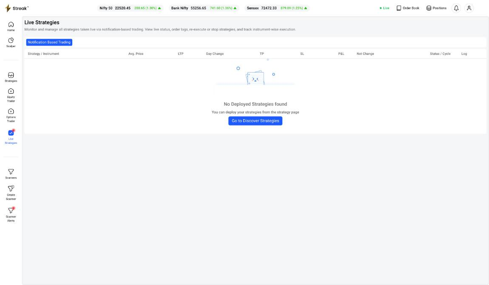
**Kite/platform dependency** none / local only.
**Open questions** What clears the red dots (unread alerts? new feature?).

### SHELL-006 Onboarding guided tours (per page)
**Description** First-visit step-by-step popovers anchored to UI regions, with "N of M" counter, Next/Back/Done and ×.
**Where** Per page. Observed tours:
- **Discover Live Scanners (3 steps):** 1 "Pre-built scanners" (left list: "Access a collection of commonly used
  scanners across instruments, segments, and timeframes.") · Next; 2 "Scan Results" ("View live scan results as
  conditions trigger…") · Back/Next; 3 "Take Scanner Live" (anchored to Set Alerts: "Activate scanners to run
  continuously and receive real-time alerts.") · Back/Done.
- **Prebuilt scanner view (2 steps):** 1 "Scan universe and conditions" — select instruments and define conditions
  using indicators, price action and custom logic; click "Run Scan" to view results; 2 "Scan Results" — instruments
  that qualify instantly.
- **Options Trader (5 steps; Back/Next/Done/×):** 1 "Entry – Underlying or Time Based" (trigger from underlying
  price conditions or time rules; can combine conditions for 2 different underlying scrips); 2 "Execution" (option
  selection logic: pre-defined setups or real-time ATM/ITM/OTM); 3 "Exit" (rule-based conditions, risk parameters or
  time-based); 4 "Pay Off Graph" (risk/reward before going live); 5 "Underlying Chart" (click to expand).
- **Scalper (4 steps):** 1 Option Chain, 2 Watchlist, 3 Third Chart, 4 Positions & Orderbook – Quick access.
- **Full backtest results page:** its own 2-step tour (steps not transcribed).
**UI & controls** Popover with title, text, counter "N of M", buttons Next / Back / Done, close ×.
**Behaviour & rules** Shown on first visit per page (INFERRED: persisted "seen" flag).
**Evidence** OBSERVED — INV §Global shell, §Full backtest results; A02 §1.3; A03 §1 Onboarding tour, §2 Tour; A04 §6.1.
**Screenshots** 

**Kite/platform dependency** none / local only (local "tour seen" preference).
**Open questions** Backtest-page tour step texts; whether tours can be replayed from help.

### SHELL-007 Unsaved-change navigation guard
**Description** Leaving a builder with unsaved edits prompts the browser "Leave site?" dialog.
**Where** Equity strategy builder, Options builder.
**UI & controls** Native browser beforeunload prompt.
**Behaviour & rules** Present on strategy builders; **absent on Create Scanner** (`/scanner` draft discarded silently on
navigation). Side effect observed: a draft builder tab could not be closed without the prompt. **Correction (REVIEW-2 #28):**
only the native `beforeunload` is guarded — leaving a dirty equity or options draft through the **sidebar or the "My
Strategies" button** (client-side navigation) shows no prompt and the draft is discarded.
**Evidence** OBSERVED — INV §Global shell; A02 §1.12; A03 §3 Layout; A01 §12; R2 §(c) #28.
**Screenshots** none.
**Kite/platform dependency** none / local only (desktop: window-close / view-change guard instead of beforeunload).
**Open questions** none.

### SHELL-008 Toast notifications (INFO / SUCCESS / ERROR)
**Description** Top-centre transient messages with coloured left border and ×, used for feedback and errors.
**Where** All pages.
**UI & controls** Levels: INFO (blue), SUCCESS (green), ERROR (red); × to dismiss; auto-dismiss. Observed texts:
INFO "No symbols matched the conditions."; SUCCESS "Found 5 symbols"; INFO "Copy the Scanner in order to set
alerts"; ERROR "Invalid indicator"; ERROR "Fill all the conditions before running scan."; toast "Strategy Saved
Successfully". A toast region labelled "Notifications alt+T" exists in page markup (A06 §7, keyboard hint).
**Behaviour & rules** Also used as the only feedback for some failures (see Cross-cutting §3.2).
**Evidence** OBSERVED — A03 §Run Scan behaviour, §Cross-cutting; A01 §10; INV §Execute → Backtest; DOCUMENTED — A06 §7
Keyboard shortcuts.
**Screenshots** 

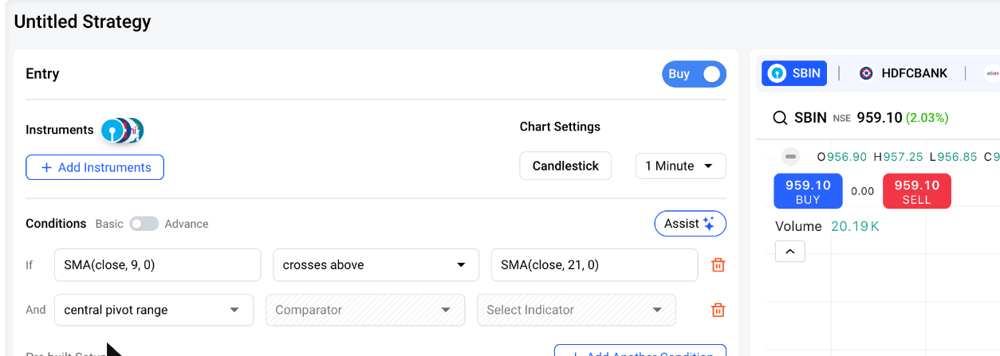
**Kite/platform dependency** none / local only.
**Open questions** Whether alt+T focuses the toast region (undocumented).

### SHELL-009 Profile menu (avatar dropdown)
**Description** Account dropdown with identity, links, theme switch and version.
**Where** Top bar, avatar button (far right).
**UI & controls** Card anchored under the avatar, top to bottom: 1 user name (bold) + broker client ID (grey);
2 divider; 3 **Profile** (person icon → `/profile`); 4 **Holdings** (calendar-grid icon → `/holdings`); 5 **Help**
(paper-plane icon → external `https://help.streak.tech`); 6 divider; 7 **Dark Theme** label + toggle (SHELL-010);
8 divider; 9 **Version** "V1.0.0" right-aligned.
**Behaviour & rules** No Logout here (it is on `/profile`), no plans/billing, referral, broker connection, settings,
keyboard-shortcut or logs items. While open, the status dot turned amber and "Live" label disappeared (possibly
coincidental).
**Evidence** OBSERVED — A05 §7.
**Screenshots** 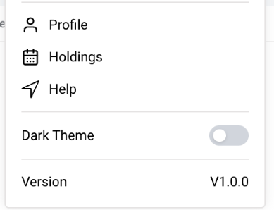
**Kite/platform dependency** `GET /user/profile` (gokiteconnect `GetUserProfile`) for name/client ID — A07 A11.
**Open questions** none.

### SHELL-010 Dark theme toggle
**Description** Switches the app between light (default) and dark theme.
**Where** Profile menu (SHELL-009).
**UI & controls** Toggle switch "Dark Theme"; default **off** (light).
**Behaviour & rules** Not toggled during research; dark appearance unobserved. The 404 page's near-white text on light
grey suggests a theming bug (dark-theme text on light theme) — see Cross-cutting §3.2.
**Evidence** OBSERVED — A05 §7, §9.
**Screenshots** 
**Kite/platform dependency** none / local only (persisted preference).
**Open questions** Dark theme appearance; whether TradingView iframe follows the theme.

### SHELL-011 In-app 404 page
**Description** Fallback page for unknown routes.
**Where** Any unknown route (e.g. `/pricing`, `/plans`, `/subscription`, `/settings`, `/referral`).
**UI & controls** Text "404 | This page could not be found." in near-white on light grey (almost invisible).
**Behaviour & rules** Confirms there are no pricing/plans/settings/referral pages.
**Evidence** OBSERVED — A05 §9.
**Screenshots** 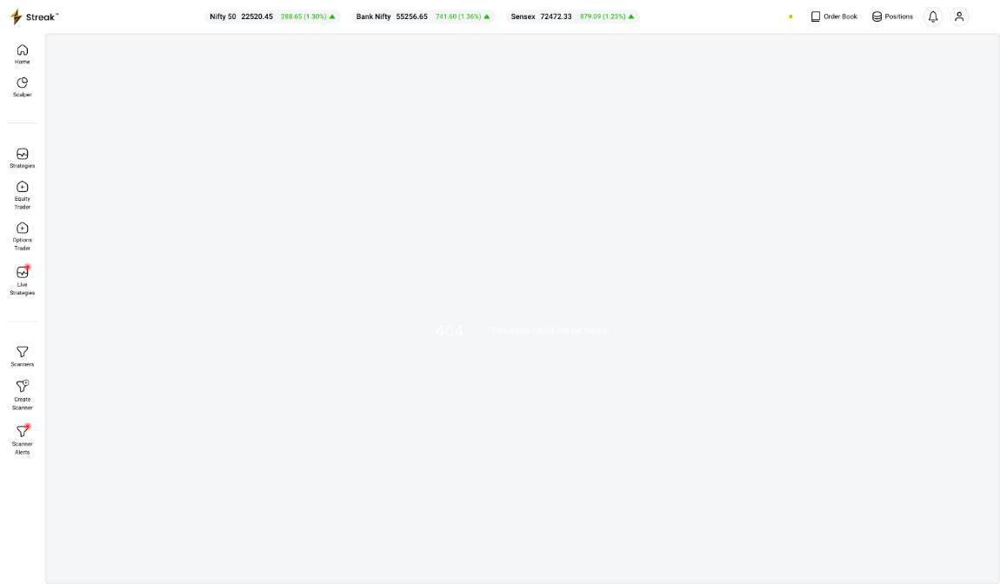
**Kite/platform dependency** none.
**Open questions** none (do not replicate the contrast bug).

### SHELL-012 Contextual help links and tooltips
**Description** Inline (i) icons and tooltips that link to the help centre, plus the Help menu item.
**Where** "Advance" conditions header (i) → tooltip "Learn about Advance Create — Click here"; Help in profile menu;
hover tooltips on icon buttons (e.g. "Refresh chart data", "Save Indicators and Drawings", "Clear Indicators and
Drawings", "Chart", "Disable"/"Enable", "Copy logic", "Paste logic after", "Delete Watchlist 1", "Search Symbols",
"Filter options coming soon").
**UI & controls** Tooltips on hover; (i) icon click opens help link.
**Behaviour & rules** Help centre article URLs are `https://help.streak.tech/<documentId>`.
**Evidence** OBSERVED — A01 §1.5; A03 §2 Conditions shown; A04 §3.1, §5.1; A05 §7.
**Screenshots** 
**Kite/platform dependency** none (rebuild would ship its own help).
**Open questions** none.

### SHELL-013 Risk-disclosure acknowledgement (once per login session)
**Description** A risk-disclosure modal or interstitial that the user acknowledges once per login session.
**Where** Global, after login (not rendered during the sweep; the session had already acknowledged it).
**UI & controls** Not observed. Evidence is indirect: `localStorage` holds `riskDisclosureSeen:<session-token>=1` and the app
bundle defines the constant `RISK_DISCLOSURE_PREFIX:'riskDisclosureSeen'` next to `PRODUCT_TOUR`.
**Behaviour & rules** Shown and acknowledged once per login session (keyed by the session token); a new login shows it again.
Text and layout not captured. Related: the deploy dialog's "trading terms" link (DEP-001, ACCT-009).
**Evidence** INFERRED (code/storage) — R2 §(b) N9.
**Screenshots** none (needs a fresh login).
**Kite/platform dependency** none / local (a rebuild shows its own disclosure after each daily Kite login).
**Open questions** Exact text, placement (modal vs page) and whether it gates any action.

---

### Module HOME — Home dashboard

### HOME-001 Dashboard layout
**Description** Single-glance cockpit: portfolio/strategy summary, an interactive chart with analytics beneath it, and
a right column of watchlist, live scanner hits and a prebuilt-strategy backtest teaser.
**Where** `/` and `/dashboard` (sidebar "Home").
**UI & controls** Left/centre column (~2/3): Holdings card + Live Strategy Overview card in one row (HOME-002/003);
main chart card (CHART-001…); bottom analytics tab panel with Collapse (ANLY-001). Right column (~1/3,
independently scrollable): Watchlist panel (WATCH-001), Live Scanners panel (HOME-004), Live Backtest panel
(HOME-005).
**Behaviour & rules** Main chart defaults to NIFTY 50 (docs); selected symbol persists across reload (CHART-013).
**Evidence** OBSERVED — INV §Home / Dashboard; A04 §0, §5; DOCUMENTED — A06 §7 Home.
**Screenshots** 
**Kite/platform dependency** Aggregates: holdings (`GET /portfolio/holdings`), ticker, local strategy store.
**Open questions** none.

### HOME-002 Holdings summary card
**Description** Quick portfolio snapshot from the linked broker.
**Where** Dashboard top row, left.
**UI & controls** `Current Value ₹x`, `Investment ₹x`, P&L `abs +pct%` (green/red, ▲).
**Behaviour & rules** Empty state shows all `₹ 0.00` and `0.00 +0.00% ▲` — no "no holdings" message. Counters are
not links (A04 open question: does the card navigate to `/holdings`?).
**Evidence** OBSERVED — INV §Home; A04 §2.
**Screenshots** 
**Kite/platform dependency** `GET /portfolio/holdings` (gokiteconnect `GetHoldings`/`GetHoldingsSummary`); LTP via
ticker or `GET /quote/ltp` for current value — A07 A5, A11.
**Open questions** Whether clicking opens `/holdings`; whether P&L is day or overall.

### HOME-003 Live Strategy Overview card
**Description** Counts of the user's deployed strategies.
**Where** Dashboard top row, right of Holdings.
**UI & controls** Three counters: `Active Strategies`, `Closed Strategies`, `Total Strategies` (0/0/0 observed).
**Behaviour & rules** Not links (no click affordance).
**Evidence** OBSERVED — INV §Home; A04 §2.
**Screenshots** 
**Kite/platform dependency** Local deployment store (DEP-003).
**Open questions** Definition of "Closed" (expired T+29? stopped?).

### HOME-004 Live Scanners widget
**Description** Compact live view of prebuilt scanners on the home page for a chosen universe, with jump to full scanner.
**Where** Dashboard right column, middle card.
**UI & controls**
- Header: orange (pulsing) status dot + "Live Scanners"; read-only label of the active scanner's timeframe (`1 Day`
  for Top Gainers, `5 Minutes` for Opening Range Breakout — not a control); universe dropdown (29 options, Appendix H).
- Tabs (horizontal, « » scroll, full names): the first 20 prebuilt scanners — Top Gainers, Top Losers, Opening Range
  Breakout, Opening Range Breakdown, Higher high for 2 days, Lower Low for 2 days, Short Term Bullish, Short Term
  Bear, Momentum Surge, Momentum Fade, Bullish Engulfing, Bearish Engulfing, Volume Breakout, Volume Breakdown, RSI
  Entering Bullish Territory, Possible Downtrend, 52 Week High Breakout, Bullish Harami, Inverted Hammer, Hammer.
- Rows: Symbol (+ exchange tag / C-P badge for options), "LTP / Change" (LTP + coloured % in one column), B / S
  buttons (no chart button, no volume). ~6 rows visible, scrollable. Row hover shows 📈 (loads symbol into main chart —
  verified).
- `See Full Results ↗` → same tab navigates to `/scanner/<slug>` of the active tab (e.g.
  `/scanner/scanner-opening-range-breakout`).
**Behaviour & rules** Widget and Discover Scanners share **one persisted universe preference** per account (changing
one changes the other). Option rows render as `NIFTY 13ᵗʰ ʷ OCT 22250 CE NFO-OPT`. Charting an option from here shows
only the Technicals analytics tab (ANLY-001).
**Evidence** OBSERVED — INV §Home; A03 §7; A04 §5.2.
**Screenshots** 

**Kite/platform dependency** Local scanner engine over locally aggregated candles (ticker → candles) for the universe;
constrained by the ~9,000-instrument live cap (3 sockets × 3,000) — A07 A6, Constraint 6/8. Option universes need
selective subscription.
**Open questions** Refresh cadence during market hours.

### HOME-005 Live Backtest widget
**Description** Rotating showcase of prebuilt strategies with their recent (~3-month) backtest result, as a hook into
Discover Strategies.
**Where** Dashboard right column, bottom card.
**UI & controls**
- Header: orange dot + `Live Backtest`. Strategy tabs (scrollable «/»): Bollinger Band Mean Reversion, Falling
  Momentum, Volatility Contraction, Volatility Expansion, Strong Breakout Continuation, Vwap Mean Reversion,
  Volatility burst, TEMA Momentum Shift, RSI Trend Momentum Breakout, Volatility Expansion Trend Breakout.
- Metrics: `Backtest P&L` (₹, red/green, e.g. ₹-434.98 / ₹22,336.70), `Max Gain`, `Max Loss`, `Win vs Loss` progress bar
  (green fill = win share) with `142 W` / `129 L`, `Trades` (Traded count), `Capital Used`.
- Calendar heatmap: one mini-grid per month (Jul–Oct 2026), cells = days (weekday columns), green/red shades by daily %,
  grey = no trade/holiday. Hover tooltip `13 Jul, 2026: -1.48%`.
- `See Full Results ↗` button (opens full backtest page BT-008).
**Behaviour & rules** Docs: cards show Backtest P&L, Trades, Win vs Loss, Capital Used, Max Gain/Max Loss and a
month-by-month grid. Capital Used ≈ 3.46 L suggests aggregation over all instruments (INFERRED).
**Evidence** OBSERVED — INV §Home; A04 §5.3; DOCUMENTED — A06 §2 "Live Backtest cards", §7 Discover.
**Screenshots** 

**Kite/platform dependency** Local backtest engine (BT) over local candle store (Kite historical API backfill, 3 req/s —
A07 A4).
**Open questions** Whether metrics aggregate all instruments; which strategies rotate into the tabs.

---
### Module CHART — Charting

### CHART-001 Main chart widget (TradingView Charting Library) with Streak header bar
**Description** Full interactive candlestick chart for any NSE/BSE stock, index, future or option, with timeframes,
100+ studies, drawing tools and one-click Buy/Sell. Streak supplies its own header bar instead of TradingView's.
**Where** Dashboard main chart card; Scalper charts (SCALP-002); strategy builder right pane (EQB-031); options
chart drawers (OPT-027/028); full-page `/chartiq` (CHART-013).
**UI & controls** Embedded in a same-origin `blob:` iframe (TV logo bottom-left; `data-name` attributes such as
`linetool-group-*`, `legend-*`, `buy-order-button`, `sell-order-button`). Header bar (Streak-owned):
| Control | Type | Detail |
|---|---|---|
| 🔍 + `SYMBOL` `EXCH` `LTP (pct%)` | button | Opens symbol search modal (CHART-003). Exchange tag e.g. `INDICES`, `NSE`; % coloured. |
| ⟳ | icon button | Tooltip "Refresh chart data" (CHART-004). |
| `1 Hour ▾` | dropdown | Timeframe (CHART-002). |
| `💾 Save` | button (blue text) | Tooltip "Save Indicators and Drawings" (CHART-005). |
| 🗑 (orange) | icon button | Tooltip "Clear Indicators and Drawings" (CHART-005). |
| `ƒx Indicators` | button | Opens Indicators dialog (CHART-006). |
No chart-type selector is exposed (candles only); TV Settings → Symbol offers only candle colouring.
**Behaviour & rules** Docs: chart stack is TradingView for trading/scalping and **ChartIQ** next to strategy conditions;
new condition indicators can be added only if ChartIQ supports them (A06 §7 Chart stack).
**Evidence** OBSERVED — INV §Home; A04 §3, §3.1; DOCUMENTED — A06 §7.
**Screenshots** 

**Kite/platform dependency** Historical candles `GET /instruments/historical/:token/:interval` (intervals minute…day;
chunk limits 60/100/200/400/2000 days; 3 req/s) + ticker for live bar updates — A07 A4, A6. Charting library choice is a
local decision (TradingView Charting Library requires a licence; not a Streak asset to copy).
**Open questions** Whether Save stores one layout per symbol or globally; whether a chart-type switch (Heikin-Ashi/line)
exists anywhere (not on dashboard; docs say candlestick only).

### CHART-002 Chart timeframe dropdown
**Description** Selects the candle interval of the chart.
**Where** Chart header bar (every chart instance).
**UI & controls** Dropdown options: 1 Minute, 3 Minutes, 5 Minutes, 10 Minutes, 15 Minutes, 30 Minutes, 1 Hour, 1 Day.
Defaults: dashboard & Scalper **1 Hour** as observed by A04 on 11 Oct; the REVIEW-2 sweep the same day saw **1 Day** on the
dashboard and both Scalper charts with empty `chart_preferences` — the default is UNVERIFIED (Conflicts §6 #29); builder chart
follows the strategy's Chart Settings (default 1 Minute); `/chartiq` takes `timeframe=` from the URL (e.g. `day`). Docs list Scalper timeframes as 1, 3, 5, 15, 30 min, 1 h, 1 d (no 10 min —
see Conflicts §6).
**Behaviour & rules** Analytics Technicals tab follows the chart timeframe (ANLY-002). In Scalper, changing chart 1's
timeframe syncs all charts, which can then be changed individually (DOCUMENTED).
**Evidence** OBSERVED — A04 §3.1, §6.1; A01 §4.3; A03 §2 Results row actions; DOCUMENTED — A06 §7 Scalper Timeframes.
**Screenshots** 
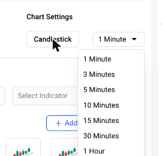
**Kite/platform dependency** Kite intervals `minute, 3minute, 5minute, 10minute, 15minute, 30minute, 60minute, day` map 1:1
(A07 A4).
**Open questions** none.

### CHART-003 Chart symbol search modal ("Add Stocks" single-select variant)
**Description** Search any instrument and load it into the chart.
**Where** 🔍 symbol button in the chart header (dashboard, Scalper "Search Symbols", `/chartiq`).
**UI & controls** Title "Add Stocks" (same component as the strategy instrument picker, WATCH-005). Search input
placeholder "Search eg: SBIN, TCS etc", auto-focused. Quick chips: `NIFTY 50`, `NIFTY BANK`, `SENSEX`, `BANKEX`.
Columns: `Instrument` (logo + symbol + exchange tag) | `Company Name` (uppercase, right-aligned). Default list (empty
query): NSE equities alphabetical (ADANIENT, ADANIPORTS, APOLLOHOSP, …).
**Behaviour & rules** Results cover segments `INDICES`, `NSE`, `BSE`, `NFO-FUT` (e.g. "RELIANCE OCT FUT", round "F" icon),
`NFO-OPT` ("RELIANCE OCT 1290 CE" with "C" icon, "… PE" with red "P" icon). Matching is fuzzy on symbol and name (query
"BANKNIFTY" matched NIFTY BANK, NIFTY PSU BANK, BANKNIFTY1, SETFNIFBK …). Clicking a row switches the chart symbol,
closes the modal, and reloads the analytics tabs for that symbol. Escape does not close; × or backdrop click.
**Evidence** OBSERVED — A04 §3.2, §7.
**Screenshots** 
**Kite/platform dependency** Instruments dump `GET /instruments` (gzipped CSV, daily ~08:30; columns instrument_token,
tradingsymbol, name, expiry, strike, lot_size, instrument_type, segment, exchange) cached locally for search — A07 A5.
**Open questions** none.

### CHART-004 Refresh chart data
**Description** Re-fetches the chart's candles.
**Where** ⟳ icon in the chart header; also present in Options builder chart drawers.
**UI & controls** Icon button, tooltip "Refresh chart data".
**Behaviour & rules** Not exercised beyond tooltip.
**Evidence** OBSERVED — A04 §3.1; A02 §1.11.
**Screenshots** 
**Kite/platform dependency** Historical candles re-fetch (3 req/s).
**Open questions** none.

### CHART-005 Save / Clear indicators and drawings
**Description** Persist or wipe the chart's study and drawing layout.
**Where** Chart header: `💾 Save` (tooltip "Save Indicators and Drawings") and orange 🗑 (tooltip "Clear Indicators and
Drawings"). Both NOT clicked.
**UI & controls** Two buttons.
**Behaviour & rules** Unsaved studies do **not** persist across reload (RSI added → reload → gone); the selected symbol does
persist (CHART-013). Docs: Scalper allows up to **5 indicators per chart**, on charts 1 and 2 only (SCALP-012).
**Evidence** OBSERVED — A04 §3.1; DOCUMENTED — A06 §6 Scalper chart indicators.
**Screenshots** 
**Kite/platform dependency** none / local only (persist layout JSON locally).
**Open questions** Per-symbol vs global layout; what Clear confirms.

### CHART-006 Indicators dialog (ƒx) — 107 built-in studies
**Description** Add any of the TradingView built-in studies to the chart.
**Where** `ƒx Indicators` button (chart header).
**UI & controls** Modal "Indicators" with ×, search box, single flat list under header **SCRIPT NAME** — no categories/tabs,
no favourites, no "My scripts". Search filters as you type and highlights the matched substring. Full list of 107 studies:
Appendix J.
**Behaviour & rules** Click a row → study added immediately with defaults; dialog stays open for multi-add; close with ×
(Escape does not close TV dialogs — focus stays in iframe). Oscillators get their own pane below price (RSI 14 with 30/70
band shading). This list differs from the strategy-condition catalogue (Appendix A/B): charting has Hull MA / Connors RSI;
conditions have Central Pivot Range / Opening Range / Nth Candle.
**Evidence** OBSERVED — A04 §3.4.
**Screenshots** 

**Kite/platform dependency** none / local (charting library studies).
**Open questions** none.

### CHART-007 Study configuration (legend icons, settings dialog, pane controls)
**Description** Show/hide, configure, remove a study; per-pane controls.
**Where** Hover the study legend in the chart.
**UI & controls** Legend hover icons: 👁 show/hide, ⚙ settings, 🗑 remove, ⋯ more. Settings dialog (e.g. "RSI") tabs
**Inputs / Style / Visibility**; Inputs for RSI = Length 14, Smoothing Line [SMA ▾], Smoothing Length 14; footer `Defaults ▾`,
Cancel, Ok. Pane has its own ↓ / collapse / maximise buttons. Legend row: collapse (–) button; `Volume` legend with ˄
collapse for the indicator list.
**Behaviour & rules** TV standard behaviour.
**Evidence** OBSERVED — A04 §3.3, §3.4.
**Screenshots** 
**Kite/platform dependency** none / local.
**Open questions** none.

### CHART-008 Drawing toolbar
**Description** Hidden left toolbar of drawing tools with flyouts and keyboard shortcuts.
**Where** Small blue `›` tab on the chart's left edge toggles the toolbar.
**UI & controls** Groups (TV `data-name`): cursors (Cross); trend-line (Trend Line ⌥T, Ray, Info Line, Extended Line, Trend
Angle, Horizontal Line ⌥H, Horizontal Ray ⌥J, Vertical Line ⌥V, Cross Line ⌥C, …); gann-and-fibonacci (Fib Retracement…);
patterns (XABCD Pattern…); prediction-and-measurement (Long Position / Short Position…); geometric-shapes (Brush…);
annotation (Text); font-icons (emoji); Measure; Zoom In; Magnet; "stay in drawing mode"; Lock all drawings; Hide all;
Remove all drawings. Each group has a `›` flyout listing variants with shortcuts. See Appendix J.
**Behaviour & rules** Drawings persist only via Save (CHART-005).
**Evidence** OBSERVED — A04 §3.3.
**Screenshots** 
**Kite/platform dependency** none / local.
**Open questions** none.

### CHART-009 In-chart readouts: OHLC legend, volume, crosshair, price scale
**Description** Standard chart readouts.
**Where** Inside every chart.
**UI & controls** Legend `O H L C change (pct%)` coloured by candle direction; `Volume` legend (value coloured) + volume
histogram at bottom (green/red; indices show 0); price scale right with last-price red/green label; crosshair with time label
(`01 Oct '26 09:15`) and price label with ⊕ (add alert/order on hover — TV standard); bottom-right ⚙ gear = chart settings
(CHART-012). Scroll/drag to pan, wheel to zoom. When the analytics panel is collapsed the chart shows `A` (auto-scale) /
`L` (log-scale) toggles bottom-right.
**Behaviour & rules** Number format: Indian grouping on axes (22,520.45).
**Evidence** OBSERVED — A04 §3.3, §4, §7.
**Screenshots** 

**Kite/platform dependency** none / local.
**Open questions** none.

### CHART-010 Buy / Sell quick-trade overlay buttons
**Description** One-click trade buttons overlaid on the chart showing bid/ask.
**Where** Top-left of every chart (dashboard, Scalper, builder charts, options drawers).
**UI & controls** Blue `<price> BUY`, a spread value between (`0.00`), red `<price> SELL` (TV `buy-order-button`/
`sell-order-button`). NOT clicked.
**Behaviour & rules** Docs (Scalper): Buy shows the best ask, Sell the best bid; **Market** is the default order type; required
margin is shown inside the Buy/Sell buttons. On options with market closed the buttons show `0.00`. TV hidden `qtyEl`
("Quantity") holds `1` (default qty 1; no quantity presets).
**Evidence** OBSERVED — INV §Home; A04 §3.3, §6.7; DOCUMENTED — A06 §7 Scalper Trade-from-chart, Margin.
**Screenshots** 
**Kite/platform dependency** `GET /quote` (depth, 500/call) or ticker `full` mode (5-level depth) for best bid/ask; order
placement `POST /orders/regular` with `market_protection` mandatory for MARKET; static IP mandatory for order placement;
10 OPS cap — A07 A5–A7, A12, Constraints 3–5. Margin via `POST /margins/orders`.
**Open questions** Whether the click is instant or opens an order window (not tested for safety) — see ORD-004.

### CHART-011 Chart context menu and Trade submenu
**Description** Right-click menu with TV trading-terminal integration.
**Where** Right-click on any chart.
**UI & controls** Items: `Copy price 1,249.30`, `Paste ⌘V`, `Trade ›`, `Lock vertical cursor line by time`, `Remove N
indicators`, `Hide marks on bars`, `⚙ Settings…`. `Trade ›` submenu (NOT clicked): `Sell 1 NSE_RELIANCE @ <price> limit`,
`Buy 1 NSE_RELIANCE @ <price> stop`, `Buy 1 … stop <price> limit`, `Create new order… ⇧T`, `Trading settings…`.
**Behaviour & rules** Broker symbol format `EXCHANGE_SYMBOL` (e.g. `NSE_RELIANCE`); default qty 1. Docs (Scalper): hover a
price and click "+" to place a limit or SL order; drag an order line to modify; click X to cancel/close (SCALP-011).
**Evidence** OBSERVED — A04 §3.5; DOCUMENTED — A06 §7 Scalper Trade-from-chart.
**Screenshots** 
**Kite/platform dependency** Orders API (LIMIT, SL, SL-M types; modify limit 25 per order) — A07 A7.
**Open questions** none.

### CHART-012 Chart settings dialog
**Description** TradingView chart appearance/behaviour settings.
**Where** ⚙ gear bottom-right of chart or context menu `Settings…`.
**UI & controls** Left tabs **Symbol, Status line, Scales and lines, Canvas, Trading**. Symbol tab: CANDLES (Color bars based
on previous close ☐; Body ☑ green/red; Borders ☑; Wick ☑), DATA MODIFICATION (Precision: Default), Timezone `(UTC+5:30)
Kolkata`. Footer: Template ▾, Cancel, Ok.
**Behaviour & rules** Only candle colouring; no chart-type switch.
**Evidence** OBSERVED — A04 §3.5.
**Screenshots** 
**Kite/platform dependency** none / local.
**Open questions** none.

### CHART-013 Symbol persistence and full-page chart route `/chartiq`
**Description** The dashboard remembers the last charted symbol; a standalone full-screen chart page exists for scanner rows.
**Where** Dashboard (persistence); `/chartiq?seg_sym=<SEG>_<SYM>&timeframe=<tf>` (e.g. `NSE_ADANIENT`, `day`), opened in a
**new browser tab** from the scanner results chart icon (SCAN-014).
**UI & controls** `/chartiq`: full-screen chart with symbol search, LTP + %, timeframe dropdown (1 Day), Save, delete, ƒx
Indicators, OHLC readout, BUY/SELL price buttons, Volume pane.
**Behaviour & rules** Selected dashboard symbol persists across reload (RELIANCE stayed after reload). Scalper right chart kept
22400 CE after navigation within the session (persistence scope unknown).
**Evidence** OBSERVED — A03 §2 Results row actions; A04 §3.1, §8, §6.7 open questions.
**Screenshots** 
**Kite/platform dependency** none / local preference store.
**Open questions** Whether persistence is server-side or local; the route name suggests ChartIQ but the widget looked
TradingView-style (A03) — see Conflicts §6.

---

### Module ANLY — Analytics panel (under the chart)

### ANLY-001 Analytics tab bar, symbol-dependent tab set, Collapse/Expand
**Description** Context analytics for the charted symbol as a tabbed panel docked under the chart.
**Where** Dashboard under main chart; Scalper bottom-left (for the left chart's symbol).
**UI & controls** Segmented tab bar (icon + label, active = filled blue pill): `Technicals`, `Option Chain`, `OI`, `PCR`,
`Advance/Decline`, `ATM IV/Straddle`. Right: black `Collapse ⌄⌄` button; when collapsed the tab bar stays docked at the bottom
with `Expand ⌃`. Panel height fixed (~270 px); content scrolls inside.
**Behaviour & rules** Tab set depends on symbol: index (NIFTY 50) → all six; F&O stock (RELIANCE) → `Advance/Decline` absent
(5 tabs); option contract → only `Technicals`. Presumably non-F&O stocks show only Technicals (INFERRED, not verified).
Collapse hides panel content; chart grows to fill. In Scalper, Collapse collapses both bottom panels.
**Evidence** OBSERVED — INV §Home; A04 §4, §5.2, §6.1, §7.
**Screenshots** 

**Kite/platform dependency** Instrument metadata (segment, F&O availability) from instruments dump.
**Open questions** Refresh cadence during market hours; exact tab set for non-F&O stocks.

### ANLY-002 Technicals tab
**Description** Technical summary: sentiment gauge, pivot ruler, moving-average/RSI verdicts and recent pattern events.
**Where** Analytics panel → Technicals.
**UI & controls**
- Left half: sentiment gauge — horizontal gradient bar red→grey→green labelled `Bearish N` / `Neutral N` / `Bullish N`
  with a black ▲ pointer; counts sum to **27** (e.g. 9/9/9 on 1h; 13/12/2 on 1d) → 27 indicator votes. Pivot ruler — blue
  line with ticks `S3 S2 S1 R1 R2 R3` and values (classic pivots; 1h NIFTY: 20,847 / 21,710 / 22,066 / 22,929 / 23,436 /
  24,299); no pivot P shown. Verdict rows: `Short Term (5 & 20 SMA CrossOver)` → Bullish (green) / Bearish (orange) /
  `------` (none); `Long Term (20 & 50 SMA CrossOver)`; `RSI (14)` → e.g. `51 - Neutral`, `33 - Bearish`, `37 - Bearish`.
- Right half: `Event | Time` table of recently detected patterns/indicator events, newest first, ~5 rows: Heikin Ashi
  Bearish/Bullish Reversal, Bullish/Bearish Engulfing Pattern, Bullish CCI Crossover, Bullish Inside bar, Bearish Money
  Flow Trend, Bullish Harami Pattern, Bearish/Bullish RSI Divergence, Doji, Volatility Expansion, Three Black Crows. Time
  format `09 Oct 2026 15:15`.
**Behaviour & rules** Follows the chart timeframe (verified: 1 Hour → hourly event times; 1 Day → daily events, different
pivots/counts). No tooltips on gauge/pivots. **Correction (REVIEW-2 N1/#30):** each row of the `Event | Time` list is a
`<button>` with a dark **hover tooltip** explaining the event in plain English (e.g. "Bullish RSI Divergence is a technical
analysis concept where the price makes a lower low, but the RSI forms a higher low…"; the CCI row's tooltip describes it as a
scanner over Nifty 100 on the daily timeframe); clicking a row still does nothing (no markers on chart). Docs: indicators lag
about **6–7 minutes**; pivots R1–R3 / S1–S3 documented.
**Evidence** OBSERVED — INV §Home; A04 §4.1; R2 §(b) N1; DOCUMENTED — A06 §7 Home and Technicals.
**Screenshots** 

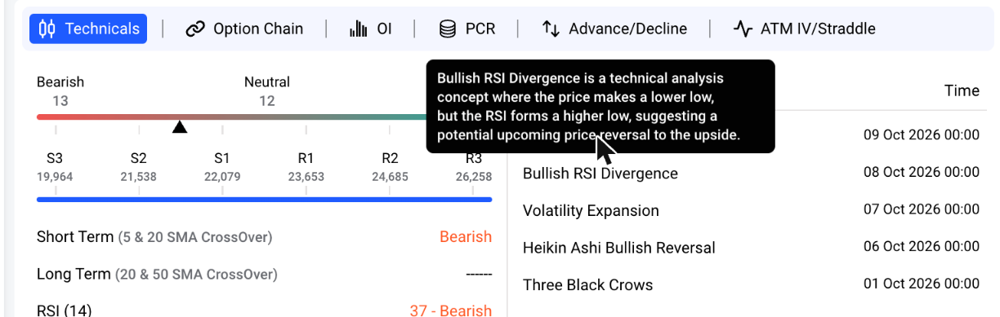
**Kite/platform dependency** Local indicator/pattern engine over local candles (historical API + ticker).
**Open questions** How the 27 votes are composed; pivot type (classic assumed) and period per timeframe.

### ANLY-003 Option Chain tab (dashboard variant)
**Description** Compact option chain for the charted underlying with OI bars, ATM/ITM highlighting and row-hover B/S.
**Where** Analytics panel → Option Chain.
**UI & controls** Columns: `Call OI (Lakh)` [value with (OI change %) to its left], `Call LTP` [with (LTP change %)], `Strike`
(centre), `Put LTP` [with (chg %)], `Put OI (Lakh)` [with (chg %)]; percentages green/red small type. **No greeks, IV, volume,
bid/ask** columns in this variant (the Scalper/Options drawers add Greeks — SCALP-004, OPT-015). ATM strike bold; ITM side
shaded light blue (calls below spot, puts above). Thin OI bars under each row: red bar leftward for call OI, teal rightward for
put OI (length ∝ OI). Expiry dropdown (right of header), default nearest: `13 Oct, 19 Oct, 27 Oct, 03 Nov, 09 Nov, 23 Nov,
29 Dec` (weekly + monthly). Strike range wide (22350…24050+ for NIFTY; 50-pt steps), vertically scrollable, opens scrolled
around ATM.
**Behaviour & rules** Row hover reveals `S` `B` next to the strike on the call side and `B` `S` on the put side → one-click order
window for that option (NOT clicked). Market closed: last-session values, no banner.
**Evidence** OBSERVED — INV §Home; A04 §4.2; DOCUMENTED — A06 §7 ("hover a row to show B/S").
**Screenshots** 

**Kite/platform dependency** Instruments dump for strikes/expiries; `GET /quote` (OI, last price, 500 instruments/call, 1 req/s)
or ticker `quote`/`full` mode with selective subscription (9,000-instrument cap) — A07 A5, A6, Constraint 6.
**Open questions** Whether option-chain B/S opens the same order window as watchlist B/S.

### ANLY-004 OI tab
**Description** Open-interest distribution and OI change per strike.
**Where** Analytics panel → OI.
**UI & controls** Two side-by-side bar charts, each with its own expiry dropdown (`13 Oct 26 ▾`): **Open Interest** (grouped bars
per strike, `Call OI` red, `Put OI` teal; x-axis strikes 22100…22900, ~±8 strikes around ATM) and **Open Interest Change**
(same layout; negatives not observed). Hover tooltip `Strike: 22500` / `Put OI: 1.32Cr` (units Cr/L auto-scaled) or `Put OI
Change: 1.03Cr`. Legend dots (toggle not verified).
**Behaviour & rules** none further observed.
**Evidence** OBSERVED — A04 §4.3; DOCUMENTED — A06 §7.
**Screenshots** 

**Kite/platform dependency** `GET /quote` (oi, oi_day_high/low) or historical with `oi=1`; OI change needs a stored baseline.
**Open questions** Baseline for "OI change" (previous day close?).

### ANLY-005 PCR tab
**Description** Put-call ratio history against price.
**Where** Analytics panel → PCR.
**UI & controls** Dual-axis line chart: `Price` (blue, left axis) vs `PCR` (orange, right axis); legend top-left; `Expiry 13 Oct`
label top-right (nearest expiry; **no selector**). X-axis intraday timestamps over ~5 sessions (05 Oct 09:14 … 09 Oct 15:29),
minute resolution. Crosshair tooltip `07 Oct 14:04` / `Price: 22,569.9` / `PCR: 0.8444`.
**Behaviour & rules** none further.
**Evidence** OBSERVED — A04 §4.4; DOCUMENTED — A06 §7.
**Screenshots** 

**Kite/platform dependency** Needs a local minute-level OI time series for the whole chain (Kite has no PCR endpoint; must be
computed and stored by the app while running — a gap vs Streak's server-side history; A07 Constraint 2/8).
**Open questions** PCR definition (OI-based assumed).

### ANLY-006 Advance/Decline tab (index only)
**Description** Market breadth of index constituents.
**Where** Analytics panel → Advance/Decline (only for index symbols).
**UI & controls** Two-line chart `Advance` (teal) vs `Decline` (red) counts (0–50 for Nifty), last 2 sessions intraday; "as of"
timestamp top-right (`09 Oct 15:29`). Tooltip `09 Oct 09:57` / `Advance Count: 48` / `Decline Count: 2`.
**Behaviour & rules** Absent for stocks and options.
**Evidence** OBSERVED — A04 §4.5; DOCUMENTED — A06 §7.
**Screenshots** 
**Kite/platform dependency** Constituent lists (niftyindices CSVs — current-only, ToS forbids automated download; user-imported
lists recommended, A07 §E) + ticker for each constituent.
**Open questions** none.

### ANLY-007 ATM IV/Straddle tab
**Description** ATM implied volatility and straddle premium history.
**Where** Analytics panel → ATM IV/Straddle.
**UI & controls** Dual-axis line chart: `IV` (blue, left axis, %) and `Straddle` (red, right axis, premium ₹ of ATM CE+PE), ~1–2
sessions, timestamp top-right. Tooltip `09 Oct 12:38` / `IV: 12.78` / `Straddle: 242.80`.
**Behaviour & rules** none further.
**Evidence** OBSERVED — A04 §4.6; DOCUMENTED — A06 §7.
**Screenshots** 

**Kite/platform dependency** Local IV computation (Kite provides no IV) + stored minute series of ATM CE/PE prices.
**Open questions** IV model used (Black-Scholes assumed, INFERRED).

---

### Module WATCH — Watchlists & instrument selection

### WATCH-001 Watchlist panel (multiple named lists, Create Watchlist)
**Description** Named lists of instruments with live prices; click to chart, one-click Buy/Sell, inline add.
**Where** Dashboard right column (top card); Scalper watchlist drawer (SCALP-008); lists reused as chips in Add Stocks (WATCH-005).
**UI & controls** Header `Watchlist` + blue link `Create Watchlist +` (NOT clicked — may create immediately). Tabs as segmented
control `Watchlist 1 | Watchlist 2` (active = blue pill; presumably scroll if many). Search input "Search symbols..." (WATCH-002)
+ orange-bordered 🗑 (WATCH-004). Table headers `Symbol | LTP / Change | Buy/Sell` — **not sortable**. Observed contents:
Watchlist 1 = NIFTY 50, SENSEX, NIFTY BANK, APOLLOHOSP, SBIN, TCS, RELIANCE, INFY, ASIANPAINT (9); Watchlist 2 = AXISBANK,
BHARTIARTL, TITAN, ULTRACEMCO, TATACHEM, ….
**Behaviour & rules** Docs: watchlist size **50**; watchlists can be imported into strategies and scanners. No drag-reorder
affordance; max number of watchlists unknown.
**Evidence** OBSERVED — INV §Home; A04 §5.1; DOCUMENTED — A06 §1 Instruments per strategy, §4 Scanner-to-strategy linking, §6 Watchlist size.
**Screenshots** 

**Kite/platform dependency** Ticker subscription per watchlist row (`ltp`/`quote` mode); local store for lists.
**Open questions** Whether Create Watchlist prompts for a name; max lists; reorder.

### WATCH-002 Inline symbol search / add to watchlist
**Description** Search and add an instrument to the active watchlist without a modal.
**Where** Watchlist panel search input.
**UI & controls** Dropdown under the input: rows `logo SYMBOL EXCH ……… COMPANY NAME`; hovering a row shows a blue `+` (add to
current watchlist). Same instrument universe as chart search (INDICES/NSE/BSE/NFO-FUT/NFO-OPT).
**Behaviour & rules** Not clicked (would change account data).
**Evidence** OBSERVED — A04 §5.1.
**Screenshots** 
**Kite/platform dependency** Instruments dump search (local).
**Open questions** Duplicate handling; 50-item cap message.

### WATCH-003 Watchlist row (instrument row with chart / remove / B / S)
**Description** The standard instrument row: click to chart, hover for actions, B/S buttons.
**Where** Watchlist panel rows (same pattern in scanner results, Live Scanners widget).
**UI & controls** Row: logo, symbol, exchange tag (INDICES/NSE/NFO-OPT…), LTP, (pct%) coloured, `B` (blue outline) `S` (red
outline). Row hover reveals `📈` (load in main chart) and `🗑` (remove from watchlist) before B/S. For **indices B/S are rendered
disabled** (faded, not tradable).
**Behaviour & rules** Row click (on symbol) loads it into the main chart; selected row stays highlighted.
**Evidence** OBSERVED — A04 §5.1, §7.
**Screenshots** 
**Kite/platform dependency** Ticker; B/S → ORD-004 order window.
**Open questions** none.

### WATCH-004 Delete watchlist
**Description** Deletes the whole active watchlist.
**Where** Orange-bordered 🗑 beside the watchlist search.
**UI & controls** Icon button; tooltip "Delete Watchlist 1" (names the active list). NOT clicked.
**Behaviour & rules** Confirmation unknown.
**Evidence** OBSERVED — A04 §5.1.
**Screenshots** 
**Kite/platform dependency** none / local.
**Open questions** Confirm dialog? Can the last list be deleted?

### WATCH-005 "Add Stocks" instrument picker dialog (multi-select, shared)
**Description** Shared dialog to pick up to 50 instruments by search, universe chip or watchlist, used by the equity builder
("Add Instruments") and scanner Custom Symbols ("Add Symbols"); a single-select variant backs chart symbol search (CHART-003).
**Where** Equity builder Entry card → `+ Add Instruments`; Create Scanner → Scan On `Custom Symbols` → `+ Add Symbols`.
**UI & controls** Search box ("Search eg: SBIN, TCS etc."). Universe chips: NIFTY50, NIFTY100, NIFTY200, NIFTY500, BANKNIFTY;
watchlist chips: Watchlist 1, Watchlist 2. Left list: select-all checkbox; rows = checkbox, logo, symbol, exchange tag (NSE),
Company Name. Right list "Symbol (4 / 50)" (counter; **max 50**); each with Live Price + % change; remove (−). Footer:
`+ Add to Watchlist` (save current selection as a watchlist), `Done`.
**Behaviour & rules** Escape does not close; backdrop click does. Docs: up to 50 instruments per equity strategy; watchlists
importable. Instruments: NSE plus BSE stocks in the BSE 1000 index only; no MCX, currency, AMO or MTF (A06 §1 Instruments).
**Evidence** OBSERVED — INV §Add Instruments dialog; A01 §4.2; A03 §3 Controls (Custom Symbols); A04 §3.2; DOCUMENTED — A06 §1.
**Screenshots** 

**Kite/platform dependency** Instruments dump; index constituent lists for the universe chips (A07 §E — current lists only,
user-imported to respect ToS); `GET /quote/ltp` (1000/call) for live prices in the right list.
**Open questions** Message when exceeding 50; whether BSE listings appear here.

### WATCH-006 Universes / baskets (scan-on dropdown, 29 options)
**Description** Predefined instrument baskets (index baskets, Indices, Futures, NFO Equities, option-chain baskets, sectors)
used by scanners, Discover Scanners and the Live Scanners widget.
**Where** Discover Scanners universe dropdown (DISC-010), Create Scanner "Scan On" (SCAN-002), dashboard widget (HOME-004).
**UI & controls** 29 options in order (Appendix H): Nifty 50 · Bank Nifty · Sensex · Bankex · Nifty 100 · Nifty 200 · Nifty 500 ·
Indices · Futures · NFO Equities · Nifty Weekly Options · Sensex Weekly Options · Nifty Next Week Options · Sensex Next Week
Options · Nifty Monthly Options · Sensex Monthly Options · Banknifty Monthly Options · Finnifty Monthly Options · Energy ·
Communication Services · Materials · Consumer Discretionary · Consumer Staples · Industrials · Healthcare · Information
Technology · Financials · Utilities · Real Estate. Create Scanner adds `Custom Symbols 🛒` after Futures (WATCH-007).
**Behaviour & rules** Selection persists across reloads and is shared between Discover Scanners and the dashboard widget. Docs:
broadest stock universe = Nifty 500; option baskets = Nifty, Bank Nifty, Sensex across weekly/next-weekly/monthly; NFO futures
and stock-futures baskets **not supported** for scanners (Mar 2026) — yet a "Futures" universe appears in the UI (Conflicts §6).
**Evidence** OBSERVED — A03 §1 Universe dropdown, §7; A04 §5.2; A02 §4; DOCUMENTED — A06 §4 Universes, Option baskets, Not supported.
**Screenshots** 

**Kite/platform dependency** Constituents from user-imported niftyindices CSVs (ind_nifty50list.csv etc.; sector = `Industry`
column) and instruments dump (segment/expiry) for options/futures baskets — A07 §E; live cap 9,000 instruments.
**Open questions** Sector basket membership source; "Indices" basket contents.

### WATCH-007 Custom Symbols (custom baskets)
**Description** A user-defined basket of up to 50 symbols as the scan universe.
**Where** Create Scanner → Scan On → `Custom Symbols 🛒`.
**UI & controls** Sub-field "Custom Symbols ()" / "No symbols selected." + `+ Add Symbols` → Add Stocks dialog (WATCH-005),
counter "Symbol (0 / 50)". Cart icon suggests a paid/add-on feature (INFERRED; Streak is free).
**Behaviour & rules** Docs: up to **10 custom baskets of 50 stocks** each.
**Evidence** OBSERVED — A03 §3 Controls; DOCUMENTED — A06 §4 Universes, §6 Custom baskets.
**Screenshots** 
**Kite/platform dependency** none / local store.
**Open questions** Whether Custom Symbols requires a plan (cart icon); whether baskets are named/saved separately from scanners.

### WATCH-008 Instrument naming & exchange tagging conventions
**Description** How instruments are rendered everywhere (chips, rows, legs).
**Where** All instrument rows, option legs, chart headers.
**UI & controls** Exchange tags: `INDICES`, `NSE`, `BSE`, `NFO-FUT`, `NFO-OPT`. Option naming: weekly `NIFTY 13thʷ OCT 22500 CE`
(superscript day ordinal + "w"); monthly `BANKNIFTY OCT 55300 CE`; dynamic rule leg `NIFTY 13 OCT LTP@74.7 PE`; futures
`RELIANCE OCT FUT`. Circular `C`/`P` badges before option contracts in scanner results; round "F" icon for futures. Broker
symbol format in TV trade menu `NSE_RELIANCE`; `/chartiq` uses `seg_sym=NSE_ADANIENT`.
**Behaviour & rules** Inconsistent exchange tagging observed (same F&O stocks tagged BSE in the options underlying picker, NSE
elsewhere) — do not replicate.
**Evidence** OBSERVED — A02 §1.5, §4; A03 §1 Options-universe extras; A04 §3.2, §3.5, §5.2.
**Screenshots** 
**Kite/platform dependency** Kite `tradingsymbol` (e.g. `NIFTY25O1322500CE`-style) must be mapped to a display formatter using
instruments dump `expiry`, `strike`, `instrument_type`.
**Open questions** none.

---
### Module EQB — Equity strategy builder

### EQB-001 Equity builder page layout
**Description** No-code editor where the user defines an equity strategy — instruments, chart timeframe, entry conditions,
exits — while seeing a live chart of the selected instruments.
**Where** `/strategy?defaultType=equity` (sidebar "Equity Trader"); `/strategy/<slug>` for saved strategies (EQB-033).
**UI & controls** Two columns. Left (~48%): strategy form — **Entry** card (Buy/Sell toggle, Instruments, Chart Settings,
Conditions, Assist, Pre built Setups), **Exit** card, bottom-right primary **Save** (own strategies: Save + Execute). Right
(~52%): live chart with one tab per selected instrument (EQB-032). Header: editable title "Untitled Strategy" (EQB-002),
top-right "My Strategies" outline button.
**Behaviour & rules** A brand-new draft is **pre-seeded with 4 instruments** (SBIN, HDFCBANK, ADANIENT, APOLLOHOSP). Left
pane scrolls internally when exit conditions are expanded. Unsaved-change guard (SHELL-007).
**Evidence** OBSERVED — INV §Equity strategy builder; A01 §1.1, §4.2.
**Screenshots** 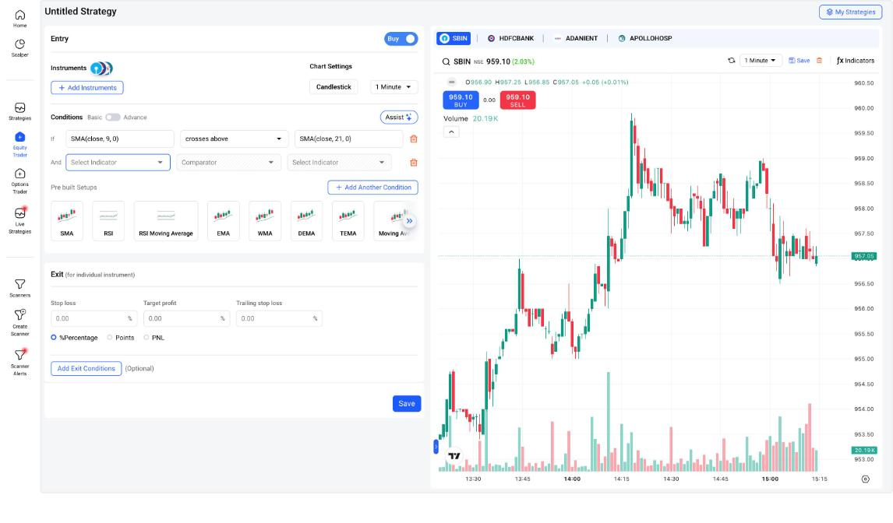
**Kite/platform dependency** Historical candles for the chart pane; local strategy store.
**Open questions** none.

### EQB-002 Strategy title / rename (opens Save dialog)
**Description** The strategy name shown in the header; clicking it opens the Save Strategy dialog.
**Where** Builder header.
**UI & controls** Editable title "Untitled Strategy". Saved strategies show the slug-ish name (e.g. lower-case) plus a
description line.
**Behaviour & rules** Clicking the title opens the **Save Strategy dialog** (EQB-029) rather than inline rename (surprising UX).
**Evidence** OBSERVED — A01 §7, §8, §11.
**Screenshots** 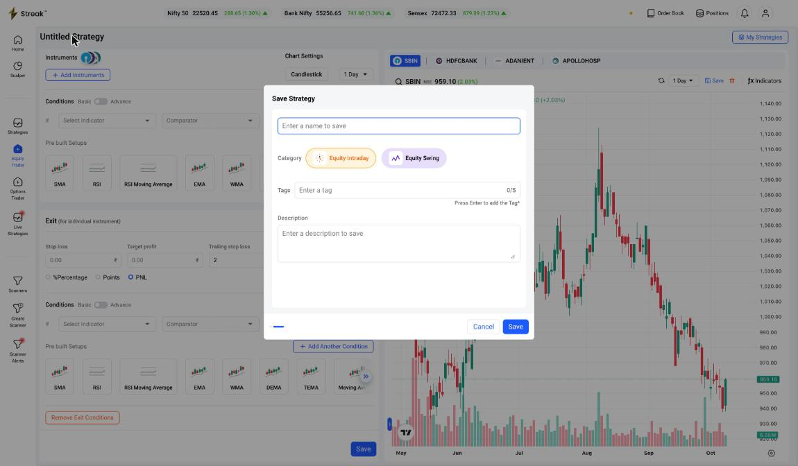
**Kite/platform dependency** none.
**Open questions** none.

### EQB-003 Buy / Sell (position direction) toggle
**Description** Chooses whether the entry signal opens a long (Buy) or short (Sell) position.
**Where** Entry card, top-right pill switch.
**UI & controls** Blue "Buy" (knob right) ↔ orange-red "Sell" (knob left).
**Behaviour & rules** Only the pill changes; conditions/exit card unchanged (no automatic comparator inversion). Docs: intraday
short-selling backtests on equity are supported (A06 §1 Short selling).
**Evidence** OBSERVED — INV §Equity builder; A01 §4.1; DOCUMENTED — A06 §1.
**Screenshots** 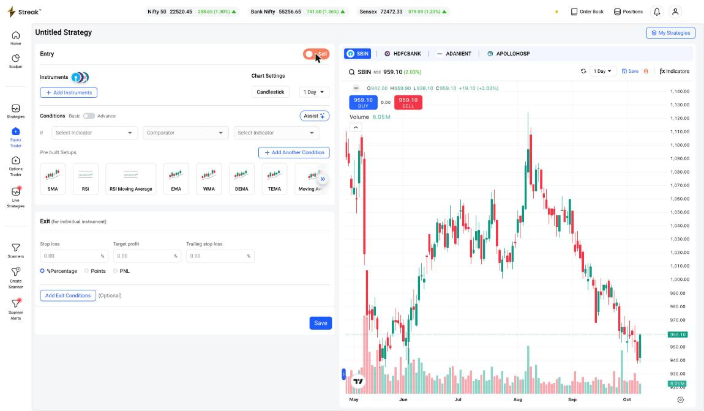
**Kite/platform dependency** Order side BUY/SELL; MIS product for intraday shorts (A07 A7).
**Open questions** Whether Sell + CNC is blocked at save/deploy (short delivery not possible).

### EQB-004 Instruments selection (avatar stack + Add Instruments)
**Description** Shows the strategy's instruments and opens the picker.
**Where** Entry card → "Instruments".
**UI & controls** Avatar stack of instrument logos (+N overflow, e.g. "+10") and `+ Add Instruments` button → Add Stocks dialog
(WATCH-005, max 50).
**Behaviour & rules** Right-hand chart gets one tab per instrument (scrollable with » when many).
**Evidence** OBSERVED — INV §Equity builder, §Add Instruments dialog; A01 §4.2.
**Screenshots** 
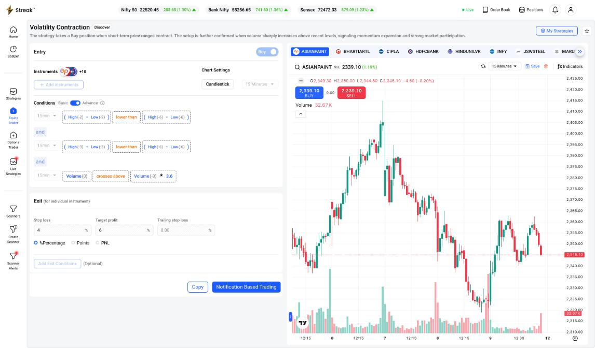
**Kite/platform dependency** Instruments dump.
**Open questions** none.

### EQB-005 Chart Settings (chart type + base timeframe)
**Description** Sets the candle type and base timeframe the strategy is evaluated on.
**Where** Entry card → "Chart Settings".
**UI & controls** `Candlestick` — rendered as a button but **inert** (no menu; only candlestick exists). Timeframe dropdown:
1 Minute, 3 Minutes, 5 Minutes, 10 Minutes, 15 Minutes, 30 Minutes, 1 Hour, 1 Day (default **1 Minute**).
**Behaviour & rules** Changing it re-renders the chart (1 Day shows ~6 months). Nothing else changes (no intraday/positional
switch). Advance rows' timeframe chip defaults to the chart timeframe. Docs: base timeframes 1, 3, 5, 10, 15, 30 min, 1 hr,
1 day; Weekly/Monthly only as MTF condition timeframes; chart types candlestick only (Heikin-Ashi and Renko unsupported;
[LEGACY] Heikin-Ashi/Renko existed). Base timeframe drives the backtest lookback (BT-006).
**Evidence** OBSERVED — INV §Equity builder; A01 §4.3; DOCUMENTED — A06 §1 Base timeframes, Weekly/Monthly, Chart types.
**Screenshots** 
**Kite/platform dependency** Kite intervals map 1:1 (A07 A4).
**Open questions** none.

### EQB-006 Basic condition row
**Description** Entry rules as a list of rows `If|And <LHS operand> <comparator> <RHS operand|number>`, all AND-joined.
**Where** Entry card → Conditions (Basic mode); same component in Exit conditions, scanners and options underlying blocks.
**UI & controls** Row = `If|And [Select Indicator ▾] [comparator ▾] [Select Indicator ▾] 🗑`. First row label "If", later rows
static "And". Comparator select disabled (hatched) until an LHS operand exists; RHS also disabled until LHS chosen. Red row trash
deletes the row. `+ Add Another Condition` appends a row.
**Behaviour & rules** Picking an indicator into an **empty** row auto-fills a complete default condition (comparator + RHS),
e.g. SMA → `SMA(close, 9, 0) crosses above SMA(close, 21, 0)`; Supertrend → `Supertrend(7,3,0) crosses below Close(0)`. If the
row already had comparator/RHS, only the LHS changes (RSI replaced Supertrend and kept `crosses below Close(0)`). Empty rows are
silently ignored on Run Scan (scanner). Docs: Basic mode allows **5 entry and 5 exit conditions**; Basic cannot mix AND and OR.
Indicator syntax `NAME(source, period, offset)`; default templates per indicator in Appendix A.
**Evidence** OBSERVED — INV §Equity builder; A01 §1.2, §1.3; A03 §3 Controls; DOCUMENTED — A06 §1 Condition limits, Basic mode logic.
**Screenshots** 

**Kite/platform dependency** none / local rule engine.
**Open questions** Save-time validation messages for empty conditions (Save not pressed).

### EQB-007 Indicator dropdown (searchable combobox with "See All")
**Description** Picks the LHS/RHS operand from the Basic indicator catalogue.
**Where** Each operand cell in a Basic row.
**UI & controls** Searchable combobox: typing filters by full name ("Super" → "Supertrend"). First ~9 items visible, scrollable;
list always ends with a "See All" link (→ EQB-014). Full names ("Simple Moving Average (SMA)", "Relative Strength Index
(RSI)", …). **RHS dropdown starts with a "Number" item** (EQB-009). Catalogue = 71 entries (Appendix A).
**Behaviour & rules** Central Pivot Range is listed but **invalid** in Basic (red toast "ERROR · Invalid indicator", row stays
empty with search text left in the box) — EQB-037.
**Evidence** OBSERVED — INV §Equity builder; A01 §1.2, §1.3, §2; A03 §3 Indicator picker.
**Screenshots** 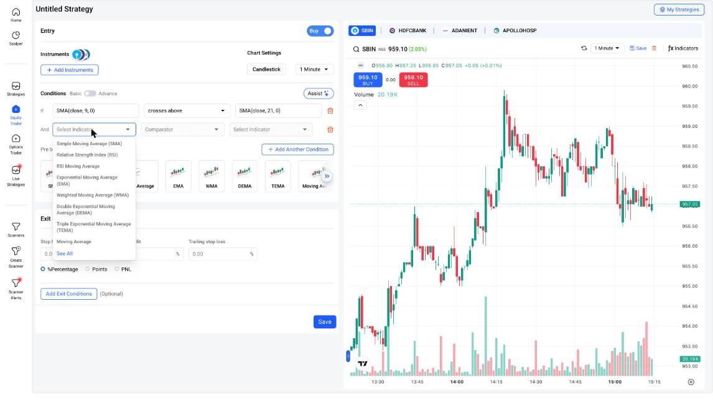
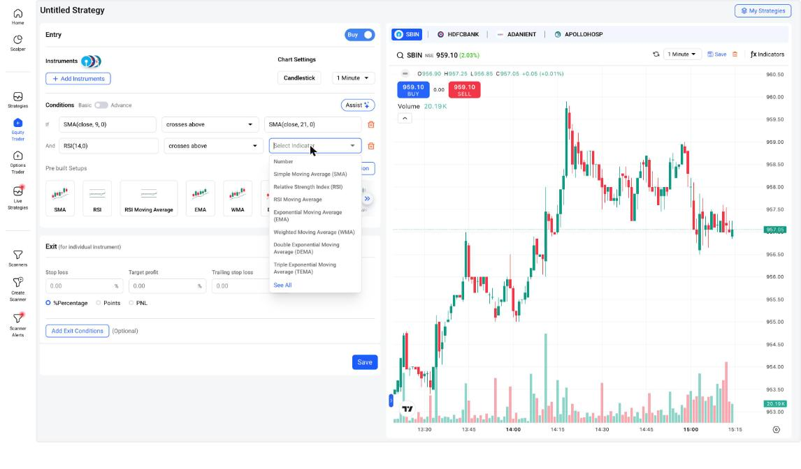

**Kite/platform dependency** none / local indicator library.
**Open questions** none.

### EQB-008 Indicator parameter dialog
**Description** Edits an operand's parameters (fields, periods, types, offset).
**Where** Click a filled operand (Basic) or an operand token name (Advance).
**UI & controls** Modal, centred, dimmed backdrop. Title = short indicator name (e.g. "SMA", "Chaikin Money Flow"); red trash icon
top-right (clears that operand back to "Select Indicator" and disables the comparator; RHS kept); one labelled field per
parameter; footer Cancel / Save (Save applies to draft only; in the Up-By dialog Save is disabled until changed). Numeric fields:
`<input type=number step=1>`, placeholder "Enter <label>", spinner arrows, **no min/max**; selects for enumerations (e.g. `field`:
close/open/high/low/volume; MA type list "MA11" = simple, exponential, weighted, triple, triangular, double, hull, mesa, variable,
kaufman, vidya). Every indicator except Nth Candle / Opening Range / Pivot Points / Day High Low / Central pivot range / Candle Time
has a trailing **offset** (default 0; negative = N candles ago). Per-indicator parameter table: Appendix A (Basic) and B (Advance).
**Behaviour & rules** Escape does NOT close; backdrop click does. **No inline validation** — period could be cleared or set to −5
without a message. Parameter labels are raw identifiers (`Fast_MA_period`, `standard_deviations`, `Minimum_AF`, "continous").
**Evidence** OBSERVED — A01 §1.2, §2; A03 §3 Indicator parameter dialog, §Advance mode.
**Screenshots** 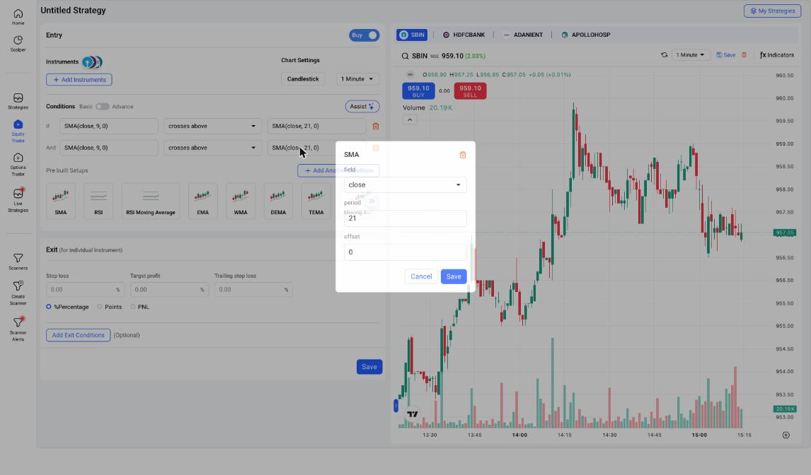
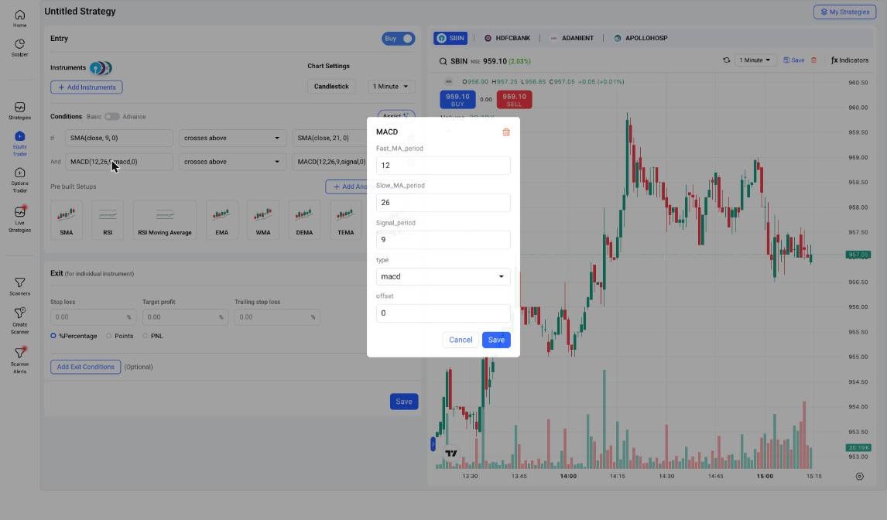

**Kite/platform dependency** none / local.
**Open questions** Where validation of empty/negative periods happens (dialog Save or strategy Save).

### EQB-009 Number operand and "Number" dialog
**Description** Use a numeric constant as the RHS (or any Advance operand).
**Where** RHS dropdown "Number" item; Advance "Select Expression" search ("Use number: 2.5").
**UI & controls** Typing a number in the RHS search and blurring/Escape creates a constant operand (e.g. `45`). Clicking a number
operand opens a **"Number"** dialog: single field "number", Cancel/Save, trash. Numbers render blue in Advance.
**Behaviour & rules** Decimals allowed (2.5). Negative thresholds exist in defaults (`Will%r(14,0) crosses above -80`).
**Evidence** OBSERVED — A01 §1.3, §1.5.
**Screenshots** 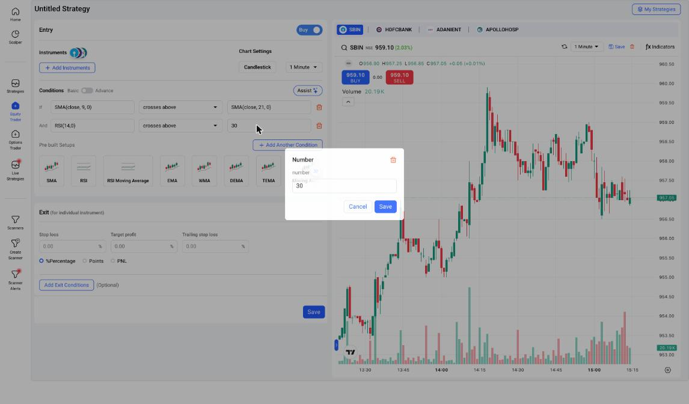
**Kite/platform dependency** none.
**Open questions** none.

### EQB-010 Comparator select (9 comparators)
**Description** Chooses the relation between LHS and RHS.
**Where** Middle cell of a Basic row; "Add comparator" in Advance (EQB-021).
**UI & controls** Options (Basic order): Equal to, Crosses above, Crosses below, Lower than, Higher than equal to, Lower than equal
to, Higher than, Up by, Down by. Identical list for all 70 selectable indicators (verified programmatically). Selected value shown
lower-case ("crosses above"). Appendix C.
**Behaviour & rules** Docs semantics: **Crosses above** = false on the previous candle and true now; **Higher than** = current state
only and counts equal as true (A06 §1). Up by / Down by take a value + type (%) — EQB-011. Disabled until LHS exists.
**Evidence** OBSERVED — INV §Equity builder; A01 §1.3; A03 §3 Comparators; DOCUMENTED — A06 §1 "Crosses above" vs "Higher than".
**Screenshots** 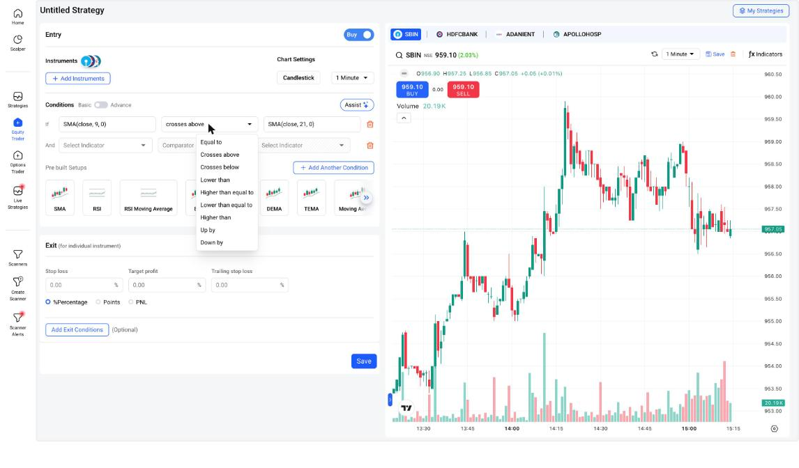

**Kite/platform dependency** none.
**Open questions** Exact semantics of Equal to (tolerance?), Crosses below, and Up/Down by (percent vs absolute — "type" dropdown
showed only `%`, disabled).

### EQB-011 "Up By" / "Down By" parameter dialog
**Description** Parameterises the Up by / Down by comparators (percentage move from the RHS value).
**Where** Click the comparator cell when it reads e.g. `up by 1% from`.
**UI & controls** Small dialog "Up By": `value` (number, e.g. 1) and `type` (dropdown: **`%` or `abs`**; disabled in the prebuilt,
enabled on an editable scanner — REVIEW-2 N4/#27), an orange **trash (delete) icon** top-right of the dialog header, Cancel /
Save (Save disabled until changed). Comparator cell renders the parameter inline: `If Close(0) | up by 1% from | Close(-1)`.
**Behaviour & rules** Observed locked in the prebuilt Top Gainers scanner and editable on `zz-research-scanner`: absolute-point
moves (`abs`) exist alongside `%`.
**Evidence** OBSERVED — A03 §2 Conditions shown; R2 §(b) N4.
**Screenshots** 
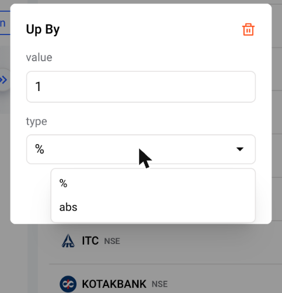
**Kite/platform dependency** none.
**Open questions** none (type options resolved by REVIEW-2 N4).

### EQB-012 Pre built Setups carousel
**Description** One-click tiles that fill the first empty row with an indicator's default condition.
**Where** Under the Conditions rows (Basic mode) in equity builder, options underlying blocks, scanner builder.
**UI & controls** Horizontally scrolling tiles (mini chart icon + short name) with a » button; 71 tiles = the Basic dropdown
indicators (SMA, RSI, RSI Moving Average, EMA, WMA, DEMA, TEMA, Moving Average, ADX, +DI, -DI, Adx Moving Average, Supertrend,
Williams %R, Upper/Lower/Middle Bollinger Bands, VWAP, Vwap Moving Average, Volume, Volume Oscillator, Vortex Indicator, Money Flow
Index, MFI Moving Average, Stochastic, Stochastic RSI, CCI, ATR, Awesome Oscillator, Choppiness Index, Ultimate Oscillator, Chaikin
Money Flow, Chande Momentum Oscillator, Bollinger Bandwidth, Alligator, Aroon Oscillator, Donchian Channel, Elder Force Index, High,
Ichimoku Cloud, Keltner Channel, Low, Median Price, Median Price Moving Average, Nth Candle, Open, Opening Range, Pivot Points,
Previous N, Close, MACD, Parabolic SAR, Momentum Indicator, Trend Intensity Index, Bollinger %B, OBV, Standard Deviation, Fractal
Chaos Bands, Linear Regression Forecast, Aroon Up, Aroon Down, Swing Index, Twiggs Money Flow, OBV Moving Average, True Range, Price
Rate Of Change, Ehler Fisher, Time Series Forecast, Coppock Curve, ATR Bands, Central Pivot Range).
**Behaviour & rules** Clicking a tile fills the first empty row with that indicator's default condition (Appendix A column
"Default condition"). Hidden in Advance mode.
**Evidence** OBSERVED — INV §Equity builder; A01 §1.3; A02 §1.5; A03 §3 Controls.
**Screenshots** 
**Kite/platform dependency** none.
**Open questions** none.

### EQB-013 Assist button
**Description** Labelled as an assistant, it opens the static "Add Prebuild Suggestions" modal (no free-text AI prompt).
**Where** Conditions header, Basic mode only (hidden in Advance).
**UI & controls** Button "Assist ✨/✦".
**Behaviour & rules** Opens the same modal as "See All" (EQB-014). Docs: Assist does guided/autocomplete condition building in
Basic Create; no generative AI documented. INV called it an "AI helper" — see Conflicts §6.
**Evidence** OBSERVED — A01 §5; A02 §1.5.1; A03 §3 Controls; DOCUMENTED — A06 §7 Assist.
**Screenshots** 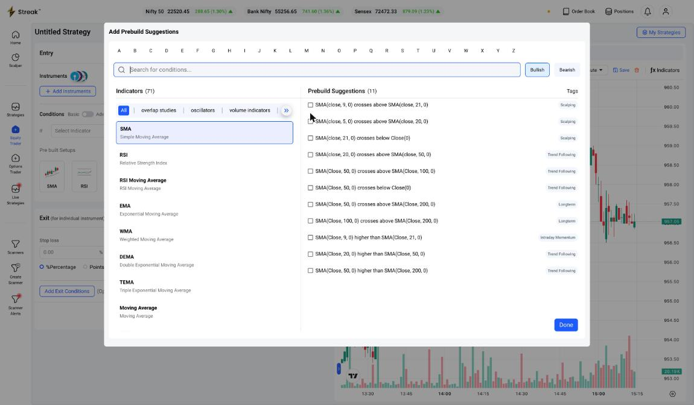
**Kite/platform dependency** none.
**Open questions** none.

### EQB-014 "Add Prebuild Suggestions" modal (See All / Assist)
**Description** Large browsing dialog of ready-made single conditions grouped by indicator, with A–Z, category chips,
Bullish/Bearish sets and full-text search; ticked suggestions become condition rows.
**Where** "See All" at the bottom of any indicator dropdown; Assist button.
**UI & controls** Title "Add Prebuild Suggestions". A–Z letter strip (filters indicators by first letter; selected letter bold).
Search "Search for conditions..." (filters both indicator list and suggestion text; "cross" → Indicators (37), Suggestions (78)).
**Bullish / Bearish** segmented toggle (single-select; Bullish default): Bullish = 71 indicators / 335 suggestions; Bearish = 69 /
331 (Lower Bollinger Bands and High have no bearish suggestions). Left pane "Indicators (N)": category chip row (horizontal
scroll ») — All, overlap studies, oscillators, volume indicators, volatility indicators, price action, volatility indicator,
momentum indicators, volume & momentum, volume trend, momentum, trend, volatility (duplicated/inconsistent categories in source
data; A02 saw a shorter list: All · overlap studies · oscillators · volume indicators · volatility indicators · price action ·
momentum indicators). Each card: short name (bold) + long name; selected card highlighted. Right pane "Prebuild Suggestions (N)"
+ "Tags" column: rows = checkbox + condition text + grey tag pill (Scalping, Trend Following, Longterm, Golden Cross, Oversold
Reversal, Intraday Momentum, Trend Reversal… ~139 distinct free-text tags). Footer: primary "Done". No ×. Per-indicator counts and
first suggestions: Appendix D.
**Behaviour & rules** Conditions already in the strategy appear pre-ticked. Escape does not close; backdrop click closes. A01:
backdrop close discards without applying, ticking + Done adds rows; A03 (scanner): ticking a checkbox **immediately inserts** the
row behind the modal (AND-joined), unticking removes it, Done closes — see Conflicts §6. The modal lists "ATR Trailing Stoploss"
(not in the inline dropdown) and lacks "Central Pivot Range". Data bugs: Open shows Opening Range items; Volume Oscillator shows
Volume items; ATR shows ATR Trailing Stoploss items; inconsistent casing/double spaces in generated text.
**Evidence** OBSERVED — A01 §3, §3.1; A02 §1.5.1; A03 §3 "Add Prebuild Suggestions" dialog.
**Screenshots** 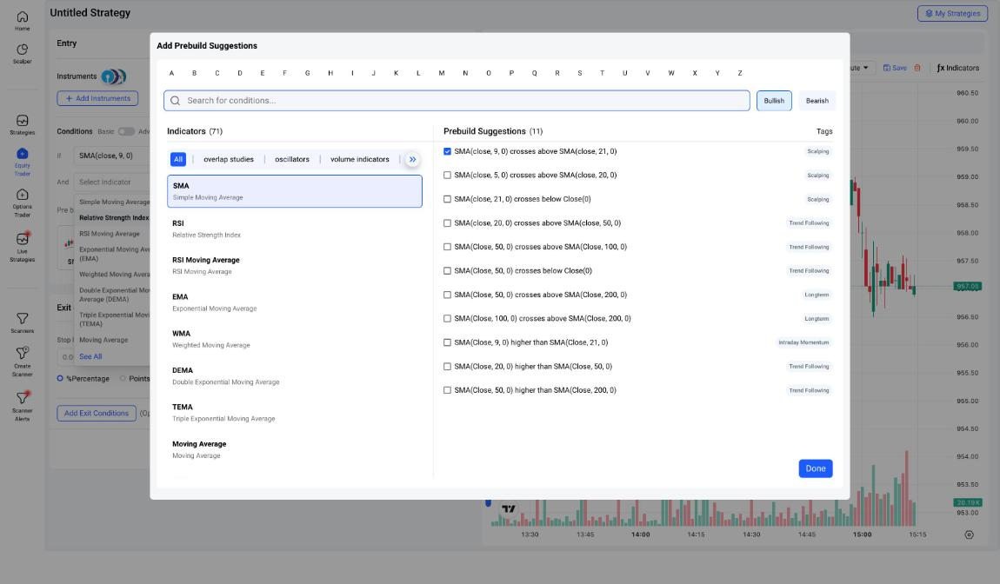
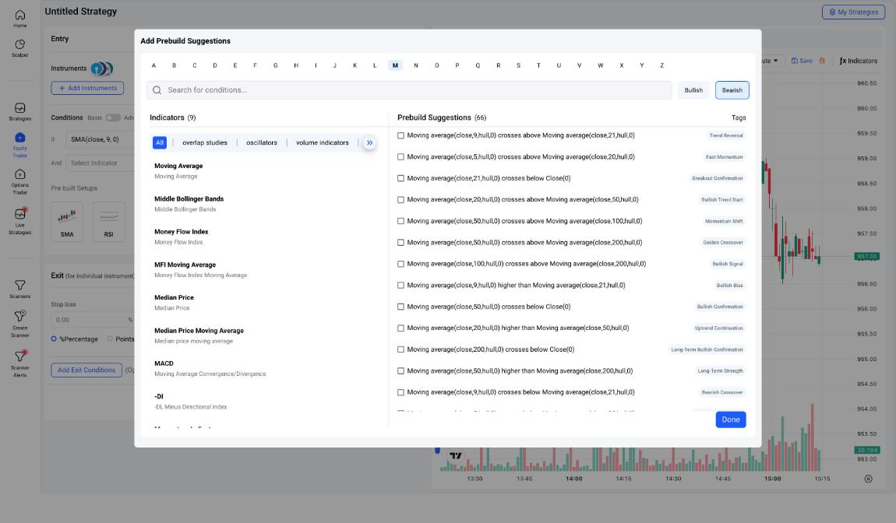
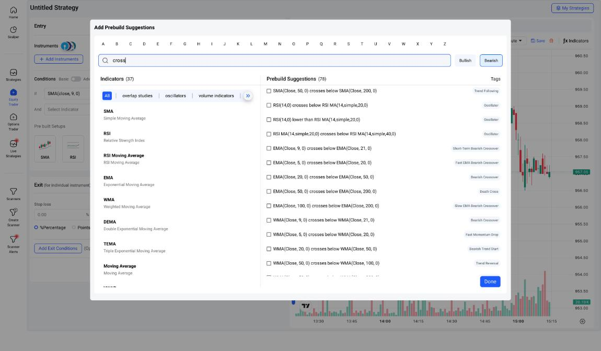

**Kite/platform dependency** none / local suggestion catalogue (generate text from one canonical formatter).
**Open questions** Exact apply semantics (immediate vs on Done); full suggestion list beyond counts/first items.

### EQB-015 Basic ↔ Advance mode switch ("Switch Mode" confirm)
**Description** Toggles between the simple row editor and the expression editor.
**Where** Conditions header: "Conditions  Basic [toggle] Advance (i)".
**UI & controls** Toggle switch; (i) tooltip "Learn about Advance Create — Click here" (help link).
**Behaviour & rules** If conditions exist, switching shows modal **"Switch Mode"**: "Switching to advance mode will reset your
current conditions. Are you sure?" [Cancel] [Confirm]. With no conditions it switches silently. Conditions are **not converted**
(a rebuild could convert Basic rows to expressions). Prebuilt (locked) scanners also show the confirm.
**Evidence** OBSERVED — A01 §1.4; A03 §2 Conditions shown, §3 Controls.
**Screenshots** 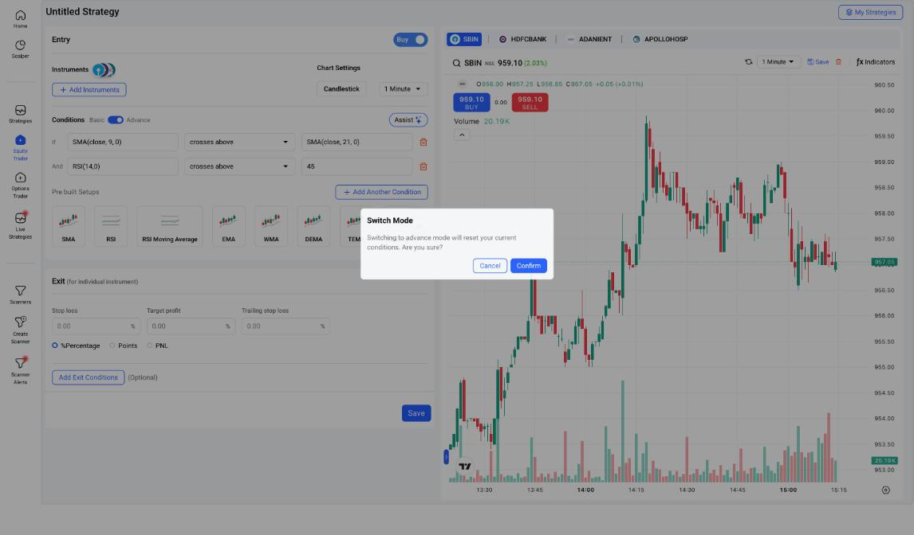

**Kite/platform dependency** none.
**Open questions** Whether Advance → Basic also resets (not stated; INFERRED yes).

### EQB-016 Advance mode expression row
**Description** Free-form logic builder: each row is `expression comparator expression`; expressions combine indicators, numbers
and math functions with + − × ÷; rows have their own timeframe and can be disabled/copied/pasted.
**Where** Conditions in Advance mode (equity, options underlying, scanner, exit conditions).
**UI & controls** Row layout: `[timeframe chip ▾] [Add expression] [Add comparator] [Add expression]` + right-aligned row tools
(EQB-025). Empty placeholders "Add expression" · "Add comparator" · "Add expression". Operand tokens render blue name + grey args
(`High (0)`); comparator orange; operators black; numbers blue. Hovering an operand shows a red × (remove) and ⊕ (append
operator/term, EQB-018). Saved-strategy rows show inline ⊕ in expression boxes.
**Behaviour & rules** Docs: Advanced allows **10 conditions**, AND/OR, Group(), math operators, Period Min/Max, Min/Max, Ceil, Floor;
timeframes are per condition, not per indicator. Observed prebuilt expressions: `( High(-2) - Low(-2) ) lower than ( High(-6) -
Low(-6) )`, `Volume(0) crosses above Volume(-3) * 3.6`, `Abs( Central pivot range(tc) - Central pivot range(bc) ) lower than Central
pivot range(pp) * 0.001`.
**Evidence** OBSERVED — INV §Own strategy — editable Advance mode, §Strategy view; A01 §1.5; A03 §3 Advance mode; DOCUMENTED — A06 §1 Condition limits, MTF.
**Screenshots** 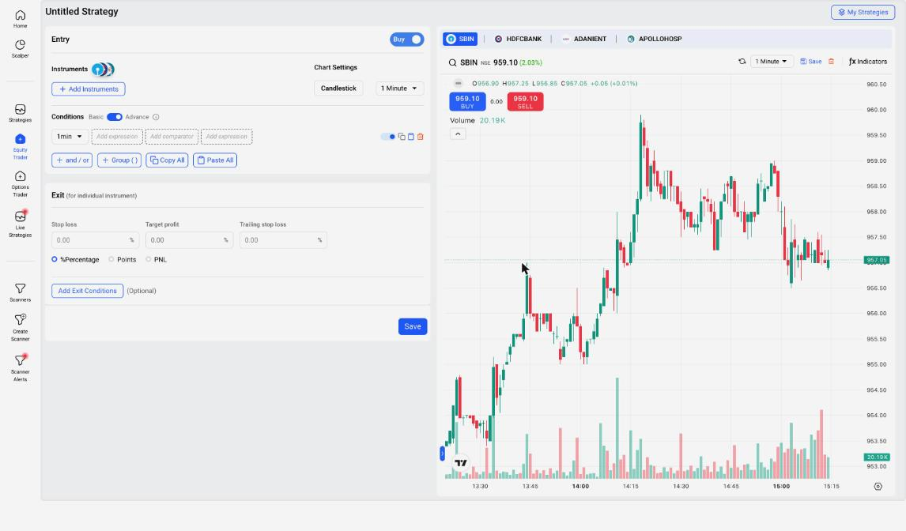
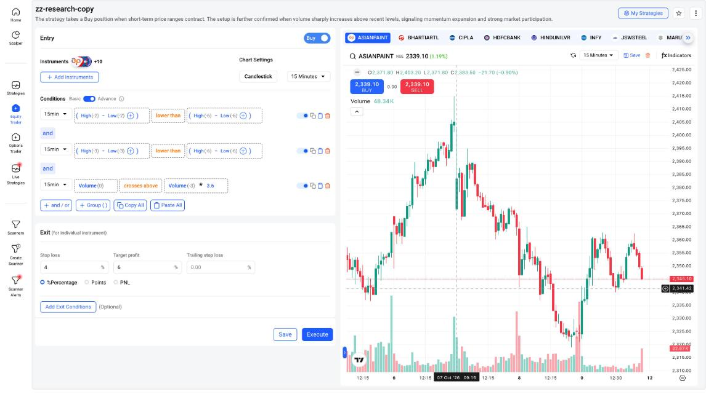
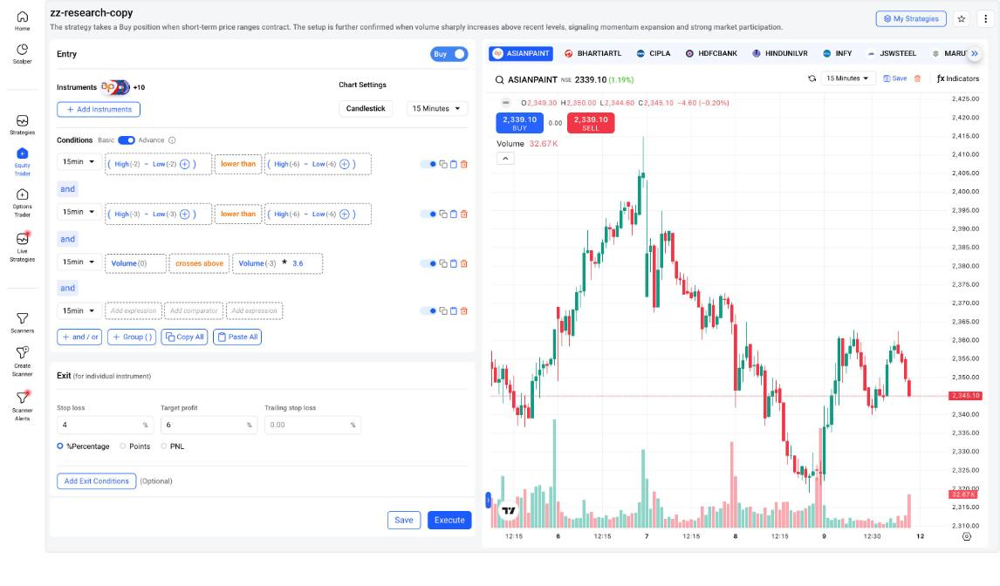

**Kite/platform dependency** none / local expression engine.
**Open questions** none.

### EQB-017 "Select Expression" popover (All / Indicators / Math Functions)
**Description** Picks an operand for an Advance expression slot: any of ~97 indicators, 8 math functions, or a typed number.
**Where** "Add expression" placeholder or ⊕ in Advance rows.
**UI & controls** Popover "Select Expression" with × close, tabs **All / Indicators / ƒx Math Functions**, search "Search or enter a
number..." (typing a number shows "Use number: 2.5"/"Use number: 60"). All list = 97 entries + 8 math functions (A01) / ~105
(A03). Names include Basic indicators under alternative labels (T Range, MOM, LBB, UBB, Aroon-Up, Aroon-Down, Commodity Channel
Index, Coppock curve, Linear regression forecast, Pivot points, Nth candle) plus Advance-only operands (Appendix B).
**Behaviour & rules** Choosing an operand places a token; clicking its name opens the parameter dialog (EQB-008).
**Evidence** OBSERVED — INV §Own strategy; A01 §1.5, §1.6; A03 §3 Advance mode.
**Screenshots** 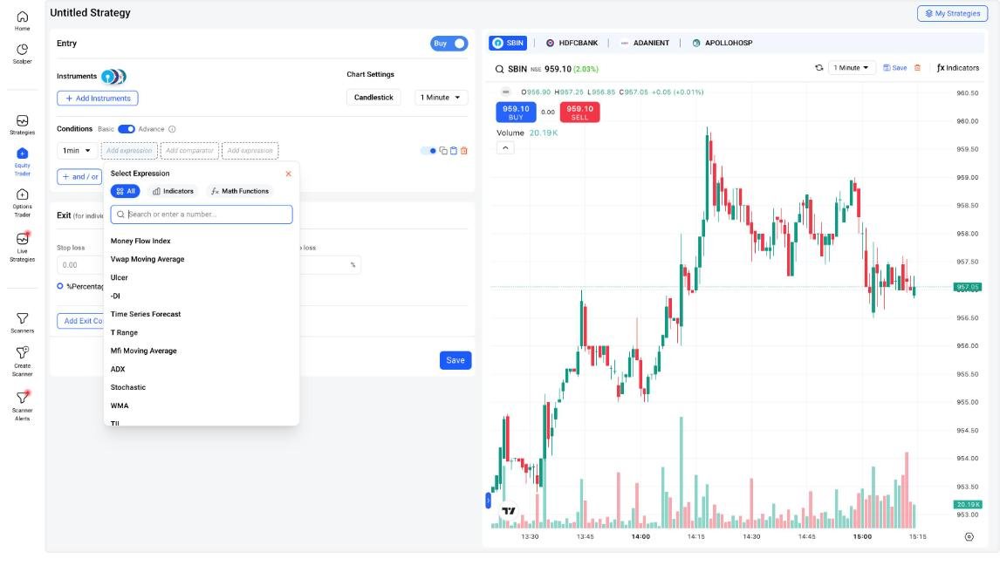
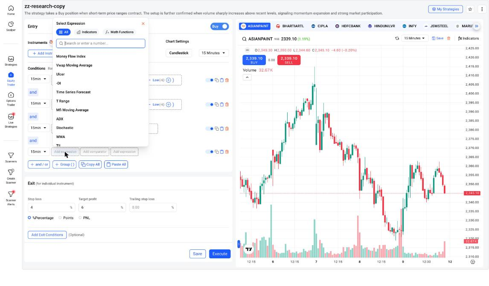

**Kite/platform dependency** none.
**Open questions** Exact Advance catalogue size (97 vs ~105 — Conflicts §6).

### EQB-018 Math Operator popover (+ − × ÷) and arithmetic expressions
**Description** Inserts an arithmetic operator after an operand and chains the next operand.
**Where** ⊕ / blank area after a placed operand in an Advance expression.
**UI & controls** Popover **"Math Operator"** with 4 tiles: `+ ADD`, `− SUBTRACT`, `× MULTIPLY`, `÷ DIVIDE`.
**Behaviour & rules** Choosing one immediately opens Select Expression for the next operand → `High(0) - Low(0)`. Constant
multipliers allowed (`Volume(-3) * 3.6`). Brackets function gives precedence (EQB-019).
**Evidence** OBSERVED — A01 §1.5; (A03 noted the operator UI wasn't found in its brief exploration but saw rendered `-`, `*`).
**Screenshots** 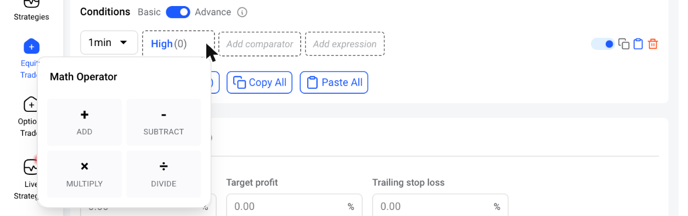
**Kite/platform dependency** none.
**Open questions** none.

### EQB-019 Math functions (Period min/max, Min/Max, Floor, Ceil, Abs, Brackets)
**Description** Function tokens with expression slots.
**Where** Select Expression → Math Functions tab.
**UI & controls** Period min, Period max, Min, Max, Floor, Ceil, Abs, Brackets. Tokens render with slots: `Min( ⊕ ⊕ )`, `Period min(
14 , ⊕ )` (period number + one expression slot), `Period max( 14 , Trange(0) ⊕ )`; Floor/Ceil/Abs = one slot (assumed); Brackets =
`( expr )` grouping. Docs list math as + − × ÷, Period Min/Max, Min/Max, Ceil, Floor (Abs and Brackets observed only).
**Behaviour & rules** Clicking a number inside a function opens the inline number editor (EQB-020).
**Evidence** OBSERVED — A01 §1.5, §1.6; A03 §3 Advance mode; DOCUMENTED — A06 §1 Condition limits (Math).
**Screenshots** 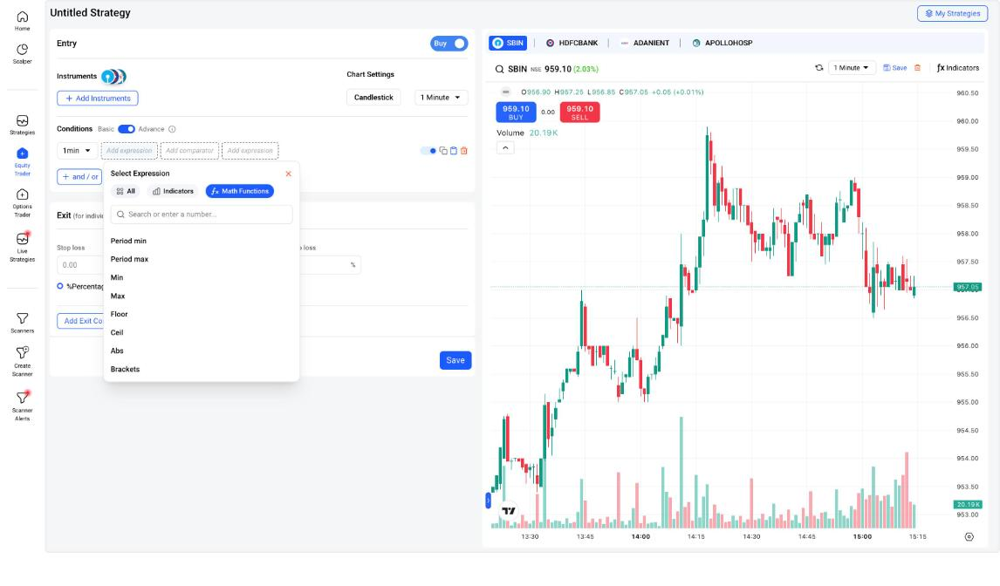
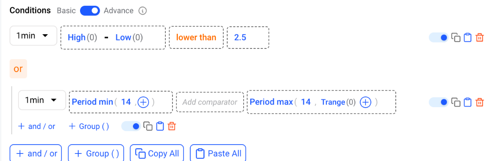

**Kite/platform dependency** none.
**Open questions** Params of Floor/Ceil/Abs/Brackets/Min/Max beyond slot structure (not opened).

### EQB-020 Inline number editor (function arguments)
**Description** Small popover to edit a numeric argument inside a function token.
**Where** Click a number inside e.g. `Period min( 14 , … )`.
**UI & controls** Spinner input + "OK" button.
**Behaviour & rules** none further.
**Evidence** OBSERVED — A01 §1.5.
**Screenshots** 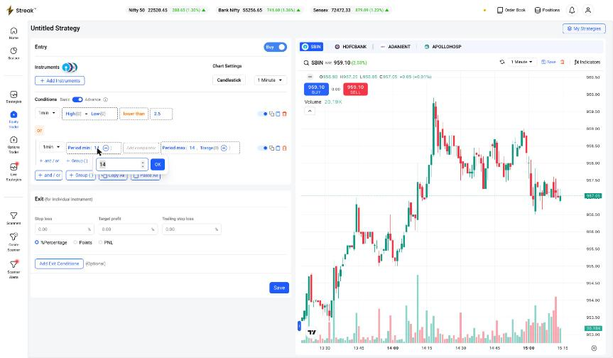
**Kite/platform dependency** none.
**Open questions** none.

### EQB-021 "Select Comparator" popover (Advance)
**Description** Picks the comparator for an Advance row.
**Where** "Add comparator" placeholder.
**UI & controls** Popover with search; same 9 comparators lower-case in a different order: up by, equal to, crosses above, crosses
below, lower than, higher than equal to, lower than equal to, higher than, down by. Chosen comparator renders orange.
**Behaviour & rules** As EQB-010.
**Evidence** OBSERVED — A01 §1.5; A03 §3 Advance mode.
**Screenshots** 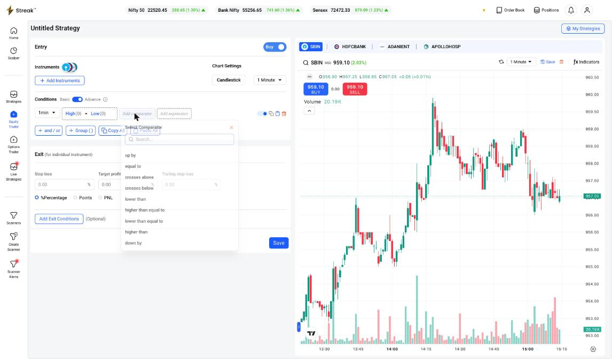

**Kite/platform dependency** none.
**Open questions** none.

### EQB-022 Per-condition timeframe chip (multi-timeframe conditions)
**Description** Each Advance row evaluates on its own timeframe, enabling MTF logic.
**Where** Left chip of every Advance row; also shown as a 4th column on Basic rows of imported prebuilt logic (EQB-038).
**UI & controls** Dropdown: 1min, 3min, 5min, 10min, 15min, 30min, hour, day, **week, month** (week/month not in the chart
timeframe list). Default = chart timeframe (e.g. "1min"). Greyed/disabled for time-only operands (Candle Time) and on prebuilt
(locked) scanners.
**Behaviour & rules** Docs: strategy evaluated on every base-TF candle close; each higher-TF condition uses its last fully closed
candle; non-multiple timeframes fire at their LCM (3 & 5 min → every 15 min); a weekly candle completes only when the next week
begins; Weekly/Monthly only as MTF (never base); lookback limits warm-up (EMA(50) on Monthly MTF cannot compute with 3 years of
daily data). Scanner rule: at least one condition must use the base timeframe (SCAN-006).
**Evidence** OBSERVED — INV §Strategy view; A01 §1.5, §4.3; A03 §3 Advance mode; DOCUMENTED — A06 §1 MTF evaluation, Weekly candles, Data range.
**Screenshots** 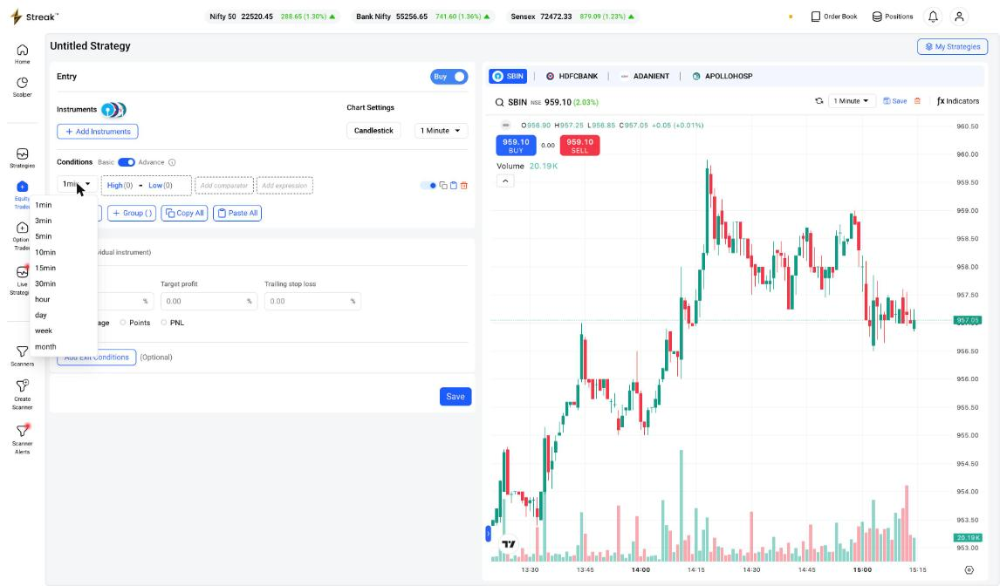
**Kite/platform dependency** Local resampling of Kite candles to week/month; LCM scheduler.
**Open questions** none.

### EQB-023 AND / OR joiner between rows
**Description** Each pair of Advance rows is joined by a clickable and/or pill.
**Where** Between Advance rows; `+ and / or` appends a new row with a joiner.
**UI & controls** Joiner pill: "and" (blue) ↔ "or" (orange), toggled by click. Per-pair, so mixed chains are possible; grouping
gives precedence.
**Behaviour & rules** Basic mode has only a static "And" (no OR). Docs: Basic cannot mix AND and OR.
**Evidence** OBSERVED — INV §Own strategy; A01 §1.5; A03 §3 Advance mode; DOCUMENTED — A06 §1.
**Screenshots** 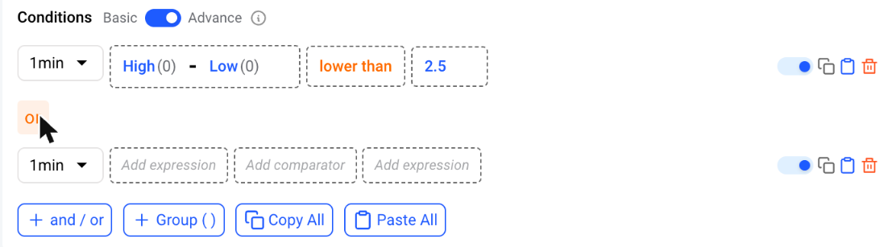

**Kite/platform dependency** none.
**Open questions** Precedence of a flat mixed and/or chain without groups (left-to-right vs AND-first).

### EQB-024 Group ( ) — nested bracketed condition groups
**Description** Bracketed block of rows with its own joiners, nestable.
**Where** `+ Group ( )` below rows (top level and inside groups).
**UI & controls** Indented block with a left border containing its own rows plus its own `+ and / or`, `+ Group ( )` (nesting) and its
own enable/copy/paste/delete tools.
**Behaviour & rules** Docs: Group() supported in Advanced mode.
**Evidence** OBSERVED — A01 §1.5; A03 §3 Advance mode; DOCUMENTED — A06 §1.
**Screenshots** 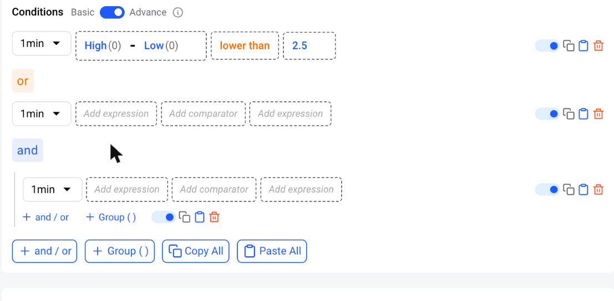
**Kite/platform dependency** none.
**Open questions** Nesting depth limit.

### EQB-025 Row tools: enable/disable, Copy logic, Paste logic after, delete
**Description** Per-row (and per-group) utilities in Advance mode.
**Where** Right side of each Advance row/group; also on editable own-strategy rows (toggle, duplicate, delete).
**UI & controls** Enable/disable switch (tooltip "Disable"/"Enable"; disabled row greyed, kept but ignored); copy icon ("Copy
logic"); clipboard icon ("Paste logic after"); red trash. INV describes the right-side controls of a saved strategy row as
enable/disable toggle, duplicate, delete.
**Behaviour & rules** none further.
**Evidence** OBSERVED — INV §Own strategy; A01 §1.5; A03 §3 Advance mode.
**Screenshots** 
**Kite/platform dependency** none.
**Open questions** Clipboard scope (per session? cross-strategy?).

### EQB-026 Copy All / Paste All (logic clipboard)
**Description** Copies the whole condition tree to paste into another strategy/section.
**Where** Below Advance rows: `Copy All`, `Paste All`.
**UI & controls** Two links/buttons.
**Behaviour & rules** INV: copy conditions between strategies/sections; A03: clipboard of the whole logic tree.
**Evidence** OBSERVED — INV §Own strategy; A01 §1.5; A03 §3 Advance mode.
**Screenshots** 
**Kite/platform dependency** none.
**Open questions** Persistence of the clipboard.

### EQB-027 Exit card — Stop loss / Target profit / Trailing stop loss + unit radio
**Description** Defines how each open position is closed with fixed risk parameters.
**Where** "Exit (for individual instrument)" card.
**UI & controls** Three numeric inputs (placeholder 0.00, spinner): Stop loss, Target profit, Trailing stop loss. Unit radio
(applies to all three): ◉ %Percentage (suffix "%"), ○ Points (suffix "pts"), ○ PNL (suffix "₹"); default %Percentage. Example saved
values (prebuilt copy): Stop loss 4 %, Target 6 %, Trailing blank.
**Behaviour & rules** Typing "-5" is rejected silently (field stays empty) — negatives blocked, no inline message. Docs: SL/TP/TSL in
%, points or absolute/P&L; no conditional/dynamic TSL modification; engine evaluation rules in BT-021. In deployment, TP/SL are
alerts only (DEP-006).
**Evidence** OBSERVED — INV §Equity builder, §Strategy view; A01 §6; DOCUMENTED — A06 §1 Exit units, No conditional TSL.
**Screenshots** 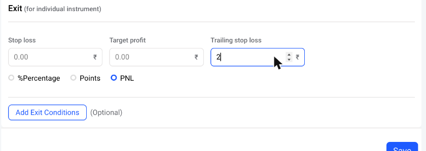
**Kite/platform dependency** none for backtest; for live, server-side fallbacks could use Kite GTT OCO (limit orders) or ATO alerts
(A07 A8/A8b) while the app is closed.
**Open questions** none.

### EQB-028 Add Exit Conditions (indicator-based exit block)
**Description** Optional second full Conditions block for rule-based exits.
**Where** Exit card → "Add Exit Conditions (Optional)".
**UI & controls** Expands a second Conditions block (Basic/Advance toggle, Assist, If-row, Pre built Setups, + Add Another
Condition); button becomes red-outlined "Remove Exit Conditions".
**Behaviour & rules** Docs: 5 exit conditions in Basic. Trade-log trigger `EX` = exit condition (BT-030).
**Evidence** OBSERVED — INV §Equity builder; A01 §6; DOCUMENTED — A06 §1 Condition limits.
**Screenshots** 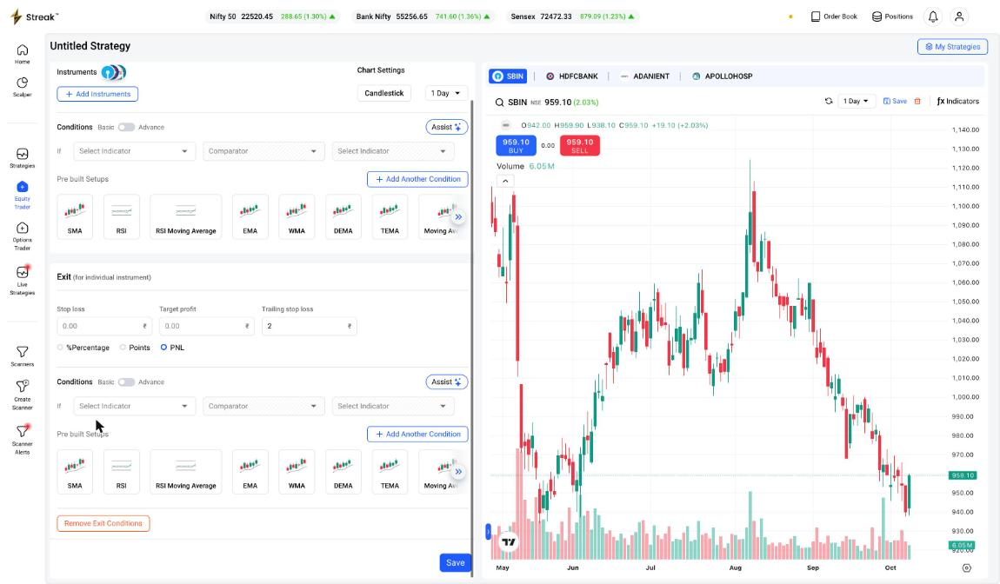
**Kite/platform dependency** none.
**Open questions** none.

### EQB-029 Save Strategy dialog (name, category, tags, description)
**Description** Names and categorises the strategy; the category decides intraday (MIS-like) vs swing/positional (CNC-like).
**Where** Click the title (EQB-002) or the bottom "Save" button (presumed, not pressed).
**UI & controls** Name ("Enter a name to save"); **Category** chips: "Equity Intraday" (orange/beige, sun/clock icon, default) /
"Equity Swing" (purple, zig-zag icon); **Tags** input (counter 0/5, "Press Enter to add the Tag*"; max 5); **Description** textarea.
Footer: 2-step progress indicator (dot + bar; clicking does nothing), Cancel, Save.
**Behaviour & rules** No quantity, capital, date-range, entry/exit time or charges fields exist here (those live in Execute →
Backtest, BT-001). Category also appears in Copy Strategy (DISC-008) and determines the My Strategies tab.
**Evidence** OBSERVED — A01 §7.
**Screenshots** 
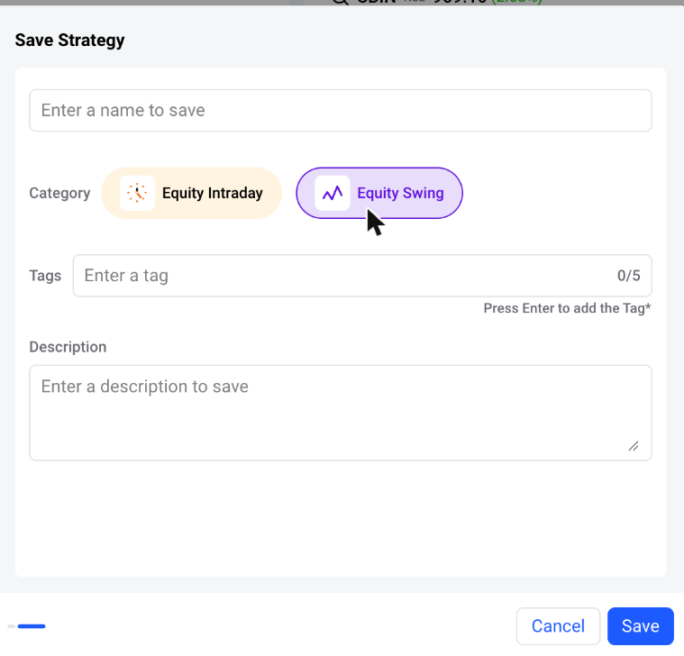
**Kite/platform dependency** none / local store.
**Open questions** What the bottom Save does beyond the dialog (second step?); save-time validation messages.

### EQB-030 Footer actions: Save / Execute
**Description** Persist the strategy and launch the Execution panel.
**Where** Builder footer. New draft: primary **Save**. Saved own strategy: "Save" (outline) + "Execute" (primary).
**UI & controls** Execute → Execution panel with modes **Notification-Based Trading** and **Backtest** (BT-001, DEP-001).
**Behaviour & rules** Running a backtest also saves (toast "Strategy Saved Successfully"). Docs: Execution tab has two modes NBT and
Backtest.
**Evidence** OBSERVED — INV §Own strategy, §Execute → Backtest; A01 §8; DOCUMENTED — A06 §3 Execution tab.
**Screenshots** 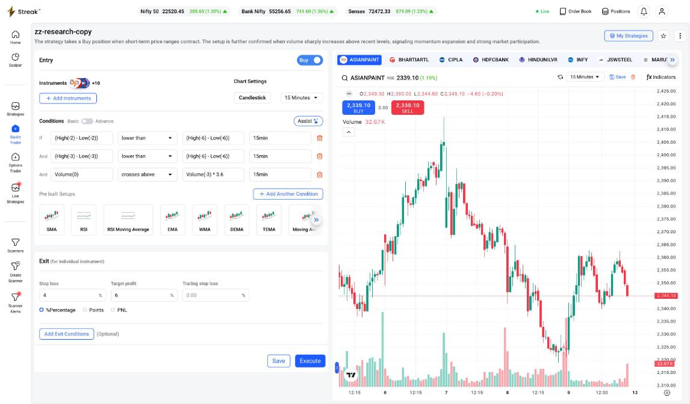
**Kite/platform dependency** none.
**Open questions** none.

### EQB-031 Builder chart pane (tab per instrument)
**Description** Right-pane chart showing each selected instrument at the strategy timeframe.
**Where** Builder right column.
**UI & controls** Tabs for each instrument (scrollable with » when many), timeframe, Save, ƒx Indicators (CHART-001 header).
**Behaviour & rules** Timeframe follows Chart Settings (EQB-005). Docs: ChartIQ next to strategy conditions.
**Evidence** OBSERVED — INV §Equity builder, §Strategy view; A01 §1.1, §4.2.
**Screenshots** 
**Kite/platform dependency** Historical candles per instrument.
**Open questions** none.

### EQB-032 Saved own strategy in the builder (favourite, ⋮ menu, description)
**Description** Editing view of a saved strategy with extra header actions.
**Where** `/strategy/<slug>` for own strategies (e.g. after Copy).
**UI & controls** Title (slug-ish, e.g. `zz-research-copy`) + description line; header right: My Strategies, ☆ favourite, ⋮ menu →
**Delete, Copy**. Footer Save / Execute.
**Behaviour & rules** Basic rows from a copied prebuilt show expression operands (`(High(-2) - Low(-2))`, `Volume(-3) * 3.6`) plus a
**4th column with the timeframe ("15min")** — Basic mode can carry per-row timeframe for imported logic; clicking that chip turned
it into an editable token and raised "ERROR · Invalid indicator" (bug).
**Evidence** OBSERVED — INV §Own strategy; A01 §8.
**Screenshots** 
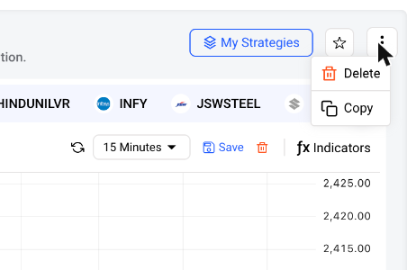
**Kite/platform dependency** none.
**Open questions** Meaning of the Basic 4th "15min" column; whether Basic rows can be switched to OR.

### EQB-033 Favourite (☆) toggle
**Description** Marks a strategy or scanner as favourite.
**Where** Builder header (own strategy), My Strategies rows, My Scanners rows, My Strategies detail.
**UI & controls** Star toggle.
**Behaviour & rules** No favourite filter observed.
**Evidence** OBSERVED — INV §Own strategy, §My Strategies, §Scanner copy; A01 §8, §9.
**Screenshots** 
**Kite/platform dependency** none.
**Open questions** Whether favourites sort first.

### EQB-034 Condition limits and mode rules (documented)
**Description** Platform limits on conditions.
**Where** Builder (enforced at save/run, not observed).
**UI & controls** n/a.
**Behaviour & rules** Basic: 5 entry + 5 exit conditions; no mixed AND/OR. Advanced: 10 conditions; AND/OR, Group(), math
operators/functions, weekly/monthly MTF, wider indicator set. Options underlying-based: up to 5 conditions (A06 §5).
**Evidence** DOCUMENTED — A06 §1 Condition limits, §4, §5.
**Screenshots** none.
**Kite/platform dependency** none.
**Open questions** Whether limits apply per block (entry/exit) in Advance.

### EQB-035 Validation and error states in the builder
**Description** Observed error feedback.
**Where** Builder.
**UI & controls** Red toast "ERROR · Invalid indicator" (Central Pivot Range in Basic; clicking the per-row timeframe chip of a saved
strategy). Parameter dialogs: no inline validation (empty/negative accepted). Exit inputs: negatives silently rejected. Switch
Mode confirm. Not observed: messages for empty conditions / no instruments / missing name.
**Behaviour & rules** See Cross-cutting §3.2 for bug list.
**Evidence** OBSERVED — A01 §10.
**Screenshots** 
**Kite/platform dependency** none.
**Open questions** Save-time validation set.

### EQB-036 Basic indicator catalogue (71) with parameters & defaults
**Description** The 71 indicators selectable in Basic rows, each with parameter schema, defaults, allowed values and default
condition template.
**Where** Indicator dropdown, Pre built Setups, suggestions modal.
**UI & controls** See **Appendix A** (full table copied from A01 §2). Extra entry only in the See All modal: ATR Trailing Stoploss
`ATR Trailing Stoploss(3, 21, 0)`.
**Behaviour & rules** Token naming inconsistent (Will%r, Efi, Proc, Trange, Vo, Obv Ma) — a rebuild should keep display name, short
token and canonical parameter schema per indicator. Field enumerations vary per indicator (some include volume); default templates
are indicator-specific (threshold for oscillators, crossover for MAs, "crosses below Close(0)" for bands/levels).
**Evidence** OBSERVED — A01 §2 (all 71 dialogs read programmatically); INV §Equity builder.
**Screenshots** 
**Kite/platform dependency** Local indicator library (OHLCV from Kite; Open Interest-based operands need `oi=1` candles).
**Open questions** ATR Trailing Stoploss param semantics; Pivot Points "continous" meaning.

### EQB-037 Advance-only operands (33) and alternative labels
**Description** Operands available only in the Advance "Select Expression" list.
**Where** Select Expression popover.
**UI & controls** See **Appendix B** (table copied from A01 §1.6): Ulcer, Choppiness Index MA, OI MA, Open interest, Negative Volume
Index, Pvi, Klinger Volume Oscillator, True Range MA, Central pivot range, Vortex MA, Trade Volume Index, Moving average volume, Cci
MA, Stochastic Momentum Index, Moving Average Deviation, Schaff Trend Cycle, Intraday Momentum Index (+MA), Center Of Gravity,
Bollinger %B MA, ATR Trailing Stoploss, Vwma, Elder Ray Index, Day High Low, Vwap StdDev, Proc MA, TriMA, Candle Time, plus functions.
**Behaviour & rules** Central pivot range works in Advance, invalid in Basic. Candle Time has a disabled timeframe chip.
**Evidence** OBSERVED — A01 §1.6; A03 §3 Advance mode (extra items list).
**Screenshots** 
**Kite/platform dependency** Open interest operands need Kite candles with `oi=1` (F&O only).
**Open questions** none.

### EQB-038 Basic-mode per-row timeframe column (imported logic)
**Description** Basic rows of a copied prebuilt strategy display a 4th timeframe column.
**Where** Own strategy opened in Basic mode after Copy.
**UI & controls** Chip "15min" per row.
**Behaviour & rules** Clicking it converts to an editable token and errors (bug). Indicates the data model carries per-row timeframe
regardless of mode.
**Evidence** OBSERVED — A01 §8, §12.
**Screenshots** 
**Kite/platform dependency** none.
**Open questions** Intended behaviour.

### EQB-039 Execute → step 1 "Choose your execution type"
**Description** The Execute button opens a two-step modal; step 1 chooses between Notification Based Trading and Backtest.
**Where** `/strategy/<own-slug>` → footer **Execute** (EQB-030).
**UI & controls** Title "Step 1: Choose your execution type". Two radio cards with icons: **Notification Based Trading** ("Get
notified when your Strategy met your condition", selected by default) and **Backtest** ("Backtest your Strategy with Historical
Data."). Right-hand pane: an animated preview for the selected type. Footer: progress bar, **Cancel**, **Next**.
**Behaviour & rules** Next opens step 2 = the parameters form of the chosen type (BT-001 or DEP-001); step 2's footer is **Back**
+ **Run Backtest** / **Execute** (no Cancel there). Step 2 for NBT defaults Strategy Cycle to **1 Cycle**; the Backtest step
defaults it to "–". The "I accept the **trading terms**" text in the NBT step links to `/terms` (ACCT-009) in a new tab.
**Evidence** OBSERVED — R2 §(b) N2, N3; §(c) #14, #15.
**Screenshots** 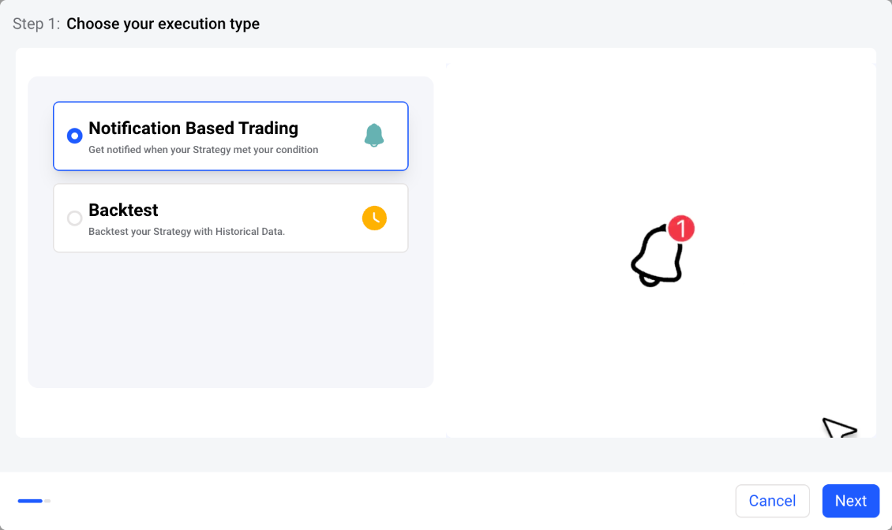
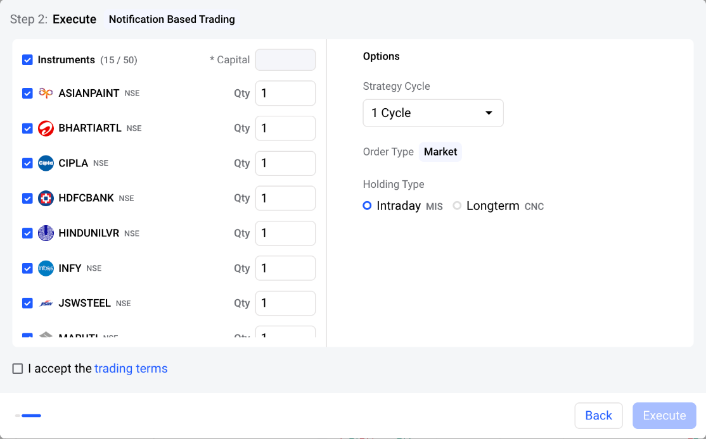
**Kite/platform dependency** none.
**Open questions** Whether the preview animation differs per type beyond the illustration.

---
### Module OPT — Options strategy builder ("Options Trader")

### OPT-001 Options builder layout and new-draft defaults
**Description** Single-page builder for an options strategy: entry trigger, execution legs, exits, with a live payoff pane.
**Where** `/strategy?defaultType=options&isNew=true` (sidebar "Options Trader").
**UI & controls** Header: name "Untitled Strategy" (editable) · "My Strategies" button. Left column (~47%, scrolls
independently): cards **Entry** → **Execution** → **Exit**, sticky footer **Save** (outline) + **Notification Based Trading**
(primary) — **no Backtest button**. Right column: **Pay-off Graph | Pay-off Table** tabs, "Option Chain" link, legend (blue =
Target Date, green/red = Expiry), payoff chart, Target Price slider, Date of Expiry, Max Profit / Max Loss / Break Even, Fund
and Margins. Two vertical collapsed drawers on the divider: "» Underlyings Chart", "» Options Chart".
**Behaviour & rules** Defaults on `isNew=true`: Entry = Underlying Based; Underlying NIFTY 50; timeframe 1 Minute; one leg
**B** `NIFTY 13th(w) OCT 22500 CE` (nearest weekly expiry, ATM), Qty **65** (1 lot), LTP, Premium 137.05, Total Premium
8,908.25 (= LTP × qty); Prebuilt tab All with "Buy Call" highlighted; payoff populated (Max Profit Unlimited, Max Loss −8,908.25
(100.00%), Break Even 22,637.05). Options backtesting is **not available** (DOCUMENTED, A06 §1).
**Evidence** OBSERVED — A02 §1.1–1.4; DOCUMENTED — A06 §5, §1 Holding type.
**Screenshots** 
**Kite/platform dependency** Instruments dump (NFO option contracts, lot_size, expiry, strike); quotes for premiums.
**Open questions** Save-time validation; whether options can be backtested after save (My Strategies shows "Run Backtest" for
saved strategies — Conflicts §6).

### OPT-002 Entry mode selector (Underlying Based / Time Based)
**Description** Chooses whether legs enter on indicator conditions or at a clock time.
**Where** Entry card top.
**UI & controls** Segmented radio: **Underlying Based** (default) · Time Based.
**Behaviour & rules** Switching swaps the card body; legs/exit untouched. Docs: two modes; Underlying-Based allows up to 5
conditions with an optional second reference instrument.
**Evidence** OBSERVED — A02 §1.5; DOCUMENTED — A06 §5 Two modes.
**Screenshots** 
**Kite/platform dependency** none.
**Open questions** none.

### OPT-003 Underlying picker (F&O universe)
**Description** Searchable combobox for the instrument whose chart drives entry conditions.
**Where** Entry card → Underlying block; also in the leg-picker drawer (locked while legs exist) and exit-condition blocks.
**UI & controls** Combobox with logo + exchange tag; default NIFTY 50. List = F&O universe: ~210 stocks (tagged "BSE"/"NSE" —
inconsistent, most show BSE here) + indices NIFTY 50, NIFTY BANK, NIFTY FIN SERVICE, SENSEX, BANKEX (tag "INDICES"). No
MIDCPNIFTY observed. Opening it clears text to placeholder "Search for an underlying".
**Behaviour & rules** Docs: Sensex weekly/next-weekly/monthly expiries supported.
**Evidence** OBSERVED — A02 §1.5; DOCUMENTED — A06 §5 Expiry.
**Screenshots** 

**Kite/platform dependency** Instruments dump filtered to NFO/BFO underlyings.
**Open questions** none.

### OPT-004 Underlying timeframe
**Description** Candle interval for the underlying's conditions.
**Where** Underlying block.
**UI & controls** Dropdown: 1 Minute (default), 3, 5, 10, 15, 30 Minutes, 1 Hour, 1 Day.
**Behaviour & rules** Docs: two timeframes allowed in Options Trader; evaluation only at their LCM, after the higher-TF candle
closes (OPT-031).
**Evidence** OBSERVED — A02 §1.5; DOCUMENTED — A06 §5 MTF.
**Screenshots** 
**Kite/platform dependency** Kite intervals.
**Open questions** none.

### OPT-005 Underlying conditions block (Basic/Advance, Assist, Pre built Setups)
**Description** Condition editor identical to the equity builder, applied to the underlying.
**Where** Underlying block.
**UI & controls** Basic/Advance toggle + rows `If [Select Indicator] [Comparator] [Select Indicator]` (comparator & RHS hatched until
LHS chosen); Assist ✦ (→ EQB-014 modal: A–Z, search, Bullish/Bearish, Indicators (71) with category chips All · overlap studies ·
oscillators · volume indicators · volatility indicators · price action · momentum indicators, suggestions with Tag pills Scalping,
Trend Following, Longterm, Intraday Momentum; Done; no ×; Esc does not close, backdrop does); Pre built Setups carousel (71);
`+ Add Another Condition`.
**Behaviour & rules** As EQB-006…EQB-026. Docs workaround for discretionary entry: "Close higher than 0" condition.
**Evidence** OBSERVED — A02 §1.5, §1.5.1; DOCUMENTED — A06 §5 Discretionary entry.
**Screenshots** 
**Kite/platform dependency** none.
**Open questions** none.

### OPT-006 Add Underlying (second underlying block)
**Description** Adds a second underlying with its own timeframe and conditions (max 2).
**Where** Entry card → `+ Add Underlying` link.
**UI & controls** Second block (Underlying, timeframe, Conditions, Assist, setups); each block then shows a red **Remove** link.
Link disappears once 2 exist. **No visible AND/OR selector** between blocks.
**Behaviour & rules** Tour text: "combine conditions for 2 different underlying scrips". Docs: optional second reference instrument;
two timeframes → LCM evaluation.
**Evidence** OBSERVED — A02 §1.5; DOCUMENTED — A06 §5.
**Screenshots** 
**Kite/platform dependency** none.
**Open questions** How the two blocks combine (AND/OR); any hidden per-block toggle in Advance.

### OPT-007 Time Based entry (clock time + weekday chips)
**Description** Enter the legs at a fixed time on selected weekdays (e.g. 9:20 straddle).
**Where** Entry card with Time Based selected; same widget in Time Based Exit (OPT-021).
**UI & controls** Time hour dropdown 01–12 (default **9**); minute dropdown 00–59 (default **15**); AM/PM toggle pill (**AM**
default; click → PM); weekday chips Mon Tue Wed Thu Fri, **all selected** by default (blue outline), click to deselect (grey); no
Sat/Sun.
**Behaviour & rules** No validation that the time is within market hours (9:15 PM accepted). Docs: day-of-week restriction for
time-based options strategies.
**Evidence** OBSERVED — A02 §1.5 Time Based; DOCUMENTED — A06 §1 Day-of-week restriction, §5.
**Screenshots** 

**Kite/platform dependency** Local scheduler (app must be running — A07 Constraint 2).
**Open questions** Re-entry semantics (once per day?).

### OPT-008 Execution card — leg table
**Description** The list of option legs traded when entry fires.
**Where** Execution card.
**UI & controls** Header "Execution" + **+ Add Instruments** (→ OPT-014). Columns: (checkbox) · **B/S** · **Instrument** · **Qty** ·
**LTP** · **Exit** · (trash). B/S badge: blue "B" buy, red/orange "S" sell. Instrument pill e.g. `NIFTY 13th ʷ OCT 22500 CE`,
monthly `BANKNIFTY OCT 55300 CE`, dynamic `NIFTY 13 OCT LTP@74.7 PE`; clicking opens the drawer. LTP live (some legs showed
**0.0** silently). **Clear all** red link removes all legs; trash deletes one leg (OPT-013).
**Behaviour & rules** Docs: legs execute in the order added; add the hedge (Buy) first for margin benefit (OPT-030).
**Evidence** OBSERVED — A02 §1.6; DOCUMENTED — A06 §5 Legs, Leg order.
**Screenshots** 
**Kite/platform dependency** Quotes for LTP; orders placed sequentially with queueing under 10 OPS (A07 Constraint 4).
**Open questions** none.

### OPT-009 Leg include-in-payoff checkbox
**Description** Toggles whether a leg is part of the payoff calculation.
**Where** First column of each leg row.
**UI & controls** Checkbox (checked by default).
**Behaviour & rules** Unchecking removed the leg from the graph and Max P/L; premium totals did not change.
**Evidence** OBSERVED — A02 §1.6.
**Screenshots** 
**Kite/platform dependency** none.
**Open questions** Whether unchecked legs are still traded.

### OPT-010 Leg quantity (lot multiples)
**Description** Quantity per leg in lot multiples.
**Where** Qty column.
**UI & controls** Dropdown of 1–20 lots (NIFTY: 65, 130 … 1300; BANKNIFTY lot = 30).
**Behaviour & rules** Docs/A05: orders above the exchange freeze limit are rejected (A06 §3 Freeze limit).
**Evidence** OBSERVED — A02 §1.6; DOCUMENTED — A06 §3.
**Screenshots** 
**Kite/platform dependency** `lot_size` from instruments dump; `autoslice=true` to split above freeze qty (A07 A7).
**Open questions** none.

### OPT-011 Per-leg SL / TP / TSL
**Description** Risk parameters per leg.
**Where** "Add SL/TP" link in the Exit column of a leg row.
**UI & controls** Expands a sub-row: **SL**, **TP**, **TSL** numeric inputs (placeholder 0.00, suffix %) + unit radio **%Percentage**
(default) · Points · PNL. Link becomes red **Remove SL/TP**.
**Behaviour & rules** Alerts only in live (DEP-006).
**Evidence** OBSERVED — A02 §1.6.
**Screenshots** 
**Kite/platform dependency** none.
**Open questions** Behaviour of "PNL" vs "Points" units for sell legs.

### OPT-012 Premium / Total Premium readout
**Description** Net premium per unit and total for the leg set.
**Where** Execution card footer.
**UI & controls** Premium (net per unit; observed straddle 211.75 = 137.05 + 74.70; condor 50.90 net) and Total Premium (× qty).
**Behaviour & rules** Sign convention (sells − buys?) INFERRED.
**Evidence** OBSERVED — A02 §1.4, §1.6; DOCUMENTED — A06 §5 Legs (live premium, LTP, total premium).
**Screenshots** 
**Kite/platform dependency** Quotes.
**Open questions** Exact formula.

### OPT-013 Clear all / delete leg and empty-legs state
**Description** Removes legs; empty state prompts to add instruments.
**Where** Execution card.
**UI & controls** `Clear all` (red link), per-row trash. Empty state (payoff pane): illustration + "No Instruments available — Please
add instruments to the strategy" + **+ Add Instrument**; Max Profit / Max Loss / Break Even = N/A; Margin Needed 0.
**Behaviour & rules** After Clear all, the drawer's underlying search becomes editable.
**Evidence** OBSERVED — A02 §1.6, §1.7.
**Screenshots** 
**Kite/platform dependency** none.
**Open questions** none.

### OPT-014 Leg-picker drawer (shell: Option Chain | Auto Strike Selection)
**Description** Left slide-over to pick contracts from a live chain or by rule.
**Where** `+ Add Instruments`, clicking a leg, or the "Option Chain" link in the payoff pane.
**UI & controls** Top segmented **Option Chain | Auto Strike Selection**; underlying search (shows current underlying; **locked/hatched
while legs exist**; editable after Clear All). Footer **Clear All** (outline red) · **Done**.
**Behaviour & rules** Drawer overlays the Entry/Execution cards; its Done sits exactly over the page's NBT button (mis-click hazard).
**Evidence** OBSERVED — A02 §1.7, §1.13.
**Screenshots** 
**Kite/platform dependency** see OPT-015/016/017.
**Open questions** none.

### OPT-015 Drawer — Option Chain tab (expiry, OI, Greeks, hover B/S)
**Description** Pick strikes by clicking B/S on a live option chain.
**Where** Leg-picker drawer → Option Chain.
**UI & controls** Expiry dropdown — absolute dates (NIFTY 50: 13 Oct, 19 Oct, 27 Oct, 03 Nov, 09 Nov, 23 Nov, 29 Dec 2026; NIFTY BANK:
27 Oct, 23 Nov, 29 Dec 2026 — monthly only; default nearest). Checkboxes **OI** (on), **Greeks** (off). Columns (OI on): Call OI (Lakh)
with %chg · Call LTP with %chg · **Strike** (ATM bold) · Put LTP · Put OI (Lakh); thin OI bars; ITM side shaded light blue. Greeks on:
adds Call Gamma, Call Vega, Call Theta, Call Delta, Call IV (and Put equivalents); table scrolls horizontally. Hovering an LTP cell
reveals **S** and **B** (tooltips "Sell"/"Buy"). Strike step: NIFTY 50, BANKNIFTY 100.
**Behaviour & rules** Clicking B/S adds a draft leg; legs already in the strategy show filled B/S badges on their strike.
**Evidence** OBSERVED — A02 §1.7; DOCUMENTED — A06 §5 Strike selection.
**Screenshots** 

**Kite/platform dependency** Instruments dump (expiries/strikes), `GET /quote` for OI/LTP (500/call, 1 req/s) or ticker; Greeks/IV
computed locally (Kite has none).
**Open questions** none.

### OPT-016 Drawer — Auto Strike Selection: ATM Based
**Description** Dynamic strike resolved at entry time relative to ATM.
**Where** Leg-picker drawer → Auto Strike Selection → ATM Based (default sub-mode).
**UI & controls** Row: **Position** toggle (B ↔ S, blue/red) · **Underlying** (read-only) · **Strike Selection** dropdown **ATM 10 … ATM 1,
ATM, ATM -1 … ATM -10** (21 options; no ITM/OTM wording) · **Type** toggle (CE ↔ PE) · **Expiry** dropdown (absolute dates). **+ Click to
add Instrument** appends the rule; table below: B/S · Instrument (rule) · **Live Symbol** (currently resolved contract, e.g. `NIFTY
13th OCT 22500 PE`) · Qty · LTP · Add SL/TP · trash.
**Behaviour & rules** Docs: ATM 1 = one strike above and ATM −1 = one strike below, for both CE and PE. No delta-based strikes; no
relative expiry ("current week/next week") — expiries are fixed dates. [LEGACY] "Dynamic Contracts" replaced by Auto Strike Selection.
**Evidence** OBSERVED — A02 §1.7 Auto Strike; DOCUMENTED — A06 §5 Strike selection, Dynamic Contracts.
**Screenshots** 

**Kite/platform dependency** Spot LTP + instruments dump to resolve ATM±N at entry.
**Open questions** Whether dynamic legs re-resolve at each entry or are fixed at deploy (A02 §1.14).

### OPT-017 Drawer — Auto Strike Selection: Premium Based
**Description** Dynamic strike chosen by option premium.
**Where** Auto Strike Selection → Premium Based.
**UI & controls** Operator dropdown **Premium Equal to** (default) · Premium Above · Premium Below + numeric premium input (prefilled,
e.g. 74.7). Resulting leg label `NIFTY 13 OCT LTP@74.7 PE`.
**Behaviour & rules** Docs: "Premium equal to" picks the nearest premium (above or below); "higher than"/"lower than" pick the nearest on
that side.
**Evidence** OBSERVED — A02 §1.7; DOCUMENTED — A06 §5.
**Screenshots** 

**Kite/platform dependency** Chain quotes at entry time.
**Open questions** none.

### OPT-018 Prebuilt option strategy templates (34)
**Description** One-click templates that replace the legs with a classic multi-leg structure around ATM.
**Where** Execution card → Prebuilt Strategies carousel; also Scalper basket panel (SCALP-006).
**UI & controls** Filter tabs **All · Bearish · Bullish · Neutral**; cards (mini payoff icon + name + ⓘ tooltip), horizontal carousel ».
Full list (34): Appendix G. ⓘ example: Short Straddle — "Sell both ATM call and put for a neutral short straddle."
**Behaviour & rules** Clicking a card **replaces all legs without confirm** and highlights the card. Observed resolutions (NIFTY spot
22520, ATM 22500): Short Straddle → S 22500 PE, S 22500 CE; Short Iron Condor → B 22100 PE, S 22300 PE, S 22700 CE, B 22900 CE
(shorts ±200, wings ±400), 1 lot each.
**Evidence** OBSERVED — A02 §1.8; A04 §6.4; DOCUMENTED — A06 §5 Legs.
**Screenshots** 

**Kite/platform dependency** none (local template definitions).
**Open questions** Strike offsets for each template.

### OPT-019 Exit card — Combined SL / TP (strategy-level ₹ P&L)
**Description** Whole-position stop/target in rupees.
**Where** Exit card.
**UI & controls** Combined SL (number, suffix "P&L", empty/0.00), Combined TP (number, suffix "P&L"; spinner on focus). `type=number`.
**Behaviour & rules** Does not draw a line on the payoff graph. Docs: strategy-level SL/TP triggers one exit notification; actual fill
can overshoot (alert only).
**Evidence** OBSERVED — A02 §1.9; DOCUMENTED — A06 §3 Combined SL/TP, §5.
**Screenshots** 
**Kite/platform dependency** Local P&L tracking from positions/ticker.
**Open questions** Absolute vs per-lot; negative/percentage allowed?

### OPT-020 Exit card — Add Exit Conditions (underlying block)
**Description** Indicator-based exit on an underlying.
**Where** Exit card → "Add Exit Conditions (Optional)".
**UI & controls** Adds an Underlying block (empty "Search for an underlying", timeframe 1 Minute, Conditions, Assist, Pre built Setups);
button becomes filled red **Remove Exit Conditions**.
**Behaviour & rules** As OPT-005.
**Evidence** OBSERVED — A02 §1.9.
**Screenshots** 
**Kite/platform dependency** none.
**Open questions** none.

### OPT-021 Exit card — Add Time Based Exit
**Description** Exit all legs at a clock time on chosen weekdays.
**Where** Exit card → "Add Time Based Exit (Optional)".
**UI & controls** Time row: hour 9 : min 15 · AM + Mon–Fri chips (same widget as OPT-007; default 9:15 AM is an odd exit default).
Button becomes **Remove Time Based Exit**.
**Behaviour & rules** No validation against entry time observed.
**Evidence** OBSERVED — A02 §1.9.
**Screenshots** 
**Kite/platform dependency** Local scheduler.
**Open questions** Validation vs entry time.

### OPT-022 Payoff graph
**Description** Live P&L vs underlying price at expiry for the current legs.
**Where** Right pane → Pay-off Graph (default tab).
**UI & controls** x = underlying price (≈ ±10% around spot, labels every ~900 pts), y = P&L ₹. Expiry line green above 0 / orange-red
below with area fill; vertical line at current/target price; pill "Current price: 22520.45" on top; "Projected profit/loss: X (Y%)" pill
at bottom (P&L at target price). Hover tooltip "Price: 23030 · 13 Oct 2026 (EXP): −9691.50". Legend **Target Date** (blue) / **Expiry**;
no separate blue target-date curve visible on same-week expiry.
**Behaviour & rules** Updates instantly as legs change.
**Evidence** OBSERVED — A02 §1.10; DOCUMENTED — A06 §5 Payoff panel.
**Screenshots** 
**Kite/platform dependency** Local payoff math; spot via quote.
**Open questions** Target-date (pre-expiry) curve model.

### OPT-023 Payoff table
**Description** Tabular P&L by underlying price.
**Where** Right pane → Pay-off Table.
**UI & controls** Columns Target · On Expiry; rows every 10 points of underlying; P&L coloured.
**Behaviour & rules** none further.
**Evidence** OBSERVED — A02 §1.10.
**Screenshots** 
**Kite/platform dependency** none.
**Open questions** none.

### OPT-024 Target Price slider and Date of Expiry
**Description** What-if price for projected P&L.
**Where** Under the payoff chart.
**UI & controls** Slider + −/value/+ stepper (step 10) with % change from spot (green) and **Reset** link. **Date of Expiry** read-only
text, e.g. "Tue, 13 Oct 2026 3:30 PM" (no target-date picker).
**Behaviour & rules** Moving it re-centres the graph and updates the projected P&L pill.
**Evidence** OBSERVED — A02 §1.10; DOCUMENTED — A06 §5 (target price slider).
**Screenshots** 
**Kite/platform dependency** none.
**Open questions** none.

### OPT-025 Payoff stats — Max Profit, Max Loss, Break Even
**Description** Key risk numbers for the leg set.
**Where** Right pane stats row.
**UI & controls** Max Profit (value + %), Max Loss (value + %), Break Even (one or two comma-separated values); "Unlimited" for
open-ended sides; N/A when no legs.
**Behaviour & rules** none further.
**Evidence** OBSERVED — A02 §1.4, §1.10; DOCUMENTED — A06 §5.
**Screenshots** 
**Kite/platform dependency** none.
**Open questions** none.

### OPT-026 Fund and Margins (Margin Needed / Margin Available)
**Description** Required margin for the legs and account funds.
**Where** Right pane bottom.
**UI & controls** *Margin Needed (computed, e.g. 67,691.92 condor; 183,002 naked short) · *Margin Available (account funds).
**Behaviour & rules** none further.
**Evidence** OBSERVED — A02 §1.10; DOCUMENTED — A06 §5.
**Screenshots** 
**Kite/platform dependency** `POST /margins/basket` (with `consider_positions`, spread benefit `final`) and `GET /user/margins` —
A07 A9, A11.
**Open questions** none.

### OPT-027 Underlyings Chart drawer
**Description** Expandable chart of the underlying over the payoff pane.
**Where** Vertical tab "» Underlyings Chart" on the divider.
**UI & controls** TradingView-style chart: symbol header (NIFTY 50 · INDICES · LTP · %), refresh, timeframe (1 Minute), Save, delete,
ƒx Indicators, BUY/SELL quick buttons, OHLC readout, volume. Tab flips to "« Close".
**Behaviour & rules** As CHART-001.
**Evidence** OBSERVED — A02 §1.11.
**Screenshots** 
**Kite/platform dependency** Historical candles.
**Open questions** none.

### OPT-028 Options Chart drawer (tab per leg)
**Description** Chart of each option leg.
**Where** Vertical tab "» Options Chart".
**UI & controls** Same chart widget with a **tab per leg** (e.g. NIFTY 13th OCT 22100 PE | 22300 PE | 22700 CE | …, » scroller), symbol
tagged NFO-OPT.
**Behaviour & rules** As CHART-001.
**Evidence** OBSERVED — A02 §1.11.
**Screenshots** 
**Kite/platform dependency** Historical candles for option tokens (expired-contract intraday history UNVERIFIED — A07 A4).
**Open questions** none.

### OPT-029 Footer — Save / Notification Based Trading (options)
**Description** Persist or deploy the options strategy.
**Where** Sticky footer.
**UI & controls** Save (outline), Notification Based Trading (primary). Not clicked.
**Behaviour & rules** Leaving with unsaved edits triggers "Leave site?" (SHELL-007). Saved options strategies are classified Option
Buying / Option Selling in My Strategies (MYS-002).
**Evidence** OBSERVED — A02 §1.12, §3.
**Screenshots** 
**Kite/platform dependency** none.
**Open questions** Deploy dialog for options (not observed); Buying/Selling classification rule.

### OPT-030 Leg execution order and margin benefit (documented)
**Description** Legs execute in the order added; hedge first for margin benefit; drag to reorder in Scalper basket.
**Where** Execution card; Scalper basket (SCALP-005).
**UI & controls** Drag handle ≡ in Scalper basket rows.
**Behaviour & rules** DOCUMENTED.
**Evidence** DOCUMENTED — A06 §5 Leg order, §7 Basket orders; OBSERVED drag handle — A04 §6.4.
**Screenshots** 
**Kite/platform dependency** Sequential order placement; `POST /margins/basket` to show benefit.
**Open questions** none.

### OPT-031 Options MTF evaluation (two timeframes, LCM)
**Description** Engine rule for options entry with two underlying timeframes.
**Where** n/a (engine).
**UI & controls** n/a.
**Behaviour & rules** Two timeframes allowed; evaluation at their LCM after the higher-TF candle closes.
**Evidence** DOCUMENTED — A06 §5 MTF in Options Trader.
**Screenshots** none.
**Kite/platform dependency** Local scheduler.
**Open questions** none.

### OPT-032 Options in Discover / My Strategies (coverage facts)
**Description** How options strategies surface outside the builder.
**Where** `/discover-strategies`, `/my-strategies`, dashboard.
**UI & controls** Discover tabs All · Equity Swing · Equity Intraday only — **no options prebuilt** (45 strategies, all equity; search
"straddle"/"option"/"nifty" → empty state). My Strategies tabs include Option Buying / Option Selling (empty for this account).
Dashboard Live Scanners has option universes; dashboard chart can display an option contract.
**Behaviour & rules** No options `/backtest/<slug>` page or read-only options view exists to document.
**Evidence** OBSERVED — A02 §2, §3, §4.
**Screenshots** 

**Kite/platform dependency** none.
**Open questions** none.

---
### Module DISC — Discover strategies & scanners

### DISC-001 Discover Strategies page layout and disclaimer
**Description** Catalogue of prebuilt educational strategies with a summary backtest for each.
**Where** `/discover-strategies` (sidebar "Strategies").
**UI & controls** Disclaimer: prebuilt strategies are educational, not recommendations; subtitle "Explore pre-built equity and
options strategies…". Buttons `Create Strategy`, `My Strategies`. Left list (DISC-002…005) and right detail pane (DISC-006).
**Behaviour & rules** Docs: positioned as educational only; copy a strategy to customise it.
**Evidence** OBSERVED — INV §Discover Strategies; A02 §2; DOCUMENTED — A06 §7 Discover Strategies.
**Screenshots** 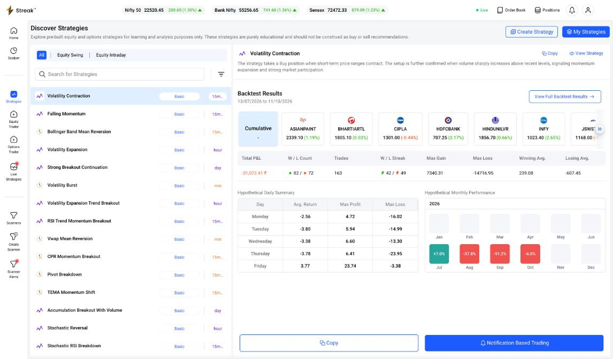
**Kite/platform dependency** Local prebuilt catalogue + local backtest engine.
**Open questions** none.

### DISC-002 Strategy category tabs (All / Equity Swing / Equity Intraday)
**Description** Filters the list by category.
**Where** Top of the left list.
**UI & controls** Tabs **All / Equity Swing / Equity Intraday** (no Options tab). Docs claim filters Equity Swing, Equity Intraday,
Option Buying, Option Selling — Conflicts §6.
**Behaviour & rules** List is infinite-scroll; 45 strategies total, all equity.
**Evidence** OBSERVED — INV §Discover Strategies; A02 §2; DOCUMENTED — A06 §7.
**Screenshots** 
**Kite/platform dependency** none.
**Open questions** none.

### DISC-003 Strategy search (live)
**Description** Filters as you type, auto-selects first match.
**Where** Left list search box.
**UI & controls** Text input. Empty state: illustration + "No strategies found" + **Create Strategy** button; right pane blank.
**Behaviour & rules** Live filtering.
**Evidence** OBSERVED — A02 §2.
**Screenshots** 
**Kite/platform dependency** none.
**Open questions** none.

### DISC-004 Strategy list filter popover (Trend / Technicals)
**Description** Narrows the list by market bias or technical style.
**Where** Funnel icon next to search (Discover Strategies and My Strategies).
**UI & controls** Popover **Filters**, two-pane: categories left, checkboxes right. **Trend:** Bullish, Bearish. **Technicals:**
Momentum, Trend Following, Reversal, Breakout, Breakdown, Trend Confirmation, Uptrend, Downtrend, Momentum Shift, Crossover, Price
Action (scrollable). Footer **Apply** (disabled/pale until something ticked) and **Clear** (appears once a box is ticked).
**Behaviour & rules** Multi-select; applying filters in place. No badge on the funnel to show an active filter (UX gap).
**Evidence** OBSERVED — A02 §2.1; A01 §9.
**Screenshots** 

**Kite/platform dependency** none.
**Open questions** Mapping of filter values to strategy tags.

### DISC-005 Strategy list rows
**Description** Row per prebuilt strategy.
**Where** Left list.
**UI & controls** Icon (wave = swing, sun/clock = intraday), name, complexity badge (Basic), timeframe chip (min / 5min / 15min / hour /
day). Strategy names: Appendix E.
**Behaviour & rules** First page then infinite scroll.
**Evidence** OBSERVED — INV §Discover Strategies; A02 §2.
**Screenshots** 
**Kite/platform dependency** none.
**Open questions** none.

### DISC-006 Strategy detail pane (summary backtest)
**Description** Plain-English description plus a ~3-month backtest summary with per-weekday and per-month breakdowns.
**Where** Right pane of Discover Strategies (same component on My Strategies, MYS-004).
**UI & controls** Name, **Copy**, **View Strategy**, description; "Backtest Results" with period (e.g. 13/07/2026 to 11/10/2026, ~3
months) and **View Full Backtest Results** (→ BT-008); instrument chips (Cumulative + each symbol with LTP/%). Summary metrics: Total
P&L, W/L Count, Trades, W/L Streak, Max Gain, Max Loss, Winning Avg., Losing Avg. **Hypothetical Daily Summary**: per weekday Avg.
Return, Max Profit, Max Loss. **Hypothetical Monthly Performance**: year grid of months with % return, green/red. Footer actions:
**Copy**, **Notification Based Trading** (deploy).
**Behaviour & rules** Metric definitions: Appendix M / BT-011.
**Evidence** OBSERVED — INV §Discover Strategies.
**Screenshots** 
**Kite/platform dependency** Local backtest engine results.
**Open questions** none.

### DISC-007 Read-only prebuilt strategy view
**Description** The builder layout, locked, for inspecting a prebuilt strategy's logic.
**Where** `/strategy/<slug>` via "View Strategy" or the backtest page "View" action.
**UI & controls** "Discover" badge; description under the title; instruments avatar stack + "+10"; chart tabs for every instrument
(scrollable). Conditions in Advance mode show per-condition timeframe chip (15min), bracketed arithmetic, candle offsets
(`High(-2)`), constant multipliers (`Volume(-3) * 3.6`), joiners ("and"). Exit example: Stop loss 4 %, Target 6 %, no TSL. Footer:
**Copy**, **Notification Based Trading**.
**Behaviour & rules** Locked (no editing).
**Evidence** OBSERVED — INV §Strategy view (read-only, prebuilt).
**Screenshots** 
**Kite/platform dependency** none.
**Open questions** none.

### DISC-008 Copy Strategy dialog (Copy button variant)
**Description** Clones a prebuilt or own strategy into My Strategies so it can be edited, backtested and deployed.
**Where** Copy on Discover detail, strategy view, backtest page, My Strategies.
**UI & controls** Name (required, "Enter a name to save"); Category chips Equity Intraday / Equity Swing (prefilled from source); Tags
(free text chips with ×, counter 3/5 → max 5); Description (multi-line, prefilled). Buttons **Cancel / Copy**.
**Behaviour & rules** After Copy: navigates to `/strategy/equity-<name-slug>` in editable mode. (Research copy `zz-research-copy`
created with approval — delete after research.) The deploy-flow variant replaces Cancel/Copy with a step indicator + **Next**
(DEP-002).
**Evidence** OBSERVED — INV §Copy Strategy dialog.
**Screenshots** 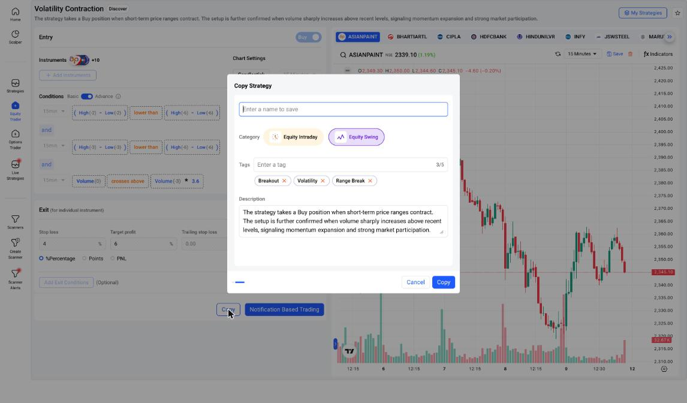
**Kite/platform dependency** none / local store.
**Open questions** none.

### DISC-009 Discover Live Scanners page layout
**Description** Library of ready-made scanners running continuously on Streak's servers; pick a universe and scanner and see current
matches with one-click Buy/Sell/Chart.
**Where** `/discover-scanners` (sidebar "Scanners").
**UI & controls** Header: title "Discover Live Scanners"; subtitle (commonly used live scanners across instruments, segments and
timeframes, running live). Right: `Create Scanner` (outlined → `/scanner`), `My Scanners` (primary). Left column (~35%) card: search
"Search for Scanners", universe dropdown (DISC-010), timeframe segmented filter (DISC-011), scanner list (DISC-012). Right column
(~65%) detail pane (DISC-013). Sticky footer `Copy` (outlined) + `🔔 Set Alerts` (primary).
**Behaviour & rules** First row (Top Gainers) auto-selected on load. Universe selection persists across reloads and is shared with the
dashboard widget.
**Evidence** OBSERVED — A03 §1 Layout; INV §Scanner copy.
**Screenshots** 
**Kite/platform dependency** Local scanner engine; see HOME-004 constraints.
**Open questions** Exact refresh cadence of "Last Scan"; whether some prebuilt scanners are paid-plan only (no lock icons seen).

### DISC-010 Scanner universe dropdown (Discover)
**Description** Selects the basket the prebuilt scanners run on.
**Where** Discover Scanners left card.
**UI & controls** 29 options (WATCH-006, Appendix H); default Nifty 50.
**Behaviour & rules** Changing it re-labels every row's universe pill (e.g. Nifty Weekly Options → "Nifty Current Week") and reloads
results for the selected scanner. The same 37 scanners are offered for every universe. Persisted and shared with HOME-004.
**Evidence** OBSERVED — A03 §1 Universe dropdown.
**Screenshots** 
**Kite/platform dependency** see WATCH-006.
**Open questions** none.

### DISC-011 Scanner timeframe filter and search
**Description** Filters the scanner list by timeframe or name.
**Where** Discover Scanners left card; same chips on My Scanners.
**UI & controls** Segmented `All | 1min | 5min | 15min | 1hour | 1day` (All default, filled blue). Search: case-insensitive substring on
name, live ("rsi" → RSI Entering Bullish…, RSI Overbought, RSI Oversold, Falling RSI).
**Behaviour & rules** `1min` → empty state: illustration + "No scanners found" + `Create Scanner`; right pane keeps the previous scanner.
**Bug:** `5min` listed 8 of 10 five-minute scanners — filter applies only to already-loaded rows (first page of 20).
**Evidence** OBSERVED — A03 §1 Timeframe filter & search.
**Screenshots** 

**Kite/platform dependency** none.
**Open questions** none.

### DISC-012 Scanner list rows (prebuilt catalogue, 37)
**Description** Row per prebuilt scanner.
**Where** Discover Scanners left list.
**UI & controls** Pattern-icon thumbnail, name (truncated "…" at ~22 chars), universe pill (e.g. "Nifty 50" / "Nifty Current Week"),
timeframe pill (`day`, `5min`, `15min`, `hour`). Infinite scroll: first page 20 rows, 37 total. Full catalogue: Appendix F.
**Behaviour & rules** Selected row light-blue. Docs: "50+ prebuilt scanners" (Conflicts §6).
**Evidence** OBSERVED — A03 §1 Catalogue; DOCUMENTED — A06 §4 Catalogue.
**Screenshots** 
**Kite/platform dependency** none.
**Open questions** Full names of truncated scanners 22, 31, 33, 34, 36.

### DISC-013 Scanner detail pane (results snapshot)
**Description** Description, options filters, and the latest server-side scan results for the selected scanner.
**Where** Discover Scanners right pane.
**UI & controls** Header: scanner name (truncated), complexity badge (`Basic` blue outline / `Advance` green outline), `👁 View
Conditions` link (→ DISC-015). Description paragraph. (Options universes) Filter By + Strike Selection (DISC-014). "Scanner Results
(N)" + "Last Scan: Fri, 09 Oct 2026, 4:29 pm". Results table: **Symbol** (logo, symbol, exchange tag `NSE`/`NFO-OPT`) · **LTP** ·
**Change %** (parentheses, green/red) · **Volume** (thousands separators) · **Buy/Sell** (`B` blue outline, `S` red/orange outline,
chart-line icon tooltip "Chart"). Empty: "No Results Found — Run on a different basket (Scan on) to view if any symbols match the
criteria." with illustration; header still shown; count "(0)".
**Behaviour & rules** Results are a server-side snapshot (not recomputed in browser). No sorting/search here (unlike SCAN-008).
**Evidence** OBSERVED — A03 §1 Layout, Results empty state, UX observations.
**Screenshots** 

**Kite/platform dependency** Local scanner results + quotes.
**Open questions** none.

### DISC-014 Options-universe filters (CALL / PUT / VOLUME>0, Strike Selection)
**Description** Narrow option-basket scan results by side, liquidity and strike range.
**Where** Detail pane (Discover) and prebuilt scanner view when an options universe is selected.
**UI & controls** Filter By checkboxes `CALL` ✓, `PUT` ✓, `VOLUME>0` ✓ (all default). **Strike Selection** dropdown: `-1 ATM +1` …
`-30 ATM +30` (30 options) and `Show All`; default `-6 ATM +6` (ATM ± N strikes). Result rows show a `C`/`P` circular badge before the
contract name.
**Behaviour & rules** Docs: strike selection ATM/ITM/OTM or a range; CE/PE/both; Volume > 0; live alerts supported for options scanners.
**Evidence** OBSERVED — A03 §1 Options-universe extras; DOCUMENTED — A06 §4 Option baskets.
**Screenshots** 

**Kite/platform dependency** Spot LTP for ATM; chain quotes; selective ticker subscription.
**Open questions** Whether ITM/OTM-only modes exist (docs mention; UI shows only ±N range).

### DISC-015 Prebuilt scanner view (View Conditions) `/scanner/<slug>`
**Description** Opens a prebuilt scanner inside the scanner editor (locked) to inspect conditions, re-run on another universe, copy or
set alerts.
**Where** `/scanner/<slug>` (e.g. `/scanner/scanner-top-gainers-6040`, `/scanner/scanner-narrow-cpr-sap`) via View Conditions or
dashboard "See Full Results".
**UI & controls** Header: name + one-line description; right: `Discover` link, `My Scanners` button, `⋮` menu (only `Copy`). Left card
"Scanner Conditions" (~40%): Scan On dropdown, Chart Settings (`Candlestick` chip, timeframe dropdown **disabled/greyed** e.g. "1 Day",
"15 Minutes"), Conditions with Basic/Advance switch, rows, Pre built Setups, `+ Add Another Condition`; footer `🔔 Set Alerts`
(primary) + `Copy` (outlined); **no Save / Run Scan**. Right card "Scanner Results (N)" + timestamp `DD/MM/YYYY, HH:mm:ss`
(09/10/2026, 16:29:32 — different format from Discover); toolbar download icon, `Search`, fullscreen icon; same table. Options
universes show Filter By + Strike Selection.
**Behaviour & rules** Basic prebuilt renders `If Close(0) | up by 1% from | Close(-1)` (comparator cell clickable → Up By dialog on Top
Gainers; greyed on ORB: `If Close(0) crosses above Opening Range(High, 30mi…)`). Advance prebuilt (Narrow CPR) renders read-only dashed
expression boxes with per-row timeframe chip greyed. Basic→Advance shows Switch Mode confirm.
**Evidence** OBSERVED — A03 §2, §7.
**Screenshots** 

**Kite/platform dependency** Local scanner engine.
**Open questions** What the download exports (CSV/XLSX, columns).

### DISC-016 Copy Scanner dialog (gate for Set Alerts on prebuilt)
**Description** Prebuilt scanners cannot be alerted directly; the user first saves a personal copy.
**Where** `Set Alerts` or `Copy` on a prebuilt scanner (Discover footer, prebuilt view).
**UI & controls** Toast INFO "Copy the Scanner in order to set alerts" + modal "Copy Scanner": `Enter a name to save` (required,
focused); Tags input "Enter a tag" with counter `5/5`, pre-filled removable chips (Top Gainers: Bullish, Momentum, Price Strength,
Short-Term Uptrend, Intraday Gainer) → max 5; Description textarea pre-filled, resizable; footer small progress bar (2-step wizard
indicator) + `Copy` primary. **No Cancel**; Esc does not close; backdrop closes.
**Behaviour & rules** After Copy → `/scanner/<slug>?openAlert=true`: editable scanner with the "Get Scanner Alert!" modal (SCAN-009).
Research copy `zz-research-scanner` created (alerts not enabled).
**Evidence** OBSERVED — INV §Scanner copy + alerts; A03 §4.
**Screenshots** 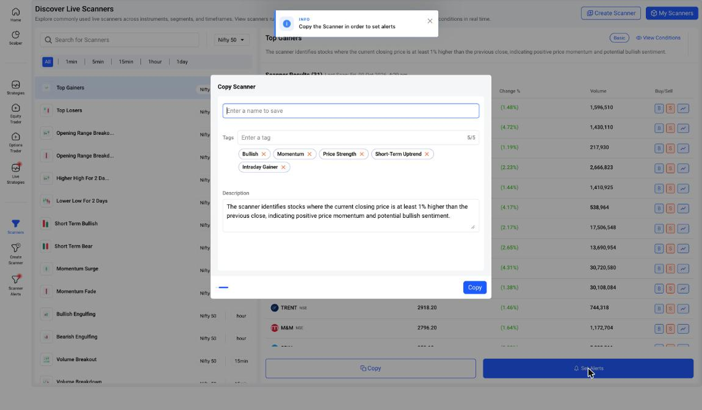

**Kite/platform dependency** none.
**Open questions** none.

### DISC-017 Sharing strategies/scanners by URL (documented)
**Description** Share by copying the URL; requires "Public Sharing" enabled.
**Where** Not observed in UI.
**UI & controls** Unknown ("Public Sharing" setting location not seen).
**Behaviour & rules** DOCUMENTED only.
**Evidence** DOCUMENTED — A06 §7 Sharing.
**Screenshots** none.
**Kite/platform dependency** For a local app: export/import of strategy files instead (INFERRED design note).
**Open questions** Where the Public Sharing toggle lives.

---

### Module MYS — My Strategies / My Scanners

### MYS-001 My Strategies page layout
**Description** The user's library of saved strategies with a quick backtest summary and entry points to edit, copy, backtest or deploy.
**Where** `/my-strategies` (button "My Strategies" on builders/Discover).
**UI & controls** Header "← My Strategies", subtitle "View and manage all the strategies you have created across equity and
options."; right: **Create Strategy** (outline), **Discover Strategies** (primary). Left list pane + right detail pane. Empty state:
"No strategies found" + **Create Strategy**.
**Behaviour & rules** none further.
**Evidence** OBSERVED — INV §My Strategies; A01 §9; A02 §3; A05 §2 My Strategies.
**Screenshots** 
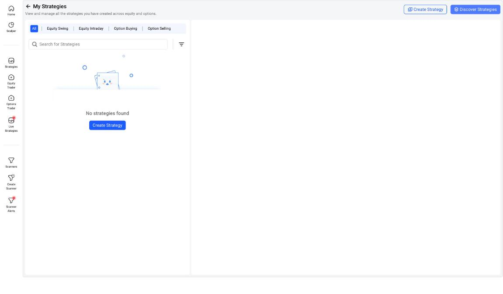
**Kite/platform dependency** Local store.
**Open questions** Sorting (none visible); behaviour with many strategies.

### MYS-002 My Strategies tabs, search and filter
**Description** Segment and search the library.
**Where** Left pane.
**UI & controls** Tabs **All | Equity Swing | Equity Intraday | Option Buying | Option Selling**; search "Search for Strategies"; filter
icon (≡) → same Filters popover as DISC-004 (Trend: Bullish, Bearish; Technicals: Momentum, Trend Following, Reversal, Breakout,
Breakdown, Trend Confirmation, Uptrend, Downtrend, Momentum Shift, Crossover, Price Action; Apply disabled until a change).
**Behaviour & rules** Option Buying / Option Selling classification rule unknown (presumably by net premium / leg sides).
**Evidence** OBSERVED — A01 §9; A02 §3.
**Screenshots** 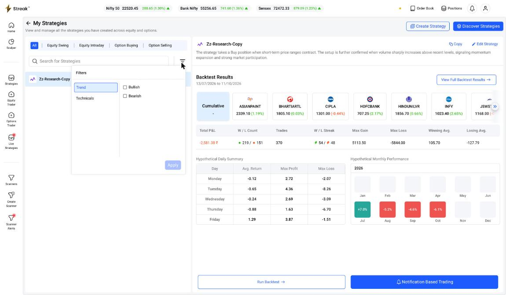
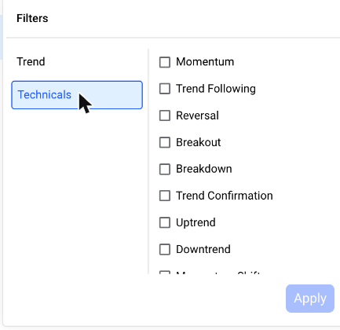

**Kite/platform dependency** none.
**Open questions** Classification rule for options tabs.

### MYS-003 My Strategies row and row menu
**Description** Row per saved strategy with quick actions.
**Where** Left list.
**UI & controls** Strategy icon, name, ☆ favourite toggle, complexity badge ("Basic"/"Advance"), timeframe badge ("15m…", truncated), ⋮
menu → **Delete, Edit, Copy**. Selected row light blue. No column/sorting UI.
**Behaviour & rules** none further.
**Evidence** OBSERVED — INV §My Strategies; A01 §9.
**Screenshots** 
**Kite/platform dependency** none.
**Open questions** Delete confirmation.

### MYS-004 My Strategies detail pane
**Description** Selected strategy's summary and actions.
**Where** Right pane.
**UI & controls** Name, **Copy**, **✎ Edit Strategy**, description; "Backtest Results" (date range) + "View Full Backtest Results →" or
"Run Backtest →"; instrument chip carousel (Cumulative + each symbol LTP/%); metrics row (Total P&L, W/L Count, Trades, W/L Streak,
Max Gain, Max Loss, Winning Avg., Losing Avg.); Hypothetical Daily Summary; Hypothetical Monthly Performance; sticky footer **Run
Backtest →** (outline) and **🔔 Notification Based Trading** (primary). Empty backtest state: "No backtest results available." + Run
Backtest.
**Behaviour & rules** none further.
**Evidence** OBSERVED — INV §My Strategies; A01 §9; A02 §3.
**Screenshots** 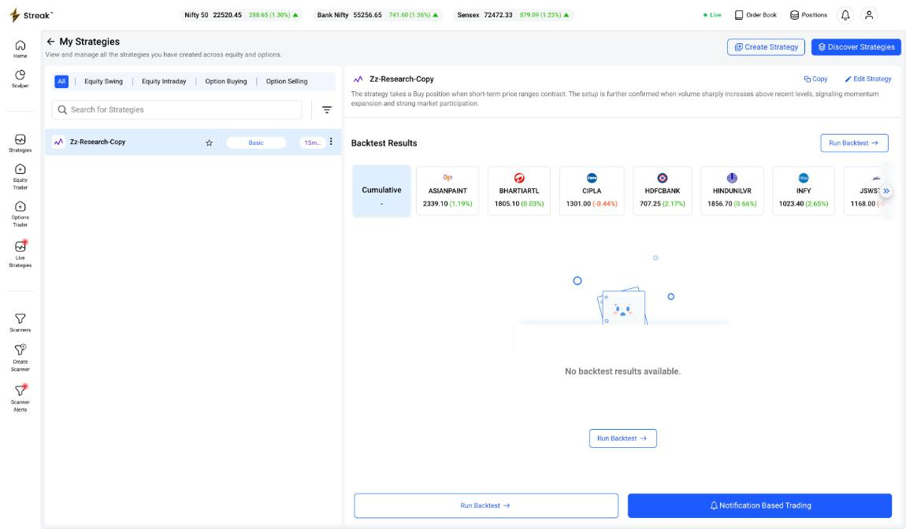
**Kite/platform dependency** Local backtest store.
**Open questions** none.

### MYS-005 My Scanners page layout
**Description** The user's saved scanners (created or copied), browsable like Discover.
**Where** `/my-scanners`.
**UI & controls** Header "← My Scanners", subtitle "View, manage, and monitor all the scanners you have created."; right: `Create
Scanner`, `Discover Scanners` (primary). Left: search, filter icon (tooltip "Filter options coming soon"), timeframe chips
All/1min/5min/15min/1hour/1day, list. Right: "Select a scanner". Empty: "No scanners found" + `Create Scanner`.
**Behaviour & rules** none further.
**Evidence** OBSERVED — INV §Scanner copy + alerts; A03 §6.
**Screenshots** 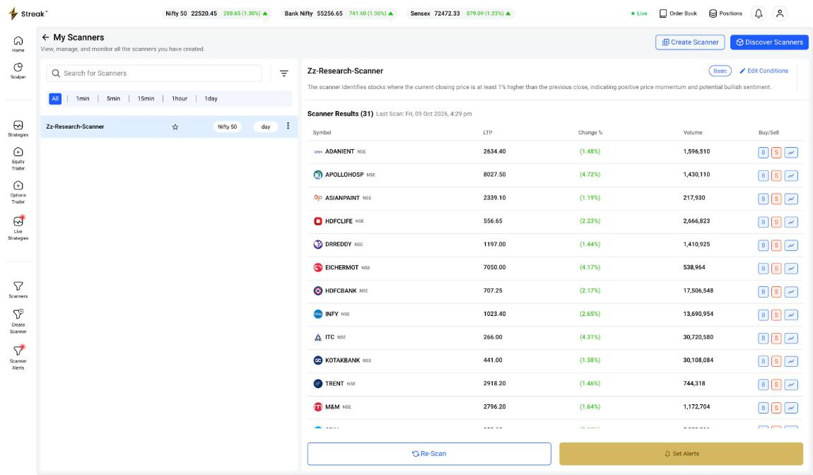

**Kite/platform dependency** Local store.
**Open questions** Limits on number of saved scanners.

### MYS-006 My Scanners row, row menu and detail pane
**Description** Row per saved scanner with actions; detail shows conditions summary and last results.
**Where** `/my-scanners`.
**UI & controls** Row: name, ☆ favourite, universe chip, timeframe chip, ⋮ menu (**Delete, Edit, Copy**). Right pane: name, Basic/Advance
badge, **Edit Conditions**, description, "Scanner Results (N) Last Scan: <ts>" table (Symbol, LTP, Change %, Volume, B / S / chart),
footer **Re-Scan**, **Set Alerts**.
**Behaviour & rules** Docs: pausing a live scanner is done with "Stop Alerts" (SCAN-012).
**Evidence** OBSERVED — INV §Scanner copy + alerts; DOCUMENTED — A06 §4 Stop alerts.
**Screenshots** 
**Kite/platform dependency** Local scanner engine.
**Open questions** Live/paused status indicator per row (not seen); toggle-live action.

### MYS-007 `/scanners` alias route (renders My Scanners)
**Description** An undocumented route that renders the My Scanners master/detail view.
**Where** `/scanners` (HTTP 200; not linked from any `a[href]` in the app).
**UI & controls** Identical to `/my-scanners` (MYS-005/006).
**Behaviour & rules** `localStorage` holds `SCANNERS_ACTIVE_TAB=my`, suggesting one scanners route that remembers a my/discover tab.
**Evidence** OBSERVED — R2 §(a), §(b) N8.
**Screenshots** 
**Kite/platform dependency** none (a desktop rebuild has one My Scanners view; no alias needed).
**Open questions** Whether `SCANNERS_ACTIVE_TAB=discover` renders Discover Scanners at the same route.

---

### Module BT — Backtesting

### BT-001 Execute → Backtest parameters dialog
**Description** Sets capital, date range, entry window, holding type and daily cycle before running a backtest.
**Where** Builder footer **Execute** → step 1 execution-type chooser (EQB-039) → **Backtest** → step 2; My Strategies "Run Backtest";
backtest page "Run Backtest".
**UI & controls** Title "Execute · Backtest". Fields: **Initial Capital** (default 25000); **Start Date** (default = base-TF lookback
start, 13/07/2026 for 15-min ≈ 90 days); **End Date** (today); **Start Time** (hh dropdown : mm dropdown, AM/PM; default 9:15 AM); **End
Time** (default 3:30 PM) — entry window; **Holding Type** radio Intraday (MIS) / Longterm (CNC); **Strategy Cycle** dropdown {–, 1
Cycle … 5 Cycles} (disabled when CNC; default "–"). Buttons **Back / Run Backtest** (Back returns to step 1; Cancel exists only on
step 1 — corrected by REVIEW-2 #14, earlier text said Cancel / Run Backtest). **No quantity field**.
**Behaviour & rules** On run: toast "Strategy Saved Successfully" (running also saves), navigates to `/backtest/<slug>`, results stream
in per instrument with spinners (BT-007). Docs: "Strategy cycle", "Entry Start Time" and "Entry Stop Time" in Backtest Parameters set
entries per day and the time window. A01 (earlier observation) found no such controls — superseded (Conflicts §6).
**Evidence** OBSERVED — INV §Execute → Backtest parameters dialog; DOCUMENTED — A06 §1 Re-entry, trades per day, time window.
**Screenshots** 

**Kite/platform dependency** Local engine over local candle store (Kite historical backfill).
**Open questions** Validation of start/end dates beyond the lookback; whether End Time acts as forced exit or only entry stop.

### BT-002 Strategy Cycle (max entries per day)
**Description** Caps the number of entry/exit cycles per day in a backtest (and re-arms per cycle in live).
**Where** Backtest parameters (BT-001) and NBT deploy dialog (DEP-001).
**UI & controls** Dropdown {–, 1 Cycle, 2 Cycles, 3 Cycles, 4 Cycles, 5 Cycles}; disabled when Holding Type = CNC.
**Behaviour & rules** [LEGACY] Daily Strategy Cycle capped hypothetical trades per day; live: how many times the strategy re-arms after
an exit; CNC cycle per deployment, MIS cycle per day. Live Strategies shows "Status / Cycle".
**Evidence** OBSERVED — INV §Execute → Backtest; DOCUMENTED — A06 §1 Cycle semantics [LEGACY].
**Screenshots** 
**Kite/platform dependency** none.
**Open questions** Meaning of "–" (unlimited?); max in live.

### BT-003 Entry window (Start Time / End Time)
**Description** Restricts entries to a time-of-day window.
**Where** Backtest parameters.
**UI & controls** hh : mm dropdowns + AM/PM; defaults 9:15 AM – 3:30 PM.
**Behaviour & rules** Docs: Entry Start/Stop Time. Live MIS triggers stop after 15:20 regardless (DEP-004).
**Evidence** OBSERVED — INV §Execute → Backtest; DOCUMENTED — A06 §1.
**Screenshots** 
**Kite/platform dependency** none.
**Open questions** Whether End Time also forces exit.

### BT-004 Holding Type (Intraday MIS / Longterm CNC)
**Description** Product type for the simulated/deployed trades.
**Where** Backtest parameters; NBT deploy dialog.
**UI & controls** Radio Intraday (MIS) / Longterm (CNC).
**Behaviour & rules** MIS → square-off rules (BT-020); CNC → open positions marked to close in the calendar (BT-015), cycle disabled.
Docs: products MIS and CNC; live MIS stops triggering after 3:20 PM and expires 3:21 PM; use CNC to trigger after 3:20.
**Evidence** OBSERVED — INV §Execute → Backtest; DOCUMENTED — A06 §1 Holding type.
**Screenshots** 
**Kite/platform dependency** Kite products `MIS`, `CNC` (also `NRML`, `MTF` exist — A07 A7).
**Open questions** Options/futures product (NRML) handling.

### BT-005 Initial Capital and quantity derivation
**Description** Capital per instrument; quantity derived automatically.
**Where** Backtest parameters.
**UI & controls** Initial Capital number (default 25000).
**Behaviour & rules** Quantity = floor(Initial Capital ÷ entry price) per instrument (verified: 25000 / 2651.80 → qty 9; 25000 /
8835.5 → 2). Docs: Initial Capital must be ≥ Quantity × Close for every instrument; trade happens only if `Price × Qty ≤ Initial Capital
+ cumulative P&L up to the previous trade`, else "No trades happened because the initial capital is low"; **no margin or leverage**;
**freeze limits ignored**. [LEGACY] capital and Max Allocation per instrument; "risk-based position sizing" existed — not confirmed
on new platform. A01's "quantity fixed by platform (e.g. 2)" is explained by this derivation.
**Evidence** OBSERVED — INV §Execute → Backtest; DOCUMENTED — A06 §1 Position sizing and capital.
**Screenshots** 
**Kite/platform dependency** none.
**Open questions** Whether capital is per instrument or shared (legacy says per instrument).

### BT-006 Date range and lookback per base timeframe
**Description** Backtest window limited by a per-timeframe lookback.
**Where** Backtest parameters Start/End Date.
**UI & controls** Date pickers; default start = lookback start.
**Behaviour & rules** Lookback: 1 min → 30 calendar days; 3–30 min → 90 days; 1 hour → 365 days; 1 day → 3 years ([OLD] 5 years).
Window can sit anywhere inside the lookback; lookback also limits indicator warm-up. Observed prebuilt results all span 13 Jul 2026 –
11 Oct 2026 (~3 months, 15-min base).
**Evidence** OBSERVED — INV, A01 §7; DOCUMENTED — A06 §1 Data range.
**Screenshots** 
**Kite/platform dependency** Kite historical: minute data from ~2015; per-request windows 60/100/200/400/2000 days; 3 req/s; local
store + incremental backfill with progress UI (A07 A4, Constraint 7). A rebuild could exceed Streak's lookback.
**Open questions** none.

### BT-007 Run backtest → save, navigate, progressive per-instrument loading
**Description** Running saves the strategy and streams results.
**Where** Run Backtest button.
**UI & controls** Toast "Strategy Saved Successfully"; navigation to `/backtest/<slug>`; spinners per instrument while results stream.
**Behaviour & rules** Docs: today's backtest data lags — current-day results refresh after 21:00; daily backtest cap ("Limit Exceeded",
number unpublished) — BT-027.
**Evidence** OBSERVED — INV §Execute → Backtest; DOCUMENTED — A06 §1.
**Screenshots** 
**Kite/platform dependency** Local engine (no daily cap needed).
**Open questions** none.

### BT-008 Full backtest results page layout and header actions
**Description** Detailed per-instrument results with charts, trade log and calendar.
**Where** `/backtest/<strategy-slug>` (e.g. `equity-volatility-contraction-146555-sap`).
**UI & controls** Header: strategy name, backtest period (13 Jul 2026 to 11 Oct 2026); actions — prebuilt: **View** (strategy
definition), **Copy Strategy**, **Notification Based Trading**; own strategy: **Edit ✏**, **Run Backtest**, **Notification Based
Trading** (no Copy). Own 2-step tour. Left column: Combined Results + per-instrument table (BT-009). Right pane per selected
instrument (symbol, exchange, LTP, % change): Trading Charges toggle (BT-010), metrics row (BT-011), Daily Summary (BT-012), Monthly
Performance (BT-013), Chart / Trade Log (BT-014), cumulative P&L calendar (BT-015), Trade Log (BT-016), P&L Chart (BT-018).
**Behaviour & rules** Docs: results cumulative across all instruments; combined download for all instruments not supported.
**Evidence** OBSERVED — INV §Full backtest results, §Execute → Backtest; A01 §9.
**Screenshots** 

**Kite/platform dependency** Local.
**Open questions** none.

### BT-009 Combined Results card and per-instrument table
**Description** Aggregate and per-instrument P&L with instrument switcher.
**Where** Backtest page left column.
**UI & controls** Combined Results: total P&L, Wins, Losses, Trades. Table: Instrument (logo), P&L (coloured). Clicking an instrument
switches the right pane.
**Behaviour & rules** none further.
**Evidence** OBSERVED — INV §Full backtest results.
**Screenshots** 
**Kite/platform dependency** none.
**Open questions** none.

### BT-010 Trading Charges toggle
**Description** Shows P&L net of brokerage and statutory charges.
**Where** Right pane top-right of backtest page.
**UI & controls** Toggle, default **OFF**. Example: APOLLOHOSP −523.79 → −1,254.00 when ON.
**Behaviour & rules** Docs: brokerage, STT, transaction charges, GST and SEBI fees from the broker's brokerage calculator, applied on
**both buy and sell** legs; stamp duty not named.
**Evidence** OBSERVED — INV §Full backtest results; DOCUMENTED — A06 §1 Trading charges.
**Screenshots** 
**Kite/platform dependency** `POST /charges/orders` (virtual contract note: brokerage, STT/CTT, exchange turnover, SEBI fee, stamp duty,
GST) with synthetic orders — A07 A9, Constraint 10.
**Open questions** none.

### BT-011 Metrics row (Total P&L, W/L Count, Trades, W/L Streak, Max Gain, Max Loss, Winning Avg., Losing Avg., Max DD)
**Description** Headline performance metrics per instrument / cumulative.
**Where** Backtest page right pane; Discover/My Strategies detail (without Max DD).
**UI & controls** Nine tiles (Max DD only on the full page).
**Behaviour & rules** Definitions (Appendix M): P&L total over all simulated trades; W vs L counts; WS/LS longest consecutive win/loss
runs; Max DD largest peak-to-trough drop, formula `(Peak − Trough)/Peak`, sign convention unclear; Winning/Losing Avg = average gain and
loss per trade.
**Evidence** OBSERVED — INV; DOCUMENTED — A06 §2.
**Screenshots** 
**Kite/platform dependency** none.
**Open questions** Max DD sign/units.

### BT-012 Hypothetical Daily Summary (per weekday)
**Description** Avg. Return, Max Profit, Max Loss by weekday.
**Where** Backtest page; Discover/My Strategies detail.
**UI & controls** Table weekday × (Avg. Return / Max Profit / Max Loss).
**Behaviour & rules** DOCUMENTED definition matches.
**Evidence** OBSERVED — INV; DOCUMENTED — A06 §2.
**Screenshots** 
**Kite/platform dependency** none.
**Open questions** none.

### BT-013 Hypothetical Monthly Performance grid
**Description** Year grid of month tiles with % return, colour intensity by return.
**Where** Backtest page; Discover/My Strategies detail.
**UI & controls** Month tiles green/red.
**Behaviour & rules** DOCUMENTED.
**Evidence** OBSERVED — INV; DOCUMENTED — A06 §2.
**Screenshots** 
**Kite/platform dependency** none.
**Open questions** none.

### BT-014 "Chart / Trade Log" candle chart with trade markers
**Description** Instrument chart at the strategy timeframe with entry/exit markers.
**Where** Backtest page right pane.
**UI & controls** TradingView-style candle chart with markers; "See All Transactions" scrolls to the log.
**Behaviour & rules** Marker codes: EN = entry candle, EX = exit candle, SO = MIS square-off (A05 FAQ).
**Evidence** OBSERVED — INV; DOCUMENTED — A05 §1 FAQ Chart trade markers.
**Screenshots** 
**Kite/platform dependency** Historical candles.
**Open questions** none.

### BT-015 Hypothetical cumulative P&L calendar heatmap
**Description** One mini-grid per month; each cell a trading day coloured by day P&L.
**Where** Backtest page; dashboard Live Backtest widget.
**UI & controls** Monthly grids (Jul 2026 … Oct 2026), green/red cells, grey = no trade/holiday; tooltip `13 Jul, 2026: -1.48%`.
**Behaviour & rules** Docs: open CNC positions are marked to that day's close against the buy price.
**Evidence** OBSERVED — INV; A04 §5.3; DOCUMENTED — A06 §2.
**Screenshots** 
**Kite/platform dependency** none.
**Open questions** none.

### BT-016 Trade Log table with pagination
**Description** Every simulated transaction.
**Where** Backtest page.
**UI & controls** Columns Date & Time, Symbol, P&L, Price, Buy/Sell, Qty (signed), Trigger; pagination Prev / 1 2 3 … / Next (own
backtest paginated 1–5).
**Behaviour & rules** The P&L column is the **cumulative running P&L** on every row (entry and exit) — corrected by REVIEW-2 #17
(earlier text said exit rows carry the round-trip P&L). Example (APOLLOHOSP, qty 2): SO rows read −111 → −111 → −167 → −80; each
step = previous total + (exit − entry) × 2, e.g. −111 + (8901 − 8929) × 2 = −167. Displayed trigger time = signal candle's open
time (docs). Trigger codes: BT-030.
**Evidence** OBSERVED — INV §Full backtest results, §Execute → Backtest; R2 §(c) #16–#17; DOCUMENTED — A06 §1 Fills.
**Screenshots** 

**Kite/platform dependency** none.
**Open questions** none.

### BT-017 Download Trade Log
**Description** Exports the trade log file.
**Where** Backtest page, Trade Log section.
**UI & controls** "Download Trade Log" button (not clicked).
**Behaviour & rules** Docs: combined download for all instruments not supported (per instrument only).
**Evidence** OBSERVED — INV; DOCUMENTED — A06 §2 Results scope.
**Screenshots** 
**Kite/platform dependency** Local file export (CSV).
**Open questions** Format/columns.

### BT-018 P&L chart (cumulative line)
**Description** Cumulative P&L over dates.
**Where** Backtest page bottom.
**UI & controls** Line chart; segments green above 0 / red below 0.
**Behaviour & rules** none further.
**Evidence** OBSERVED — INV.
**Screenshots** 
**Kite/platform dependency** none.
**Open questions** none.

### BT-019 Engine rule — fills and signal timing
**Description** How signals become fills.
**Where** Engine.
**UI & controls** n/a.
**Behaviour & rules** Signals evaluated on **completed-candle OHLC**, never LTP/ticks (backtest and live). Fill at the **next candle's
open**, regardless of volume. Entry needs a fresh transition (true now, false previous candle). **No averaging/pyramiding**: one position
at a time per instrument. Displayed trigger time = signal candle's open time (9:20–9:25 candle shows 9:20, fills at 9:25 open). INV
observed "entry fills at the candle close price of the signal candle" and fixed qty per instrument — see Conflicts §6.
**Evidence** DOCUMENTED — A06 §1 Fills and signal timing; A05 §1 FAQ; OBSERVED — INV §Full backtest results.
**Screenshots** none.
**Kite/platform dependency** Local.
**Open questions** none.

### BT-020 Engine rule — intraday (MIS) square-off times
**Description** When open MIS positions are force-closed in backtests.
**Where** Engine.
**UI & controls** n/a; trade-log trigger `SO`.
**Behaviour & rules** Generic: squared off at the open of the **3:15 PM** candle. Instrument-specific (Sep 2026, treat as current): F&O
stocks under CAS **3:10 PM**; non-F&O equity **3:25 PM**; futures **3:25 PM**; indices **3:10 PM**; 1-hour timeframe on F&O stocks →
the **2:15 PM** candle. Currency MIS 4:30 PM (segment not tradable). Observed: SO at 15:15 (prebuilt) and SO at 15:25 for a non-CAS
stock (own backtest). Conflicts §6.
**Evidence** DOCUMENTED — A06 §1 Intraday square-off; OBSERVED — INV.
**Screenshots** 
**Kite/platform dependency** Local; the app needs the CAS list of F&O stocks (instruments dump: NFO underlyings).
**Open questions** Exact CAS stock list source.

### BT-021 Engine rule — SL / TP / TSL evaluation
**Description** How exits are simulated.
**Where** Engine.
**UI & controls** n/a.
**Behaviour & rules** SL and TP checked on the entry candle; if both hit in the same candle, **SL assumed first**. Intra-candle path for
TSL: longs O→L→H→C, shorts O→H→L→C. Also stated: "evaluated on the close price of every candle while a position is active" (conflicting
wording — Conflicts §6). Units %, points, absolute/P&L. No conditional TSL. [LEGACY] SL filled at close of the candle after trigger +
flat slippage.
**Evidence** DOCUMENTED — A06 §1 SL/TP/TSL evaluation.
**Screenshots** none.
**Kite/platform dependency** Local.
**Open questions** Close-based vs high/low-based evaluation.

### BT-022 Engine rule — capital gating, no margin/leverage, freeze limits ignored
**Description** Position-sizing constraints.
**Where** Engine.
**Behaviour & rules** See BT-005. No margin/leverage for any order type; freeze limits not applied in backtests.
**Evidence** DOCUMENTED — A06 §1 Position sizing.
**Screenshots** none.
**Kite/platform dependency** none.
**Open questions** none.

### BT-023 Engine rule — multi-timeframe evaluation
**Description** See EQB-022 (strategy evaluated every base-TF close; higher-TF uses last closed candle; LCM for non-multiples; weekly
completes next week).
**Where** Engine.
**Evidence** DOCUMENTED — A06 §1 MTF evaluation.
**Screenshots** none.
**Kite/platform dependency** Local resampling.
**Open questions** none.

### BT-024 Engine rule — no slippage model
**Description** Backtest is "near-ideal … fewer or no slippages". [LEGACY 2018] flat minimum slippage existed.
**Where** Engine.
**Evidence** DOCUMENTED — A06 §1 Slippage.
**Screenshots** none.
**Kite/platform dependency** none (a rebuild may add an optional slippage setting — INFERRED improvement).
**Open questions** none.

### BT-025 Engine rule — no corporate-action adjustment
**Description** Raw OHLCV used; no split/bonus adjustment.
**Where** Engine.
**Evidence** DOCUMENTED — A06 §1 SL/TP/TSL evaluation (last bullet).
**Screenshots** none.
**Kite/platform dependency** UNVERIFIED whether Kite day candles are adjusted (A07 §E); bhavcopies are raw.
**Open questions** Adjustment source if a rebuild wants it.

### BT-026 Engine rule — segments and instruments supported
**Description** What can be backtested.
**Behaviour & rules** Equities and futures only; **options backtesting not available** (confirmed 3 Sep 2026). Instruments NSE + BSE
stocks in BSE 1000 only; no MCX, currency, AMO, MTF. Candlestick only. Intraday short-selling supported.
**Evidence** DOCUMENTED — A06 §1 Holding type, segments, chart types.
**Screenshots** none.
**Kite/platform dependency** Kite has NFO option history (expired-contract intraday UNVERIFIED) — a rebuild could add options backtests.
**Open questions** none.

### BT-027 Backtest error messages and daily cap
**Description** Known engine errors.
**Behaviour & rules** "No Trades Happened"; "No Trades Happened Because the Initial Capital Is Low"; "Limit Exceeded" (daily backtest
cap, resets next day; number unpublished; third-party claims "1000+").
**Evidence** DOCUMENTED — A06 §1 Backtest errors, §Unverified 4.
**Screenshots** none.
**Kite/platform dependency** none (local engine has no cap).
**Open questions** Cap value.

### BT-028 Backtest results refresh for the current day
**Description** Current-day backtest and trade details update after 21:00.
**Evidence** DOCUMENTED — A06 §1, A05 §1 FAQ.
**Screenshots** none.
**Kite/platform dependency** Local (can be live).
**Open questions** none.

### BT-029 Backtest page onboarding tour (2 steps)
**Description** See SHELL-006.
**Evidence** OBSERVED — INV §Full backtest results.
**Screenshots** none.
**Open questions** Step texts.

### BT-030 Trade-log trigger codes
**Description** Codes in the Trigger column / chart markers.
**Behaviour & rules** EN (entry), EX (exit condition), SL (stop loss), TP (target), TSL (trailing SL), SO (square-off), EXP (contract
expired). Observed: EN, SO. Appendix M.
**Evidence** OBSERVED — INV; DOCUMENTED — A06 §1 Trade-log trigger codes.
**Screenshots** 
**Kite/platform dependency** none.
**Open questions** none.

---
### Module DEP — Deployment / Notification-Based Trading

### DEP-001 Execute → Notification Based Trading dialog (own strategy)
**Description** Deployment parameters for taking a saved strategy live in notification-based mode.
**Where** Builder footer Execute → step 1 chooser (EQB-039; NBT is the default selection) → step 2; My Strategies / backtest page
"Notification Based Trading".
**UI & controls** Title "Execute · Notification Based Trading". Left: "Instruments (15 / 50)" master checkbox; "* Capital" (required);
per-instrument checkbox + **Qty** input (default 1). Right "Options": **Strategy Cycle** dropdown (BT-002; **defaults to 1 Cycle**
here, unlike the Backtest step's "–"); **Order Type** (Market — fixed); **Holding Type** Intraday MIS / Longterm CNC. Footer: "I accept
the **trading terms**" checkbox (the link opens `/terms` in a new tab, ACCT-009), **Back**, **Execute** (disabled until terms
accepted). Corrected by REVIEW-2 #15 (earlier text: Cancel / Execute, no default cycle). Observed, NOT deployed.
**Behaviour & rules** Each instrument counts as one deployment toward the 100 limit (DEP-004). A05 inferred step 2 of the deploy flow
would hold quantity per instrument, product, cycles — consistent with this dialog.
**Evidence** OBSERVED — INV §Execute → Notification Based Trading dialog; DOCUMENTED — A06 §3 Execution tab.
**Screenshots** 

**Kite/platform dependency** Local deployment engine (must run while app is open — A07 Constraint 2); order placement later via
`POST /orders/regular` (MARKET with `market_protection`; product MIS/CNC; `tag` for strategy ID; static IP; ≤10 OPS). Options
deployment dialog not observed.
**Open questions** Role of "Capital" alongside per-instrument Qty; validity/expiry field (docs say T+29 days); risk disclaimer text.

### DEP-002 Deploy from prebuilt — step 1 "Copy Strategy" (wizard variant)
**Description** Deploying a Discover strategy first forces a personal copy, in a 2-step wizard.
**Where** "Notification Based Trading" (bell icon, full-width primary) on Discover detail footer, `/backtest/<slug>`, `/strategy/<slug>`.
**UI & controls** Modal "Copy Strategy", centred; two-dot step indicator bottom-left (step 1 of 2); **Next** bottom-right; no × and no
Cancel. Fields: Name (text, "Enter a name to save", required, auto-focused — pressing Next empty turns border red with ⚠ icon and
tooltip "Please enter a name…"); Category pills Equity Intraday (sun/clock, beige) / Equity Swing (zig-zag, purple), source's category
pre-selected; Tags "Enter a tag" + counter "3/5" + hidden Add, chips with orange ×, pre-filled (Breakout, Volatility, Range Break), max 5;
Description textarea pre-filled.
**Behaviour & rules** Escape does not close; backdrop click does. Step 2 not observed (not in DOM until Next; pressing Next would save a
copy). Deploying from an own strategy opens DEP-001 directly (INV).
**Evidence** OBSERVED — A05 §2; INV §Copy Strategy dialog.
**Screenshots** 

**Kite/platform dependency** none.
**Open questions** Step 2 fields for the prebuilt path (presumably DEP-001); confirmation/risk disclaimer.

### DEP-003 Live Strategies page
**Description** Tracks every deployed strategy and instrument: live price, P&L, TP/SL levels, status/cycle, log.
**Where** `/live-trades` (sidebar "Live Strategies", red-dot badge).
**UI & controls** H1 "Live Strategies"; description "Monitor and manage all strategies taken live via notification-based trading. View
live status, order logs, re-execute or stop strategies, and track instrument-wise execution." Mode tabs: single segmented tab
**"Notification Based Trading"** (only mode; no Auto/Paper/Virtual). Table columns: Strategy / Instrument · Avg. Price · LTP · Day
Change · TP · SL · P&L · Net Change · Status / Cycle · Log. Empty state: illustration, "No Deployed Strategies found", "You can deploy
your strategies from the strategy page", button **"Go to Discover Strategies"** (→ `/discover-strategies`). No Search/Refresh/filter/sort
in empty state.
**Behaviour & rules** (INFERRED from headers) strategy = parent row, instruments = child rows; TP/SL = absolute levels derived from the
strategy's %/points exit; Status/Cycle combines status and cycle counter; Log opens the order/notification log. Description confirms
**re-execute** and **stop** actions. Stale P&L: rows keep showing running P&L if the position was closed at the broker or deployed
without SL/TP.
**Evidence** OBSERVED — A05 §1; DOCUMENTED — A06 §3 Untracked positions.
**Screenshots** 
**Kite/platform dependency** Ticker for LTP; `GET /portfolio/positions` to reconcile; local deployment store.
**Open questions** Exact status values; cycle format/max; row action menu contents; details page vs modal log; grouping/expansion.

### DEP-004 Deployment lifecycle rules (limits, validity, MIS expiry)
**Description** Platform rules governing live deployments.
**Behaviour & rules** Up to **100 concurrent deployments** (each instrument = 1; 50-stock strategy = 50). Validity **T+29 days**, then
stops automatically ([LEGACY] 30 days). **MIS** deployments expire daily at **15:21**; no MIS triggers after **15:20**; use CNC to
trigger later. Only one login session active. Freeze-limit orders rejected.
**Evidence** DOCUMENTED — A06 §3 Deployment limit, Validity, MIS expiry, Single session, Freeze limit; A05 §1 FAQ, §9 Limits table.
**Screenshots** none.
**Kite/platform dependency** Local scheduler; Kite session expires 06:00 daily → manual re-login every trading day (A07 A2).
**Open questions** none.

### DEP-005 Signal generation and alert delivery (candle close, latency)
**Description** How live triggers are produced and delivered.
**Behaviour & rules** Conditions evaluated on completed candles only (5-min crossover at 09:23 → alert after 09:25 close). Alert latency
~**8–14 s** after candle close. The user clicks the notification to place the order; Streak then tracks SL/TP and sends exit alerts.
Triggers after 15:30 can be placed in post-market **15:40–16:00**; AMO not supported. Channels: web push (enable in Profile + browser
permission) and mobile app; **no Telegram/email/webhook**. Internal notification types hint: `alert-notification`, `order-notification`,
`order-placement`, `order-webhook`, `price-trigger-notification` (SL/TP), `scanner`.
**Evidence** DOCUMENTED — A06 §3 NBT flow, Latency, Late triggers, Notification channels, Internal types; A05 §1 FAQ.
**Screenshots** none.
**Kite/platform dependency** Local engine aggregating ticks into candles; OS notifications (Wails) + in-app inbox; optional Kite ATO
alerts (500 max, simple price conditions) as server-side fallback (A07 A8b).
**Open questions** Whether an in-session toast/pop-up appears on trigger; trigger expiry.

### DEP-006 TP / SL / Combined SL-TP handling in live mode (alerts only)
**Description** Exits are alerts the user acts on; nothing is auto-executed.
**Behaviour & rules** When TP/SL is reached an alert is sent; user closes manually. Combined SL/TP (options) fires one exit notification;
fills can overshoot. **Partially filled** entries: TP/SL not monitored. Backtest vs live: same trigger candles, different fills.
**Evidence** DOCUMENTED — A06 §3 Combined SL/TP, Partial fills; A05 §1 FAQ.
**Screenshots** none.
**Kite/platform dependency** Local P&L tracking from ticker + positions; GTT OCO as server-side exit fallback (limit orders only).
**Open questions** none.

### DEP-007 Re-execute / Stop a deployment
**Description** Row-level actions implied by the page description.
**Where** Live Strategies rows (not observable).
**Behaviour & rules** INFERRED from "re-execute or stop strategies".
**Evidence** OBSERVED (text) — A05 §1.
**Screenshots** none.
**Kite/platform dependency** none.
**Open questions** Menu contents (Stop, Re-execute, View strategy, Delete?).

### DEP-008 Deployment log
**Description** Per-row log of orders/notifications.
**Where** "Log" column, Live Strategies.
**Behaviour & rules** Not observable.
**Evidence** OBSERVED (column) — A05 §1.
**Screenshots** none.
**Kite/platform dependency** Local; Kite `GET /orders` history for reconciliation.
**Open questions** Modal or page.

### DEP-009 Notifications page (alert inbox)
**Description** History of every alert from deployed strategies and live scanners; where the user acts on entry/exit/SL/TP triggers.
**Where** `/notifications` (bell icon).
**UI & controls** Header "← Notifications", "View all alerts and updates generated by strategies and scanners in one place." Filter
tabs **All** (default) | **Notification Based** | **Scanner**; Search box right-aligned. Columns: Trade Type · Instrument ·
Strategy/Scanner · Time · Status. Empty: "No notifications found".
**Behaviour & rules** Implied types: strategy entry/exit triggers (Trade Type Buy/Sell; Status e.g. pending/placed/ignored/expired —
INFERRED) and scanner alerts. Clicking a trigger presumably opens an order-confirmation dialog (INFERRED from FAQ).
**Evidence** OBSERVED — A05 §6; A03 §5 Notifications page.
**Screenshots** 

**Kite/platform dependency** Local inbox; order placement on click.
**Open questions** Status values; expiry of triggers.

### DEP-010 Push Notifications channel (profile toggle)
**Description** Browser push delivery of alerts; see ACCT-003.
**Evidence** OBSERVED — A05 §8; DOCUMENTED — A06 §3.
**Screenshots** 
**Kite/platform dependency** OS notifications in a desktop app.
**Open questions** none.

### DEP-011 Deployment modes that do NOT exist (no auto-trading, no paper trading)
**Description** Explicit absences.
**Behaviour & rules** Automated trading not supported pending regulatory approval (Jan 2026). Virtual/paper trading not supported
(Jan 2026; site meta still says "virtually deploy" — treat as unsupported). [LEGACY] "Take Live" and "Paper Trade" modes existed.
**Evidence** DOCUMENTED — A06 §3 No automation, No paper trading; A05 §1.
**Screenshots** 
**Kite/platform dependency** A rebuild *could* auto-place orders (own key, static IP, ≤10 OPS) — A07 §B; see Cross-cutting §3.3.
**Open questions** none.

---

### Module SCAN — Scanners

### SCAN-001 Create Scanner page layout
**Description** No-code builder: pick a universe and timeframe, compose conditions, Run Scan to see matches now; save and turn into
alerts.
**Where** `/scanner` (sidebar "Create Scanner").
**UI & controls** Header "Untitled Scanner" (editing not observed — likely set on Save), `My Scanners` button. Left card "Scanner
Conditions" with sticky footer `💾 Save` (outlined) + `🔍 Run Scan` (primary). Right card "Scanner Results (N)" with timestamp after a
run, download icon, Search, expand icon (expand only when results exist). Initial empty: "No Results Found — Run on a different
basket…".
**Behaviour & rules** **No "Leave site?" guard** (draft discarded silently). No scan frequency/schedule control — scheduling lives in Set
Alerts.
**Evidence** OBSERVED — A03 §3 Layout.
**Screenshots** 
**Kite/platform dependency** Local scanner engine.
**Open questions** Save flow (name prompt? limits).

### SCAN-002 Scan On (universe) selector
**Description** Chooses the basket to scan.
**Where** Scanner Conditions card.
**UI & controls** Dropdown, default **Nifty 50**; the 29 universes (Appendix H) **plus `Custom Symbols 🛒`** inserted after Futures.
**Behaviour & rules** See WATCH-006/007. Docs: Nifty 500 broadest; options baskets; NFO futures baskets unsupported.
**Evidence** OBSERVED — A03 §3 Controls; DOCUMENTED — A06 §4.
**Screenshots** 
**Kite/platform dependency** see WATCH-006.
**Open questions** none.

### SCAN-003 Scanner Chart Settings (chart type + timeframe)
**Description** Base timeframe for the scan.
**Where** Scanner Conditions card.
**UI & controls** `Candlestick` chip (click has no effect); Timeframe dropdown 1 Minute (default), 3, 5, 10, 15, 30 Minutes, 1 Hour, 1 Day.
Docs list 1, 5, 15 min, 1 h, 1 d for Create Scanner (Conflicts §6).
**Behaviour & rules** Advance rows may use week/month as MTF.
**Evidence** OBSERVED — A03 §3 Controls; DOCUMENTED — A06 §4 Condition limits and timeframes.
**Screenshots** 
**Kite/platform dependency** Kite intervals.
**Open questions** none.

### SCAN-004 Scanner conditions (Basic & Advance — shared editor)
**Description** Same condition editor as the equity builder (EQB-006…EQB-026), condition-only (no side/exits).
**Where** Scanner Conditions card.
**UI & controls** Basic/Advance switch (ⓘ help in Advance); Assist (opens suggestions dialog); rows; `+ Add Another Condition`; Pre built
Setups (71 tiles). Advance: per-row timeframe, Select Expression (**107** entries on the All tab = 99 operands including "Number" +
8 math functions — REVIEW-2 #25 corrected the earlier "~105"), math functions, comparators, and/or, groups, row tools, Copy
All/Paste All.
**Behaviour & rules** Empty Basic rows ignored by Run Scan. Docs: Basic ≤5 conditions, Advanced ≤10.
**Evidence** OBSERVED — A03 §3 Controls, Indicator picker, Advance mode; DOCUMENTED — A06 §4.
**Screenshots** 

**Kite/platform dependency** none.
**Open questions** none.

### SCAN-005 Advance-mode scanner validation (fill-all, base-timeframe rule)
**Description** Scanner-specific validation before running.
**Where** Run Scan in Advance mode.
**UI & controls** Empty slots → red dashed borders + toast ERROR "Fill all the conditions before running scan." + ⚠ icon. ⚠ tooltip
"At least one condition must use the base timeframe (1 Minute)." — when every row uses a non-base timeframe, Run Scan **silently does
nothing**.
**Behaviour & rules** Setting chart timeframe = 1 Day made `day RSI(14,0) higher than 60` run → 2 results. Docs confirm the rule.
**Evidence** OBSERVED — A03 §3 Advance mode Validation; DOCUMENTED — A06 §4 MTF in scanners.
**Screenshots** 

**Kite/platform dependency** none.
**Open questions** none.

### SCAN-006 Run Scan (manual scan)
**Description** One-off scan of the universe on the current candle.
**Where** Footer `🔍 Run Scan`; expanded-results toolbar.
**UI & controls** Toasts: INFO "No symbols matched the conditions." / SUCCESS "Found 5 symbols". Result timestamp updated to run time
(`11/10/2026, 22:31:14`).
**Behaviour & rules** Works on unsaved drafts. Docs: Manual scan is one-time and checks the current (forming) candle; base-TF condition
uses current candle, higher TFs their last closed candle.
**Evidence** OBSERVED — A03 §3 Run Scan behaviour; DOCUMENTED — A06 §4 Two modes.
**Screenshots** 

**Kite/platform dependency** Quotes/ticker for the universe + local candles; universe cap 9,000 instruments.
**Open questions** none.

### SCAN-007 Scanner results table (sort, search, export, expand)
**Description** Matches with quick actions and tools.
**Where** Right card of Create Scanner / prebuilt view / My Scanners.
**UI & controls** Columns Symbol (logo + exchange), LTP, Change %, Volume, Buy/Sell (B, S, Chart); **no indicator-value columns**.
**Sorting**: click a header cycles ascending ↑ → descending ↓ → unsorted (seen on LTP). **Search**: live symbol substring filter, updates
count ("Scanner Results (1)"). **Download** icon (export, not clicked). **Expand ⛶**: results full-width; conditions hidden; header
`Show Conditions` link; inline toolbar with Universe dropdown + Timeframe dropdown + `Run Scan` + collapse icon.
**Behaviour & rules** Docs: orders can be placed from scan results (Market, Limit, SL, SLM) with a technical summary shown first
(ORD-004). % change after hours can differ because NSE close = VWAP of 15:00–15:30.
**Evidence** OBSERVED — A03 §3 Run Scan behaviour; DOCUMENTED — A06 §4 Orders from results, % change.
**Screenshots** 

**Kite/platform dependency** Quotes; local CSV export.
**Open questions** Export format/columns.

### SCAN-008 Save scanner
**Description** Persists the scanner to My Scanners.
**Where** Footer `💾 Save` (not clicked).
**Behaviour & rules** Name likely set at save. Copy Scanner dialog (DISC-016) shows the name/tags/description shape.
**Evidence** OBSERVED (button) — A03 §3.
**Screenshots** 
**Kite/platform dependency** none.
**Open questions** Save dialog contents; limits.

### SCAN-009 Set Alerts → "Get Scanner Alert!" dialog (take scanner live)
**Description** Activates continuous scanning with notifications at every candle close of the scanner timeframe.
**Where** Editable scanner footer `Set Alerts`; `/scanner/<slug>?openAlert=true` after Copy; My Scanners detail footer.
**UI & controls** Modal "Get Scanner Alert!": "This action will activate alerts for the scanner, providing you with notifications every
1 Day" (frequency = scanner timeframe); an animated bell illustration; a warning line with an icon "This Scanner Alert will get
trigger every 1 Day."; "I accept the trading terms" checkbox (link, presumably `/terms` — ACCT-009); **Get Alerts** button (disabled
until accepted). **No channel choice.** The dialog has **no × and no Cancel**; Escape does not close it — only a backdrop click does
(REVIEW-2 N5).
**Behaviour & rules** Editable scanner footer = Set Alerts / Save / Run Scan; results header has download, search, full-screen. Docs:
alerts at every candle close; custom frequencies not on roadmap; live scanner limit **25**; "Set Alerts" on Discover deploys one live.
**Evidence** OBSERVED — INV §Scanner copy + alerts; R2 §(b) N5; DOCUMENTED — A06 §4 Frequency, Live scanner limit, §7.
**Screenshots** 

**Kite/platform dependency** Local live-scanner scheduler (app must be running); OS notifications.
**Open questions** Alert expiry; whether more settings exist after activation.

### SCAN-010 Live scanner mode and alert frequency (documented)
**Description** Continuous scanning during market hours.
**Behaviour & rules** Live scanner runs during market hours, updates on candle close, generates alerts; alert frequency = base timeframe
(5-min → 10:15, 10:20 …). MTF: base uses current candle; higher TFs last completed candle; weekly/monthly only MTF.
**Evidence** DOCUMENTED — A03 §5 Help-centre facts; A06 §4.
**Screenshots** none.
**Kite/platform dependency** see SCAN-009.
**Open questions** none.

### SCAN-011 Scanner Alerts page `/live-alerts`
**Description** History of alerts from the user's live scanners (master/detail).
**Where** `/live-alerts` (sidebar "Scanner Alerts", red-dot badge).
**UI & controls** Header "My Scanner Alerts" + "Access the complete history of alerts generated by your scanners."; right `Create Scanner`,
`My Scanners`. Left: search "Search for Scanners", filter icon → popover **"Filter options coming soon"**, list of user's scanners
(empty: illustration, "No scanners found", `Create Scanner`). Right: "Select a scanner".
**Behaviour & rules** Detail columns/statuses not observable (no scanners).
**Evidence** OBSERVED — A03 §5.
**Screenshots** 

**Kite/platform dependency** Local alert store.
**Open questions** Columns, statuses (active/paused/expired), per-alert menus.

### SCAN-012 Stop Alerts (pause a live scanner)
**Description** Documented action to pause alerts.
**Evidence** DOCUMENTED — A06 §4 Stop alerts.
**Screenshots** none.
**Kite/platform dependency** none.
**Open questions** Location in UI (My Scanners row/footer presumed).

### SCAN-013 Scanner limits
**Description** Basic ≤5 / Advanced ≤10 conditions; 25 live scanners ([OLD] 5); universes up to Nifty 500; 10 custom baskets × 50.
**Evidence** DOCUMENTED — A06 §4, §6; A05 §9 Limits table.
**Screenshots** none.
**Kite/platform dependency** Local (limits optional).
**Open questions** none.

### SCAN-014 Results row Chart action → full-page chart tab
**Description** Opens the symbol in a full-screen chart in a new tab.
**Where** Chart-line icon (tooltip "Chart") in results rows.
**Behaviour & rules** New tab `/chartiq?seg_sym=NSE_ADANIENT&timeframe=day` (CHART-013).
**Evidence** OBSERVED — A03 §2 Results row actions.
**Screenshots** 
**Kite/platform dependency** Historical candles.
**Open questions** none.

### SCAN-015 Scanner builder vs strategy builder differences (reference)
**Description** Consolidated comparison (from A03).
| Aspect | Strategy builder | Scanner builder |
|---|---|---|
| Instruments | Add Instruments dialog, ≤50 symbols | Universe dropdown (29 baskets incl. option chains & sectors) or Custom Symbols (≤50) |
| Timeframes | 1m…1d | same chart TFs; Advance rows also week/month |
| Comparators / Basic indicators | 9 / 71 | identical |
| Buy/Sell side, exits (SL/TP/TSL) | yes | none — condition-only |
| Assist | opens Prebuild Suggestions | opens Prebuild Suggestions |
| Output | backtest | live match list with B/S/Chart |
| Scanner-only | — | Run Scan, options filters (CALL/PUT/VOLUME>0, strike range), results sort/search/export/expand |
**Evidence** OBSERVED — A03 §3 Scanner builder vs equity strategy builder.
**Screenshots** none.
**Open questions** none.

---

### Module SCALP — Scalper workspace

### SCALP-001 Scalper layout
**Description** Options-scalping workspace: underlying and its options charted side by side (optionally a third chart), slide-out
option chain building basket orders with payoff, slide-out watchlist, live positions/orders — one screen.
**Where** `/markets` (sidebar "Scalper").
**UI & controls** Full-width page. Top half: two TradingView charts — left = underlying (default `NIFTY 50 INDICES`), right = ATM option
of nearest weekly expiry (default `NIFTY 13ᵗʰ ʷ OCT 22500 NFO-OPT CE`). Left-edge vertical tabs `» Option Chain`, `» Watchlist`;
right-edge `« Add Chart` / `» Hide Chart`. Bottom half: left = analytics tabs (ANLY-001) for the left chart's symbol; right = `Positions
| Open Orders | OrderBook` tabs + ⟳ refresh + `Collapse ⌄⌄`. Tour (4 steps, SHELL-006).
**Behaviour & rules** Docs: primary chart takes only an index or stock; enabling the watchlist limits the view to 2 charts.
**Evidence** OBSERVED — A04 §6, §6.1; DOCUMENTED — A06 §7 Scalper mode.
**Screenshots** 
**Kite/platform dependency** Ticker + historical candles; instruments dump for ATM/expiry.
**Open questions** Whether layout/symbols persist server-side.

### SCALP-002 Scalper chart headers (CE/PE toggle, per-chart controls)
**Description** Each chart has its own header with symbol search and, for options, a call/put flip.
**Where** Each Scalper chart.
**UI & controls** 🔍 symbol button (tooltip "Search Symbols"); for options a **`CE ⇕` / `PE ⇕` toggle** (flip call/put at the same
strike); LTP (pct%); ⟳; timeframe dropdown (8 options, default 1 Hour); Save; 🗑; ƒx Indicators (label hidden when 3 charts shown).
Each chart has its own Buy/Sell overlay and drawing toolbar.
**Behaviour & rules** Docs: changing chart 1's timeframe syncs all charts (then individually changeable); indicators up to 5 per chart on
charts 1 and 2 only.
**Evidence** OBSERVED — A04 §6.1; DOCUMENTED — A06 §7 Scalper Layout, Indicators, Timeframes.
**Screenshots** 
**Kite/platform dependency** see CHART-001.
**Open questions** none.

### SCALP-003 Add Chart / Hide Chart (third chart = ATM PE)
**Description** Inserts a third chart showing the ATM PE for an underlying + CE + PE layout.
**Where** Right-edge tab `« Add Chart` → `» Hide Chart`.
**UI & controls** Toggle tab.
**Behaviour & rules** Third chart shows `NIFTY 13ᵗʰ OCT 22500 PE`; Hide removes it.
**Evidence** OBSERVED — A04 §6.2; DOCUMENTED — A06 §7.
**Screenshots** 
**Kite/platform dependency** none.
**Open questions** none.

### SCALP-004 Option Chain drawer (Scalper)
**Description** Overlay option chain with Greeks that loads options into the right chart and toggles basket legs.
**Where** Left-edge `» Option Chain`.
**UI & controls** Overlay drawer (page dimmed; click outside closes). Header: symbol search (`NIFTY 50`), `Expiry [13 October 2026 ▾]`
(13 Oct, 19 Oct, 27 Oct, 03 Nov, 09 Nov, 23 Nov, 29 Dec 2026), checkboxes **☑ OI**, **☐ Greeks**. Default columns: Call OI (Lakh)
(chg%), Call LTP (chg%), Strike, Put LTP (chg%), Put OI (Lakh) (chg%); ITM shading, bold ATM, OI bars. Strikes ~21900…23100+. **Greeks
☑** widens and adds per side Gamma, Vega, Theta, Delta, IV (calls: `Call Gamma | Call Vega | Call Theta | Call Delta | Call IV | Call OI
| Call LTP`; puts mirrored; e.g. ATM 22500 Call Δ 0.60, IV 10.96, Θ −12.52, Vega 9.13, Γ 0.0015). Row hover: `📈` (load option in right
chart — verified) + `S` and `B`. `» Expand` tab opens the Place Basket Order panel (SCALP-005); `« Collapse` hides it.
**Behaviour & rules** The ATM call row shows `B` pre-selected (filled) on open → B/S **toggle legs in a basket** (INFERRED), not instant
orders.
**Evidence** OBSERVED — A04 §6.3; DOCUMENTED — A06 §7 Option chain.
**Screenshots** 

**Kite/platform dependency** Chain quotes; local Greeks/IV.
**Open questions** none.

### SCALP-005 Place Basket Order panel
**Description** Multi-leg basket with product/order-type/qty per leg, margin totals and a place button.
**Where** Option Chain drawer → `» Expand`.
**UI & controls** Leg table: `☐(select all) | Type | Instruments | LTP | Holding | Market/Limit | Qty | Req. Margin | Status`. Row: drag
handle ≡, checkbox ☑, `B`/`S` badge, instrument (`C NIFTY 13ᵗʰ ʷ OCT 225…`), LTP 137.05, product toggle `MIS ⇕` (vs NRML presumably),
order type toggle `Market ⇕` (vs Limit), Qty spinner `65` (lot-stepped), Req. Margin 8908.25, Status `---`. Footer: `Total Margin
Required: 8908.25`, `Margin Blocked After Execution: 8908.25` with ⟳ recalc, orange outlined `Place Basket Order 🛒`; `Done`
bottom-right. NOT clicked.
**Behaviour & rules** Docs: drag legs to reorder; hedge first for margin benefit.
**Evidence** OBSERVED — A04 §6.4; DOCUMENTED — A06 §7 Basket orders.
**Screenshots** 
**Kite/platform dependency** `POST /margins/basket` (initial/final, spread benefit); sequential `POST /orders/regular` with
`market_protection`, product MIS/NRML, order type MARKET/LIMIT; queue under 10 OPS — A07 A7, A9.
**Open questions** Whether MIS/NRML and Market/Limit toggles cycle other values (SL, SL-M); select-all semantics.

### SCALP-006 Prebuilt strategies in the basket panel (34 templates)
**Description** Same template catalogue as the options builder, inside the basket panel.
**Where** Basket panel.
**UI & controls** Filter `All | Bearish | Bullish | Neutral`; scrollable cards (mini payoff icon + name): full list Appendix G.
**Behaviour & rules** Selecting one presumably fills legs around ATM (not tried).
**Evidence** OBSERVED — A04 §6.4.
**Screenshots** 
**Kite/platform dependency** none.
**Open questions** Confirm behaviour.

### SCALP-007 Basket payoff graph / table
**Description** Payoff analysis of the basket.
**Where** Basket panel.
**UI & controls** `Pay-off Graph | Pay-off Table` toggle; legend `Target Date` (blue) / `Expiry` (green). Graph: x = underlying price
(20270…24770), y = P&L, vertical marker "Current price: 22520.45", red loss / green profit zones, label "Projected loss: -3336
(-37.45%)". Table: `Target | On Expiry` in 10-pt steps (21530 → -8,908.25 …).
**Behaviour & rules** As OPT-022/023.
**Evidence** OBSERVED — A04 §6.4.
**Screenshots** 
**Kite/platform dependency** none.
**Open questions** none.

### SCALP-008 Watchlist drawer (docked)
**Description** Docked watchlist that narrows the charts (not an overlay).
**Where** Left-edge `» Watchlist`.
**UI & controls** Same Watchlist component as Home (tabs, Create Watchlist, search, delete, rows with B/S); `« Collapse` on its right edge.
**Behaviour & rules** Docs: enabling the watchlist limits the view to 2 charts.
**Evidence** OBSERVED — A04 §6.5; DOCUMENTED — A06 §7.
**Screenshots** 
**Kite/platform dependency** see WATCH-001.
**Open questions** none.

### SCALP-009 Positions / Open Orders / OrderBook panel
**Description** Live broker positions and orders docked in the workspace.
**Where** Bottom-right of Scalper.
**UI & controls** Tabs with ⟳ refresh. **Positions**: Product, Symbol, Qty, Avg., LTP, P&L, Net Change (empty: "No Positions found").
**Open Orders**: Time, Type, Symbol, Qty, LTP, Price, Status ("No orders found"). **OrderBook**: Time, Type, Symbol, Qty, LTP, Avg. Price,
Status.
**Behaviour & rules** Docs: 3-dot menu per row (Buy, Sell, Info, Cancel, Modify, Add More, Exit full or partial) and a **Total P&L** field
(ORD-006) — not observable while empty.
**Evidence** OBSERVED — A04 §6.6; DOCUMENTED — A06 §7 Margin and positions; A05 §3.
**Screenshots** 

**Kite/platform dependency** `GET /portfolio/positions` (net/day), `GET /orders`, WebSocket order updates (postbacks unusable for a desktop
app) — A07 A10, A11.
**Open questions** Row actions during market hours.

### SCALP-010 Collapse both bottom panels
**Description** Charts take full height.
**Where** `Collapse ⌄⌄` on the bottom-right panel.
**Behaviour & rules** Both bottom panels collapse (tab bars docked, `Expand ⌃`).
**Evidence** OBSERVED — A04 §6.1.
**Screenshots** 
**Kite/platform dependency** none.
**Open questions** none.

### SCALP-011 Trade-from-chart (documented: order lines, + button)
**Description** Place/modify/cancel orders directly on the chart.
**Behaviour & rules** Buy shows best ask, Sell best bid; Market default; required margin shown inside the buttons; hover a price and click
"+" to place a limit or SL order; drag an order line to modify; click X to cancel/close.
**Evidence** DOCUMENTED — A06 §7 Scalper Trade-from-chart, Margin; OBSERVED buttons — A04 §3.3, §6.7.
**Screenshots** 
**Kite/platform dependency** Orders API (place/modify/cancel; 25 modifications per order); margins.
**Open questions** none.

### SCALP-012 Scalper indicator limit (5 per chart, charts 1–2 only)
**Description** Documented constraint.
**Evidence** DOCUMENTED — A06 §6, §7.
**Screenshots** none.
**Kite/platform dependency** none.
**Open questions** none.

### SCALP-013 What the Scalper does NOT have (observed absences)
**Description** No market depth / DOM ladder, no bid/ask quantity view; no hotkey legend or shortcut settings (only TV drawing
shortcuts ⌥T/⌥H… and `Create new order… ⇧T`); no quantity presets (TV `qtyEl` = 1; basket qty = one lot); chart Buy/Sell on options show
`0.00` when market closed.
**Evidence** OBSERVED — A04 §6.7.
**Screenshots** none.
**Kite/platform dependency** Kite `full` ticker mode offers 5-level depth — a rebuild could add DOM (note, not a Streak feature).
**Open questions** none.

---

### Module ORD — Orders, positions, holdings

### ORD-001 Order Book page
**Description** Real-time list of every order placed through the linked broker (placed, pending, executed, cancelled).
**Where** `/order-book` (top bar "Order Book").
**UI & controls** Header: ←, H1 "Orderbook", "Track all placed, pending, executed, and cancelled orders in real time."; right: refresh
icon + Search. Section heading **"Executed Orders (0)"** (count); other sections presumably appear when non-empty. Columns: Time · Type
(Buy/Sell) · Instrument · Product (MIS/CNC/NRML) · Quantity · Avg Price · Status. Empty: "No orders found".
**Behaviour & rules** Docs: rejected order shows an "Order Rejected" icon; clicking reveals the broker's rejection reason (ORD-005).
**Evidence** OBSERVED — A05 §3.
**Screenshots** 
**Kite/platform dependency** `GET /orders`, `GET /orders/:id` history, `GET /trades`; WebSocket order updates — A07 A7, A6.
**Open questions** Sortable columns; what Search matches; poll vs stream.

### ORD-002 Positions page
**Description** Today's open and closed positions with live P&L.
**Where** `/positions` (top bar "Positions").
**UI & controls** Header: ← "Positions", "View your open and closed trading positions along with real-time P&L."; refresh + Search.
Columns: Product · Symbol · Qty · Avg. · LTP · P&L · Net Change. Empty: "No positions found".
**Behaviour & rules** none further.
**Evidence** OBSERVED — A05 §4.
**Screenshots** 
**Kite/platform dependency** `GET /portfolio/positions` (net & day), `PUT /portfolio/positions` for product conversion; ticker for LTP.
**Open questions** Open/Closed sub-tabs and Total P&L footer when populated.

### ORD-003 Holdings page
**Description** Long-term equity holdings synced from the broker.
**Where** `/holdings` (profile menu "Holdings").
**UI & controls** Header: ← "Holdings", "Check your long-term equity holdings synced from your linked Zerodha account."; Search (no
refresh). Columns: Symbol · Qty · Avg. · LTP · Invested · Current Value · P&L · Net Change · Day Change. Empty state copy bug: "No
positions found".
**Behaviour & rules** Dashboard Holdings card summarises (HOME-002).
**Evidence** OBSERVED — A05 §5.
**Screenshots** 
**Kite/platform dependency** `GET /portfolio/holdings`, `GET /portfolio/holdings/auctions` — A07 A11.
**Open questions** none.

### ORD-004 Order window (Buy / Sell) — entry points and documented fields
**Description** The order ticket reached from every B/S button (watchlist rows, scanner results, option chains, chart overlay, TV
context menu, notification triggers). **Never opened** during research (places real orders).
**Where** All B/S buttons; chart BUY/SELL; `Create new order… ⇧T`.
**UI & controls** Unobserved. Docs: order types Market, Limit, SL, SL-M; a technical summary shown first when ordering from scan
results; Market default from chart; Buy = best ask / Sell = best bid; required margin shown. Profile toggle "Remember F&O order
quantity" (ACCT-002) implies a quantity field with memory for NFO-OPT/NFO-FUT/BFO-OPT/BFO-FUT.
**Behaviour & rules** Indices: B/S disabled. Orders above freeze limit rejected.
**Evidence** OBSERVED (entry points) — A04 §3.3, §4.2, §5.1; A03 §2; DOCUMENTED — A06 §4 Orders from results, §7 Scalper; A05 §8.
**Screenshots** 
**Kite/platform dependency** `POST /orders/:variety` (regular/amo/co/iceberg/auction; MARKET/LIMIT/SL/SL-M; CNC/NRML/MIS/MTF; DAY/IOC/TTL;
`market_protection` mandatory for MARKET/SL-M; `autoslice`; `tag`) — A07 A7; static IP, 10 OPS, 400/min, 5,000/day, 25 modifications.
**Open questions** All fields/defaults (product, order type, SL/target, qty, validity).

### ORD-005 Rejected-order reason
**Description** "Order Rejected" icon in the order book reveals the broker's rejection reason on click.
**Evidence** DOCUMENTED — A05 §3 (FAQ).
**Screenshots** none.
**Kite/platform dependency** `status_message` from `GET /orders`.
**Open questions** none.

### ORD-006 Order/position row actions (⋮ menu) and Total P&L (documented)
**Description** In the Scalper docked panel: per-row ⋮ menu with Buy, Sell, Info, Cancel Order, Modify Order, Add More, Exit (full or
partial); a Total P&L field.
**Evidence** DOCUMENTED — A06 §7 Margin and positions; A05 §3.
**Screenshots** none (panels empty).
**Kite/platform dependency** `PUT /orders/:variety/:id` (modify), `DELETE` (cancel), exit via opposite order; positions P&L from API.
**Open questions** Whether the standalone pages have the same menu.

### ORD-007 Instrument-row B / S buttons (shared affordance)
**Description** Every instrument row (watchlist, scanner results, Live Scanners widget, option chains) carries `B` (blue outline) and `S`
(red/orange outline) buttons opening the order flow.
**Evidence** OBSERVED — A03, A04 §7.
**Screenshots** 
**Kite/platform dependency** ORD-004.
**Open questions** none.

---

### Module ACCT — Account & settings

### ACCT-001 My Profile page
**Description** Read-only broker account details plus two preferences and Logout.
**Where** `/profile` (profile menu "Profile").
**UI & controls** Header: ← "My Profile", "View your account details and personal information as linked to your Zerodha account."
Identity card: avatar placeholder, name, client ID with broker logo chip. Form rows (label left, input right): **Name**, **Email**,
**Broker ID**, **Broker** (value "zerodha") — all **disabled**. Divider; toggles (ACCT-002, ACCT-003); **Logout** (ACCT-004). No Save
button (toggles presumably apply instantly).
**Behaviour & rules** none further.
**Evidence** OBSERVED — A05 §8.
**Screenshots** 
**Kite/platform dependency** `GET /user/profile`.
**Open questions** Effect of toggles (not tested).

### ACCT-002 "Remember F&O order quantity" toggle
**Description** Saves the last quantity for F&O orders.
**Where** Profile page.
**UI & controls** Toggle; help text "Save quantity for orders (NFO-OPT, NFO-FUT, BFO-OPT, BFO-FUT)". Default **off**.
**Evidence** OBSERVED — A05 §8.
**Screenshots** 
**Kite/platform dependency** none / local preference.
**Open questions** none.

### ACCT-003 "Push Notifications" toggle
**Description** Enables browser push alerts for trades, scanners and deployments.
**Where** Profile page.
**UI & controls** Toggle; help text "Get real-time alerts for trades, scanners, and deployments". Default **off**.
**Behaviour & rules** Docs: enable here and allow browser notifications; mobile app also receives alerts.
**Evidence** OBSERVED — A05 §8; DOCUMENTED — A06 §3 Notification channels.
**Screenshots** 
**Kite/platform dependency** OS notifications (Wails) instead of web push.
**Open questions** none.

### ACCT-004 Logout
**Description** Ends the session.
**Where** Profile page (orange outline button with logout icon).
**Behaviour & rules** Only one active login session per account (docs).
**Evidence** OBSERVED — A05 §8; DOCUMENTED — A06 §3 Single session.
**Screenshots** 
**Kite/platform dependency** `DELETE /session/token` (gokiteconnect `InvalidateAccessToken`); access token expires 06:00 next day regardless.
**Open questions** none.

### ACCT-005 Broker binding, login, pricing (platform facts)
**Description** Streak is Zerodha-only, free, login via Kite credentials; no broker-connection page, no plans/pricing/referral/settings
pages (all 404).
**Behaviour & rules** No Kite Connect subscription needed by the user (Streak side). Chrome recommended; no public API; support by email
only (support@streak.tech). Page title "Streak | Free Systematic Trading Platform". A `/login` route exists (ACCT-011). [OLD] free
"Unlimited" tier Jan 2024 and 2018–19 paid plans — irrelevant now.
**Evidence** OBSERVED — A05 §9; DOCUMENTED — A06 §6, §7 Platform and support.
**Screenshots** 
**Kite/platform dependency** A rebuild needs the user's own Kite Connect **Connect plan (₹500/month per API key)** for data; Personal plan
only for orders/portfolio; manual browser login daily with loopback redirect (UNVERIFIED acceptance of http://127.0.0.1) — A07 A1, A2.
**Open questions** none.

### ACCT-006 Platform limits (consolidated)
**Description** All numeric limits; see Appendix N.
**Evidence** OBSERVED/DOCUMENTED — A05 §9 Limits table; A06 §6.
**Screenshots** none.
**Kite/platform dependency** Kite's own limits in Appendix L.
**Open questions** Backtests/day cap value.

### ACCT-007 Help centre (help.streak.tech)
**Description** Public knowledge base linked from the profile menu and (i) tooltips.
**Where** External.
**UI & controls** Hero search ("Search for help topics & Articles…"), six category cards (Home Page, Scalper Mode, Strategies, Scanners,
Frequently Asked Questions, Advance Create), "Browse Help Topics" lists; article pages with left category tree and "Updated on" date;
footer "Still need help? Write to us at support@streak.tech". ~90 FAQs / 143 articles.
**Behaviour & rules** No in-app keyboard-shortcut list, support chat or logs page. Help logo/Login link to beta.streak.tech.
**Evidence** OBSERVED — A05 §10; DOCUMENTED — A06 §Read this first.
**Screenshots** 
**Kite/platform dependency** none.
**Open questions** none.

### ACCT-008 Mobile app (companion, note)
**Description** Android (`com.open.streak`) and iOS (id6476100104) apps; scanner alerts reach web and app; no web-vs-app feature matrix.
**Evidence** DOCUMENTED — A06 §7 Mobile; A05 §10.
**Screenshots** none.
**Kite/platform dependency** Out of scope for a desktop rebuild (note only).
**Open questions** none.

### ACCT-009 Terms & Conditions page (`/terms`)
**Description** Long legal page rendered in-app without the shell or sidebar.
**Where** `/terms` (HTTP 200); linked with `target=_blank` from the deploy dialog's "trading terms" (DEP-001, EQB-039) and presumably
from the scanner-alert dialog (SCAN-009).
**UI & controls** "TERMS & CONDITIONS" heading; a boxed "IMPORTANT REGULATORY CLARIFICATION" (no auto-trading; decision-support only);
numbered sections; a glossary of product terms (Strategy, Live Strategy, Notification-based Trading, Equity Trader, Options Trader,
Scalper Mode, Live Scanners, Discover…, Live Backtest, Payoff Graph…).
**Behaviour & rules** Static page; no shell. Text is Streak's own and must not be reused (clean-room).
**Evidence** OBSERVED — R2 §(a), §(b) N6.
**Screenshots** 
**Kite/platform dependency** none (a rebuild ships its own terms text).
**Open questions** none.

### ACCT-010 Privacy Policy page (`/privacy`)
**Description** Privacy policy page rendered in-app without the shell.
**Where** `/privacy` (HTTP 200); found by route probing — no visible link in the app UI.
**UI & controls** "PRIVACY POLICY" heading with numbered sections (privacy commitment, information collected, broker integration
data, device data, …).
**Behaviour & rules** Static page; no shell. Other probed legal/utility routes (`/privacy-policy`, `/disclaimer`, `/risk-disclosure`,
`/terms-and-conditions`, `/settings`, `/pricing`, `/help`, `/shortcuts`, …) return 404 (R2 §(a)).
**Evidence** OBSERVED — R2 §(a), §(b) N7.
**Screenshots** 
**Kite/platform dependency** none (a rebuild ships its own privacy notice).
**Open questions** Where, if anywhere, the app links to it.

### ACCT-011 Login route (`/login`)
**Description** Dedicated login route.
**Where** `/login` (HTTP 200 on a same-origin fetch; **not opened** during the sweep to avoid disturbing the session).
**UI & controls** Not observed. ACCT-005 documents login via Kite credentials.
**Behaviour & rules** Unknown beyond existence.
**Evidence** OBSERVED (status only) — R2 §(a), §(b) N10.
**Screenshots** none.
**Kite/platform dependency** A rebuild's login is its own screen leading to the Kite Connect browser login (A07 A2).
**Open questions** Screen contents; whether it redirects straight to Kite.

---
## 3. Cross-cutting

### 3.1 UX patterns (reuse these)
- **Instrument row** everywhere: logo, symbol, exchange chip, LTP, coloured % change, `B`/`S` outline buttons; hover reveals 📈
  (chart) and 🗑 (remove) / S-B on option chains. Indices render B/S disabled (faded). (A04 §7)
- **Master/detail list pages** (Discover Strategies/Scanners, My Strategies/Scanners, Scanner Alerts): left list with search +
  filter + segmented tabs/chips, right detail pane with sticky footer actions (Copy / Set Alerts / Run Backtest / NBT). (A03 §Cross-cutting)
- **Account list-page template**: back arrow + title + one-line description, right-aligned Refresh + Search, flat table, illustrated
  empty state + one CTA. (A05 §Cross-cutting)
- **Empty states**: light-blue illustration + one-line message (+ CTA such as "Create Scanner" / "Create Strategy" / "Go to Discover
  Strategies"); Holdings card simply shows zeros; Live Strategies adds a hint line.
- **Toasts**: top-centre, coloured left border, INFO/SUCCESS/ERROR, ×, auto-dismiss (SHELL-008).
- **Tours**: "N of M" popovers with Next/Back/Done/× per page (SHELL-006).
- **Dialogs**: centred modal over dim backdrop; **Escape rarely closes** (parameter dialogs, Add Stocks, suggestions modal, Copy
  dialogs, TV dialogs); backdrop click closes most; some have no × / no Cancel (Copy Scanner, deploy Copy Strategy, suggestions).
- **Hover-only affordances** are pervasive (row actions, option-chain B/S, study legend icons, operand ⊕/×) — a desktop rebuild
  needs keyboard/visible alternatives (A04 §7).
- **Badges/chips**: complexity `Basic` (blue outline) / `Advance` (green outline); timeframe chips (`min`, `5min`, `15min`, `hour`,
  `day`); universe pills; tag pills (grey); category chips Equity Intraday (orange/beige) / Equity Swing (purple).
- **Colour semantics**: blue = buy/and/indicator names; orange-red = sell/or/comparators; green/red = positive/negative P&L and
  payoff zones; grey = parameters/no data.
- **Number & date formats**: Indian grouping (22,520.45), ₹ prefix, OI in Lakh/Crore (auto-scaled Cr/L), % in parentheses next to
  LTP; dates `09 Oct 2026 15:15`, `13 Jul, 2026: -1.48%`, backtest period `13 Jul 2026 to 11 Oct 2026` or `13/07/2026 to
  11/10/2026`; "Last Scan" as `Fri, 09 Oct 2026, 4:29 pm` (Discover) **and** `09/10/2026, 16:29:32` (editor) — two formats (quirk).
  Chart crosshair `01 Oct '26 09:15`. Times in builder dialogs use 12-hour hh:mm AM/PM dropdowns.
- **Persisted preferences** observed: dashboard chart symbol; scanner universe (shared Discover ↔ widget); tour-seen flags (inferred).
- **Symbol-dependent analytics tab sets** (index 6 / F&O stock 5 / option 1).
- **Segmented pills** for mode switches (Underlying/Time Based; Option Chain/Auto Strike; ATM/Premium; Basic/Advance toggle; Buy/Sell pill).

### 3.2 Known Streak bugs and quirks observed (do NOT replicate)
1. Central Pivot Range listed in the Basic indicator dropdown but raises "ERROR · Invalid indicator"; works only in Advance. (A01 §2, §10)
2. Clicking the per-row timeframe chip on a saved strategy's Basic rows converts it to a token and errors "Invalid indicator". (A01 §8)
3. Basic↔Advance switch **destroys** conditions instead of converting them. (A01 §1.4)
4. "Assist" label promises AI but opens the static suggestions modal. (A01 §11)
5. Suggestion data bugs: "Open" lists Opening Range items; "Volume Oscillator" lists Volume items; "ATR" lists ATR Trailing
   Stoploss; inconsistent casing/double spaces; duplicated category chips (volatility indicators/volatility indicator/volatility). (A01 §3)
6. Token/parameter naming inconsistent (Will%r, Efi, Proc, Trange, Vo, Obv Ma; `Fast_MA_period`, `standard_deviations`,
   `Minimum_AF`, "continous"); field enumerations vary per indicator. (A01 §2)
7. Parameter dialogs accept empty/negative periods with no message; Exit inputs reject negatives silently. (A01 §10)
8. Escape does not close parameter dialogs, Add Stocks, suggestions modal, Copy Scanner/Copy Strategy (deploy), TV dialogs. (A01, A02, A03, A04, A05)
9. "Candlestick" chart-type control looks like a button but is inert (builder, scanner). (A01 §4.3, A03 §3)
10. Clicking the strategy title opens the Save dialog instead of inline rename. (A01 §11)
11. Discover Scanners timeframe filter applies only to already-loaded rows (5min showed 8 of 10). (A03 §1)
12. Scanner names truncated in both list and detail header; duplicate names (two "Volume Breakout", two "Price Near 200 SMA -…"). (A03 §1)
13. Run Scan silently does nothing when no row uses the base timeframe (only a ⚠ tooltip). (A03 §3)
14. Two different "Last Scan" timestamp formats. (A03 §2)
15. Create Scanner has no unsaved-change guard. (A03 §3)
16. Copy Scanner / deploy Copy Strategy modals have no Cancel/× and ignore Escape; deploy name validation only in a hover tooltip. (A03 §4, A05 §2)
17. Options leg-picker drawer's Done button sits exactly over the page's NBT button (mis-click hazard). (A02 §1.13)
18. Inconsistent exchange tags (BSE vs NSE) for the same stocks in different pickers. (A02 §1.13)
19. LTP 0.0 shown silently for some option contracts; chart Buy/Sell show 0.00 when closed. (A02 §1.6, A04 §6.7)
20. Assist/suggestions modal has no ×. (A02 §1.5.1)
21. ATM ±N labels lack ITM/OTM hints. (A02 §1.13)
22. Time-based entry/exit accept out-of-market times (9:15 PM); time-based exit defaults to 9:15 AM. (A02 §1.5, §1.9)
23. Prebuilt template cards replace all legs without confirmation. (A02 §1.8)
24. No badge on the funnel icon when a filter is active. (A02 §2.1)
25. Holdings empty-state copy says "No positions found". (A05 §5)
26. 404 page text nearly invisible (contrast). (A05 §9)
27. Status dot has no tooltip/label in the amber state; no "market closed" banner anywhere. (A04 §1, §7)
28. Index tickers look like links but are inert. (A04 §1)
29. Backtest page has the "Trading Charges" toggle only; no visible slippage control. (A01 §11, A06)
30. Add Prebuild Suggestions apply semantics differ between reports (immediate vs on Done) — choose one explicit behaviour. (A01 §3 vs A03 §3)
31. Scanner Alerts filter shows "Filter options coming soon". (A03 §5)
32. Scalper tour says 3 charts; docs say watchlist limits to 2 charts — layout constraints are not surfaced in UI. (A04 §6, A06 §7)
33. Streak docs themselves conflict on square-off times and SL/TP evaluation (see §6).

### 3.3 Features that do NOT exist in Streak (notes, not features)
- **No paper / virtual trading** and **no auto-trading** — only notification-based trading (DEP-011). [LEGACY] both existed.
- **No options backtesting** (equities & futures only). (BT-026)
- **No market depth / DOM**, no bid/ask quantity view, no hotkeys/shortcut settings, no quantity presets in the Scalper. (SCALP-013)
- **No delta-based strike selection**, no relative expiry ("current week/next week") — expiries are fixed dates. (OPT-016)
- **No re-entry / wait-and-trade / move-SL-to-cost / max-trades-per-day** controls in the options builder (A02 §1.9); equity has
  Strategy Cycle only.
- **No conditional / dynamic trailing-stop modification.** (A06 §1)
- **No slippage setting**; no stamp duty named in charges; no Max Allocation field confirmed on the new platform. (A06)
- **No Telegram / email / webhook alerts**; channels are web push + mobile app only. (A06 §3)
- **No Heikin-Ashi / Renko** charts; candlestick only. (A06 §1)
- **No MCX, currency, AMO, MTF**; BSE limited to BSE 1000. (A06 §1)
- **No NFO futures / stock-futures scanner baskets** per docs (a "Futures" universe nonetheless appears — Conflicts §6). (A06 §4)
- **No options prebuilt strategies in Discover**, no options tab there. (OPT-032)
- **No sorting** on Discover scanner results, watchlist table, My Strategies list; no search inside Discover results. (A03, A04, A01)
- **No broker-connection page, plans/pricing, referral, settings, logs, keyboard-shortcut list, support chat, public API.** (A05 §9–10, A06 §7; REVIEW-2 #40 re-confirmed: "?" opens nothing, Alt+T does nothing without toasts; `/settings`, `/help`, `/shortcuts`, `/pricing`, `/paper-trading`, `/gtt` all 404)
- **Code-only hints, not UI:** the app bundle defines a deployment-mode map `{live, auto, paper}` and a timeframe map including `2min` and `4hour`; neither is exposed anywhere in the UI (REVIEW-2 §(b)); consistent with DEP-011.
- **No AI / generative assistant** (Assist = static suggestions). (A06 §7)
- **No scanner-to-strategy linking** beyond shared watchlists/baskets. (A06 §4)
- **No combined (all-instrument) trade-log download.** (A06 §2)
- **No unread badge on the bell; no dropdown notification panel** (bell is a page link). (A05 §6)
- **No "Offline" label observed** (only "Live"/amber dot).
- **No GTT UI** observed anywhere (Kite GTT/ATO alerts are a rebuild option only — A07 A8/A8b).
- **No multi-session login** (single session). (A06 §3)

---

## 4. Appendices

### Appendix A — Basic indicator catalogue (71 entries of the "Select Indicator" dropdown)
Source: A01 §2 (every dialog opened and read programmatically). Legend: **MA11** = `simple, exponential, weighted, triple, triangular,
double, hull, mesa, variable, kaufman, vidya`; **OHLCV** = `close, open, high, low, volume` (order as shown). Numeric fields are
`<input type=number step=1>`, placeholder "Enter <label>", no min/max, no inline validation. Every indicator except Nth Candle /
Opening Range / Pivot Points has a trailing **offset** (default 0; negative = N candles ago).

| # | Menu name | Token in row | Parameters (label: default; allowed) | Default condition when picked into an empty row |
|---|---|---|---|---|
| 1 | Simple Moving Average (SMA) | SMA | field: close (OHLCV); period: 9; offset: 0 | `SMA(close, 9, 0) crosses above SMA(close, 21, 0)` |
| 2 | Relative Strength Index (RSI) | RSI | period: 14; offset: 0 | `RSI(14,0) crosses above 30` |
| 3 | RSI Moving Average | RSI MA | period: 14; type: simple (MA11); ma period: 20; offset: 0 | `RSI MA(14,simple,20,0) crosses above RSI MA(14,simple,40,0)` |
| 4 | Exponential Moving Average (EMA) | EMA | field: close (OHLCV); period: 9; offset: 0 | `EMA(close, 9, 0) crosses above EMA(close, 21, 0)` |
| 5 | Weighted Moving Average (WMA) | WMA | field; period: 9; offset | `WMA(close, 9, 0) crosses above WMA(close, 21, 0)` |
| 6 | Double Exponential Moving Average (DEMA) | DEMA | field; period: 9; offset | `DEMA(close, 9, 0) crosses above DEMA(close, 21, 0)` |
| 7 | Triple Exponential Moving Average (TEMA) | TEMA | field; period: 9; offset | `TEMA(close, 9, 0) crosses above TEMA(close, 21, 0)` |
| 8 | Moving Average | Moving average | field: close (OHLCV); period: 9; type: hull (simple, exponential, weighted, triple, triangular, double, hull, variable, vidya — 9 options, no mesa/kaufman); offset: 0 | `Moving average(close,9,hull,0) crosses above Moving average(close,21,hull,0)` |
| 9 | Average Directional Index (ADX) | ADX | period: 14; offset: 0 | `ADX(14,0) crosses above 25` |
| 10 | Plus Directional Index (+DI) | Plus DI | period: 14; offset | `Plus DI(14,0) crosses above Minus DI(14,0)` |
| 11 | Minus Directional Index (-DI) | Minus DI | period: 14; offset | `Minus DI(14,0) crosses below Plus DI(14,0)` |
| 12 | ADX Moving Average | Adx MA | period: 14; type: adx (adx, plus di, minus di); ma type: simple (MA11); ma period: 9; offset | `Adx MA(14,adx,simple,9,0) crosses above Adx MA(14,adx,simple,21,0)` |
| 13 | Supertrend | Supertrend | period: 7; multiplier: 3; offset | `Supertrend(7,3,0) crosses below Close(0)` |
| 14 | Williams %R | Will%r | period: 14; offset | `Will%r(14,0) crosses above -80` |
| 15 | Upper Bollinger Bands | UBB | field: Close (OHLCV); period: 20; standard_deviations: 2; type: simple (MA11); offset | `UBB(Close,20,2,simple,0) crosses above Close(0)` |
| 16 | Lower Bollinger Bands | LBB | same as UBB | `LBB(Close,20,2,simple,0) crosses below Close(0)` |
| 17 | Middle Bollinger Bands | MBB | same as UBB | `MBB(Close,20,2,simple,0) crosses below Close(0)` |
| 18 | Volume Weighted Average Price (VWAP) | VWAP | offset: 0 | `VWAP(0) crosses below Close(0)` |
| 19 | VWAP Moving Average | VWAP MA | type: simple (MA11); ma period: 9; offset | `VWAP MA(simple,9,0) crosses above VWAP MA(simple,21,0)` |
| 20 | Volume | Volume | offset: 0 | `Volume(0) higher than 0` |
| 21 | Volume Oscillator | Vo | short: 12; long: 26; pop: pct (pct, point); offset | `Vo(12,26,pct,0) crosses above 0` |
| 22 | Vortex Indicator | Vortex | period: 14; signal: +vi (+vi, -vi); offset | `Vortex(14,+vi,0) crosses above Vortex(14,-vi,0)` |
| 23 | Money Flow Index (MFI) | MFI | period: 20; offset | `MFI(20,0) crosses above 20` |
| 24 | MFI Moving Average | Mfi MA | period: 20; type: simple (MA11); ma period: 9; offset | `Mfi MA(20,simple,9,0) crosses above Mfi MA(20,simple,21,0)` |
| 25 | Stochastic | Stochastic | period: 14; type: %k (%k, %d); smoothen: Yes (Yes, No); offset | `Stochastic(14,%k,Yes,0) crosses above Stochastic(14,%d,Yes,0)` |
| 26 | Stochastic RSI | Stochastic RSI | period: 14; type: %k (%k, %d); smoothen: Yes (Yes, No); offset | `Stochastic RSI(14,%k,Yes,0) crosses above 20` |
| 27 | Commodity Channel Index (CCI) | CCI | period: 20; offset | `CCI(20,0) crosses above 0` |
| 28 | Average True Range (ATR) | ATR | period: 14; offset | `ATR(14,0) higher than 5` |
| 29 | Awesome Oscillator | Awesome oscillator | offset | `Awesome oscillator(0) crosses above 0` |
| 30 | Choppiness Index | Choppiness Index | period: 14; offset | `Choppiness Index(14,0) crosses below 38` |
| 31 | Ultimate Oscillator | Ultimate Oscillator | length 1: 7; length 2: 14; length 3: 28; offset | `Ultimate Oscillator(7,14,28,0) crosses above 30` |
| 32 | Chaikin Money Flow Index | Chaikin MF | period: 20; offset (dialog title "Chaikin Money Flow") | `Chaikin MF(20,0) higher than 0` |
| 33 | Chande Momentum Oscillator | CMO | period: 9; offset | `CMO(9,0) higher than 0` |
| 34 | Bollinger Bandwidth | Bollinger Bandwidth | field: Close (OHLCV); period: 20; deviation: 2; type: simple (MA11); offset | `Bollinger Bandwidth(Close,20,2,simple,0) higher than 5` |
| 35 | Alligator | Alligator | signal: lips (jaw, teeth, lips); jaw period: 13; jaw offset: 8; teeth period: 8; teeth offset: 5; lips period: 5; lips offset: 3; offset: 0 | `Alligator(lips,13,8,8,5,5,3,0) higher than Alligator(teeth,13,8,8,5,5,3,0)` |
| 36 | Aroon Oscillator | Aroon oscillator | period: 14; offset | `Aroon oscillator(14,0) higher than 0` |
| 37 | Donchian Channel | Donchian channel | channel: upper (upper, lower, median); high_period: 20; low_period: 20; offset | `Donchian channel(upper,20,20,0) crosses below Close(0)` |
| 38 | Elder Force Index | Efi | period: 13; offset | `Efi(13,0) higher than 0` |
| 39 | High | High | offset: 0 | `High(0) crosses above High(-1)` |
| 40 | Ichimoku Cloud | Ichimoku | conversion: 9; base: 26; leading span b: 52; lagging span: 26; line: conversion (conversion, base, leading span a, leading span b); cloud shift: yes (yes, no); offset | `Ichimoku(9,26,52,26,conversion,yes,0) crosses below Close(0)` |
| 41 | Keltner Channel | Keltner | period: 50; band: top (top, median, bottom); ma type: exponential (MA11); shift: 5; offset | `Keltner(50,top,exponential,5,0) crosses below Close(0)` |
| 42 | Low | Low | offset | `Low(0) crosses above Low(-1)` |
| 43 | Median Price | Median Price | period: 14; offset | `Median Price(14,0) lower than Close(0)` |
| 44 | Median Price MA | Median Price MA | period: 14; type: simple (MA11); ma period: 20; offset | `Median Price MA(14,simple,20,0) crosses below Median price(14,0)` |
| 45 | Nth Candle | Nth candle | field: High (Open, High, Low, Close, Volume); range: 15min (min, 3min, 5min, 10min, 15min, 30min, hour); num: 1 — **no offset** | `Nth candle(High,15min,1) crosses below Close(0)` |
| 46 | Open | Open | offset | `Open(0) lower than Close(0)` |
| 47 | Opening Range | Opening Range | field: High (Open, High, Low, Close, Volume); range: 15min (min, 3min, 5min, 10min, 15min, 30min, hour) — **no offset** | `Opening Range(High,15min) crosses below Close(0)` |
| 48 | Pivot Points | Pivot point | signal: pp (r3, r2, r1, pp, s1, s2, s3); type: standard (standard, fibonacci); continous [sic]: No (no, yes) — **no offset** | `Pivot point(pp,standard,No) crosses below Close(0)` |
| 49 | Previous N | Prev N | field: Close (Open, High, Low, Close, Volume); offset: -1; candle: day (min, 3min, 5min, 10min, 15min, 30min, hour, day) | `Prev N(Close,-1,day) crosses below Close(0)` |
| 50 | Close | Close | offset | `Close(0) crosses above Close(-1)` |
| 51 | Moving Average Convergence/Divergence (MACD) | MACD | Fast_MA_period: 12; Slow_MA_period: 26; Signal_period: 9; type: macd (macd, signal, histogram); offset | `MACD(12,26,9,macd,0) crosses above MACD(12,26,9,signal,0)` |
| 52 | Parabolic SAR | Parabolic SAR | Minimum_AF: 0.02; Maximum_AF: 0.2; offset | `Parabolic SAR(0.02,0.2,0) crosses below Close(0)` |
| 53 | Momentum Indicator | Mom | period: 14; offset | `Mom(14,0) crosses above 0` |
| 54 | Trend Intensity Index | TII | field: Close (Open, High, Low, Close, Volume); type: TII (TII, Signal); period: 14; signal period: 9; offset | `TII(Close,TII,14,9,0) crosses above 20` |
| 55 | Bollinger %B | Bollinger %B | field: Close (Close, Open, High, Low, Volume); period: 20; deviation: 2; type: simple (MA11); offset | `Bollinger %B(Close,20,2,simple,0) higher than 50` |
| 56 | On balance Volume | OBV | offset | `OBV(0) higher than OBV(-1)` |
| 57 | Standard Deviation | StdDev | period: 14; field: close (open, high, low, close, volume); stddev: 2; ma type: simple (MA11); offset | `StdDev(14,close,2,simple,0) higher than 0` |
| 58 | Fractal Chaos Bands | Fractal chaos bands | type: upper (upper, lower); offset | `Fractal chaos bands(upper,0) lower than close(0)` |
| 59 | Linear Regression Forecast | Lrf | field: close (open, high, low, close — no volume); period: 14; offset | `Lrf(close,14, 0) crosses below close(0)` |
| 60 | Aroon Up | Aroon Up | period: 14; offset | `Aroon Up(14,0) higher than 70` |
| 61 | Aroon Down | Aroon Down | period: 14; offset | `Aroon Down(14,0) crosses above Aroon Up(14,0)` |
| 62 | Swing Index | Swing | limit move: 0.5; offset | `Swing(0.5,0) higher than 0` |
| 63 | Twiggs Money Flow | Twiggs | period: 21; offset | `Twiggs(21,0) higher than 0.2` |
| 64 | OBV Moving Average | Obv Ma | ma type: simple (MA11); ma period: 20; offset | `Obv Ma(simple,20,0) crosses below Obv(0)` |
| 65 | True Range | Trange | offset | `Trange(0) crosses above 20` |
| 66 | Price Rate Of Change | Proc | field: close (open, high, low, close); period: 14; offset | `Proc(close,14,0) crosses above 0` |
| 67 | Ehler Fisher | Ehler Fisher | period: 10; line: ef (ef, trigger); offset | `Ehler Fisher(10,ef,0) crosses above Ehler Fisher(10,trigger,0)` |
| 68 | Time Series Forecast (TSF) | TSF | period: 14; field: Close (Open, High, Low, Close); offset | `TSF(14,Close,0) crosses below Close(0)` |
| 69 | Coppock Curve | Coppock curve | field: close (open, high, low, close); period: 10; sroc: 11; lroc: 14; offset | `Coppock curve(close,10,11,14,0) crosses above 0` |
| 70 | ATR Bands | ATR Bands | period: 5; shift: 2.5; field: Close (Open, High, Low, Close); band: top (top, bottom); offset | `ATR Bands(5,2.5,Close,top,0) crosses below Close(0)` |
| 71 | Central Pivot Range | — | **Not selectable in equity builder (Basic)**: red toast "ERROR · Invalid indicator"; works in Advance as `Central pivot range(pp)` (signal pp/bc/tc). | — |

Additional entry only in the See All modal: **ATR Trailing Stoploss** — `ATR Trailing Stoploss(3, 21, 0)` (multiplier 3, period 21,
offset 0; see Appendix B).

### Appendix B — Advance-only operands (33) and math functions
Source: A01 §1.6. These appear only in the Advance "Select Expression" popover (All/Indicators tabs). The live All tab holds
**107** entries (99 operands including "Number" + 8 math functions — REVIEW-2 #25); the two entries beyond this appendix's
71 + 33 + Number were not reconciled name by name (§5.2 #45).

| Operand | Token | Parameters (default; allowed) |
|---|---|---|
| Ulcer | Ulcer(14,Close,0) | period 14; field Close (Open/High/Low/Close); offset 0 |
| Choppiness Index Moving Average | Choppiness Index MA(14,simple,20,0) | period 14; type simple (MA11); ma period 20; offset |
| Open Interest Moving Average | OI MA(simple,20,0) | type simple (MA11); ma period 20; offset |
| Open interest | Open interest(0) | offset |
| Negative Volume Index | Negative Volume Index(close,100,simple,index,0) | field close (close/high/low/open); period 100; type simple (MA11); line index (index/ma); offset |
| Pvi | Positive Volume Index(close,100,simple,index,0) | same as NVI |
| Klinger Volume Oscillator | Klinger(13,34,55,klinger,0) | signal_period 13; short_cycle 34; long_cycle 55; type klinger (klinger/signal/histogram); offset |
| True Range Moving Average | TRange MA(14,true range,simple,20,0) | period 14; type "true range" (only option); ma type simple (MA11); ma period 20; offset |
| Central pivot range | Central pivot range(pp) | signal pp (pp/bc/tc) — works in Advance, invalid in Basic |
| Vortex Moving Average | Vortex MA(14,+vi,simple,20,0) | period 14; signal +vi (+vi/-vi); type simple (MA11); ma period 20; offset |
| Trade Volume Index | TVI(0.5,0) | min tick value 0.5; offset |
| Moving average volume | Moving average(volume,20,simple,0) | field volume (OHLCV); period 20; type simple (9-type list); offset |
| Cci Moving Average | Cci MA(20,simple,20,0) | period 20; type simple (MA11); ma period 20; offset |
| Stochastic Momentum Index | Stochastic Momentum Index(%k,10,3,3,10,0) | type %k (%k/%d); %k period 10; smoothing period 3; double smoothing period 3; %d period 10; offset |
| Moving Average Deviation | MA Dev(close,12,simple,point,0) | field close (OHLCV); period 12; type simple (MA11); pop point (point/percent); offset |
| Schaff Trend Cycle | Schaff(10,close,23,50,exponential,0) | period 10; field close (o/h/l/c); short_cycle 23; long_cycle 50; ma_type exponential (simple, exponential, weighted, triple, triangular, double, hull, kaufman, vidya); offset |
| Intraday Momentum Index | Imi(20,0) | period 20; offset |
| Intraday Momentum Index Moving Average | IMI MA(20,simple,20,0) | period 20; type simple (MA11); ma period 20; offset |
| Center Of Gravity | COG(10,Close,0) | period 10; field Close (o/h/l/c); offset |
| Bollinger %B Moving Average | Bollinger %B MA(Close,20,2,simple,simple,20,0) | field Close (C/O/H/L/V); Bb period 20; deviation 2; Bb type simple (MA11); ma type simple (MA11); ma period 20; offset |
| ATR Trailing Stoploss | ATR Trailing Stoploss(3, 21, 0) | multiplier 3; period 21; offset |
| Vwma | VWMA(close,20,0) | field close (o/h/l/c); period 20; offset |
| Elder Ray Index | Elder Ray(13,Bull,0) | period 13; Elder Power Bull (Bull/Bear); offset |
| Day High Low | DayHighLow(High) | option High (High/Low) — no offset |
| Vwap Standard deviation | Vwap StdDev(14,2,simple,0) | period 14; stddev 2; ma type simple (MA11); offset |
| Price Rate Of Change Moving Average | Proc MA(close,14,simple,20,0) | field close (o/h/l/c); period 14; type simple (MA11); ma period 20; offset |
| TriMA | TriMA(close,20,0) | field close (OHLCV); period 20; offset |
| Candle Time | Candle Time(minuteofcandle) | type minuteofcandle (minuteofcandle/hourofcandle/dayofweek); timeframe chip disabled |
| Period min / Period max | Period min(14, expr) | period 14 (inline number) + one expression slot |
| Min / Max | Min(expr, expr) | two expression slots |
| Floor / Ceil / Abs | Abs(expr) | one expression slot (assumed — not opened) |
| Brackets | ( expr ) | grouping parentheses for arithmetic precedence (assumed — not opened) |
| Number | `2.5` | typed constant via search box ("Use number: N") |

Advance "All" list (97 entries + 8 math functions per A01; ~105 per A03) also includes the Basic indicators under alternative
labels: "T Range", "MOM", "LBB", "UBB", "Aroon-Up", "Aroon-Down", "Commodity Channel Index", "Coppock curve", "Linear regression
forecast", "Pivot points", "Nth candle", "MBB", "Ichimoku". Extra items A03 listed: Ulcer, T Range, TII, Choppiness Index Moving
Average, Open Interest, Open Interest Moving Average, MOM, Negative Volume Index, Pvi, Klinger Volume Oscillator, True Range Moving
Average, Vortex Moving Average, Trade Volume Index, Moving average volume, Cci Moving Average, Stochastic Momentum Index, Moving
Average Deviation, Schaff Trend Cycle, Intraday Momentum Index (+MA), Center Of Gravity, Bollinger %B Moving Average, ATR Trailing
Stoploss, Number, MBB/UBB/LBB, Ichimoku, Candle Time, Vwma, Elder Ray Index, Day High Low, Vwap Standard deviation, Price Rate Of
Change Moving Average, TriMA, Commodity Channel Index.

Math functions (Select Expression → Math Functions): **Period min, Period max, Min, Max, Floor, Ceil, Abs, Brackets**. Operators
(Math Operator popover): **+ ADD, − SUBTRACT, × MULTIPLY, ÷ DIVIDE**.

### Appendix C — Comparators (9)
| Basic dropdown order (Title case) | Advance popover order (lower case) | Documented semantics |
|---|---|---|
| Equal to | up by | — |
| Crosses above | equal to | Crosses above: false on previous candle, true now (A06 §1) |
| Crosses below | crosses above | mirror of above (INFERRED) |
| Lower than | crosses below | — |
| Higher than equal to | lower than | — |
| Lower than equal to | higher than equal to | — |
| Higher than | lower than equal to | Current state only; equal counts as true (A06 §1) |
| Up by | higher than | value + type (%) via "Up By" dialog (A03 §2) |
| Down by | down by | value + type (%) (INFERRED mirror) |
The list is identical for all 70 selectable Basic indicators (A01 §1.3) and identical between equity builder and scanner (A03 §3).

### Appendix D — Prebuild suggestions (Add Prebuild Suggestions modal)
Source: A01 §3, §3.1; A02 §1.5.1; A03 §3.
- Sets: **Bullish** = 71 indicators / 335 suggestions; **Bearish** = 69 indicators / 331 suggestions (Lower Bollinger Bands and High
  have no bearish suggestions). Bearish mirrors Bullish with "crosses below"/"lower than" (e.g. `SMA(close, 9, 0) crosses below
  SMA(close, 21, 0)`, `RSI(14,0) crosses below 50`).
- Category chips (A01): All, overlap studies, oscillators, volume indicators, volatility indicators, price action, volatility
  indicator, momentum indicators, volume & momentum, volume trend, momentum, trend, volatility. (A02 saw: All · overlap studies ·
  oscillators · volume indicators · volatility indicators · price action · momentum indicators.)
- Tags (~139 distinct, free text), e.g. Scalping, Trend Following, Longterm, Golden Cross, Oversold Reversal, Intraday Momentum, Trend
  Reversal. SMA Bullish (11) examples: `SMA(close, 9, 0) crosses above SMA(close, 21, 0)` [Scalping], `SMA(close, 20, 0) crosses above
  SMA(close, 50, 0)` [Trend Following], `SMA(Close, 50, 0) crosses above SMA(Close, 200, 0)` [Longterm], `SMA(Close, 9, 0) higher than
  SMA(Close, 21, 0)` [Intraday Momentum]. SMA Bearish (10) with tags Scalping / Trend Following / Longterm / Trend Reversal.
- Search "cross" → Indicators (37), Suggestions (78).

Bullish set per indicator (count + first suggestion):
| Indicator | # | First suggestion |
|---|---|---|
| SMA | 11 | SMA(close, 9, 0) crosses above SMA(close, 21, 0) |
| RSI | 12 | RSI(14,0) crosses above 30 (also Stochastic RSI items listed under RSI) |
| RSI Moving Average | 1 | RSI MA(14,simple,20,0) crosses above RSI MA(14,simple,40,0) |
| EMA | 36 | EMA(close, 9, 0) crosses above EMA(close, 21, 0) |
| WMA | 12 | WMA(close, 9, 0) crosses above WMA(close, 21, 0) |
| DEMA | 12 | DEMA(close, 9, 0) crosses above DEMA(close, 21, 0) |
| TEMA | 12 | TEMA(close, 9, 0) crosses above TEMA(close, 21, 0) |
| Moving Average | 12 | Moving average(close,9,hull,0) crosses above Moving average(close,21,hull,0) |
| ADX | 5 | ADX(14,0) crosses above 25 |
| Adx Moving Average | 1 | Adx MA(14,adx,simple,9,0) crosses above Adx MA(14,adx,simple,21,0) |
| Supertrend | 2 | Supertrend(7,3,0) crosses below Close(0) |
| Williams %R | 3 | Will%r(14,0) crosses above -80 |
| Lower Bollinger Bands | 6 | LBB(Close,20,2,simple,0) crosses below Close(0) |
| Middle Bollinger Bands | 4 | MBB(Close,20,2,simple,0) crosses below Close(0) |
| Upper Bollinger Bands | 1 | UBB(Close,20,2,simple,0) crosses above Close(0) |
| Aroon Oscillator | 2 | Aroon oscillator(14,0) higher than 0 |
| VWAP | 4 | VWAP(0) crosses below Close(0) |
| Vwap Moving Average | 1 | VWAP MA(simple,9,0) crosses above VWAP MA(simple,21,0) |
| CCI | 3 | CCI(20,0) crosses above 0 |
| Stochastic | 11 | Stochastic(14,%k,Yes,0) crosses above Stochastic(14,%d,Yes,0) |
| Volume | 4 | Volume(0) higher than 0 |
| Vortex Indicator | 4 | Vortex(14,+vi,0) crosses above Vortex(14,-vi,0) |
| Money Flow Index | 6 | MFI(20,0) crosses above 20 |
| MFI Moving Average | 1 | Mfi MA(20,simple,9,0) crosses above Mfi MA(20,simple,21,0) |
| Previous N | 8 | Prev N(Close,-1,day) crosses below Close(0) (variants High/Volume; vs Close/High/Volume) |
| Opening Range | 6 | Opening Range(High,15min) crosses below Close(0) (15min and 30min variants) |
| Nth Candle | 5 | Nth candle(High,15min,1) crosses below Close(0) |
| Pivot Points | 8 | Pivot point(pp,standard,No) crosses below Close(0) (pp/r1/r2/r3 variants) |
| Median Price | 2 | Median Price(14,0) lower than Close(0) |
| Median Price Moving Average | 1 | Median Price MA(14,simple,20,0) crosses below Median price(14,0) |
| ATR Trailing Stoploss | 1 | ATR Trailing Stoploss(3, 21, 0) crosses below Close(0) |
| Close | 7 | Close(0) crosses above Close(-1) |
| High | 2 | High(0) crosses above High(-1) |
| Open | 7 | (data bug: shows Opening Range items) |
| Low | 2 | Low(0) crosses above Low(-1) |
| Alligator | 5 | Alligator(lips,13,8,8,5,5,3,0) higher than Alligator(teeth,13,8,8,5,5,3,0) |
| Donchian Channel | 4 | Donchian channel(upper,20,20,0) crosses below Close(0) |
| Keltner Channel | 4 | Keltner(50,top,exponential,5,0) crosses below Close(0) |
| Volume Oscillator | 18 | (shows Volume items — data bug) |
| Choppiness Index | 2 | Choppiness Index(14,0) crosses below 38 |
| Ichimoku Cloud | 4 | Ichimoku(9,26,52,26,conversion,yes,0) crosses below Close(0) |
| ATR | 7 | ATR Trailing Stoploss(3, 21, 0) crosses below Close(0) |
| Awesome Oscillator | 2 | Awesome oscillator(0) crosses above 0 |
| Bollinger Bandwidth | 2 | Bollinger Bandwidth(Close,20,2,simple,0) higher than 5 |
| Chaikin Money Flow | 2 | Chaikin MF(20,0) higher than 0 |
| Chande Momentum Oscillator | 3 | CMO(9,0) higher than 0 |
| Elder Force Index | 3 | Efi(13,0) higher than 0 |
| Ultimate Oscillator | 2 | Ultimate Oscillator(7,14,28,0) crosses above 30 |
| MACD | 5 | MACD(12,26,9,macd,0) crosses above MACD(12,26,9,signal,0); also histogram>0, macd>0 |
| +DI | 2 | Plus DI(14,0) crosses above Minus DI(14,0) |
| -DI | 2 | Minus DI(14,0) crosses below Plus DI(14,0) |
| OBV | 5 | OBV(0) higher than OBV(-1) |
| Stochastic RSI | 6 | Stochastic RSI(14,%k,Yes,0) crosses above 20 |
| Parabolic SAR | 2 | Parabolic SAR(0.02,0.2,0) crosses below Close(0) |
| True Range | 2 | Trange(0) crosses above 20 |
| Bollinger %B | 2 | Bollinger %B(Close,20,2,simple,0) higher than 50 |
| Aroon Up | 1 | Aroon Up(14,0) higher than 70 |
| Aroon Down | 1 | Aroon Down(14,0) crosses above Aroon Up(14,0) |
| Linear Regression Forecast | 2 | Lrf(close,14, 0) crosses below close(0) |
| Standard Deviation | 2 | StdDev(14,close,2,simple,0) higher than 0 |
| Trend Intensity Index | 4 | TII(Close,TII,14,9,0) crosses above 20 |
| Momentum Indicator | 2 | Mom(14,0) crosses above 0 |
| Price Rate Of Change | 3 | Proc(close,14,0) crosses above 0 |
| Fractal Chaos Bands | 3 | Fractal chaos bands(upper,0) lower than close(0) |
| Swing Index | 2 | Swing(0.5,0) higher than 0 |
| Twiggs Money Flow | 2 | Twiggs(21,0) higher than 0.2 |
| OBV Moving Average | 4 | Obv Ma(simple,20,0) crosses below Obv(0) |
| Ehler Fisher | 2 | Ehler Fisher(10,ef,0) crosses above Ehler Fisher(10,trigger,0) |
| Coppock Curve | 2 | Coppock curve(close,10,11,14,0) crosses above 0 |
| Time Series Forecast | 2 | TSF(14,Close,0) crosses below Close(0) |
| ATR Bands | 4 | ATR Bands(5,2.5,Close,top,0) crosses below Close(0) |

### Appendix E — Prebuilt strategies (Discover Strategies)
Source: INV §Discover Strategies, A02 §2, A04 §5.3. **45 strategies total, all equity** (A02 scrolled to the end); icons wave = swing,
sun/clock = intraday; badge "Basic"; timeframe chips min / 5min / 15min / hour / day. Names (complete, 45):
1. Volatility Contraction (`/backtest/equity-volatility-contraction-146555-sap`)
2. Falling Momentum
3. Bollinger Band Mean Reversion
4. Volatility Expansion
5. Strong Breakout Continuation
6. Volatility Burst
7. Volatility Expansion Trend Breakout
8. RSI Trend Momentum Breakout
9. VWAP Mean Reversion
10. CPR Momentum Breakout
11. Pivot Breakdown
12. TEMA Momentum Shift
13. Accumulation Breakout With Volume
14. Stochastic Reversal
15. Stochastic RSI Breakdown
16. Williams With Supertrend
17. EMA Reversal
18. Bollinger Band Squeeze Breakout
19. Mean Reversion With MACD
20. CCI Recovery Signal
21. Bollinger ADX Momentum (15min)
22. Aroon ADX Bullish Drive (15min)
23. UBB Volume Surge (15min)
24. ADX RSI Momentum (15min)
25. ADX Bull Strength (15min)
26. VWAP Pivot Confirmation (15min)
27. MACD Bullish Momentum (hour)
28. Golden Crossover With SMA (day)
29. MACD Trend Shift (15min)
30. Supertrend With RSI (hour)
31. Previous High Break (hour)
32. RSI Quick Reversal (5min)
33. Price Below S1 (hour)
34. Prev N Close < Prev N Open (hour)
35. Golden Crossover With EMA (day)
36. TEMA RSI Breakdown (5min)
37. Previous Low Break (hour)
38. RSI Bullish Reversal (hour)
39. WMA EMA Confluence (hour)
40. TEMA Stochastic Rebound (hour)
41. Breakdown With EMA Volume (5min)
42. WMA Trend Momentum (day)
43. Bullish Reversal With EMA RSI (hour)
44. Dual SMA Breakout (5min)
45. WMA Volume Spike (5min)
(21–45 transcribed 2026-10-11 by the lead from the live list after scrolling; all 45 are badge "Basic".)
Live Backtest widget rotation (10): Bollinger Band Mean Reversion, Falling Momentum, Volatility Contraction, Volatility Expansion,
Strong Breakout Continuation, Vwap Mean Reversion, Volatility burst, TEMA Momentum Shift, RSI Trend Momentum Breakout, Volatility
Expansion Trend Breakout.
Example definition (Volatility Contraction, from the read-only view): 15-min conditions `( High(-2) - Low(-2) ) lower than ( High(-6) -
Low(-6) )` and `Volume(0) crosses above Volume(-3) * 3.6`; exit SL 4 %, Target 6 %; backtest 13 Jul 2026 – 11 Oct 2026; qty 2 per
instrument observed; prebuilt tags example: Breakout, Volatility, Range Break.

### Appendix F — Prebuilt scanners (37)
Source: A03 §1 Catalogue. Names truncated in UI are given in full where known; `…` = text not visible. Badge = complexity.
| # | Name | TF | Badge | What it detects |
|---|------|----|-------|-----------------|
| 1 | Top Gainers | day | Basic | Close ≥ 1% above previous close. Condition: `Close(0) up by 1% from Close(-1)` |
| 2 | Top Losers | day | Basic | Close ≥ 1% below previous close |
| 3 | Opening Range Breako(ut) | 5min | Basic | Close crosses above 30-min opening-range high (`Close(0) crosses above Opening Range(High, 30mi…)`) |
| 4 | Opening Range Breakd(own) | 5min | Basic | Close falls below 30-min opening-range low |
| 5 | Higher High For 2 Da(ys) | day | Basic | Higher highs and higher lows two days running |
| 6 | Lower Low For 2 Days | day | Basic | Lower highs and lower lows two days running |
| 7 | Short Term Bullish | 5min | Basic | Close > SMA21 > SMA50 > SMA100 on 5-min |
| 8 | Short Term Bear | 5min | Basic | Close < SMA21 < SMA50 < SMA100 on 5-min |
| 9 | Momentum Surge | 5min | Basic | 5-min candle close ≥ 0.5% above its open |
| 10 | Momentum Fade | 5min | Basic | 5-min candle close ≥ 0.5% below its open |
| 11 | Bullish Engulfing | hour | Basic | Bullish engulfing two-candle pattern |
| 12 | Bearish Engulfing | hour | Basic | Bearish engulfing two-candle pattern |
| 13 | Volume Breakout | 15min | Basic | Close > previous candle and volume > 20-period average |
| 14 | Volume Breakdown | 15min | Basic | Close < previous candle low and volume > 20-period average |
| 15 | RSI Entering Bullish… (Territory) | 5min | Basic | RSI(14) oversold-recovery signal |
| 16 | Possible Downtrend | 5min | Basic | SMA21 ≤ SMA50 and RSI14 < 50 on 5-min (description mentions Nifty options) |
| 17 | 52 Week High Breakou(t) | day | Advance | Close crosses above highest high of past 252 sessions |
| 18 | Bullish Harami | 15min | Advance | Bullish harami pattern |
| 19 | Inverted Hammer | 15min | Advance | Inverted hammer candle |
| 20 | Hammer | day | Advance | Hammer candle |
| 21 | Doji | 15min | Advance | Doji candle |
| 22 | Price Near 200 SMA - … (bearish) | day | Advance | Crossed below SMA200 while in downtrend |
| 23 | RSI Overbought | day | Advance | RSI above threshold |
| 24 | RSI Oversold | day | Advance | RSI below threshold |
| 25 | Open=High | day | Basic | Open equals high |
| 26 | Open=Low | day | Advance | Open equals low |
| 27 | Bearish Marubozu | day | Advance | Bearish marubozu candle |
| 28 | Bullish Marubozu | day | Advance | Bullish marubozu candle |
| 29 | Range Breakouts | 15min | Advance | Break of a consolidation range |
| 30 | Volume Breakout | 5min | Advance | Strong breakout with high volume (distinct from #13) |
| 31 | Price Near 200 SMA - … (bullish) | day | Advance | Crossed above SMA200 while in uptrend |
| 32 | 52 Week Low Breakdow(n) | day | Advance | Close crosses below lowest low of past 252 sessions |
| 33 | Supertrend Bearish C(rossover) | 15min | Advance | Price crosses below Supertrend |
| 34 | Supertrend Bullish C(rossover) | 5min | Advance | Price crosses above Supertrend |
| 35 | Falling RSI | 15min | Advance | RSI(14) falling for last 5 candles |
| 36 | Range Breakout On 1 … (Hour) | hour | Advance | Same description as #29 |
| 37 | Narrow CPR | 15min | Advance | Narrow Central Pivot Range: `[15min] Abs( Central pivot range(tc) - Central pivot range(bc) ) lower than Central pivot range(pp) * 0.001` |
Slugs seen: `scanner-top-gainers-6040`, `scanner-narrow-cpr-sap`, `scanner-opening-range-breakout`. The dashboard widget tabs show
#1–#20 with full names (e.g. "Higher high for 2 days", "RSI Entering Bullish Territory"). Docs claim "50+ prebuilt scanners".

### Appendix G — Option strategy templates (34)
Source: A02 §1.8; A04 §6.4 (same list in the Scalper basket panel).
- **Bullish (9):** Buy Call, Sell Put, Bull Call Spread, Bull Put Spread, Call Ratio Back Spread, Bull Condor, Bull Butterfly, Range
  Forward, Long Synthetic Futures.
- **Bearish (9):** Buy Put, Sell Call, Bear Call Spread, Bear Put Spread, Put Ratio Back Spread, Bear Condor, Bear Butterfly, Risk
  Reversal, Short Synthetic Future.
- **Neutral (8):** Short Straddle, Iron Butterfly, Short Strangle, Short Iron Condor, Batman, Double Plateau, Jade Lizard, Reverse Jade
  Lizard.
- **Only under All (8, volatile/ratio — no own tab):** Call Ratio Spread, Put Ratio Spread, Long Straddle, Long Iron Butterfly, Long
  Strangle, Long Iron Condor, Strap, Strip.
Observed resolutions (NIFTY spot 22520, ATM 22500, 1 lot each): Short Straddle → S 22500 PE, S 22500 CE; Short Iron Condor → B 22100
PE, S 22300 PE, S 22700 CE, B 22900 CE. ⓘ tooltip example: Short Straddle — "Sell both ATM call and put for a neutral short straddle."

### Appendix H — Universes / baskets and strike-range options
**Scan-on universe dropdown (29, in order):** Nifty 50 · Bank Nifty · Sensex · Bankex · Nifty 100 · Nifty 200 · Nifty 500 · Indices ·
Futures · NFO Equities · Nifty Weekly Options · Sensex Weekly Options · Nifty Next Week Options · Sensex Next Week Options · Nifty
Monthly Options · Sensex Monthly Options · Banknifty Monthly Options · Finnifty Monthly Options · Energy · Communication Services ·
Materials · Consumer Discretionary · Consumer Staples · Industrials · Healthcare · Information Technology · Financials · Utilities · Real
Estate. Create Scanner adds **Custom Symbols 🛒** after Futures. Implicit groups: index baskets; Indices; Futures; NFO Equities (F&O
stocks); option-chain baskets (weekly / next-week / monthly per underlying); GICS-style sectors. Option-universe pill labels change
(Nifty Weekly Options → "Nifty Current Week").
**Add Stocks dialog chips:** NIFTY50, NIFTY100, NIFTY200, NIFTY500, BANKNIFTY + Watchlist 1, Watchlist 2. **Chart search chips:** NIFTY 50,
NIFTY BANK, SENSEX, BANKEX.
**Options Strike Selection (scanner):** `-1 ATM +1` … `-30 ATM +30` (30 options) + `Show All`; default `-6 ATM +6`. Filter By: CALL, PUT,
VOLUME>0 (all default on).
**Options builder ATM offsets:** ATM 10 … ATM 1, ATM, ATM -1 … ATM -10 (21). Premium operators: Premium Equal to, Premium Above, Premium Below.
**Documented universe limits:** broadest stock universe Nifty 500; custom watchlists; up to 10 custom baskets × 50; option baskets Nifty,
Bank Nifty, Sensex (weekly, next-weekly, monthly); NFO futures baskets unsupported (docs).
**Free constituent sources (A07 §E):** niftyindices.com `ind_nifty50list.csv`, `ind_nifty100list.csv`, `ind_nifty200list.csv`,
`ind_nifty500list.csv`, `ind_niftybanklist.csv` (columns Company Name, Industry, Symbol, Series, ISIN Code; current lists only; ToS
forbids automated download → user-triggered import).

### Appendix I — Timeframes and calendars
| Context | Values | Default |
|---|---|---|
| Chart timeframe (dashboard, Scalper, `/chartiq`) | 1 Minute, 3 Minutes, 5 Minutes, 10 Minutes, 15 Minutes, 30 Minutes, 1 Hour, 1 Day | 1 Hour (dashboard/Scalper, A04); REVIEW-2 saw 1 Day — UNVERIFIED (Conflicts §6 #29) |
| Strategy / scanner base timeframe (Chart Settings) | same 8 | 1 Minute |
| Options underlying timeframe | same 8 | 1 Minute |
| Advance per-row (MTF) timeframe | 1min, 3min, 5min, 10min, 15min, 30min, hour, day, week, month | chart timeframe |
| Nth Candle / Opening Range `range` | min, 3min, 5min, 10min, 15min, 30min, hour | 15min |
| Previous N `candle` | min, 3min, 5min, 10min, 15min, 30min, hour, day | day |
| Discover/My Scanners list filter | All, 1min, 5min, 15min, 1hour, 1day | All |
| Scanner timeframe pills | day, 5min, 15min, hour (as seen) | — |
| Docs: Create Scanner timeframes | 1, 5, 15 min, 1 h, 1 d (MTF docs also reference 3, 10, 30 min) | — |
| Docs: Scalper timeframes | 1, 3, 5, 15, 30 min, 1 h, 1 d | — |
| Kite historical intervals (A07) | minute, 3minute, 5minute, 10minute, 15minute, 30minute, 60minute, day | — |
| Backtest lookback per base TF (docs) | 1 min → 30 days; 3–30 min → 90 days; 1 hour → 365 days; 1 day → 3 years | — |
| Kite max days per request (forum) | minute 60; 3/5/10minute 100; 15/30minute 200; 60minute 400; day 2000 | — |
| Time-of-day controls | hour 01–12, minute 00–59, AM/PM; weekday chips Mon–Fri | 9:15 AM; all weekdays |
| Market-session rules (docs) | MIS square-off 15:15 generic / 15:10 CAS & indices / 15:25 non-F&O & futures / 14:15 for 1-hour F&O; live MIS no triggers after 15:20, expiry 15:21; post-market window 15:40–16:00; current-day backtest refresh after 21:00; alert latency 8–14 s; Technicals lag 6–7 min | — |

### Appendix J — TradingView chart studies (107) and drawing-tool groups
Studies (Indicators dialog, flat list): 52 Week High/Low, Accelerator Oscillator, Accumulation/Distribution, Accumulative Swing Index,
Advance/Decline, Arnaud Legoux MA, Aroon, Average Directional Index, Average Price, Average True Range, Awesome Oscillator, Balance of
Power, Bollinger Bands, Bollinger Bands %B, Bollinger Bands Width, Chaikin Money Flow, Chaikin Oscillator, Chaikin Volatility, Chande
Kroll Stop, Chande Momentum Oscillator, Chop Zone, Choppiness Index, Commodity Channel Index, Connors RSI, Coppock Curve, Correlation -
Log, Correlation Coefficient, Detrended Price Oscillator, Directional Movement, Donchian Channels, Double EMA, Ease Of Movement, Elder's
Force Index, EMA Cross, Envelopes, Fisher Transform, Guppy Multiple MA, Historical Volatility, Hull MA, Ichimoku Cloud, Keltner
Channels, Klinger Oscillator, Know Sure Thing, Least Squares MA, Linear Regression Curve, Linear Regression Slope, MA Cross, MA with EMA
Cross, MACD, Majority Rule, Mass Index, McGinley Dynamic, Median Price, Momentum, Money Flow Index, Moving Average, MA Adaptive, MA
Channel, MA Double, MA Exponential, MA Hamming, MA Multiple, MA Triple, MA Weighted, Net Volume, On Balance Volume, Parabolic SAR, Pivot
Points Standard, Price Channel, Price Oscillator, Price Volume Trend, Rank Correlation Index, Rate Of Change, Ratio, Relative Strength
Index, Relative Vigor Index, Relative Volatility Index, SMI Ergodic Indicator/Oscillator, Smoothed MA, Spread, Standard Deviation,
Standard Error, Standard Error Bands, Stochastic, Stochastic RSI, SuperTrend, Trend Strength Index, Triple EMA, TRIX, True Strength
Index, Typical Price, Ultimate Oscillator, Volatility Close-to-Close, Volatility Index, Volatility O-H-L-C, Volatility Zero Trend
Close-to-Close, Volume, Volume Oscillator, Volume Profile Fixed Range, Volume Profile Visible Range, Vortex Indicator, VWAP, VWMA,
Williams %R, Williams Alligator, Williams Fractal, Zig Zag.
Study settings example: RSI Inputs — Length 14, Smoothing Line [SMA ▾], Smoothing Length 14; tabs Inputs / Style / Visibility; footer
Defaults ▾, Cancel, Ok.
Drawing-tool groups (`data-name`): cursors (Cross); trend-line (Trend Line ⌥T, Ray, Info Line, Extended Line, Trend Angle, Horizontal
Line ⌥H, Horizontal Ray ⌥J, Vertical Line ⌥V, Cross Line ⌥C, …); gann-and-fibonacci (Fib Retracement…); patterns (XABCD Pattern…);
prediction-and-measurement (Long Position / Short Position…); geometric-shapes (Brush…); annotation (Text); font-icons (emoji);
Measure; Zoom In; Magnet; stay in drawing mode; Lock all drawings; Hide all; Remove all drawings.
Chart settings tabs: Symbol, Status line, Scales and lines, Canvas, Trading. Context menu: Copy price, Paste ⌘V, Trade › (Sell 1 … limit,
Buy 1 … stop, Buy 1 … stop limit, Create new order… ⇧T, Trading settings…), Lock vertical cursor line by time, Remove N indicators,
Hide marks on bars, Settings…. Keyboard: `Notifications alt+T` toast region (markup hint).

### Appendix K — Options market reference observed
- **Expiries (as of 2026-10-11):** NIFTY 50 — 13 Oct, 19 Oct, 27 Oct, 03 Nov, 09 Nov, 23 Nov, 29 Dec 2026 (weeklies + monthlies); NIFTY
  BANK — 27 Oct, 23 Nov, 29 Dec 2026 (monthly only). Default nearest. Date of Expiry display "Tue, 13 Oct 2026 3:30 PM".
- **Strike steps:** NIFTY 50; BANKNIFTY 100. **Lot sizes:** NIFTY 65 (qty dropdown 65…1300 = 1–20 lots); BANKNIFTY 30.
- **Default leg:** nearest weekly ATM CE of NIFTY (`NIFTY 13th(w) OCT 22500 CE`), premium 137.05, total 8,908.25.
- **Greeks columns:** Gamma, Vega, Theta, Delta, IV per side (e.g. ATM 22500 Call Δ 0.60, IV 10.96, Θ −12.52, Vega 9.13, Γ 0.0015).
- **Margins observed:** 67,691.92 (short iron condor), 183,002 (naked short), 8,908.25 (long call basket).
- **Underlying list:** ~210 F&O stocks + NIFTY 50, NIFTY BANK, NIFTY FIN SERVICE, SENSEX, BANKEX; no MIDCPNIFTY.
- **Naming:** weekly `NIFTY 13thʷ OCT 22500 CE`; monthly `BANKNIFTY OCT 55300 CE`; dynamic `NIFTY 13 OCT LTP@74.7 PE`; segment tag NFO-OPT.

### Appendix L — Kite Connect / SEBI / Wails platform constraints (from A07)
**Kite Connect v3**
- Plans: **Personal** (free: orders, GTT, alerts, margins, portfolio; no live/historical data) vs **Connect** (₹500/month per API key:
  + WebSocket streaming + historical candles). A Streak-like app needs Connect.
- Login: browser login → `request_token` (single-use, minutes) → `POST /session/token` with SHA-256 checksum → `Authorization: token
  api_key:access_token`. Token expires **06:00 next day**; no refresh token for personal apps; do not automate TOTP (Zerodha forum,
  NSE daily-logout rule, SEBI 2FA). Loopback redirect `http://127.0.0.1:<port>/callback` UNVERIFIED.
- Rate limits: quote 1 req/s; historical 3 req/s; orders 10 req/s; others 10 req/s; 400 orders/min; 5,000/day; 25 modifications/order;
  10 OPS per client account; HTTP 429 on excess.
- Historical: `GET /instruments/historical/:token/:interval?from&to&continuous&oi`; intervals minute…day; candle
  `[ts,o,h,l,c,v(,oi)]`; `continuous=1` futures day candles only; max days/request 60/100/200/400/2000; minute data from ~2015; no bulk
  fetch; expired-option intraday UNVERIFIED. NIFTY 500 × 10y 1-min ≈ 30,500 requests ≈ 2.8 h.
- Instruments: `GET /instruments[/:exchange]` gzipped CSV daily (~08:30). Quotes: `/quote` (500, depth), `/quote/ohlc` (1000),
  `/quote/ltp` (1000).
- WebSocket: modes ltp (8 B) / quote (44 B) / full (184 B, 5-level depth); 3,000 instruments per connection, 3 connections → 9,000;
  order updates as JSON frames (use instead of postbacks).
- Orders: varieties regular/amo/co/iceberg/auction; types MARKET/LIMIT/SL/SL-M; products CNC/NRML/MIS/MTF; validity DAY/IOC/TTL;
  `market_protection` (0<x≤100 or −1; 0 → rejected) **mandatory for MARKET/SL-M**; `autoslice`; `tag` ≤20 chars; `algo_id` field in
  gokiteconnect (semantics unverified).
- GTT: single / two-leg OCO; LIMIT orders in examples; `expires_at` ~1 year. Alerts: `simple` / `ato`; 500 active; operators <=,>=,<,>,==
  on e.g. LastTradedPrice.
- Margins/charges: `POST /margins/orders`, `POST /margins/basket` (`consider_positions`, `mode=compact`; initial/final), `POST
  /charges/orders` (virtual contract note). Portfolio: holdings, positions (net/day), convert position, auctions; funds `GET /user/margins`.
- Static IP mandatory for order placement from 1 Apr 2025 (max 2 IPs, one change per week, family sharing only).
**SEBI / NSE retail-algo framework (all brokers from 1 Apr 2026)**
- Self-built algos allowed; registration only above **10 orders/second per exchange** (generic algo ID below). Family use only. Static
  IP mandatory; daily logout; OAuth + 2FA; no open APIs; third-party algo providers must be empanelled; black-box algos need RA
  registration. Distributing the app to others may raise empanelment questions (UNVERIFIED, legal review).
**gokiteconnect** v4.4.3 (2026-09-15), `github.com/zerodha/gokiteconnect/v4`; methods for session, instruments, quotes, historical,
orders, GTT, alerts, margins/charges, portfolio; `ticker` package with auto-reconnect (`OnTick`, `OnOrderUpdate`, `OnReconnect`).
**Wails v2** v2.16.0 (2026-09-14); v3 beta only. Linux needs CGO, GTK3, WebKit2GTK (`-tags webkit2_41` for Ubuntu 24.04); cross-compile
from macOS impractical → Linux container/CI; packaging via nfpm/appimagetool. Embedded DB: pure-Go SQLite (modernc) for state; DuckDB
optional for candle analytics (≈470M minute rows for 500 stocks × 10 y).
**Free NSE data**: niftyindices constituent CSVs (current only); bhavcopy UDiFF (from 2024) and legacy (2000–Jul 2024) formats; delivery
data; all raw (no corporate-action adjustment); ToS forbid automated collection → user-initiated/import only.
**Product-shaping constraints (A07 §Constraints 1–12):** paid data plan; no always-on server-side deployment (app must run; manual daily
login; GTT/ATO as only server-side fallbacks); static IP for auto-trading; ≤10 OPS throttle and queueing; market protection; ~9,000 live
instruments; rate-limited chunked history → local store + backfill job; approximate whole-market scanning; survivorship bias in index
lists; use `/charges/orders` + `/margins/basket`; legal review before distribution; Linux CGO build pipeline.

### Appendix M — Metric and trigger-code definitions
| Term | Definition (A06 §2 unless noted) |
|---|---|
| P&L / Total P&L | Total over all simulated trades |
| W/L Count (W vs L) | Count of wins against losses |
| W/L Streak (WS / LS) | Longest run of consecutive winning / losing trades |
| Max Gain / Max Loss | Largest single-trade gain / loss |
| Winning Avg. / Losing Avg. | Average gain and loss per trade (not formally defined further) |
| Max DD | Largest peak-to-trough drop in the P&L curve before a new peak; formula `(Peak − Trough) / Peak`; 0 with no losing trades; sign convention unclear |
| Trades | Number of round trips |
| Capital Used | (Live Backtest card) capital consumed; aggregation across instruments INFERRED |
| Hypothetical Daily Summary | Avg return, max profit, max loss per weekday |
| Hypothetical Monthly Performance | Month grid, green/red |
| Hypothetical cumulative P&L calendar | One block per trading day; open CNC positions marked to that day's close vs buy price |
| Trigger codes | EN entry · EX exit condition · SL stop loss · TP target · TSL trailing SL · SO square-off · EXP contract expired (chart markers: EN, EX, SO) |

### Appendix N — Limits table (consolidated)
| Limit | Value | Source |
|---|---|---|
| Price | Free (Zerodha account required) | A05 §9, A06 §6 |
| Concurrent live deployments | 100 (each instrument counts as 1) | A06 §3, A05 §1 |
| Deployment validity | T+29 days ([LEGACY] 30 days) | A06 §3 |
| Live scanners at a time | 25 ([OLD 2024] 5) | A06 §4 |
| Instruments per strategy | 50 ("Symbol (n / 50)") | INV, A06 §1 |
| Custom symbols per scanner basket / baskets | 50 / 10 baskets | A03 §3, A06 §6 |
| Watchlist size | 50 | A06 §6 |
| Conditions | 5 Basic (entry) + 5 (exit) / 10 Advanced | A06 §1 |
| Options underlying conditions | 5; underlyings 2; timeframes 2 | A06 §5, A02 §1.5 |
| Tags per strategy/scanner | 5 | INV, A03 §4 |
| Strategy cycles (dropdown) | 1–5 | INV |
| Option leg qty | 1–20 lots (dropdown) | A02 §1.6 |
| Order quantity | ≤ exchange freeze limit per order | A06 §3 |
| MIS deployment expiry | 15:21 daily; no triggers after 15:20 | A06 §3 |
| Backtests/day | capped, number unpublished ("Limit Exceeded") | A06 §1 |
| Backtest lookback | 30 d / 90 d / 365 d / 3 y by base TF | A06 §1 |
| Scalper chart indicators | 5 per chart (charts 1–2) | A06 §6 |
| Sessions | 1 active login | A06 §3 |
| Automation / paper trading | not supported | A06 §3 |
| Kite (rebuild) | see Appendix L | A07 |

---
## 5. Coverage ledger

### 5.1 Source section → feature IDs
Every heading of every input file is listed. "Appx" = appendix; "§3.x" = cross-cutting sections of this document.

#### streak-feature-inventory.md (INV)
| Heading | Covered by |
|---|---|
| # Streak (streak.tech) — Feature & UI/UX Inventory | §0 Header (sources, caveats) |
| ## Global shell | SHELL-001, SHELL-002, SHELL-003, SHELL-004, SHELL-005, SHELL-006, SHELL-007 |
| ## Home / Dashboard `/dashboard` | HOME-001, HOME-002, HOME-003, HOME-004, HOME-005, CHART-001, ANLY-001, ANLY-002, WATCH-001 |
| ## Equity strategy builder `/strategy?defaultType=equity` | EQB-001, EQB-003, EQB-004, EQB-005, EQB-006, EQB-007, EQB-010, EQB-012, EQB-013, EQB-015, EQB-027, EQB-028, EQB-031, EQB-036, Appx A, C |
| ## Discover Strategies `/discover-strategies` | DISC-001, DISC-002, DISC-003, DISC-005, DISC-006, Appx E |
| ## Full backtest results `/backtest/<strategy-slug>` | BT-008, BT-009, BT-010, BT-011, BT-012, BT-013, BT-014, BT-015, BT-016, BT-017, BT-018, BT-019, BT-020, BT-029, BT-030, SHELL-006 |
| ## Strategy view (read-only, prebuilt) `/strategy/<slug>` | DISC-007, EQB-016, EQB-022, EQB-023, EQB-027 |
| ## Add Instruments dialog ("Add Stocks", from the equity builder) | WATCH-005, EQB-004, Appx H |
| ## Copy Strategy dialog (from Copy / first step of Notification Based Trading) | DISC-008, DEP-002 |
| ## Own strategy — editable Advance mode | EQB-016, EQB-017, EQB-019, EQB-023, EQB-024, EQB-025, EQB-026, EQB-030, EQB-032, EQB-033 |
| ## Scanner copy + alerts (observed with user approval…) | DISC-016, SCAN-009, MYS-005, MYS-006, EQB-033 |
| ## My Strategies `/my-strategies` | MYS-001, MYS-002, MYS-003, MYS-004 |
| ## Execute → Backtest parameters dialog (observed) | BT-001, BT-002, BT-003, BT-004, BT-005, BT-006, BT-007, BT-008, EQB-030 |
| ## Execute → Notification Based Trading dialog (observed, NOT deployed) | DEP-001, BT-002, BT-004 |

#### areas/01-equity-builder.md (A01)
| Heading | Covered by |
|---|---|
| # Area 01 — Equity Strategy Builder & My Strategies | §0 Header |
| ## 0. Coverage summary | §0 Header (caveats), §5.2 Gaps |
| ## 1. Equity builder — `/strategy?defaultType=equity` | EQB-001 |
| ### 1.1 Layout | EQB-001, EQB-002, EQB-031 |
| ### 1.2 Condition row mechanics (Basic mode) | EQB-006, EQB-007, EQB-008, EQB-010 |
| ### 1.3 Basic-mode details (additional) | EQB-006, EQB-007, EQB-009, EQB-010, EQB-012, EQB-023, Appx A, C |
| ### 1.4 Switching Basic → Advance | EQB-015 |
| ### 1.5 Advance mode — expression editor | EQB-016, EQB-017, EQB-018, EQB-019, EQB-020, EQB-021, EQB-022, EQB-023, EQB-024, EQB-025, EQB-026, SHELL-012 |
| ### 1.6 Advance-only operands (not in the Basic dropdown) — parameters & defaults | EQB-037, Appx B |
| ## 2. Indicator parameter table (all 71 entries…) | EQB-008, EQB-036, Appx A |
| ## 3. "See All" → "Add Prebuild Suggestions" modal | EQB-014, Appx D |
| ### 3.1 Suggestions per indicator (Bullish set…) | Appx D |
| ## 4. Entry card controls | EQB-003, EQB-004, EQB-005 |
| ### 4.1 Buy / Sell toggle | EQB-003 |
| ### 4.2 Instruments | EQB-004, WATCH-005 |
| ### 4.3 Chart Settings | EQB-005, CHART-002, Appx I |
| ## 5. Assist | EQB-013 |
| ## 6. Exit card ("Exit (for individual instrument)") | EQB-027, EQB-028 |
| ## 7. Save Strategy dialog (where intraday vs positional lives) | EQB-029, EQB-002, BT-006 (period note), Conflicts §6 |
| ## 8. Saved strategy in the builder — `/strategy/<slug>` (own strategy) | EQB-032, EQB-033, EQB-038, EQB-030 |
| ## 9. My Strategies — `/my-strategies` | MYS-001, MYS-002, MYS-003, MYS-004, DISC-004, BT-008 |
| ## 10. Validation / error states observed | EQB-035, §3.2 |
| ## 11. UX observations | §3.1, §3.2 |
| ## 12. Open questions | §5.2 Gaps |

#### areas/02-options.md (A02)
| Heading | Covered by |
|---|---|
| # Area 02 — Options Trading (Streak) | §0 Header |
| ## 1. Options Trader builder — `/strategy?defaultType=options&isNew=true` | OPT-001 |
| ### 1.1 Purpose | OPT-001 |
| ### 1.2 Layout (desktop ~1440px) | OPT-001, OPT-027, OPT-028 |
| ### 1.3 Onboarding tour (5 steps; Back / Next / Done / ×) | SHELL-006 |
| ### 1.4 Defaults on a new draft (`isNew=true`) | OPT-001, OPT-012, Appx K |
| ### 1.5 Entry card | OPT-002, OPT-003, OPT-004, OPT-005, OPT-006, OPT-007 |
| #### 1.5.1 Assist → "Add Prebuild Suggestions" modal | OPT-005, EQB-014, Appx D |
| ### 1.6 Execution card (legs) | OPT-008, OPT-009, OPT-010, OPT-011, OPT-012, OPT-013 |
| ### 1.7 Leg-picker drawer ("Add Instruments" / click a leg / "Option Chain" link) | OPT-014, OPT-015, OPT-016, OPT-017, Appx K |
| ### 1.8 Prebuilt Strategies (templates) — inside Execution card | OPT-018, Appx G |
| ### 1.9 Exit card | OPT-019, OPT-020, OPT-021, §3.3 |
| ### 1.10 Payoff pane (right) | OPT-022, OPT-023, OPT-024, OPT-025, OPT-026 |
| ### 1.11 Chart drawers (vertical tabs on the divider) | OPT-027, OPT-028 |
| ### 1.12 Footer & guards | OPT-029, SHELL-007 |
| ### 1.13 UX observations | §3.1, §3.2 |
| ### 1.14 Open questions | §5.2 Gaps |
| ## 2. Discover Strategies — options coverage — `/discover-strategies` | OPT-032, DISC-002, DISC-003, Appx E |
| ### 2.1 Left-list filter (funnel icon next to search) | DISC-004, MYS-002 |
| ## 3. My Strategies — options tabs — `/my-strategies` | MYS-002, MYS-004, OPT-029, OPT-032 |
| ## 4. Other options touch-points noticed (not deeply explored) | OPT-032, HOME-004, WATCH-006, WATCH-008 |
| ## 5. Gaps / not verified | §5.2 Gaps, §3.3 |

#### areas/03-scanners.md (A03)
| Heading | Covered by |
|---|---|
| # Area 03 — Scanners (Streak) | §0 Header |
| ## 1. Discover Live Scanners — `/discover-scanners` | DISC-009 |
| ### Layout (regions) | DISC-009, DISC-013 |
| ### Onboarding tour (3 steps, first visit) | SHELL-006 |
| ### Universe dropdown ("Scan on" basket) | DISC-010, WATCH-006, Appx H |
| ### Options-universe extras | DISC-014, WATCH-008, Appx H |
| ### Timeframe filter & search | DISC-011, §3.2 |
| ### Results empty state | DISC-013 |
| ### Catalogue of prebuilt scanners (37) | DISC-012, Appx F |
| ### UX observations | §3.1, §3.2 |
| ### Open questions | §5.2 Gaps |
| ## 2. Prebuilt scanner view — `/scanner/<slug>` (via "View Conditions") | DISC-015 |
| ### Layout | DISC-015 |
| ### Tour (2 steps) | SHELL-006 |
| ### Conditions shown | DISC-015, EQB-011, EQB-015, EQB-016, SHELL-012 |
| ### Results row actions | SCAN-014, CHART-013, ORD-007 |
| ## 3. Create Scanner — `/scanner` | SCAN-001 |
| ### Layout | SCAN-001, SHELL-007 |
| ### Controls | SCAN-002, SCAN-003, SCAN-004, WATCH-007, EQB-012, EQB-013, EQB-015 |
| ### Indicator picker (Basic) | EQB-007, EQB-008 |
| ### "Add Prebuild Suggestions" dialog (See All / Assist) | EQB-014, Appx D |
| ### Comparators (Basic) | EQB-010, Appx C |
| ### Run Scan behaviour (observed on unsaved drafts) | SCAN-006, SCAN-007, SHELL-008 |
| ### Advance mode (scanner-specific power editor) | SCAN-004, SCAN-005, EQB-016…EQB-026, EQB-037, Appx B |
| ### Scanner builder vs equity strategy builder | SCAN-015 |
| ### Open questions | §5.2 Gaps |
| ## 4. Copy Scanner dialog (gate for Set Alerts on prebuilt scanners) | DISC-016 |
| ## 5. Scanner Alerts — `/live-alerts` | SCAN-011 |
| ### Help-centre facts (help.streak.tech, read-only) | SCAN-010, SCAN-013, DISC-014, EQB-022 |
| ### Notifications page `/notifications` (bell icon) — where scanner alerts surface | DEP-009, DEP-005 |
| ## 6. My Scanners — `/my-scanners` | MYS-005 |
| ## 7. Dashboard "Live Scanners" widget — `/dashboard` | HOME-004, DISC-015 |
| ## Cross-cutting UX observations | §3.1, §3.2, SHELL-008 |
| ## Open questions / gaps | §5.2 Gaps |

#### areas/04-dashboard-charts-scalper.md (A04)
| Heading | Covered by |
|---|---|
| # Area 04 — Home Dashboard, Charting, Watchlists, Scalper | §0 Header |
| ## 0. Dashboard layout overview (`/dashboard`) | HOME-001 |
| ## 1. Global top bar | SHELL-002, SHELL-003, SHELL-004 |
| ## 2. Holdings card & Live Strategy Overview (dashboard top row) | HOME-002, HOME-003 |
| ## 3. Main chart widget | CHART-001 |
| ### 3.1 Header bar (Streak-owned) | CHART-001, CHART-002, CHART-004, CHART-005, CHART-013 |
| ### 3.2 Symbol search modal ("Add Stocks") | CHART-003, WATCH-005 |
| ### 3.3 In-chart elements (TradingView) | CHART-008, CHART-009, CHART-010, Appx J |
| ### 3.4 Indicators dialog (ƒx) | CHART-006, CHART-007, Appx J |
| ### 3.5 Chart context menu & settings | CHART-011, CHART-012 |
| ## 4. Bottom analytics panel (under the chart) | ANLY-001 |
| ### 4.1 Technicals | ANLY-002 |
| ### 4.2 Option Chain | ANLY-003 |
| ### 4.3 OI | ANLY-004 |
| ### 4.4 PCR | ANLY-005 |
| ### 4.5 Advance/Decline (index only) | ANLY-006 |
| ### 4.6 ATM IV/Straddle | ANLY-007 |
| ## 5. Right column (independently scrollable) | HOME-001, SHELL-001 |
| ### 5.1 Watchlist panel | WATCH-001, WATCH-002, WATCH-003, WATCH-004 |
| ### 5.2 Live Scanners widget (brief — scanners covered by another area) | HOME-004 |
| ### 5.3 Live Backtest widget | HOME-005, BT-015 |
| ## 6. Scalper (`/markets`) | SCALP-001 |
| ### 6.1 Layout | SCALP-001, SCALP-002, SCALP-010, SHELL-006 |
| ### 6.2 Third chart ("Add Chart") | SCALP-003 |
| ### 6.3 Option Chain drawer (left slide-over) | SCALP-004 |
| ### 6.4 Place Basket Order panel (READ ONLY…) | SCALP-005, SCALP-006, SCALP-007, OPT-030, Appx G |
| ### 6.5 Watchlist drawer | SCALP-008 |
| ### 6.6 Positions / Open Orders / OrderBook | SCALP-009 |
| ### 6.7 What the Scalper does NOT have (observed) | SCALP-013, CHART-010, §3.3 |
| ## 7. Cross-cutting UX observations | §3.1, WATCH-003, ANLY-001 |
| ## 8. Gaps / not covered | §5.2 Gaps, CHART-013 |

#### areas/05-live-orders-account.md (A05)
| Heading | Covered by |
|---|---|
| # Area 05 — Live Trading / Deployment, Orders, Account & Settings | §0 Header |
| ## Global shell elements relevant to this area | SHELL-001, SHELL-003, SHELL-004, SHELL-005 |
| ## 1. Live Strategies — `/live-trades` | DEP-003, DEP-007, DEP-008 |
| ### Behaviour documented in the official help FAQ (help.streak.tech) | DEP-004, DEP-005, DEP-006, BT-014, BT-019, BT-020, BT-028 |
| ### Open questions | §5.2 Gaps |
| ## 2. Deploy flow ("Notification Based Trading" button) | DEP-002, DEP-001 |
| ### My Strategies — `/my-strategies` (linked to deploy) | MYS-001, MYS-002 |
| ### Open questions | §5.2 Gaps |
| ## 3. Order Book — `/order-book` | ORD-001, ORD-005, ORD-006 |
| ## 4. Positions — `/positions` | ORD-002 |
| ## 5. Holdings — `/holdings` (from the profile menu) | ORD-003, HOME-002, §3.2 |
| ### Open questions (orders/positions/holdings) | §5.2 Gaps |
| ## 6. Notifications — `/notifications` (the bell) | DEP-009, SHELL-004 |
| ### Open questions | §5.2 Gaps |
| ## 7. Profile menu (avatar, top-right) | SHELL-009, SHELL-010 |
| ## 8. My Profile — `/profile` | ACCT-001, ACCT-002, ACCT-003, ACCT-004, DEP-010 |
| ## 9. Broker connection, plans/pricing, referral, settings | ACCT-005, SHELL-011 |
| ### Limits table (no paid tiers; one free tier) | ACCT-006, Appx N |
| ## 10. Help centre — `https://help.streak.tech` | ACCT-007, ACCT-008 |
| ## Cross-cutting UX observations (for the desktop rebuild) | §3.1, §3.2, SHELL-003, DEP-009 |
| ## Gaps (not observed, by design or for lack of data) | §5.2 Gaps |

#### areas/06-public-docs.md (A06)
| Heading | Covered by |
|---|---|
| # 06 — Streak public documentation research | §0 Header |
| ## Read this first: which "Streak" is documented | §0 Header (legend [LEGACY]), ACCT-007 |
| ## 1. Backtesting rules | BT-019…BT-028 |
| ### Fills and signal timing | BT-019, BT-016, BT-028 |
| ### Data range (lookback) per base timeframe | BT-006, EQB-005, EQB-022, Appx I |
| ### Intraday (MIS) square-off | BT-020, Conflicts §6 |
| ### Position sizing and capital | BT-005, BT-022 |
| ### Trading charges | BT-010 |
| ### Slippage | BT-024 |
| ### SL / TP / TSL evaluation | BT-021, BT-025, BT-030, EQB-027, Appx M |
| ### Re-entry, trades per day, time window | BT-001, BT-002, BT-003, OPT-007 |
| ### Holding type, segments, chart types | BT-004, BT-026, EQB-003, EQB-005, WATCH-005 |
| ### Multi-timeframe (MTF) evaluation | BT-023, EQB-022, EQB-034, EQB-010, EQB-023, WATCH-001 |
| ### Backtest errors | BT-027 |
| ## 2. Metric definitions | BT-011, BT-012, BT-013, BT-015, BT-017, HOME-005, Appx M |
| ## 3. Deployment and alerts | DEP-004, DEP-005, DEP-006, DEP-011, EQB-030, SHELL-003, ACCT-003, ACCT-004, OPT-019 |
| ## 4. Scanners | SCAN-002, SCAN-003, SCAN-006, SCAN-007, SCAN-009, SCAN-010, SCAN-012, SCAN-013, DISC-012, DISC-014, WATCH-006, WATCH-007, ORD-004 |
| ## 5. Options strategy builder ("Options Trader") | OPT-002, OPT-003, OPT-005, OPT-007, OPT-008, OPT-016, OPT-017, OPT-019, OPT-022, OPT-024, OPT-026, OPT-030, OPT-031 |
| ## 6. Plans and limits | ACCT-005, ACCT-006, SCALP-012, WATCH-001, WATCH-007, Appx N |
| ## 7. Other features | EQB-013, DISC-001, DISC-002, DISC-017, HOME-005, SCAN-009, SCALP-001, SCALP-002, SCALP-005, SCALP-008, SCALP-009, SCALP-011, SCALP-012, SHELL-002, HOME-001, ANLY-002…ANLY-007, CHART-001, CHART-010, CHART-011, ACCT-005, ACCT-007, ACCT-008, SHELL-008 |
| ## Unverified / conflicting | Conflicts §6, §5.2 Gaps |

#### areas/07-platform-kite-wails.md (A07)
| Heading | Covered by |
|---|---|
| # 07 — Platform research: Kite Connect, SEBI retail-algo rules, gokiteconnect, Wails v2, data sources | Appx L; "Kite/platform dependency" field of every feature |
| ## A. Kite Connect v3 | Appx L |
| ### A1. Plans and pricing | Appx L, ACCT-005, SHELL-002 |
| ### A2. Login and session | Appx L, SHELL-003, ACCT-004, ACCT-005, DEP-004 |
| ### A3. Rate limits | Appx L, CHART-010, ORD-004, OPT-008 |
| ### A4. Historical candles | Appx L, CHART-001, CHART-002, BT-006, OPT-028, HOME-005 |
| ### A5. Instruments, quotes, LTP, OHLC | Appx L, CHART-003, ANLY-003, WATCH-005, HOME-002 |
| ### A6. WebSocket ticker | Appx L, SHELL-002, SHELL-003, HOME-004, ANLY-003, ORD-001 |
| ### A7. Orders | Appx L, ORD-004, CHART-010, CHART-011, OPT-010, SCALP-005, BT-004 |
| ### A8. GTT | Appx L, EQB-027, DEP-006, §3.3 |
| ### A8b. Alerts | Appx L, DEP-005, §3.3 |
| ### A9. Margins and charges | Appx L, BT-010, OPT-026, SCALP-005 |
| ### A10. Postbacks | Appx L, SCALP-009 |
| ### A11. Portfolio and funds | Appx L, HOME-002, ORD-002, ORD-003, SHELL-009, OPT-026 |
| ### A12. Static IP (Zerodha implementation) | Appx L, CHART-010, DEP-001 |
| ## B. SEBI retail algo framework (in force for all brokers from 1 Apr 2026) | Appx L, DEP-011 |
| ## C. gokiteconnect | Appx L, SHELL-003 |
| ## D. Wails v2 on Linux, packaging, and embedded DB | Appx L |
| ## E. Free supplementary NSE data | Appx L, Appx H, ANLY-006, WATCH-005, WATCH-006, BT-025 |
| ## Constraints that shape the product | Appx L, HOME-004, ANLY-005, DEP-001, DEP-005, SCAN-006 |

#### requirements/REVIEW-2-live-sweep.md (R2)
| Heading | Covered by |
|---|---|
| (a) Routes visited and hrefs discovered | ACCT-009, ACCT-010, ACCT-011, MYS-007, §1 Module map, §3.3 |
| (b) New items not in the catalogue (N1–N10) | ANLY-002 (N1), EQB-039 (N2), BT-001 + DEP-001 (N3), EQB-011 (N4), SCAN-009 (N5), ACCT-009 (N6), ACCT-010 (N7), MYS-007 (N8), SHELL-013 (N9), ACCT-011 (N10); code-only hints → §3.3 |
| (c) Claim verification | Corrections in BT-001 (#14), DEP-001 (#15), BT-016 (#17), SCAN-004 + Appx B (#25), EQB-011 (#27), SHELL-007 (#28), ANLY-002 (#30); #29 → CHART-002, Appx I, Conflicts §6 #29; 32 confirmations recorded as evidence |
| (d) Not checked | §5.2 Gaps #43–#46 |

### 5.2 Gaps / unobserved (consolidated open questions)
Grouped by area; each item names the originating report.

**Equity builder (A01 §12, §0)**
1. What the bottom "Save" does beyond the Save Strategy dialog (second step? auto-backtest?) and its validation messages (empty
   conditions / no instruments / missing name).
2. Exact semantics of "Up by / Down by" [RESOLVED by REVIEW-2 N4: `type` offers `%` and `abs` on editable scanners] and Pivot Points
   "continous" (still open).
3. Params of Floor/Ceil/Abs/Brackets/Min/Max beyond slot structure; ATR Trailing Stoploss parameter semantics.
4. Whether Basic rows can be switched to OR; meaning of the Basic 4th "15min" column on imported logic.
5. My Strategies sorting and behaviour with many strategies; favourite semantics.
6. Where parameter validation (empty/negative periods) happens.
7. Whether Advance→Basic also resets; nesting depth; precedence of flat mixed and/or chains; clipboard scope of Copy/Paste logic.
8. Apply semantics of the suggestions modal (immediate vs on Done); full 335/331 suggestion text list.
9. A draft builder tab could not be closed due to the "Leave site?" prompt (housekeeping).

**Options (A02 §1.14, §5)**
10. How the two underlying blocks combine (AND/OR); hidden per-block toggle in Advance?
11. ATM offset sign convention in the UI (docs say ATM 1 = one strike above for both CE and PE).
12. Combined SL/TP: absolute ₹ vs per-lot; negative/percentage allowed?
13. Save-time validation (missing conditions, legs with different expiries/underlyings).
14. Re-entry semantics / max trades per day for options; whether the time-based exit default (9:15 AM) is validated against entry.
15. Whether Auto Strike legs re-resolve at each entry or are fixed at deploy.
16. Deploy (NBT) dialog for options; options backtest page (none exists); delta/relative-expiry selection (absent); behaviour of SL/TP
    unit "PNL" vs "Points" for sell legs; whether unchecked payoff legs are still traded; Option Buying/Selling classification rule.

**Scanners (A03 §1, §3, §Open questions / gaps)**
17. Exact "Last Scan" refresh cadence during market hours; whether some prebuilt scanners are paid-only.
18. Save flow for a new scanner (name prompt, limits on saved scanners).
19. Download/export format of results (CSV/XLSX, columns).
20. Whether Custom Symbols requires a paid plan (cart icon); whether baskets are saved independently.
21. Alert-configuration step after Copy (frequency/expiry, channels); Scanner Alerts list columns/statuses/menus; My Scanners row
    actions and live/paused indicator; location of "Stop Alerts".
22. Full names for truncated prebuilt scanners #22, #31, #33, #34, #36.
23. B/S order-ticket behaviour from scanner rows.
24. Whether ITM/OTM-only strike modes exist (docs) beyond the ±N range (UI).

**Dashboard / charts / Scalper (A04 §3, §4, §5, §6, §8)**
25. Whether chart Save stores one layout per symbol or globally; what Clear confirms; whether a chart-type switch exists anywhere.
26. Where chart Buy/Sell route (Streak order window vs TV panel); whether one-click or order window; order-window fields.
27. Composition of the 27 Technicals votes; pivot type/period per timeframe; analytics refresh cadence; option-chain B/S target;
    non-F&O stock tab set; OI-change baseline; PCR/IV definitions.
28. Watchlist max size (docs: 50) and max number of lists; Create Watchlist naming; reorder; delete confirmation; duplicate handling.
29. Whether Live Backtest metrics aggregate all instruments; which strategies rotate.
30. Whether selecting a Scalper prebuilt template rebuilds the basket; whether MIS/NRML and Market/Limit toggles cycle other values
    (SL, SL-M); Positions row actions during market hours; whether Scalper layout persists server-side.
31. Live-market behaviour (tick updates, status dot during hours, refresh cadence) — observed only on a Sunday.
32. Whether Holdings card navigates to `/holdings`; definition of "Closed Strategies".
33. Dark theme appearance; whether the TV iframe follows the theme.

**Live / orders / account (A05 §1, §2, §Open questions, §Gaps)**
34. Live Strategies status values; "Cycle" meaning and maximum; row action menu (Stop, Re-execute, View, Delete?); details page vs
    modal log; grouping by strategy with expandable instrument rows.
35. Deploy step 2 fields for the prebuilt path; whether own-strategy deploy skips Copy (INV: yes); risk disclaimer [PARTLY RESOLVED:
    a per-session risk-disclosure acknowledgement exists, SHELL-013, and the deploy dialog links `/terms`, ACCT-009; texts not
    captured]; validity/expiry field; role of "Capital" vs per-instrument Qty.
36. Sortable columns and Search scope on Order Book / Positions / Holdings; poll vs websocket; Positions Open/Closed sub-tabs and
    Total P&L footer.
37. Notification Status values; trigger expiry; in-session toast/pop-up on trigger.
38. Effect of profile toggles; populated states of deployments/orders/positions/notifications/rejected-order icon/log viewer/action menus.
39. What clears the sidebar red-dot badges.

**Documentation conflicts / unverified (A06 §Unverified)**
40. SL/TP evaluation (close-based vs intra-candle path); square-off times; Max DD sign/formula/units; backtests/day cap value; paper
    trading wording; live MIS cut-off (15:20 vs 15:21); full scanner timeframe list; undocumented: slippage, stamp duty, Max
    Allocation, Telegram/email alerts, keyboard shortcuts, AI features, mobile-vs-web differences; location of "Public Sharing".

**Platform (A07 UNVERIFIED items)**
41. Kite acceptance of loopback http redirect URLs; GTT count limit; expired-option intraday history; whether Kite day candles are
    corporate-action adjusted; `algo_id` semantics; Go versions beyond CI matrix; distros still on webkit2gtk-4.0; BSE data terms;
    whether market-protection is exchange-wide; legal status of distributing the app (algo-provider empanelment).

**Catalogue gaps (this synthesis)**
42. [RESOLVED: prebuilt names 21–45 added to Appendix E] full backtest-page tour step texts; "Chart /
    Trade Log" marker visuals; exact text of the Scalper tour steps beyond titles.

**REVIEW-2 sweep, not checked (R2 §(d))**
43. Risk-disclosure modal (SHELL-013) text, placement and trigger; `/login` screen contents (ACCT-011) — both need a fresh login session.
44. Narrow-window / responsive behaviour (resize not tested); order window, Place Basket Order, Trading Charges toggle, Save
    dialogs, Create Watchlist and Copy flows were not opened (state-changing); live-market behaviour (Sunday).
45. Which 2 Advance "Select Expression" entries make 107 versus this catalogue's 71 + 33 + Number = 105 (list captured, not reconciled).
46. Default chart timeframe on dashboard/Scalper: 1 Hour (A04) vs 1 Day (REVIEW-2 #29) — Conflicts §6 #29.

---

## 6. Conflicts between sources

| # | Topic | Source A says | Source B says | Newer / more authoritative | Chosen interpretation |
|---|---|---|---|---|---|
| 1 | Backtest **fill price** | INV §Full backtest results (observation): "entry fills at the candle close price of the signal candle" | A06 §1 (help, Mar 2026): fills at the **next candle's open**; displayed trigger time = signal candle's **open** time | A06 (official rule) | Fill at next candle open; log shows signal-candle open time. The observed "close price" is consistent with a 15-min signal candle whose close ≈ next open; implement per docs. |
| 2 | **MIS square-off time** | INV: SO at **15:15** (prebuilt) and **15:25** (own, non-CAS stock); A06 generic "open of 3:15 PM candle" (Mar 2026); A05 FAQ "open of the 15:15 candle" | A06 per-instrument (Sep 2026): CAS F&O stocks **15:10**, non-F&O equity **15:25**, futures **15:25**, indices **15:10**, 1-hour F&O **14:15** | A06 Sep 2026 per-instrument rule (A06 explicitly says treat as current) | Per-instrument rule; the observed 15:25 SO on a non-CAS stock confirms it. 15:15 appears for F&O stocks on legacy/generic docs. |
| 3 | **Backtest parameters exist?** | A01 §7, §11: no quantity/capital/period/time controls anywhere; period fixed ~3 months; quantity fixed by platform | INV §Execute → Backtest (later observation) + A06 §1: Execute → Backtest dialog with Initial Capital, Start/End Date, Start/End Time, Holding Type, Strategy Cycle; qty = floor(capital ÷ price) | INV (later, observed) + A06 | Parameters dialog exists (BT-001); A01 simply never pressed Execute. |
| 4 | **Assist** | INV §Equity builder: "Assist (AI helper)" | A01 §5, A02 §1.5.1, A03 §3, A06 §7: opens the static Add Prebuild Suggestions modal; no generative AI documented | A01/A02/A03 (observed) + A06 | Static suggestions modal (EQB-013). |
| 5 | **Suggestions modal apply semantics** | A01 §3: ticking + Done adds rows; backdrop close discards | A03 §3: ticking **immediately inserts** a row behind the modal; unticking removes; Done closes | Both observed (different builders) | Treat as immediate insert with Done = close (A03 is the more specific observation); verify. Rebuild should pick one explicit behaviour. |
| 6 | **Indicator counts** | A01: Basic dropdown 71 (70 selectable; CPR invalid); See All modal 71 (with ATR Trailing Stoploss, without CPR); Advance All 97 + 8 math (~99 indicators) | A03: Advance catalogue "~105"; A06 §4: "50+ indicators"; A04: 107 **TradingView chart studies** (different catalogue) | A01 (programmatic read) for conditions; A04 for chart studies | 71 Basic / ~97–105 Advance condition operands (Appendix A/B); 107 chart studies (Appendix J) are a separate list. |
| 7 | **Scanner timeframes** | A03 §3 (UI): 1, 3, 5, 10, 15, 30 Minutes, 1 Hour, 1 Day | A06 §4 (Create Scanner doc): 1, 5, 15 min, 1 h, 1 d (MTF docs mention 3/10/30) | A03 (observed UI) | Full 8-timeframe list as in the UI. |
| 8 | **Scalper timeframes** | A04 §6.1: same 8 options as dashboard (incl. 10 Minutes) | A06 §7: 1, 3, 5, 15, 30 min, 1 h, 1 d (no 10 min) | A04 (observed) | 8 options. |
| 9 | **Discover Strategies filters** | A06 §7: Equity Swing, Equity Intraday, Option Buying, Option Selling | INV, A02 §2: tabs All / Equity Swing / Equity Intraday only (options tabs exist on My Strategies) | INV/A02 (observed) | Discover has no options tabs; My Strategies does. |
| 10 | **Options backtesting** | A06 §1: not available (confirmed 3 Sep 2026); Options builder has no Backtest button (A02) | A02 §3: My Strategies detail shows "Run Backtest" for saved strategies (type unverified) | A06 | Not supported; "Run Backtest" presumed equity-only (open question). |
| 11 | **Scanner universes** | A06 §4: Nifty 50/100/500, Bank Nifty, watchlists, 10 custom baskets; NFO futures/stock-futures baskets **not supported** (Mar 2026) | A03 §1 (UI): 29 universes incl. **Futures**, NFO Equities, Indices, Sensex/Bankex, Nifty 200, 8 option baskets, 11 sectors | A03 (observed, Oct 2026) | UI list is authoritative; "Futures" basket exists (docs outdated). |
| 12 | **Scanner strike selection** | A06 §4: ATM, ITM or OTM, or a strike range | A03 §1: dropdown `-N ATM +N` (1–30) + Show All only | A03 (observed) | ±N range only; ITM/OTM-only modes unobserved. |
| 13 | **Copy Strategy dialog buttons** | INV: Cancel / Copy | A05 §2 (deploy entry): no Cancel, step indicator + Next | Both observed | Two variants: Copy flow (Cancel/Copy) and deploy wizard step 1 (Next). |
| 14 | **Status dot semantics** | A05 §Global shell: green while market open; A06: "Live"/"Offline" = server connection | A04 §1: amber unlabelled dot persistently on Sunday → WebSocket state, not market hours | A04 (DOM-verified) + A06 | Connection state indicator; no market-hours banner. |
| 15 | **SL/TP evaluation** | A06 §1: "evaluated on the close price of every candle" | A06 §1: SL/TP checked on entry candle, SL first if both hit, O→L→H→C path for TSL | Same page, internally conflicting | TSL and same-candle checks use high/low path; otherwise close-based (A06's own guess). Needs verification. |
| 16 | **Max DD** | A06 §2: `(Peak − Trough)/Peak` ratio | Same doc's examples show negative values (−0.12 better than −0.93) | — | Sign/units unresolved; implement as positive ratio with explicit label. |
| 17 | **Live MIS cut-off** | A06: no MIS triggers after 15:20 | A06: MIS deployments expire 15:21 | — | Consistent (approximate); use 15:20 trigger stop, 15:21 expiry. |
| 18 | **Lookback for daily base TF** | A06 current: 3 years | [OLD 2024] 5 years | A06 current | 3 years (a rebuild may exceed). |
| 19 | **Live scanner limit** | A06 current: 25 | [OLD 2024] 5 | A06 current | 25. |
| 20 | **Deployment validity** | A06 current: T+29 days | [LEGACY] 30 days max | A06 current | T+29. |
| 21 | **Paper/virtual trading** | A06: streak.tech meta still says "virtually deploy strategies" | A06 help (Jan 2026) + A05 (Live Strategies single mode): not supported | A05 observed + help | Not supported. |
| 22 | **Prebuilt scanner count** | A06 §4: "50+ prebuilt scanners" | A03 §1: 37 (scrolled to end) | A03 (observed) | 37. |
| 23 | **Chart library naming** | A06 §7: TradingView for trading/scalping, **ChartIQ** next to strategy conditions | A03/A04: `/chartiq` route renders a TradingView-style chart; builder chart described as TradingView-style | — | Vendor split per docs; UI appearance similar. For the rebuild it is irrelevant (own charting). |
| 24 | **Suggestion category chips** | A01: 13 chips (with duplicates) | A02: 7 chips | Both observed | Data-dependent; rebuild should use a clean category taxonomy. |
| 25 | **Scalper Positions panel features** | A05 §3 / A06 §7: ⋮ menu (Buy, Sell, Info, Cancel, Modify, Add More, Exit) and Total P&L | A04 §6.6: none observable (no data) | A06 (documented) | Include per docs (ORD-006), flagged DOCUMENTED. |
| 26 | **Scalper charts with watchlist** | A04 §6.1/6.2: three charts possible | A06 §7: enabling the watchlist limits the view to 2 charts | Both | Watchlist open → 2 charts; otherwise up to 3. |
| 27 | **Copy Strategy category pre-selection** | INV: category "prefilled from source" | A05: "Equity Swing here" pre-selected from prebuilt | Consistent | Prefilled from source. |
| 28 | **Technicals data lag** | A04: follows chart timeframe, timestamps at candle close | A06 §7: indicators lag ~6–7 minutes | — | Both true (computed after close with lag). |
| 29 | **Default chart timeframe (dashboard/Scalper)** | A04 §3.1/§6.1 (11 Oct): **1 Hour** | R2 §(c) #29 (same day): dashboard and both Scalper charts showed **1 Day**, `chart_preferences={}` | Neither (same day, different sessions/tabs) | UNVERIFIED — new default or server-side preference; a rebuild makes the default a user setting (shipped 1 Hour). |
| 30 | **Trade-log P&L column** | INV §Full backtest results: exit rows carry the round-trip P&L, entry rows the running value | R2 §(c) #17: the column is the **cumulative running P&L** on every row (worked example −111 → −167 → −80) | R2 (arithmetic verified on the live log) | Cumulative running P&L on every row (BT-016 corrected). |
| 31 | **Execute dialog footers** | INV: Backtest **Cancel / Run Backtest**; NBT **Cancel / Execute** | R2 §(c) #14/#15: step 2 footers are **Back / Run Backtest** and **Back / Execute**; Cancel lives on the step-1 chooser (EQB-039) | R2 (observed with the two-step modal open) | Two-step modal; Back on step 2, Cancel on step 1 (BT-001, DEP-001 corrected). |

---
*End of catalogue.*
