# Area 02 — Options Trading (Streak)

Clean-room observation of the logged-in Streak web app on 2026-10-11 (market "Live", NIFTY 50 ≈ 22520).
Read-only: nothing was saved, copied, deployed or ordered. Values below are examples observed at that time.

## 1. Options Trader builder — `/strategy?defaultType=options&isNew=true`

### 1.1 Purpose
Build an options strategy: an *entry trigger* (conditions on an underlying, or time-based), an *execution* block
(option legs: buy/sell, strike/expiry, qty), and *exits* (per-leg SL/TP, combined SL/TP in P&L, optional
indicator exits and time-based exit). A live payoff analysis pane is shown on the right.

### 1.2 Layout (desktop ~1440px)
- Global shell (top tickers bar, left nav) — same as equity (see feature inventory).
- Header row: strategy name "Untitled Strategy" (editable) · "My Strategies" button (top-right).
- Left column (~47% width, scrolls independently): cards **Entry** → **Execution** → **Exit**, then sticky
  footer **Save** (outline) + **Notification Based Trading** (primary).
- Right column: **Pay-off Graph | Pay-off Table** segmented tabs, "Option Chain" link, legend
  (blue line = Target Date, green/red line = Expiry); payoff chart; Target Price slider; Date of Expiry;
  Max Profit / Max Loss / Break Even; Fund and Margins.
- Two vertical collapsed drawers on the divider between columns: "» Underlyings Chart" and "» Options Chart"
  (click to expand a chart of the underlying / of the option contracts).

### 1.3 Onboarding tour (5 steps; Back / Next / Done / ×)
1. **Entry – Underlying or Time Based** — trigger trades from underlying price conditions or time rules; can combine
   conditions for 2 different underlying scrips.
2. **Execution** — define option-selection logic: pre-defined setups or real-time set-ups like ATM / ITM / OTM.
3. **Exit** — pre-define exits via rule-based conditions, risk parameters, or time-based exits.
4. **Pay Off Graph** — visualise risk/reward profile before going live.
5. **Underlying Chart** — click to expand and view the underlying index.

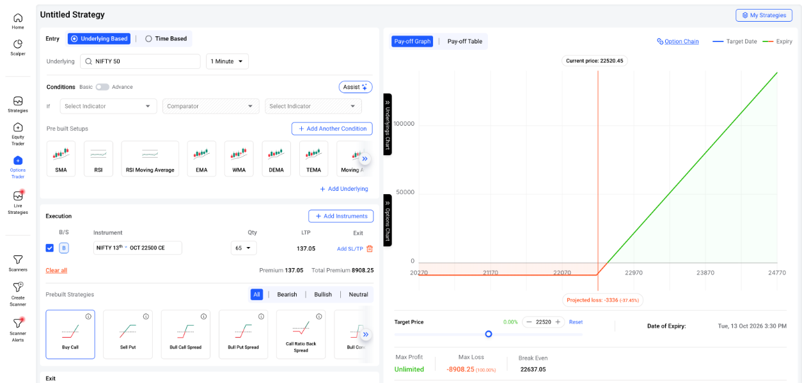

### 1.4 Defaults on a new draft (`isNew=true`)
- Name "Untitled Strategy"; Entry = **Underlying Based**; Underlying = **NIFTY 50**; timeframe **1 Minute**.
- One leg pre-populated: **B**(uy) `NIFTY 13th(w) OCT 22500 CE` (= nearest weekly expiry, ATM strike), Qty **65**
  (1 lot), LTP shown, Premium 137.05, Total Premium 8,908.25 (= LTP × qty).
- Prebuilt Strategies tab = **All**, "Buy Call" card highlighted (matches the default leg).
- Payoff pane already populated for the default leg (Max Profit Unlimited, Max Loss −8,908.25 (100.00%), Break Even 22,637.05).

---

### 1.5 Entry card

**Feature description:** decides *when* the option legs are entered — either when indicator conditions on an
underlying chart become true, or at a fixed clock time on chosen weekdays.

| Control | Type | Options / default | Notes |
|---|---|---|---|
| Entry mode | segmented radio | **Underlying Based** (default) · Time Based | Switching swaps the card body; legs/exit untouched. |
| Underlying | searchable combobox with logo + exchange tag | default NIFTY 50 | List = F&O universe: ~210 stocks (tag "BSE"/"NSE" — inconsistent tagging, most show BSE here) + indices NIFTY 50, NIFTY BANK, NIFTY FIN SERVICE, SENSEX, BANKEX (tag "INDICES"). No MIDCPNIFTY observed. Opening it clears the text to a placeholder "Search for an underlying". |
| Timeframe | dropdown | 1 Minute (default), 3, 5, 10, 15, 30 Minutes, 1 Hour, 1 Day | Same set as equity builder. |
| Conditions | Basic/Advance toggle + rows `If [Select Indicator] [Comparator] [Select Indicator]` | empty | Comparator & right operand are disabled (hatched) until the left indicator is chosen. Identical to equity builder (see inventory). |
| Assist ✦ | button → modal | — | Opens "Add Prebuild Suggestions" (see 1.5.1). |
| Pre built Setups | horizontal card carousel with » scroller | SMA, RSI, RSI Moving Average, EMA, WMA, DEMA, TEMA, Moving Average, … (all 71 indicators) | Same as equity. |
| + Add Another Condition | button | — | Adds a condition row. |
| + Add Underlying | link button | — | Adds a **second** underlying block (own Underlying, timeframe, Conditions, Assist, setups). Each block then shows a red **Remove** link. Max 2 — the link disappears once 2 exist. No visible AND/OR selector between the two blocks (tour text says "combine conditions for 2 different underlying scrips"). |

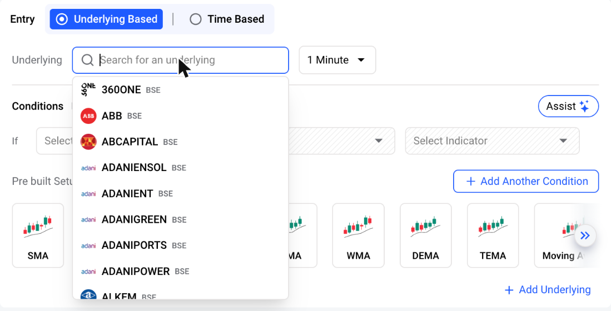
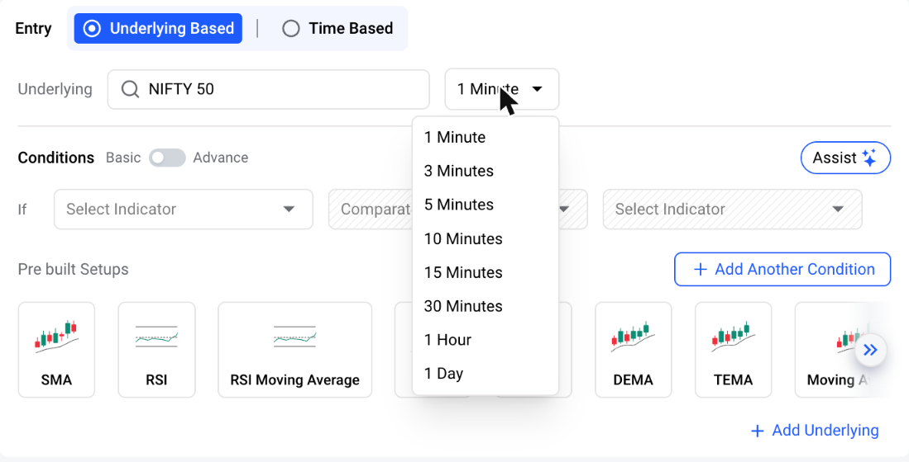
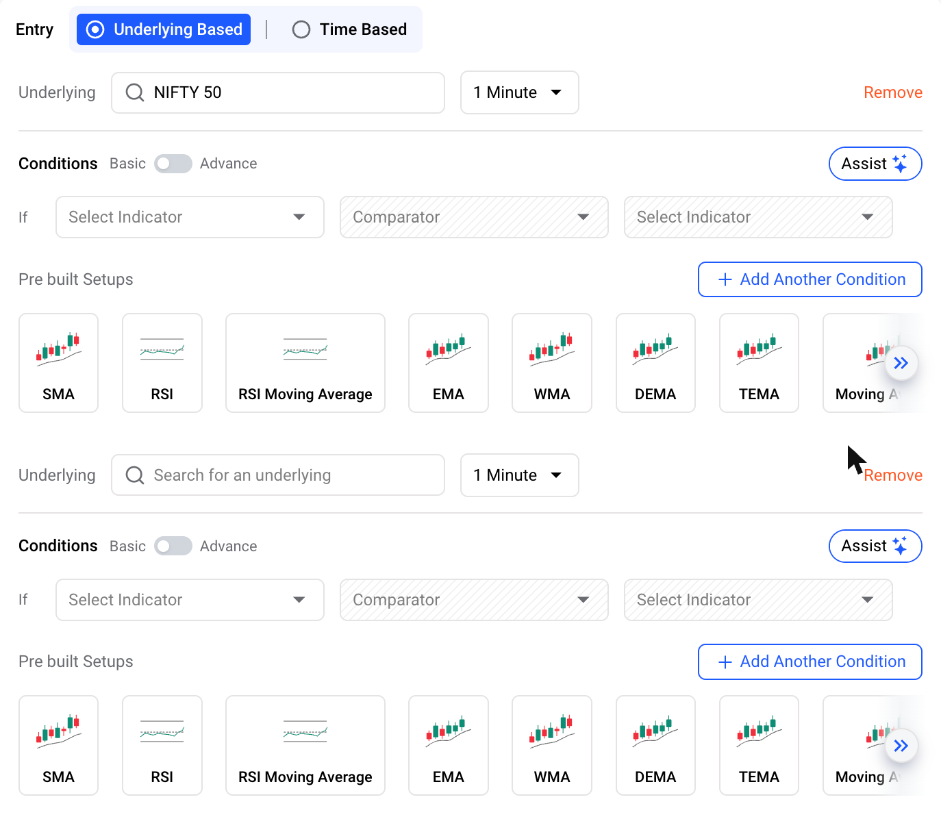

**Time Based mode** — *Feature description:* enter the legs at a fixed time on selected weekdays (classic 9:20 straddle style).

| Control | Type | Options / default |
|---|---|---|
| Time hour | dropdown | 01–12; default **9** |
| Time minute | dropdown | 00–59; default **15** |
| AM/PM | toggle pill | **AM** default; click toggles to PM. No validation that the time is within market hours (9:15 PM accepted). |
| Weekday chips | multi-toggle pills | Mon Tue Wed Thu Fri, **all selected** by default (blue outline); clicking a chip deselects it (grey). No Sat/Sun. |

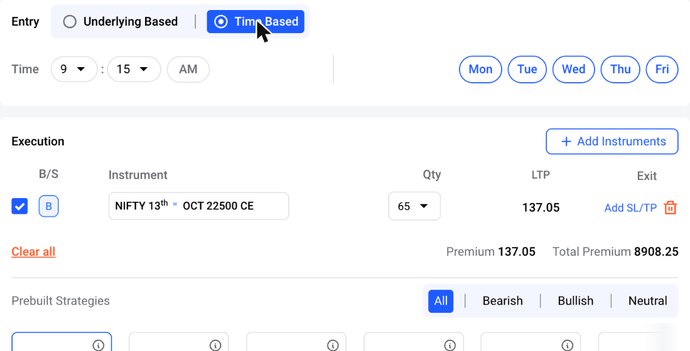

#### 1.5.1 Assist → "Add Prebuild Suggestions" modal
*Feature description:* a browsable library of ready-made indicator conditions that can be ticked and inserted.
- A–Z letter index row; search box "Search for conditions..."; **Bullish / Bearish** toggle buttons (Bullish selected).
- Left: "Indicators (71)" list with category chips **All · overlap studies · oscillators · volume indicators ·
  volatility indicators · price action · momentum indicators** (» scroller). Each item shows short name + long name.
- Right: "Prebuild Suggestions (N)" — checkbox list of full condition strings with a **Tag** pill
  (Scalping, Trend Following, Longterm, Intraday Momentum). E.g. SMA has 11: `SMA(close, 9, 0) crosses above SMA(close, 21, 0)` [Scalping] …
- Footer: **Done**. No × button; Escape does not close it; clicking the backdrop does.

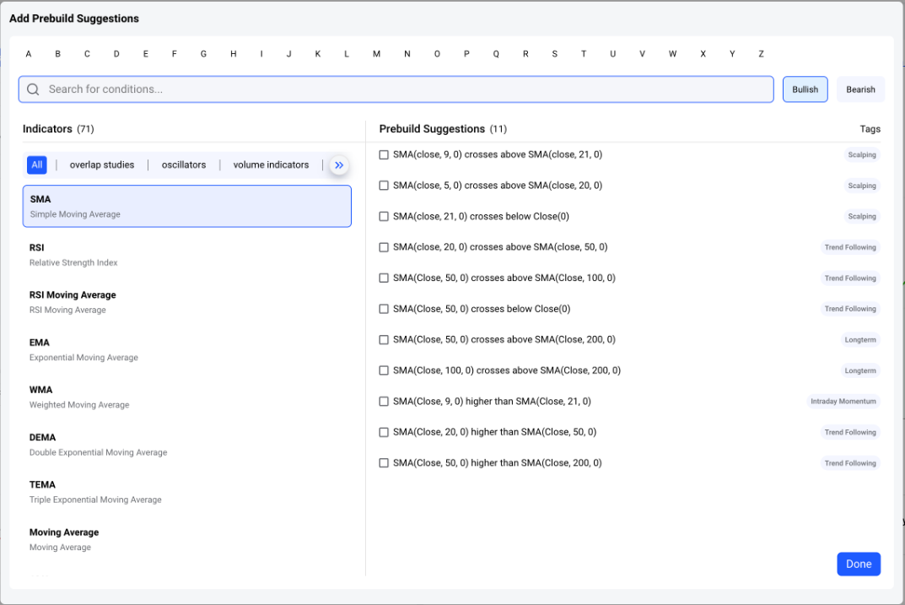

---

### 1.6 Execution card (legs)

*Feature description:* the list of option legs that will be traded when the entry fires; each leg is a buy/sell of a
specific (or dynamically chosen) call/put with a quantity and optional per-leg SL/TP/trailing SL.

Header: "Execution" + **+ Add Instruments** (opens the leg-picker drawer, 1.7).
Columns: (checkbox) · **B/S** · **Instrument** · **Qty** · **LTP** · **Exit** · (trash).

| Element | Behaviour |
|---|---|
| Checkbox | Include/exclude the leg from the **payoff calculation** (unchecking removed it from the graph and Max P/L; premium totals did not change). |
| B/S badge | Blue "B" = buy, red/orange "S" = sell. |
| Instrument | Pill showing contract, e.g. `NIFTY 13th ʷ OCT 22500 CE` (weekly marked with superscript day + "w"), monthly `BANKNIFTY OCT 55300 CE`. Dynamic legs show the rule, e.g. `NIFTY 13 OCT LTP@74.7 PE`. Clicking opens the drawer. |
| Qty | Dropdown of lot multiples: 1–20 lots (NIFTY: 65, 130 … 1300; BANKNIFTY lot = 30). |
| LTP | Live last price (some legs showed **0.0** — stale/missing data, rendered without warning). |
| Add SL/TP | Expands a sub-row: **SL**, **TP**, **TSL** numeric inputs (placeholder 0.00, suffix %) + unit radio **%Percentage** (default) · Points · PNL. Link becomes red **Remove SL/TP**. |
| Trash | Deletes the leg. |
| Clear all (red link) | Removes all legs. |
| Premium / Total Premium | Net premium per unit (sum of sells − buys? observed: straddle 211.75 = 137.05+74.70; condor 50.90 net) and × qty. |

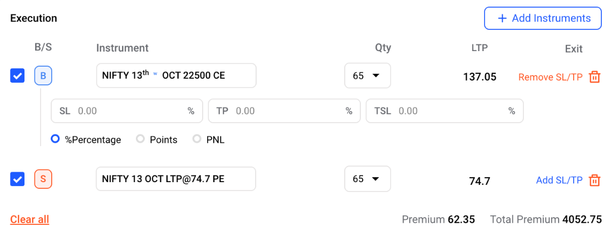
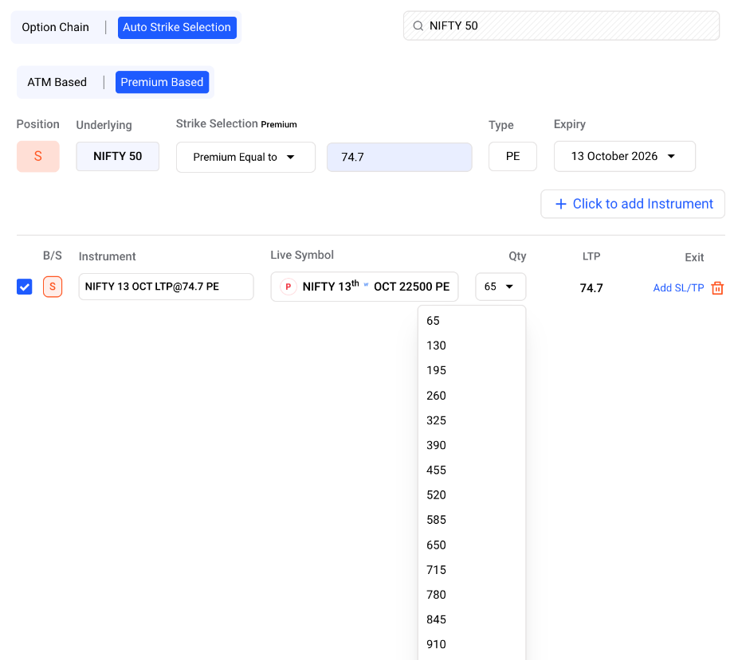

**Empty state:** after Clear all, payoff pane shows an illustration + "No Instruments available — Please add instruments
to the strategy" + **+ Add Instrument**; Max Profit / Max Loss / Break Even = N/A; Margin Needed 0.

### 1.7 Leg-picker drawer ("Add Instruments" / click a leg / "Option Chain" link)

*Feature description:* a left slide-over panel to pick option contracts either by clicking strikes in a live
option chain or by defining a rule (ATM offset / premium) that resolves the strike at entry time.

Top: segmented **Option Chain | Auto Strike Selection**; underlying search (shows current underlying; **locked/hatched
while legs exist**, becomes an editable search of F&O underlyings after Clear All). Footer: **Clear All** (outline red) · **Done**.

**Option Chain tab**
- Expiry dropdown — absolute dates. NIFTY 50: 13 Oct, 19 Oct, 27 Oct, 03 Nov, 09 Nov, 23 Nov, 29 Dec 2026 (weeklies + monthlies).
  NIFTY BANK: 27 Oct, 23 Nov, 29 Dec 2026 (monthly only). Default = nearest.
- Checkboxes **OI** (on) and **Greeks** (off).
- Columns (OI on): Call OI (Lakh) with %chg · Call LTP with %chg · **Strike** (ATM bold) · Put LTP · Put OI (Lakh). Thin
  horizontal OI bars under values; ITM side shaded light blue.
- Greeks on: adds Call Gamma, Call Vega, Call Theta, Call Delta, Call IV (and Put equivalents) — table scrolls horizontally.
- Hovering an LTP cell reveals **S** and **B** buttons (tooltips "Sell"/"Buy"); clicking adds a draft leg. Legs already
  in the strategy are shown with filled B/S badges on their strike.
- Strike step: NIFTY 50, BANKNIFTY 100.

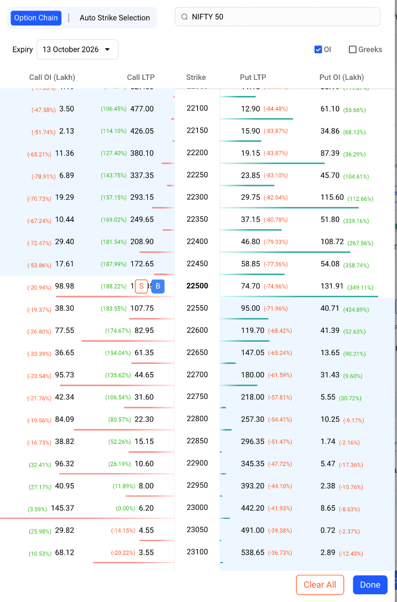
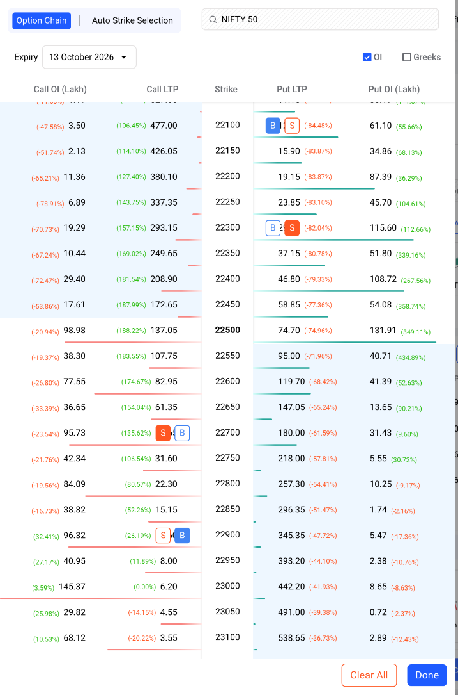
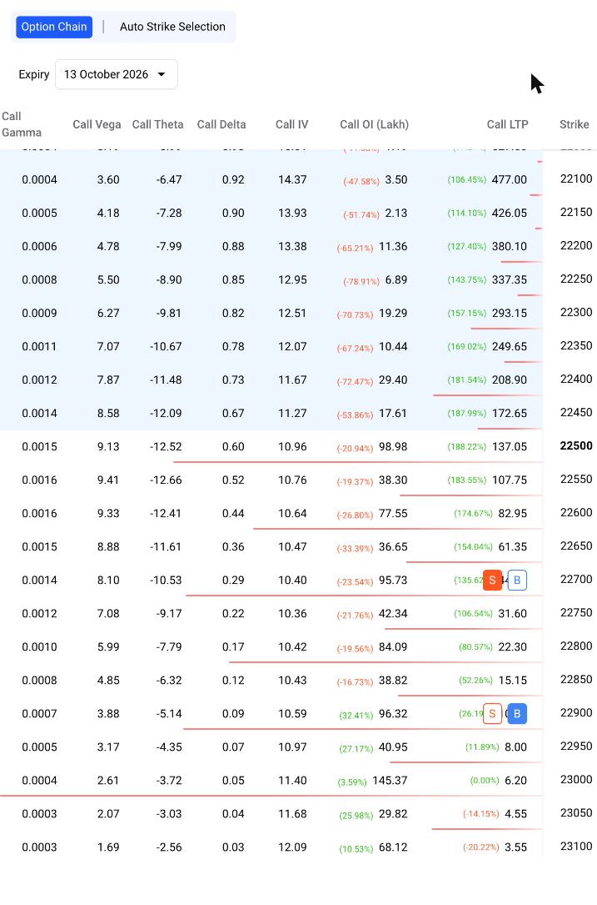
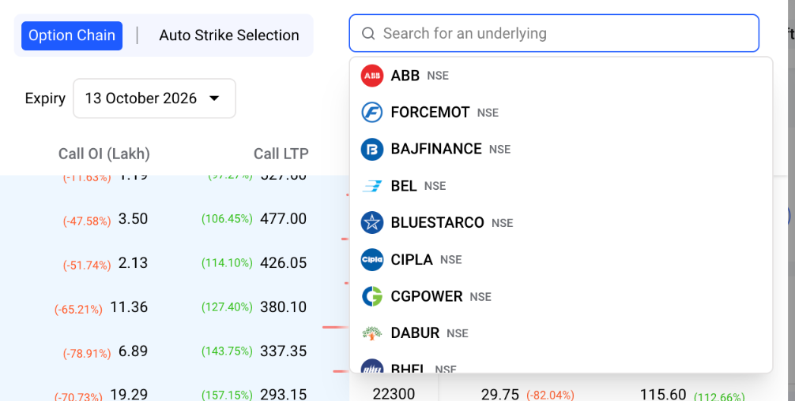
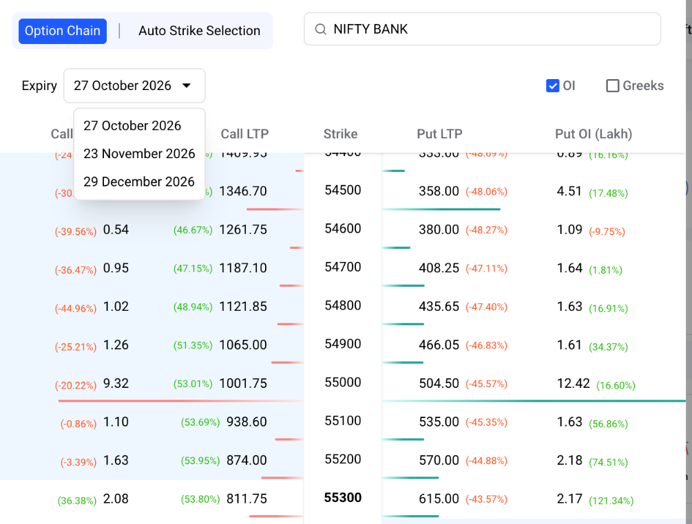

**Auto Strike Selection tab** (dynamic strikes)
- Sub-mode segmented: **ATM Based** (default) | **Premium Based**.
- Row: **Position** toggle (B ↔ S, tinted blue/red) · **Underlying** (read-only) · **Strike Selection** · **Type** toggle (CE ↔ PE) · **Expiry** dropdown (same absolute dates).
  - ATM Based: dropdown **ATM 10 … ATM 1, ATM, ATM -1 … ATM -10** (21 options; label has no ITM/OTM wording — sign convention must be inferred).
  - Premium Based: operator dropdown **Premium Equal to** (default) · Premium Above · Premium Below + numeric premium input (prefilled, e.g. 74.7).
- **+ Click to add Instrument** appends the rule as a leg; a table appears below: B/S · Instrument (rule, e.g. `NIFTY 13 OCT LTP@74.7 PE`) · **Live Symbol** (currently resolved contract, e.g. `NIFTY 13th OCT 22500 PE`) · Qty · LTP · Add SL/TP · trash.
- No delta-based strike selection, no relative expiry ("current week/next week") option was found — expiries are fixed dates.

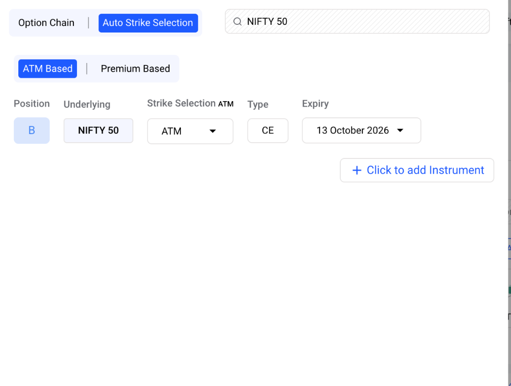
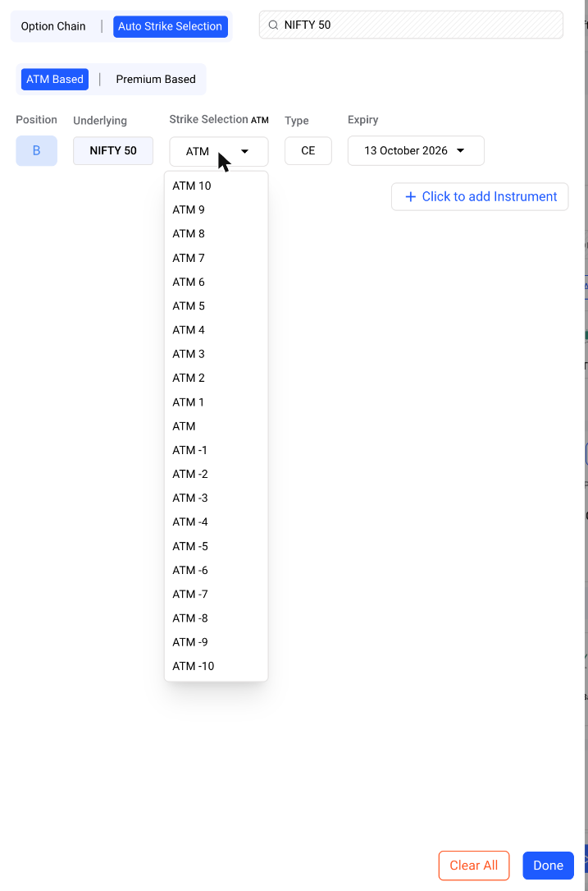
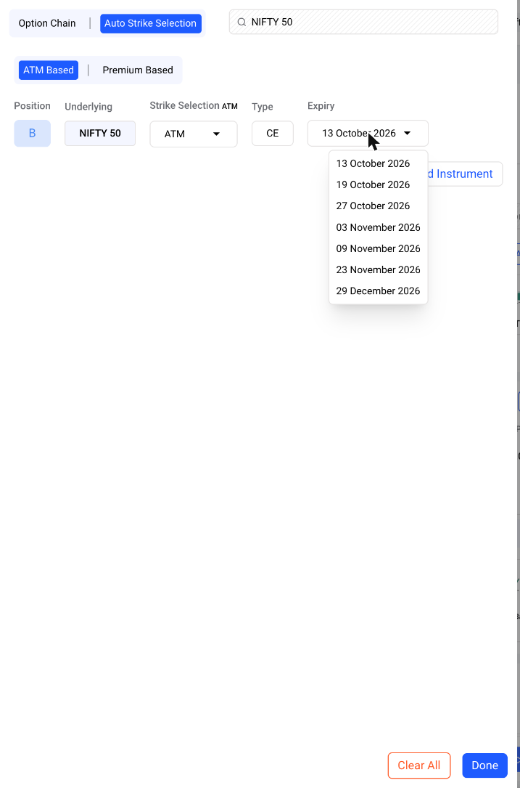
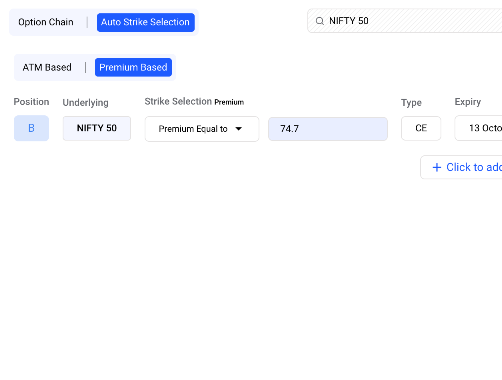
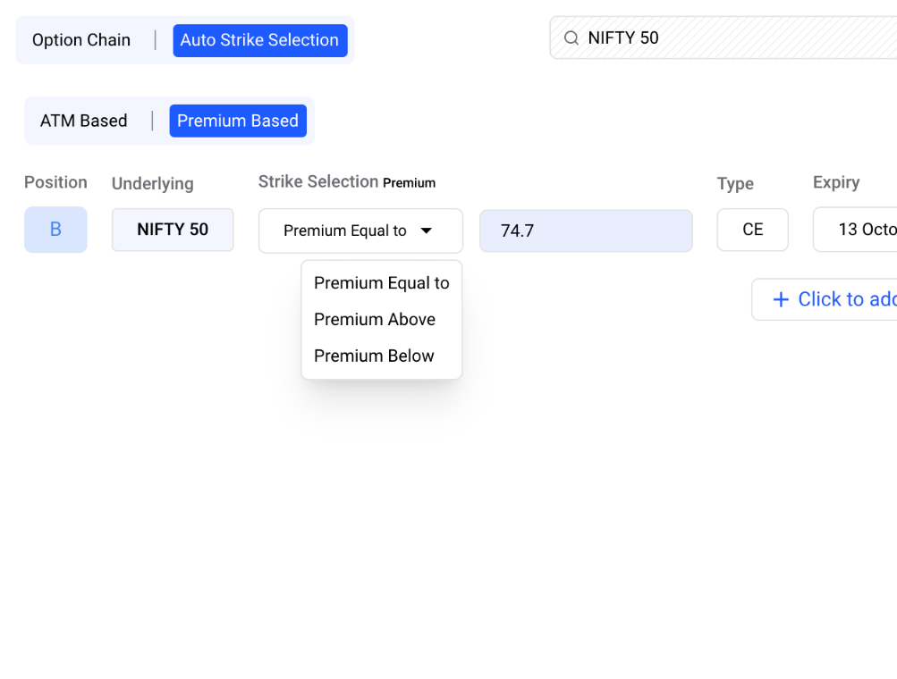
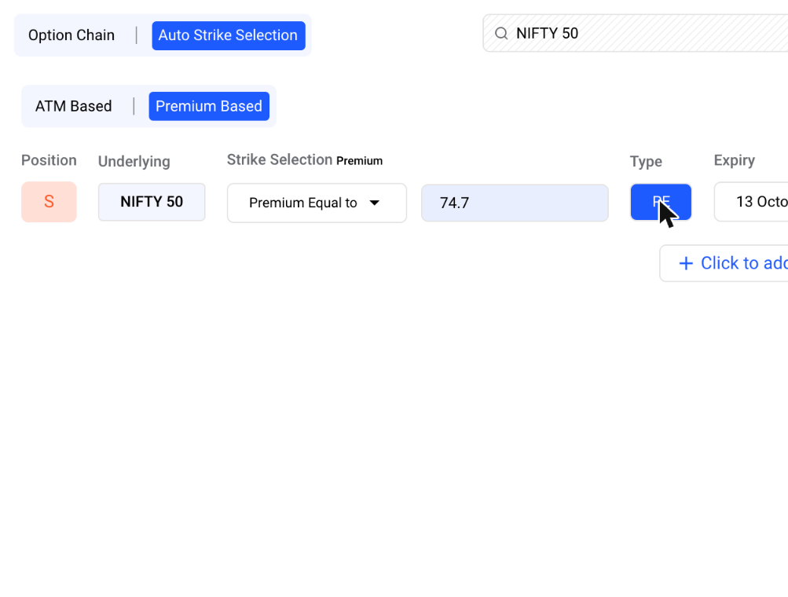
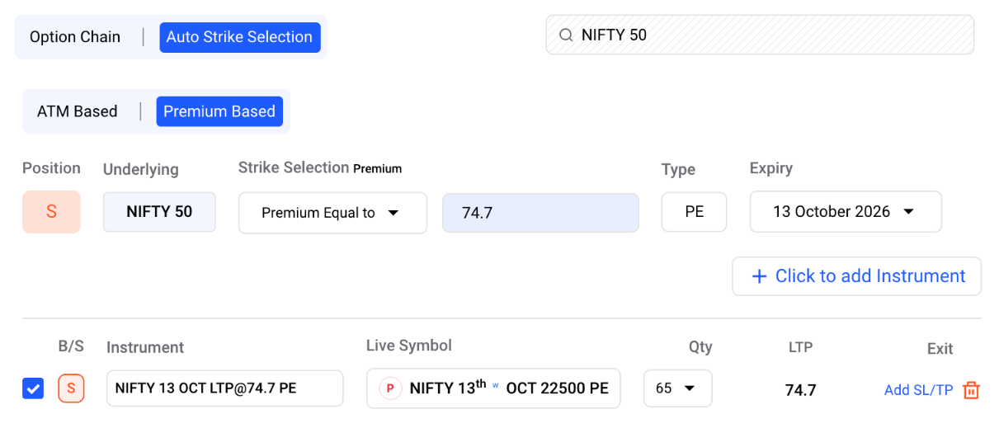

### 1.8 Prebuilt Strategies (templates) — inside Execution card

*Feature description:* one-click templates that replace the current legs with a classic multi-leg structure around ATM.

Filter tabs: **All · Bearish · Bullish · Neutral**. Cards (mini payoff icon + name + ⓘ tooltip), horizontal carousel with ».
- **Bullish (9):** Buy Call, Sell Put, Bull Call Spread, Bull Put Spread, Call Ratio Back Spread, Bull Condor, Bull Butterfly, Range Forward, Long Synthetic Futures.
- **Bearish (9):** Buy Put, Sell Call, Bear Call Spread, Bear Put Spread, Put Ratio Back Spread, Bear Condor, Bear Butterfly, Risk Reversal, Short Synthetic Future.
- **Neutral (8):** Short Straddle, Iron Butterfly, Short Strangle, Short Iron Condor, Batman, Double Plateau, Jade Lizard, Reverse Jade Lizard.
- **Only under All (8, volatile/ratio — no own tab):** Call Ratio Spread, Put Ratio Spread, Long Straddle, Long Iron Butterfly, Long Strangle, Long Iron Condor, Strap, Strip.
- ⓘ tooltip example: Short Straddle — "Sell both ATM call and put for a neutral short straddle."
- Clicking a card **replaces** all legs (no confirm) and highlights the card. Observed resolutions (NIFTY, spot 22520, ATM 22500):
  - Short Straddle → S 22500 PE, S 22500 CE.
  - Short Iron Condor → B 22100 PE, S 22300 PE, S 22700 CE, B 22900 CE (shorts ±200, wings ±400 from ATM), 1 lot each.

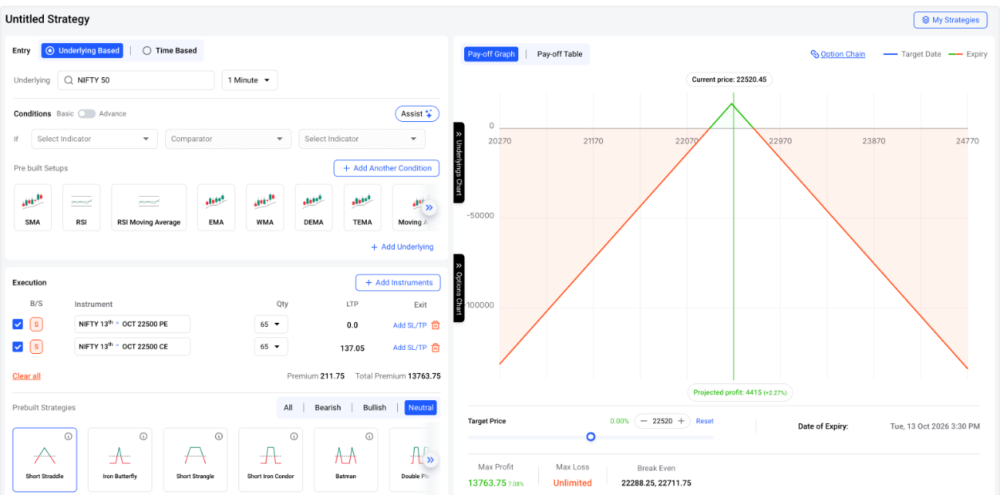
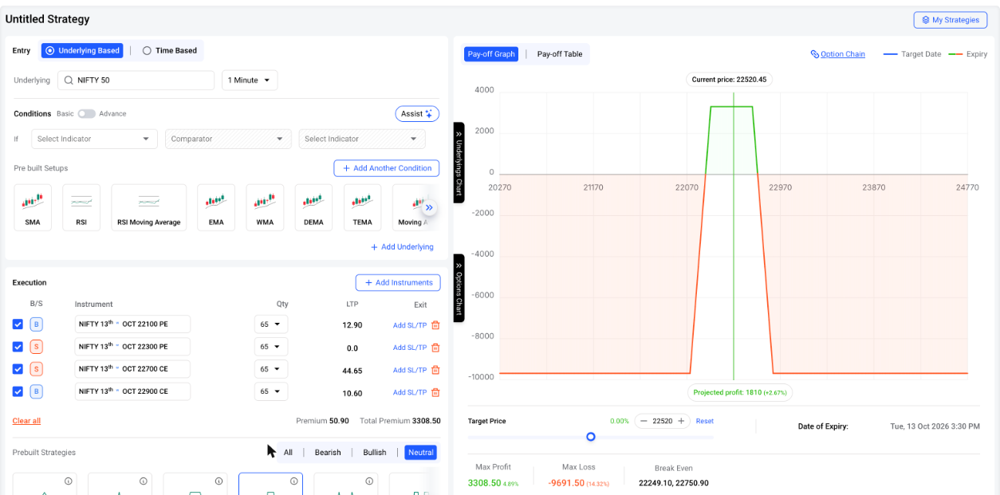

---

### 1.9 Exit card

*Feature description:* how open option positions are closed — by combined P&L stop/target across all legs, by
indicator conditions on an underlying, or at a fixed time; per-leg SL/TP/TSL live in the Execution rows.

| Control | Type | Default | Notes |
|---|---|---|---|
| Combined SL | number input, suffix "P&L" | empty (0.00) | Absolute rupee P&L for the whole position. `type=number`: non-numeric text rejected. |
| Combined TP | number input, suffix "P&L" | empty | Spinner arrows on focus. Does not draw a line on the payoff graph. |
| Add Exit Conditions (Optional) | toggle button | off | Adds an Underlying block (empty underlying "Search for an underlying", timeframe 1 Minute, Conditions, Assist, Pre built Setups). Button becomes filled red **Remove Exit Conditions**. |
| Add Time Based Exit (Optional) | toggle button | off | Adds Time row: hour 9 : min 15 · AM + Mon–Fri chips (same widget as time entry; default 9:15 AM is an odd exit default). Button becomes **Remove Time Based Exit**. |

No re-entry, wait-and-trade, move-SL-to-cost, or max-trades-per-day controls were found in the options builder.

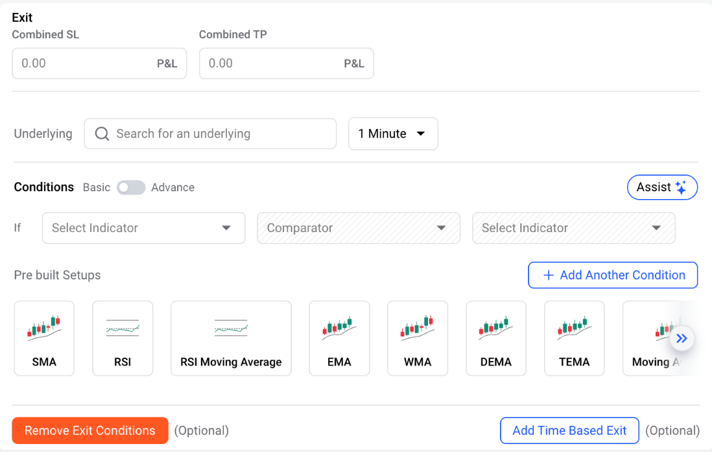
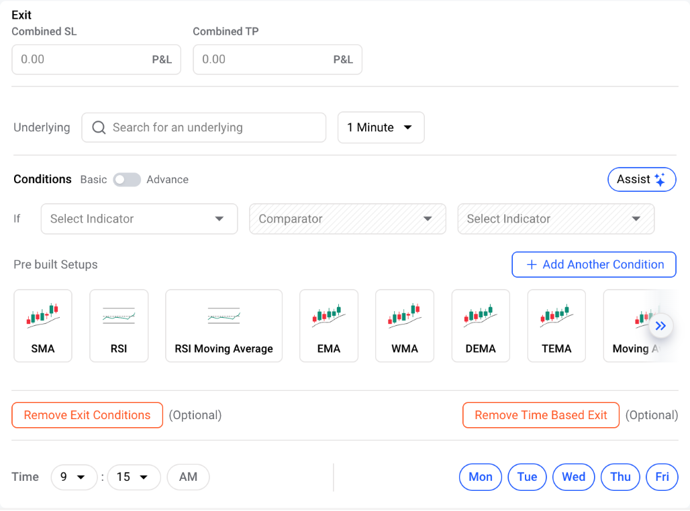

---

### 1.10 Payoff pane (right)

*Feature description:* live risk/reward analysis of the current legs — P&L vs underlying price at expiry, key stats and
margin requirement — updating instantly as legs change.

- **Pay-off Graph** (default): x = underlying price (≈ ±10% around spot, labels every ~900 pts), y = P&L ₹.
  Expiry line green above 0 / orange-red below 0 with matching area fill; vertical line at current/target price; pill
  "Current price: 22520.45" on top and "Projected profit/loss: X (Y%)" pill at bottom (P&L at the target price).
  Hover tooltip: "Price: 23030 · 13 Oct 2026 (EXP): −9691.50". Legend lists **Target Date** (blue) and **Expiry** lines —
  no separate blue target-date curve was visible on same-week expiry.
- **Pay-off Table**: columns Target · On Expiry, rows every 10 points of underlying, P&L coloured.
- **Target Price**: slider + −/value/+ stepper (step 10) with % change from spot (green) and **Reset** link. Moving it
  re-centres the graph and updates the projected P&L pill.
- **Date of Expiry**: read-only text, e.g. "Tue, 13 Oct 2026 3:30 PM" (no target-date picker found).
- Stats row: **Max Profit** (value + % ), **Max Loss** (value + %), **Break Even** (one or two comma-separated values);
  "Unlimited" shown for open-ended sides.
- **Fund and Margins**: *Margin Needed (computed, e.g. 67,691.92 for the condor; 183,002 for a naked short) · *Margin Available (account funds).
- **Option Chain** link (top-right) opens the leg-picker drawer on the Option Chain tab.

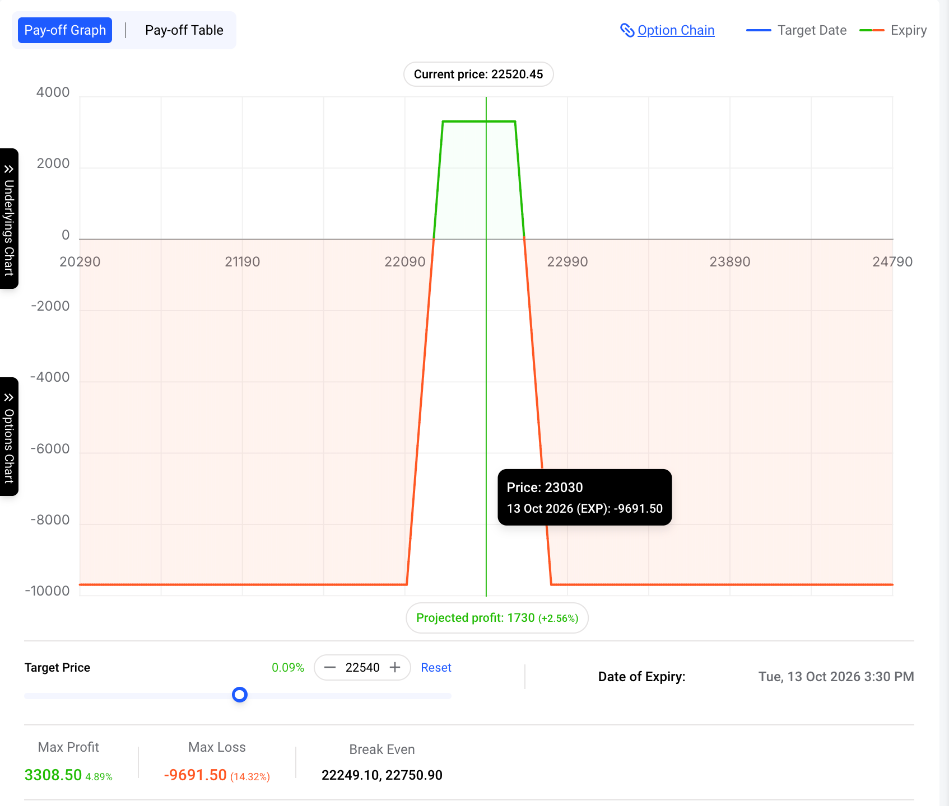
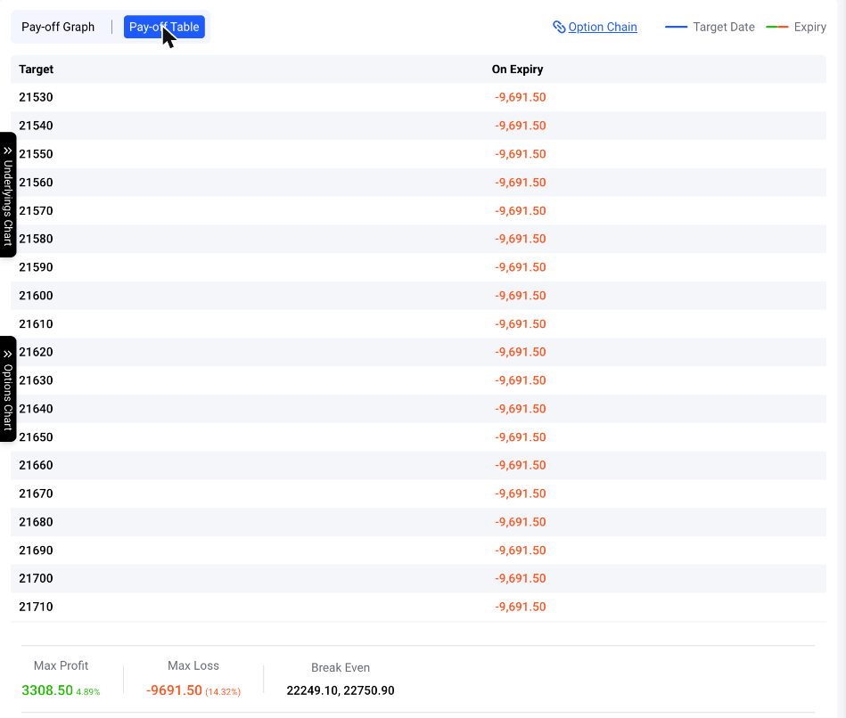

### 1.11 Chart drawers (vertical tabs on the divider)
- **» Underlyings Chart** — expands a TradingView-style chart of the underlying over the payoff pane: symbol header
  (NIFTY 50 · INDICES · LTP · %), refresh, timeframe (1 Minute), Save, delete, ƒx Indicators, BUY/SELL quick buttons
  with prices, OHLC readout, volume. Tab label flips to "« Close".
- **» Options Chart** — same chart widget with a **tab per leg** (e.g. NIFTY 13th OCT 22100 PE | 22300 PE | 22700 CE | …, » scroller), symbol tagged NFO-OPT.

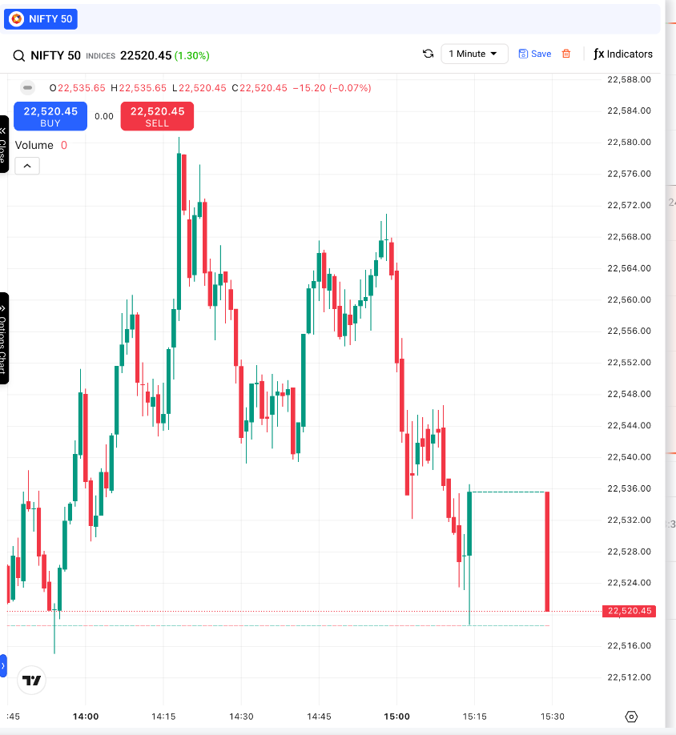
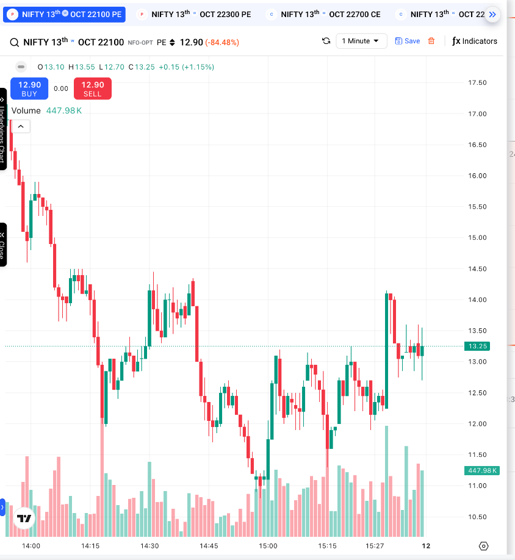
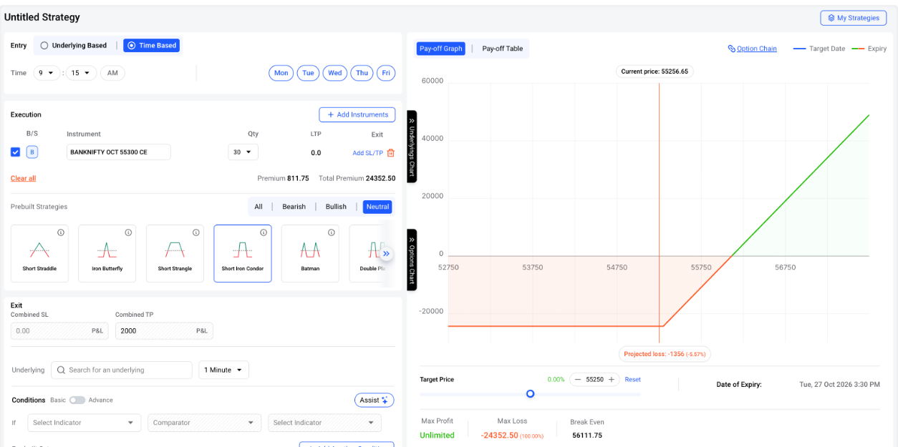

### 1.12 Footer & guards
- **Save** (outline) and **Notification Based Trading** (primary) — not clicked (read-only research).
- Leaving with unsaved edits triggers the browser "Leave site?" guard (see inventory).

### 1.13 UX observations
- Very dense single-page builder; the payoff pane gives immediate feedback — a strong pattern worth copying.
- Leg-picker drawer overlays the Entry/Execution cards and its **Done** button sits exactly over the page's
  "Notification Based Trading" button — easy mis-click hazard.
- Inconsistent exchange tags (BSE vs NSE) for the same stocks in different pickers.
- LTP 0.0 shown silently for some contracts.
- Assist modal cannot be closed with Escape / has no ×.
- ATM ±N labels lack ITM/OTM hints.

### 1.14 Open questions
- How are the two underlying blocks combined (AND/OR)? Any per-block "and/or" toggle hidden in Advance mode?
- ATM offset sign convention: is "ATM 1" one strike above spot for both CE and PE, or one strike OTM?
- Is the Combined SL/TP value an absolute ₹ amount or per-lot? Can it be negative/percentage?
- Validation messages on Save (e.g. missing conditions, legs with different expiries/underlyings) — not observable without clicking Save.
- Does the entry fire once per day or repeatedly (re-entry semantics)? Max trades per day?
- Does Time-based exit default really stay 9:15 AM, or is it validated against entry time?
- Are dynamic (Auto Strike) legs re-resolved at each entry or fixed at deploy time?

---

## 2. Discover Strategies — options coverage — `/discover-strategies`

*Feature description:* catalogue of prebuilt educational strategies with a summary backtest; the page subtitle says
"Explore pre-built equity and options strategies…", but **no options strategies are currently listed**.

Findings (2026-10-11):
- Category tabs on Discover: **All · Equity Swing · Equity Intraday** only — no Options tab.
- The All list is infinite-scroll; scrolled to the end: **45 strategies, all equity** (icons: wave = swing, sun/clock = intraday;
  badge "Basic"; timeframe chip min / 5min / 15min / hour / day).
- Search is live (filters as you type, auto-selects first match). "straddle", "option", "nifty" → empty state
  (illustration + "No strategies found" + **Create Strategy** button; right pane blank).
- Therefore **no options prebuilt, no options `/backtest/<slug>` page and no read-only options strategy view exist** to
  document; options-specific backtest metrics (per-leg P&L, margin, expiry breakdown) could not be observed.
- Note the Options builder itself has **no Backtest button** (only Save + Notification Based Trading), and My
  Strategies shows "Run Backtest" only for saved strategies — options backtesting may be absent or only post-save.

### 2.1 Left-list filter (funnel icon next to search)
*Feature description:* narrows the strategy list by market bias or technical style.
- Popover titled **Filters**, two-pane: left categories, right checkboxes.
  - **Trend:** Bullish, Bearish.
  - **Technicals:** Momentum, Trend Following, Reversal, Breakout, Breakdown, Trend Confirmation, Uptrend, Downtrend,
    Momentum Shift, Crossover, Price Action (scrollable list).
- Footer: **Apply** (disabled/pale until something is ticked) and **Clear** (appears once a box is ticked).
- Multi-select; applying filters the list in place. No badge/count on the funnel icon shows that a filter is active
  (UX gap). Same filter popover appears on My Strategies.

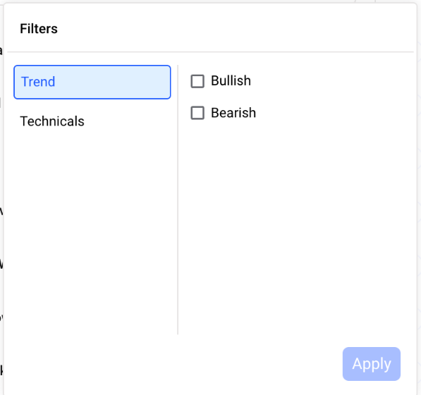
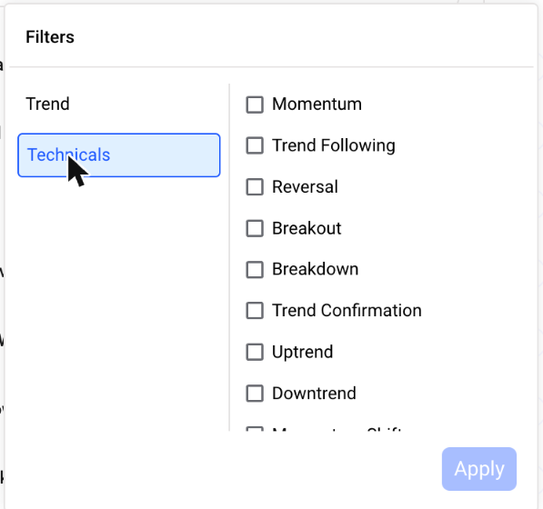
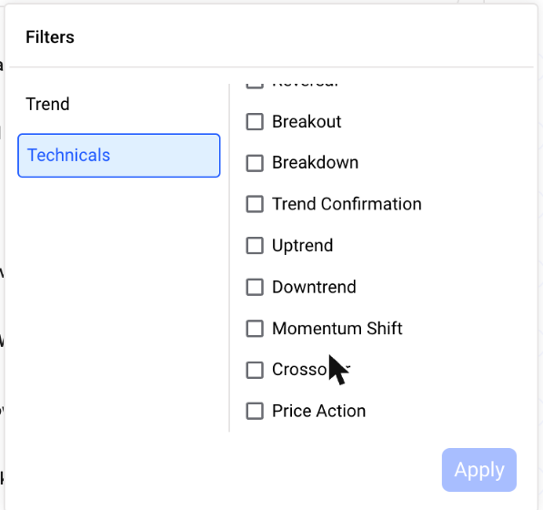

## 3. My Strategies — options tabs — `/my-strategies`
*Feature description:* the user's own strategies, segmented by type; options strategies are split by intent.
- Tabs: **All · Equity Swing · Equity Intraday · Option Buying · Option Selling** (so a saved options strategy is
  classified as buying or selling — presumably by net premium / leg sides; rule unknown).
- Option Buying / Option Selling were empty for this account: "No strategies found" + Create Strategy.
- Row actions on a saved strategy: star (favourite), ⋮ menu; detail pane: Copy, Edit Strategy, Run Backtest,
  Notification Based Trading; "No backtest results available." empty state.

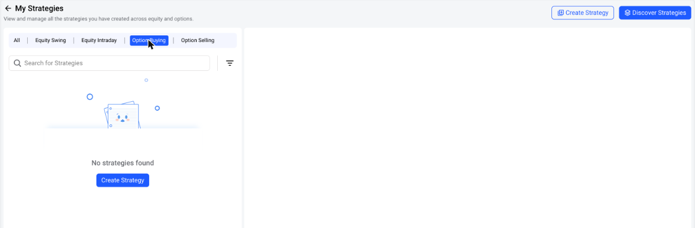

## 4. Other options touch-points noticed (not deeply explored)
- Dashboard **Live Scanners** universe dropdown includes options universes: Nifty Weekly Options, Sensex Weekly Options,
  Nifty Next Week Options, Sensex Next Week Options, Nifty Monthly Options, … (plus Nifty 50/100/200/500, Bank Nifty,
  Sensex, Bankex, Indices, Futures, NFO Equities). Rows show option contracts tagged NFO-OPT.
- Dashboard chart can display an option contract (symbol `NIFTY 13th w OCT 22150 CE NFO-OPT`).
- Symbol naming convention: weekly `NIFTY 13thʷ OCT 22500 CE`; monthly `BANKNIFTY OCT 55300 CE`; dynamic rule `NIFTY 13 OCT LTP@74.7 PE`.

## 5. Gaps / not verified
- Save-time validation messages (Save not clicked by rule).
- Deploy flow ("Notification Based Trading") dialogs for options.
- Options backtest results page — no options strategy available to open.
- Delta-based or relative-expiry strike selection — not present in UI.
- Re-entry / wait-and-trade / per-day trade caps — not present in UI.
- Behaviour of SL/TP unit "PNL" vs "Points" for sell legs.
