# Area 03 — Scanners (Streak)

Clean-room UI/UX research for the local desktop rebuild. Observed in the logged-in web app on
2026-10-11 (market closed; "Last Scan" timestamps show Fri 09 Oct 2026, 4:29 pm). Read-only: nothing was
saved, copied, alerted, deployed or ordered. Screenshots live in `../screenshots/03-scanners/`.

Screens covered:
1. Discover Live Scanners `/discover-scanners`
2. Scanner view / editor for a prebuilt scanner `/scanner/<slug>` (e.g. `/scanner/scanner-top-gainers-6040`)
3. Create Scanner `/scanner` (blank draft)
4. Scanner Alerts `/live-alerts`
5. My Scanners
6. Dashboard "Live Scanners" widget `/dashboard`
7. Row-level chart page `/chartiq?seg_sym=<SEG>_<SYM>&timeframe=<tf>`

---

## 1. Discover Live Scanners — `/discover-scanners`

**Feature description:** A library of ready-made ("pre-built") scanners that run continuously on Streak's
servers. The user picks a universe (e.g. Nifty 50 or Nifty weekly options) and a scanner, and immediately sees
which instruments currently match, with one-click Buy/Sell/Chart per row, plus routes to copy the scanner or
set alerts on it.

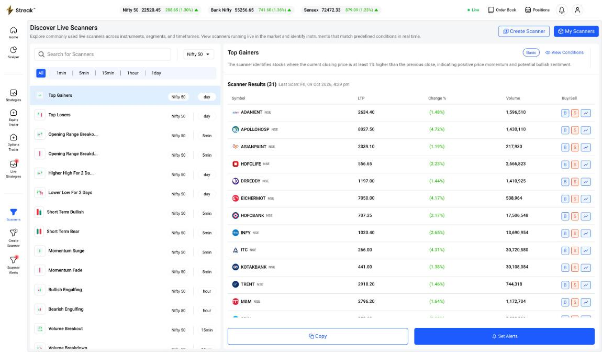

### Layout (regions)
- **Page header:** title "Discover Live Scanners"; subtitle (explains: commonly used live scanners across
  instruments, segments and timeframes, running live in the market). Right: `Create Scanner` (outlined button →
  `/scanner`), `My Scanners` (filled primary button).
- **Left column (~35% width), card:**
  - Search box with magnifier, placeholder "Search for Scanners".
  - Universe dropdown (default **Nifty 50**). The selection **persists across reloads** (after picking Nifty
    Weekly Options and reloading, the page reopened on Nifty Weekly Options).
  - Timeframe segmented filter: `All` | `1min` | `5min` | `15min` | `1hour` | `1day` (All default, selected chip
    filled blue).
  - Scanner list (scrollable, infinite-scroll pagination: first page = 20 rows, scrolling loads the rest, 37 total).
    Row = small pattern-icon thumbnail, scanner name (truncated with "…" at ~22 chars), universe pill
    (e.g. "Nifty 50" / "Nifty Current Week"), timeframe pill (`day`, `5min`, `15min`, `hour`). Selected row has a
    light-blue background; first row (Top Gainers) is auto-selected on load.
- **Right column (~65%), detail pane:**
  - Header: scanner name (same truncation as list — a UX flaw), complexity badge (`Basic` blue outline /
    `Advance` green outline), `👁 View Conditions` link (opens the scanner in the editor page, see §2).
  - Description paragraph (plain English).
  - (Options universes only) **Filter By:** checkboxes `CALL` ✓, `PUT` ✓, `VOLUME>0` ✓; **Strike Selection**
    dropdown (default `-6 ATM +6`). See below.
  - "Scanner Results (N)" + "Last Scan: Fri, 09 Oct 2026, 4:29 pm".
  - Results table: columns **Symbol** (logo, symbol, exchange tag e.g. `NSE`, `NFO-OPT`) · **LTP** ·
    **Change %** (in parentheses, green positive / red negative) · **Volume** (thousands separators) ·
    **Buy/Sell** (three small square buttons: `B` blue outline, `S` red/orange outline, chart-line icon with
    tooltip "Chart").
  - Sticky footer: `Copy` (outlined, full half-width) and `🔔 Set Alerts` (filled primary). Not clicked.

### Onboarding tour (3 steps, first visit)
1. "Pre-built scanners" — anchored to the left list ("Access a collection of commonly used scanners across
   instruments, segments, and timeframes.") · Next.
2. "Scan Results" — anchored to results ("View live scan results as conditions trigger…") · Back / Next.
3. "Take Scanner Live" — anchored to Set Alerts ("Activate scanners to run continuously and receive real-time
   alerts.") · Back / Done. Each step has ×. Counter "N of 3".

### Universe dropdown ("Scan on" basket)
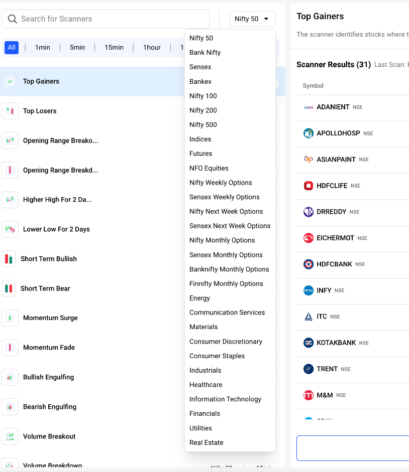

29 options, in this order:
Nifty 50 · Bank Nifty · Sensex · Bankex · Nifty 100 · Nifty 200 · Nifty 500 · Indices · Futures · NFO Equities ·
Nifty Weekly Options · Sensex Weekly Options · Nifty Next Week Options · Sensex Next Week Options ·
Nifty Monthly Options · Sensex Monthly Options · Banknifty Monthly Options · Finnifty Monthly Options ·
Energy · Communication Services · Materials · Consumer Discretionary · Consumer Staples · Industrials ·
Healthcare · Information Technology · Financials · Utilities · Real Estate.

Groups (implicit, no headers): index baskets; Indices; Futures; NFO Equities (F&O stocks); option-chain baskets
(weekly / next-week / monthly per underlying); GICS-style sectors.

Changing the universe re-labels every list row's universe pill (e.g. Nifty Weekly Options → "Nifty Current Week")
and reloads results for the selected scanner. The same 37 scanners are offered for every universe.

### Options-universe extras
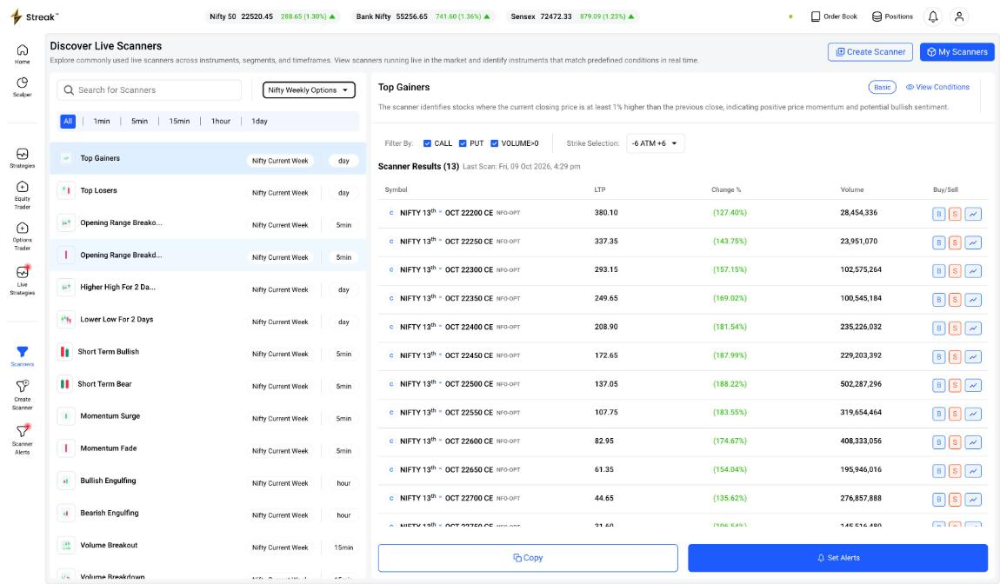

- Filter By checkboxes: `CALL`, `PUT`, `VOLUME>0` (all checked by default). Result rows show a `C`/`P` circular
  badge before the contract name, e.g. "NIFTY 13ᵗʰ ʷ OCT 22200 CE  NFO-OPT" (superscript day ordinal + `w` for
  weekly expiry).
- Strike Selection dropdown: `-1 ATM +1` … `-30 ATM +30` (30 options) and `Show All`; default `-6 ATM +6`
  (i.e. ATM ± N strikes).

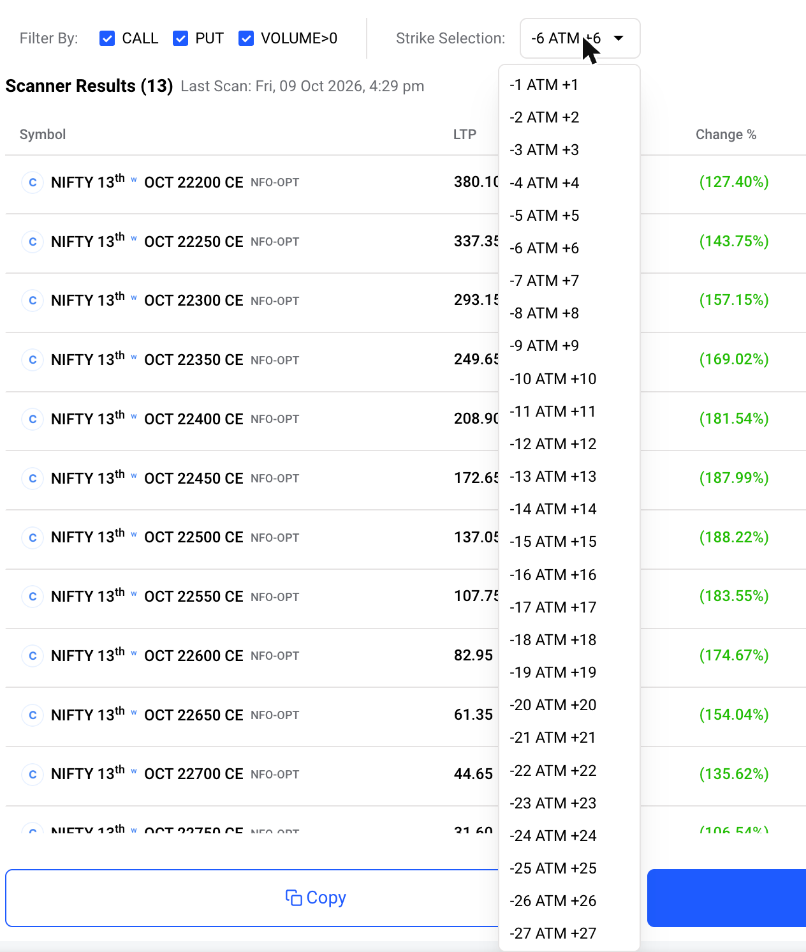

### Timeframe filter & search
- Filters the left list by scanner timeframe. `1min` produced the empty state: illustration + "No scanners
  found" + `Create Scanner` button. The right pane keeps showing the previously selected scanner (not cleared).
- Observation: with `5min` only 8 scanners were listed, though the full list contains 10 × 5min scanners
  (Volume Breakout 5min and Supertrend Bullish 5min, which live on the 2nd page, were missing) → the filter
  appears to apply only to already-loaded rows / first page. Bug worth not copying.
- Search "rsi" → RSI Entering Bullish…, RSI Overbought, RSI Oversold, Falling RSI (case-insensitive substring on
  name, live as-you-type).

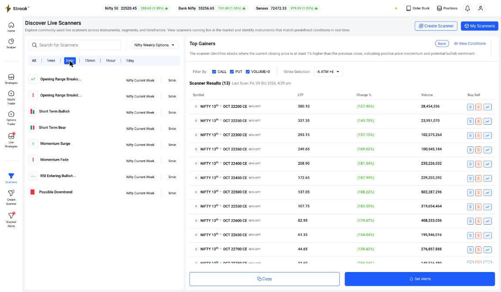
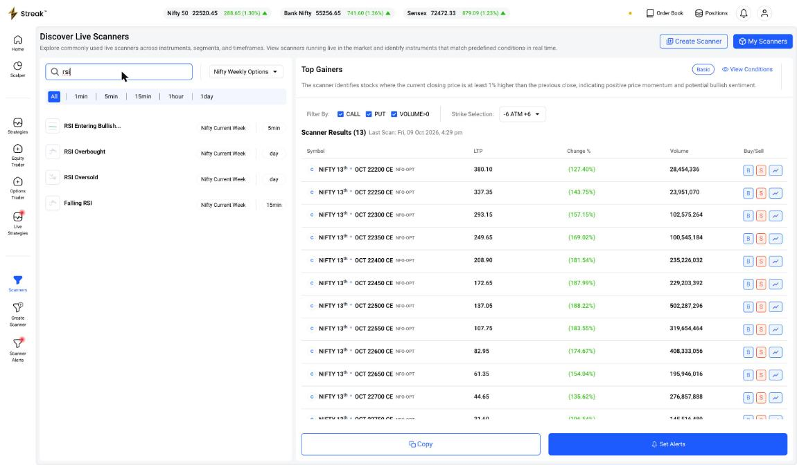

### Results empty state
"No Results Found — Run on a different basket (Scan on) to view if any symbols match the criteria." with
illustration; table header still shown; count "(0)".

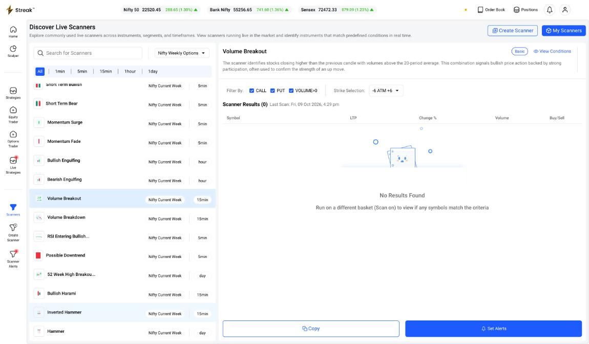

### Catalogue of prebuilt scanners (37)
Names shown truncated in the UI are given in full where known; `…` marks text that could not be seen in full.
Badge = complexity. Descriptions paraphrased.

| # | Name | TF | Badge | What it detects |
|---|------|----|-------|-----------------|
| 1 | Top Gainers | day | Basic | Close ≥ 1% above previous close. Condition: `Close(0) up by 1% from Close(-1)` |
| 2 | Top Losers | day | Basic | Close ≥ 1% below previous close |
| 3 | Opening Range Breako(ut) | 5min | Basic | Close crosses above 30-min opening-range high |
| 4 | Opening Range Breakd(own) | 5min | Basic | Close falls below 30-min opening-range low |
| 5 | Higher High For 2 Da(ys) | day | Basic | Higher highs and higher lows two days running |
| 6 | Lower Low For 2 Days | day | Basic | Lower highs and lower lows two days running |
| 7 | Short Term Bullish | 5min | Basic | Close > SMA21 > SMA50 > SMA100 on 5-min |
| 8 | Short Term Bear | 5min | Basic | Close < SMA21 < SMA50 < SMA100 on 5-min |
| 9 | Momentum Surge | 5min | Basic | 5-min candle close ≥ 0.5% above its open |
| 10 | Momentum Fade | 5min | Basic | 5-min candle close ≥ 0.5% below its open |
| 11 | Bullish Engulfing | hour | Basic | Bullish engulfing two-candle pattern |
| 12 | Bearish Engulfing | hour | Basic | Bearish engulfing two-candle pattern |
| 13 | Volume Breakout | 15min | Basic | Close > previous candle and volume > 20-period average |
| 14 | Volume Breakdown | 15min | Basic | Close < previous candle low and volume > 20-period average |
| 15 | RSI Entering Bullish… | 5min | Basic | RSI(14) oversold-recovery signal |
| 16 | Possible Downtrend | 5min | Basic | SMA21 ≤ SMA50 and RSI14 < 50 on 5-min (description mentions Nifty options) |
| 17 | 52 Week High Breakou(t) | day | Advance | Close crosses above highest high of past 252 sessions |
| 18 | Bullish Harami | 15min | Advance | Bullish harami pattern |
| 19 | Inverted Hammer | 15min | Advance | Inverted hammer candle |
| 20 | Hammer | day | Advance | Hammer candle |
| 21 | Doji | 15min | Advance | Doji candle |
| 22 | Price Near 200 SMA - … (bearish) | day | Advance | Crossed below SMA200 while in downtrend |
| 23 | RSI Overbought | day | Advance | RSI above threshold |
| 24 | RSI Oversold | day | Advance | RSI below threshold |
| 25 | Open=High | day | Basic | Open equals high |
| 26 | Open=Low | day | Advance | Open equals low |
| 27 | Bearish Marubozu | day | Advance | Bearish marubozu candle |
| 28 | Bullish Marubozu | day | Advance | Bullish marubozu candle |
| 29 | Range Breakouts | 15min | Advance | Break of a consolidation range |
| 30 | Volume Breakout | 5min | Advance | Strong breakout with high volume (distinct from #13) |
| 31 | Price Near 200 SMA - … (bullish) | day | Advance | Crossed above SMA200 while in uptrend |
| 32 | 52 Week Low Breakdow(n) | day | Advance | Close crosses below lowest low of past 252 sessions |
| 33 | Supertrend Bearish C(rossover) | 15min | Advance | Price crosses below Supertrend |
| 34 | Supertrend Bullish C(rossover) | 5min | Advance | Price crosses above Supertrend |
| 35 | Falling RSI | 15min | Advance | RSI(14) falling for last 5 candles |
| 36 | Range Breakout On 1 … | hour | Advance | Same description as #29 |
| 37 | Narrow CPR | 15min | Advance | Narrow Central Pivot Range (consolidation) |

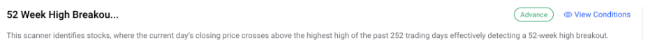

### UX observations
- Two-pane master/detail; results are a server-side snapshot ("Last Scan" timestamp), not recomputed in the browser.
- Truncated names in both list and detail header; duplicate names (two "Volume Breakout", two "Price Near 200 SMA -…").
- No sorting controls on the results table here (headers are not clickable-looking); no search inside results on this page.
- Universe choice is global to the page and sticky.

### Open questions
- Exact refresh cadence of "Last Scan" during market hours (likely per candle close of the scanner timeframe).
- Are some prebuilt scanners paid-plan only? No lock icons were seen.

---

## 2. Prebuilt scanner view — `/scanner/<slug>` (via "View Conditions")

**Feature description:** Opens a prebuilt scanner inside the scanner editor so the user can see exactly which
conditions it uses, re-run it on another universe, and then copy it into their own scanners or set alerts on it.

URL examples: `/scanner/scanner-top-gainers-6040`, `/scanner/scanner-narrow-cpr-sap`.

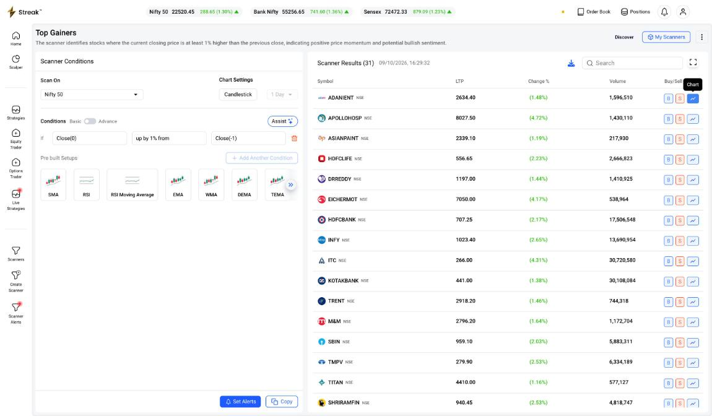

### Layout
- **Header:** scanner name + one-line description; right side: `Discover` text link (back to
  `/discover-scanners`), `My Scanners` outlined button, `⋮` overflow menu (only item: `Copy`).
- **Left card "Scanner Conditions"** (~40%): Scan On dropdown (universe), Chart Settings (`Candlestick` chip,
  timeframe dropdown — disabled/greyed for prebuilt, e.g. "1 Day", "15 Minutes"), Conditions with Basic/Advance
  switch, condition rows, Pre built Setups carousel, `+ Add Another Condition`. Footer: `🔔 Set Alerts` (primary)
  and `Copy` (outlined). (No Save / Run Scan here; the 2-step tour mentions clicking "Run Scan".)
- **Right card "Scanner Results (N)"** + timestamp in `DD/MM/YYYY, HH:mm:ss` (e.g. 09/10/2026, 16:29:32) —
  note a different date format than the Discover page ("Fri, 09 Oct 2026, 4:29 pm"). Toolbar: download icon
  (exports results — not clicked, file download), `Search` box, fullscreen/expand icon. Same table columns.
- Options universes show the same `Filter By` + `Strike Selection` row as on Discover.

### Tour (2 steps)
1. "Scan universe and conditions" — select instruments and define conditions using indicators, price action
   and custom logic; click "Run Scan" to view results. 2. "Scan Results" — instruments that qualify instantly.

### Conditions shown
- Basic prebuilt: `If Close(0) | up by 1% from | Close(-1)` — the comparator cell renders the parameter inline.
  Clicking it opens a small **"Up By" dialog**: `value` (number, 1) and `type` (dropdown, `%`, disabled here),
  `Cancel` / `Save` (Save disabled until changed).
  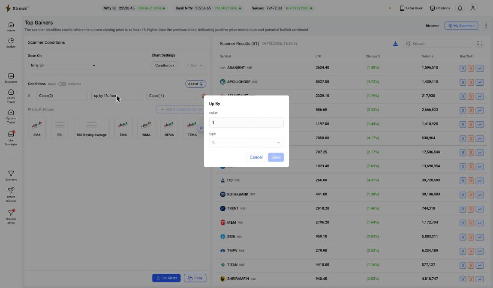
- Advance prebuilt (Narrow CPR): rendered as read-only dashed "expression boxes":
  `[15min] Abs( Central pivot range(tc) - Central pivot range(bc) )  lower than  Central pivot range(pp) * 0.001`.
  Blue = indicator/function names, grey = parameters, orange = comparator, black = operators. Per-row timeframe
  chip (greyed). An ⓘ next to "Advance" shows tooltip "Learn about Advance Create — Click here" (help link).
  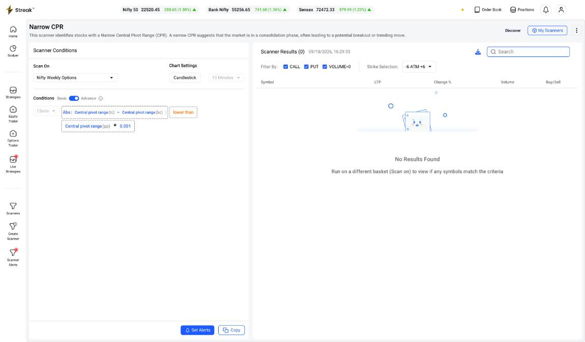
- Toggling Basic→Advance shows a confirm modal **"Switch Mode — Switching to advance mode will reset your
  current conditions. Are you sure?"** `Cancel` / `Confirm` (Cancelled).
  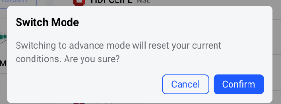

### Results row actions
- `B` / `S`: open buy/sell order flow (not clicked — order placement).
- Chart icon (tooltip "Chart"): opens a **new browser tab** `/chartiq?seg_sym=NSE_ADANIENT&timeframe=day` —
  full-screen TradingView-style chart: symbol search, LTP + %; timeframe dropdown (1 Day), Save, delete,
  ƒx Indicators, OHLC readout, BUY/SELL price buttons, Volume pane.
  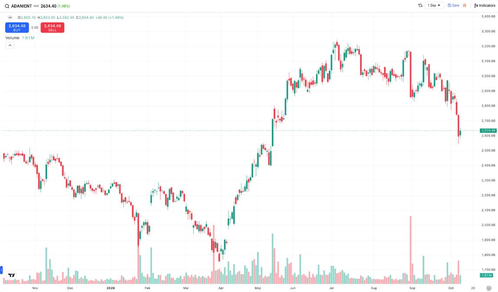

---

## 3. Create Scanner — `/scanner`

**Feature description:** A no-code builder where the user picks a universe and candle timeframe, composes
entry-style conditions from 70+ indicators (Basic rows or an Advanced expression/logic editor), and clicks
**Run Scan** to see which instruments match right now. The scanner can then be saved and turned into alerts.

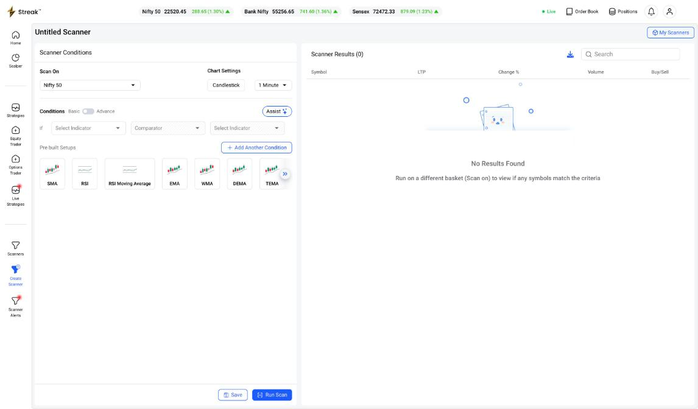

### Layout
- Header: "Untitled Scanner" (title; editing not observed — likely set on Save), `My Scanners` button (top-right).
- Left card "Scanner Conditions" with sticky footer `💾 Save` (outlined) and `🔍 Run Scan` (primary).
- Right card "Scanner Results (N)" with timestamp after a run, download icon, Search, expand icon (expand
  appears only when there are results). Initial empty state: "No Results Found — Run on a different basket…".
- No "Leave site?" guard on this page (navigating away discarded the draft silently).
- No scan frequency / schedule control in the builder — scheduling lives in Set Alerts (not opened).

### Controls
| Control | Type | Options / default | Notes |
|---|---|---|---|
| Scan On | dropdown | Default **Nifty 50**. Same 29 universes as Discover **plus `Custom Symbols 🛒`** (inserted after Futures) | Cart icon on Custom Symbols suggests a paid/add-on feature |
| Custom Symbols | sub-field | "Custom Symbols ()" / "No symbols selected." + `+ Add Symbols` | Opens the shared **Add Stocks** dialog (search; chips NIFTY50/100/200/500/BANKNIFTY; Watchlist 1/2; checkbox list; "Symbol (0 / 50)" → max 50; `+ Add to Watchlist`; `Done`). Esc does not close; backdrop click does |
| Chart type | chip button | `Candlestick` | Click had no visible effect (no Heikin-Ashi option surfaced) |
| Timeframe | dropdown | 1 Minute (default), 3, 5, 10, 15, 30 Minutes, 1 Hour, 1 Day | Same set as equity strategy builder |
| Conditions mode | switch | Basic (default) / Advance, ⓘ help tooltip in Advance | Switching with content → reset confirm modal; when empty, switches silently |
| Assist ✦ | button | — | In the scanner builder it opened the **Add Prebuild Suggestions** dialog (not an AI chat) |
| Condition row (Basic) | `If [indicator ▾] [comparator ▾] [indicator ▾] 🗑` | | 2nd+ rows prefixed with static **"And"** (no OR in Basic) |
| + Add Another Condition | button | adds empty row | Empty rows are silently ignored by Run Scan in Basic mode |
| Pre built Setups | horizontal carousel with `»` | 71 indicator tiles (SMA, RSI, RSI Moving Average, EMA, WMA, DEMA, TEMA, …, Central Pivot Range) | Same list as the strategy builder |
| Save | button | — | **Not clicked** |
| Run Scan | button | — | Pure read; shows toast + results |

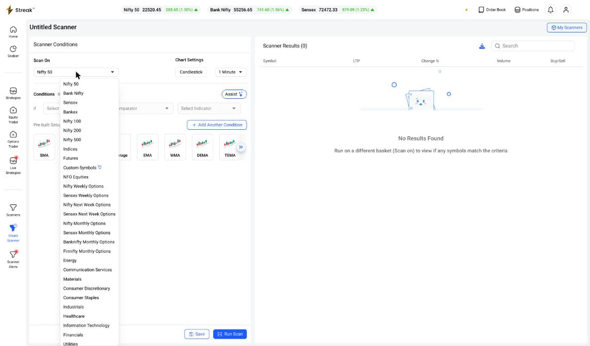
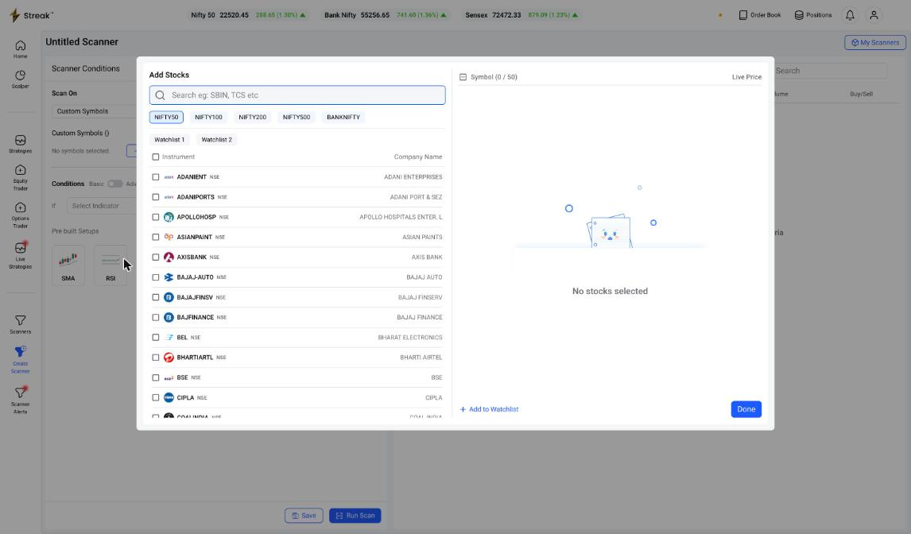
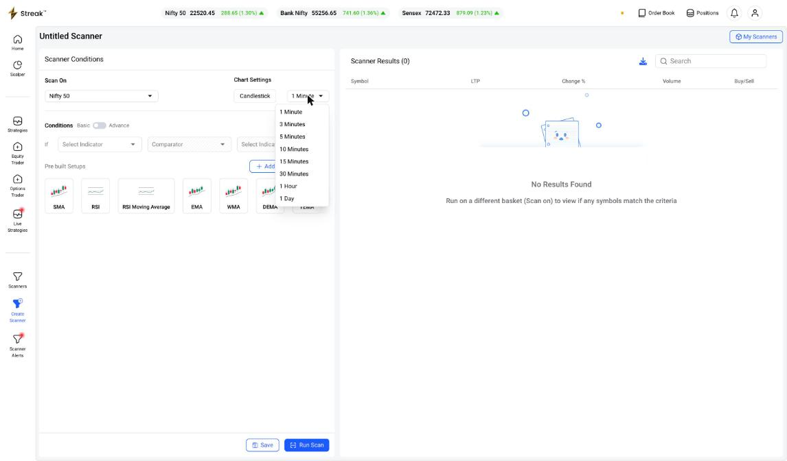

### Indicator picker (Basic)
Dropdown with full names ("Simple Moving Average (SMA)", "Relative Strength Index (RSI)", "RSI Moving Average",
"Exponential Moving Average (EMA)", …) and a `See All` link at the bottom.
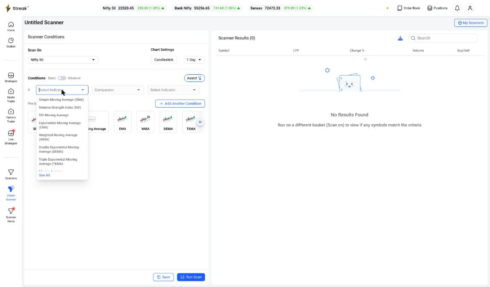

**Indicator parameter dialog** (click a filled indicator cell): title = indicator (e.g. SMA), red 🗑 (remove),
`field` dropdown {close, open, high, low, volume}, `period` (9), `offset` (0), `Cancel` / `Save`.
RSI shows only `period` (14) and `offset` (0).
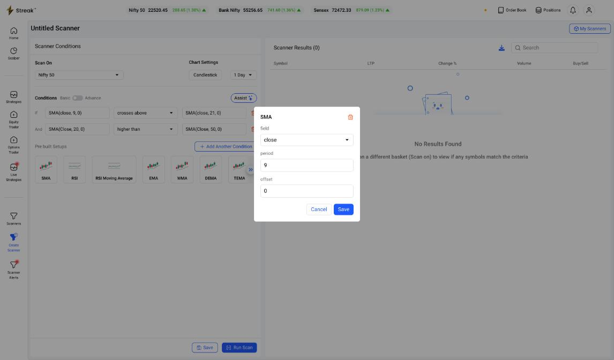

### "Add Prebuild Suggestions" dialog (See All / Assist)
- A–Z letter index; search "Search for conditions…"; `Bullish` / `Bearish` toggle (Bullish default).
- Left: **Indicators (71)** list (name + long name), category tabs (scrollable with « »): All, overlap studies,
  oscillators, volume indicators, volatility indicators, price action, volatility indicator, momentum
  indicators, volume & momentum, volume trend, momentum, trend, volatility.
- Right: **Prebuild Suggestions (N)** for the selected indicator — checkbox list of ready conditions with a
  tag pill. SMA Bullish (11): e.g. `SMA(close, 9, 0) crosses above SMA(close, 21, 0)` [Scalping],
  `SMA(close, 20, 0) crosses above SMA(close, 50, 0)` [Trend Following],
  `SMA(Close, 50, 0) crosses above SMA(Close, 200, 0)` [Longterm],
  `SMA(Close, 9, 0) higher than SMA(Close, 21, 0)` [Intraday Momentum]. SMA Bearish (10) mirrors them with tags
  Scalping / Trend Following / Longterm / Trend Reversal.
- Ticking a checkbox **immediately inserts** that condition as a row behind the modal (AND-joined);
  unticking removes it; `Done` closes.
- Dialog list also contains "ATR Trailing Stoploss" (not in the carousel).

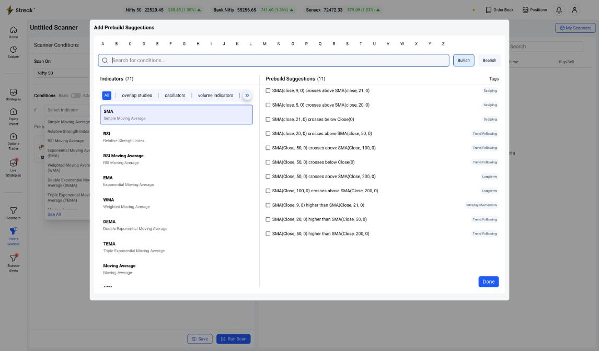
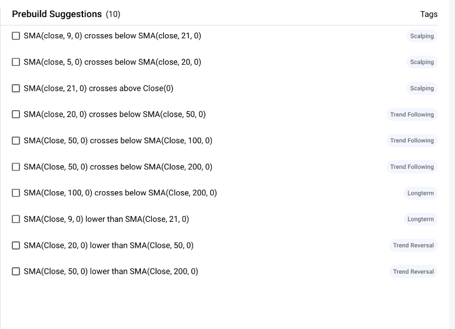
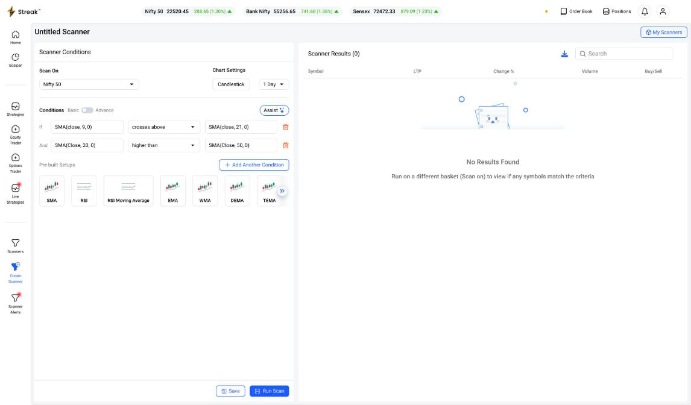

### Comparators (Basic)
Equal to, Crosses above, Crosses below, Lower than, Higher than equal to, Lower than equal to, Higher than,
Up by, Down by — **identical** to the equity strategy builder. "Up by / Down by" take a value + type (%).
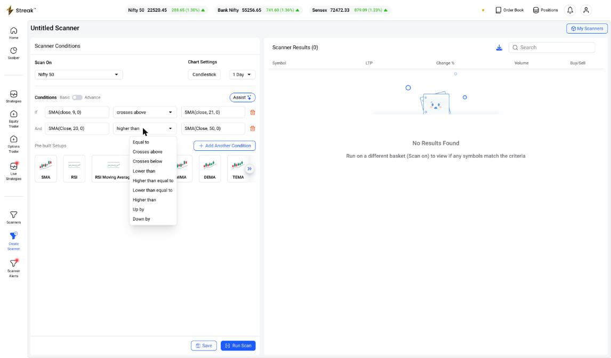

### Run Scan behaviour (observed on unsaved drafts)
- `SMA(9) crosses above SMA(21) AND SMA(20) higher than SMA(50)`, Nifty 50, 1 Day → toast **INFO "No symbols
  matched the conditions."**, result timestamp updated to the run time (`11/10/2026, 22:31:14`).
- `SMA(Close,20,0) higher than SMA(Close,50,0)` → **SUCCESS "Found 5 symbols"** (top-centre toast, auto-dismiss,
  ×), table populated. With an extra empty row the scan still ran (empty Basic rows ignored).
- Results grid: Symbol (logo + exchange), LTP, Change %, Volume, Buy/Sell (B, S, Chart). No indicator-value
  columns.
- **Sorting:** clicking a header cycles ascending (↑) → descending (↓) → unsorted. Seen on LTP.
- **Search:** filters rows live by symbol substring and updates the count ("Scanner Results (1)").
- **Expand (⛶):** results go full-width; conditions panel hidden; header shows `Show Conditions` link; inline
  toolbar gets Universe dropdown + Timeframe dropdown + `Run Scan` + collapse icon — quick re-scan without
  the builder.

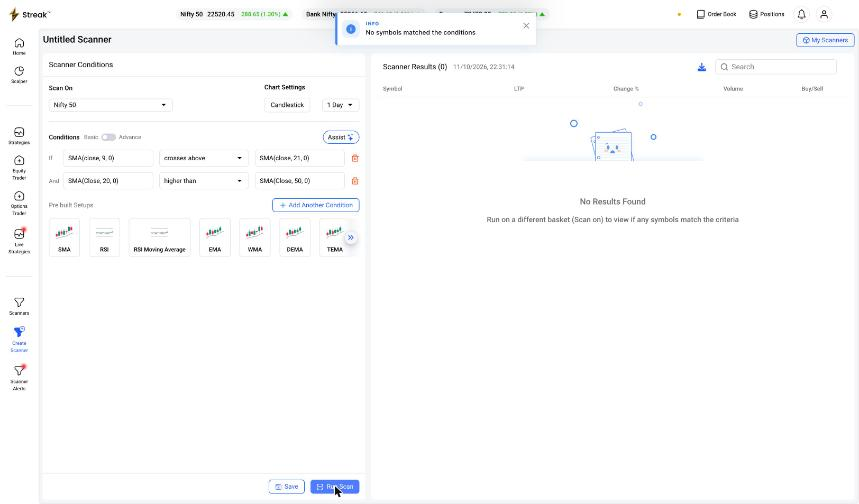
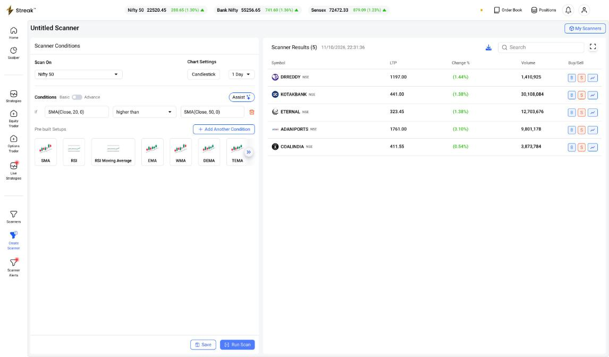
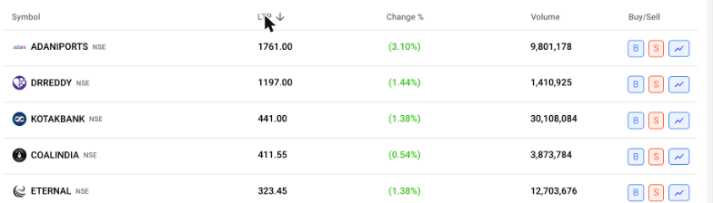
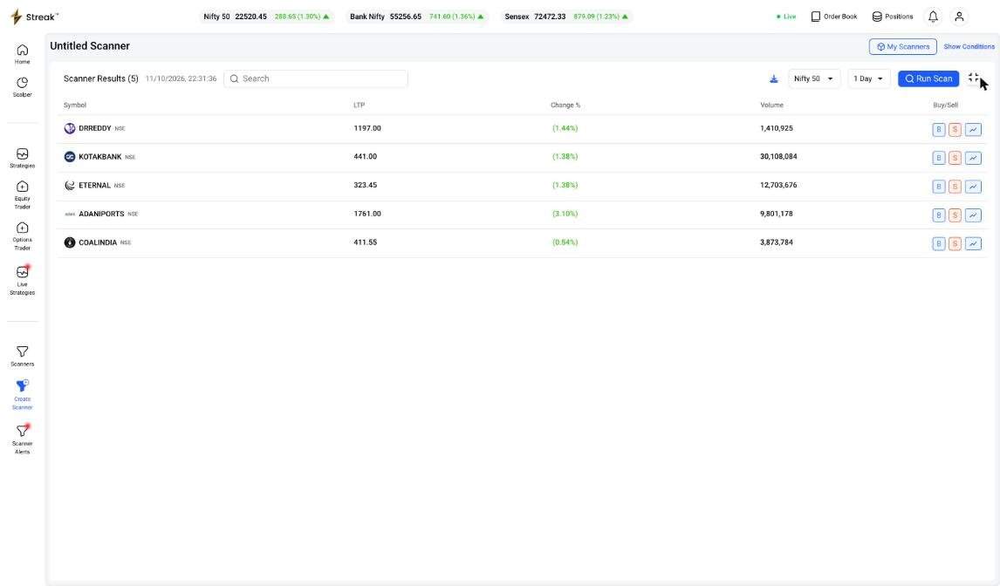
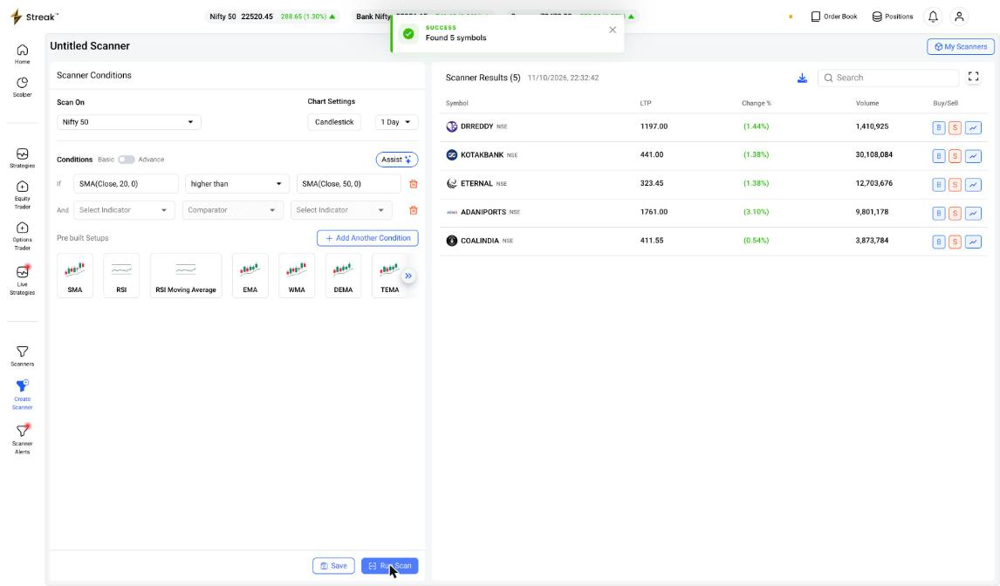

### Advance mode (scanner-specific power editor)
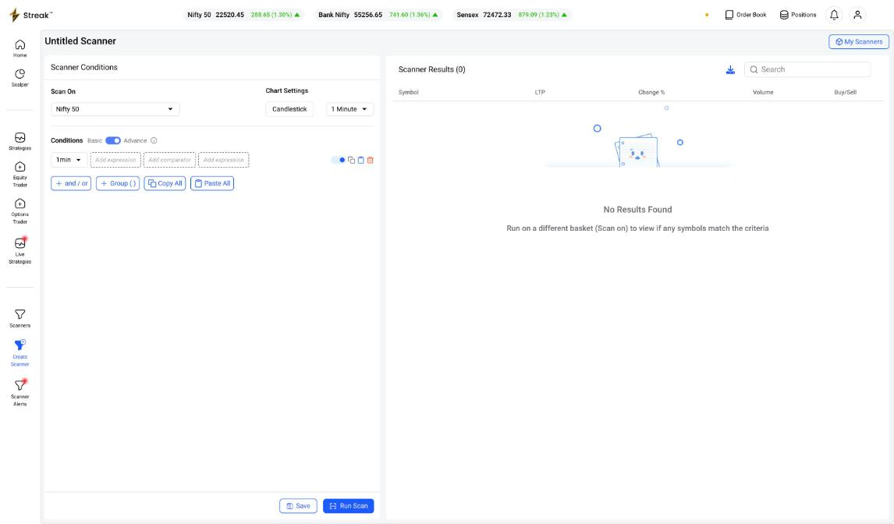

- Each row: **per-condition timeframe** dropdown {1min, 3min, 5min, 10min, 15min, 30min, hour, day, **week,
  month**} (week/month not in the chart timeframe list) · `Add expression` · `Add comparator` · `Add expression`
  · row tools: enable/disable switch (tooltip "Disable"), "Copy logic", "Paste logic after", delete.
- Below rows: `+ and / or` (adds a new row with a joiner chip), `+ Group ( )` (adds an indented bracketed
  group with its own `+ and / or`, `+ Group ()`, enable switch, copy, paste, delete — nesting supported),
  `Copy All`, `Paste All` (clipboard of the whole logic tree).
- Joiner chip toggles on click: blue **and** ↔ orange **or**.
- **Select Expression** popover: tabs `All` / `Indicators` / `ƒx Math Functions`; search "Search or enter a
  number…"; typing a number offers "Use number: 60". Math functions: Period min, Period max, Min, Max, Floor,
  Ceil, Abs, Brackets.
- Advance indicator catalogue is larger (~105) than Basic (71). Extra items seen: Ulcer, T Range, TII,
  Choppiness Index Moving Average, Open Interest, Open Interest Moving Average, MOM, Negative Volume Index, Pvi,
  Klinger Volume Oscillator, True Range Moving Average, Vortex Moving Average, Trade Volume Index, Moving average
  volume, Cci Moving Average, Stochastic Momentum Index, Moving Average Deviation, Schaff Trend Cycle, Intraday
  Momentum Index (+MA), Center Of Gravity, Bollinger %B Moving Average, ATR Trailing Stoploss, Number, MBB/UBB/LBB,
  Ichimoku, Candle Time, Vwma, Elder Ray Index, Day High Low, Vwap Standard deviation, Price Rate Of Change Moving
  Average, TriMA, Commodity Channel Index.
- **Select Comparator** popover with search: up by, equal to, crosses above, crosses below, lower than, higher
  than equal to, lower than equal to, higher than, down by (same 9).
- Clicking a placed indicator opens its parameter dialog (RSI: period 14, offset 0; Cancel/Save; delete icon).
- **Validation:**
  - Empty slots → red dashed borders + toast **ERROR "Fill all the conditions before running scan."** + ⚠ icon.
  - ⚠ tooltip **"At least one condition must use the base timeframe (1 Minute)."** — when every row uses a
    timeframe other than the chart timeframe, Run Scan silently does nothing. Setting chart timeframe = 1 Day
    made `day RSI(14,0) higher than 60` run → 2 results.

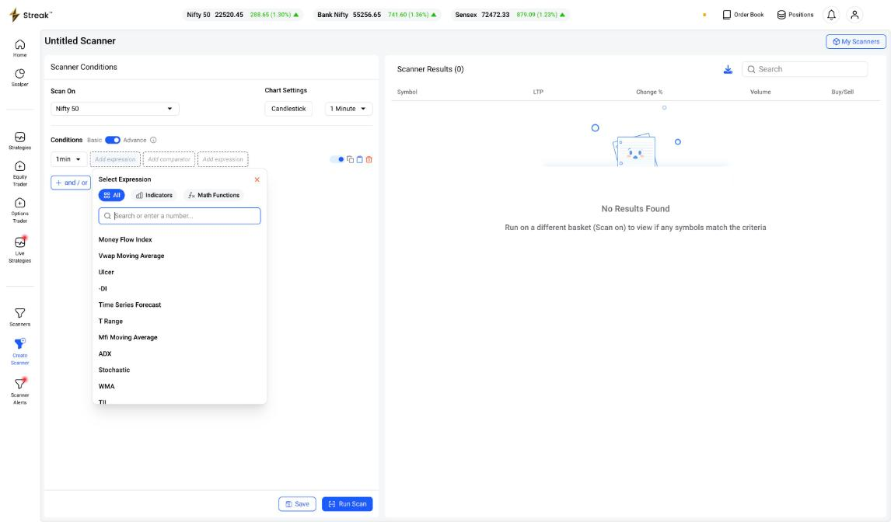
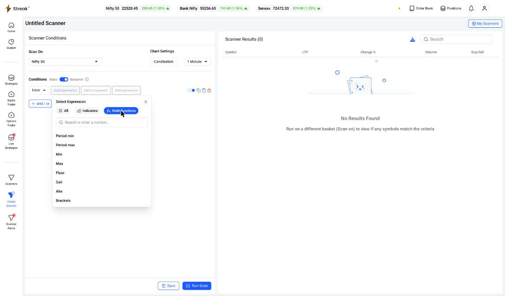
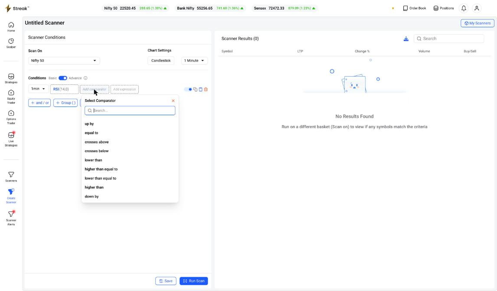
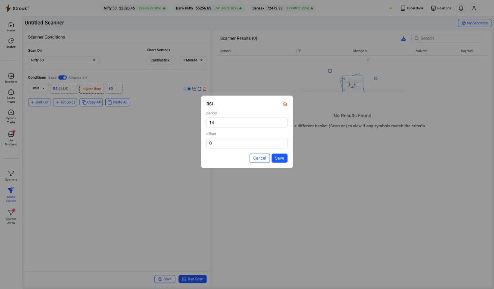
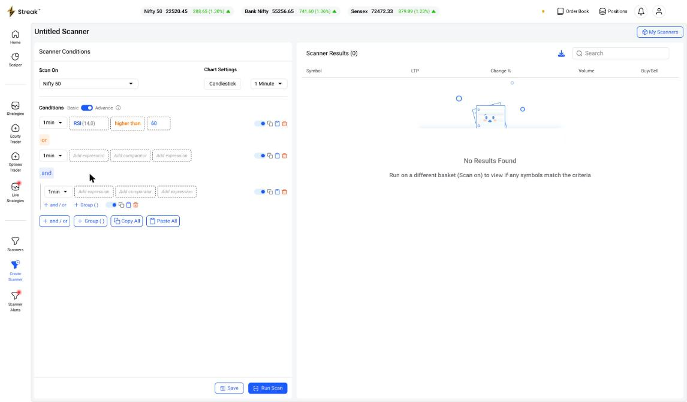
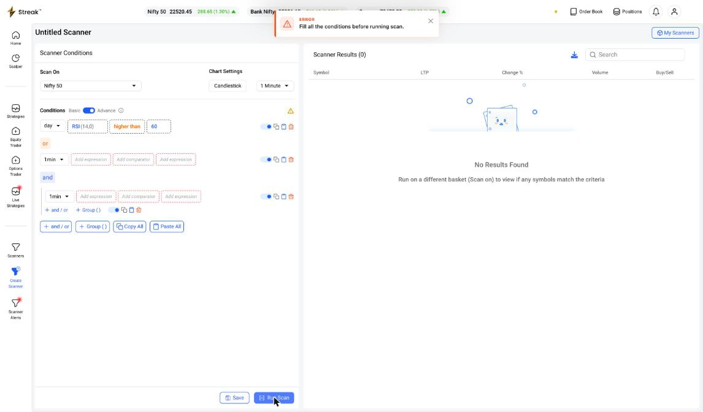
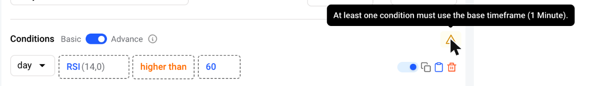
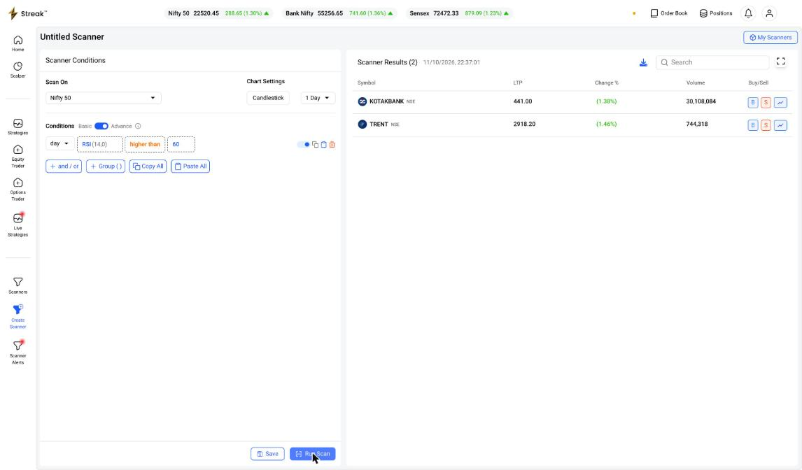

### Scanner builder vs equity strategy builder
| Aspect | Strategy builder | Scanner builder |
|---|---|---|
| Instruments | Add Instruments dialog, ≤50 symbols | Universe dropdown (29 baskets incl. option chains & sectors) or Custom Symbols (≤50) |
| Timeframes | 1m…1d | same chart TFs; Advance rows also week/month |
| Comparators / Basic indicators | 9 / 71 | identical |
| Buy/Sell side, exits (SL/TP/TSL) | yes | **none** — scanner is condition-only |
| Assist | AI helper | opens Prebuild Suggestions dialog |
| Output | backtest | live match list with B/S/Chart |
| Scanner-only | — | Run Scan, options filters (CALL/PUT/VOLUME>0, strike range), results sort/search/export/expand |

### Open questions
- Save flow (name prompt? limits on number of saved scanners?) — not exercised.
- What the download icon exports (CSV/XLSX, which columns).
- Whether Custom Symbols requires a paid plan (cart icon).
- Exact Advance arithmetic operators (+ − × ÷) entry: observed rendered in prebuilt (`-`, `*`) but the
  operator insertion UI wasn't found in the brief exploration (probably appears after an expression is placed).

---

## 4. Copy Scanner dialog (gate for Set Alerts on prebuilt scanners)

**Feature description:** Prebuilt scanners cannot be alerted directly; the user first saves a personal copy
(name, tags, description), which then lives in My Scanners and can be taken live.

Trigger: `Set Alerts` (or `Copy`) on a prebuilt scanner. A top-centre toast **INFO "Copy the Scanner in order
to set alerts"** appears together with the modal.

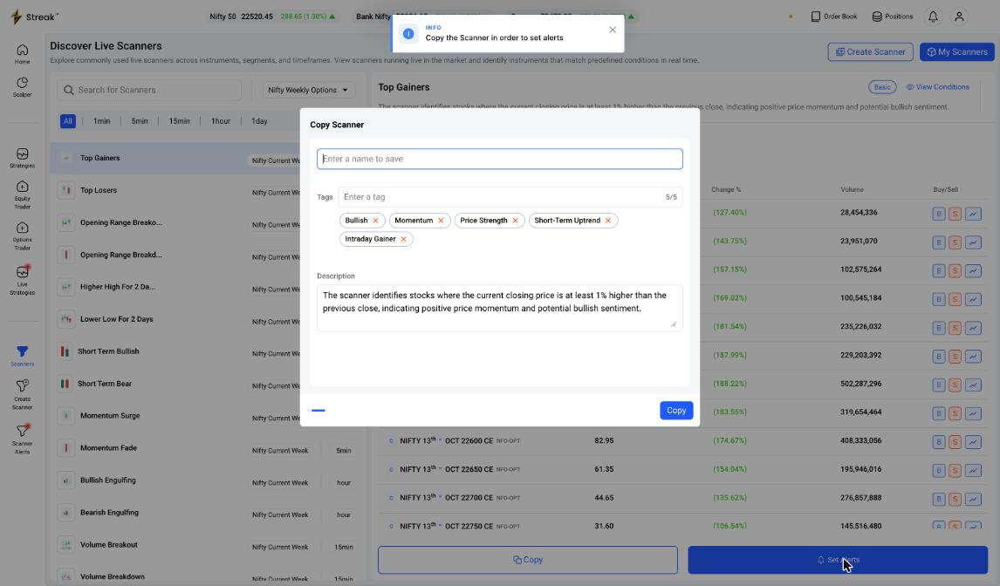

- Title "Copy Scanner".
- `Enter a name to save` text input (empty, focused, required).
- Tags: input "Enter a tag" with counter `5/5`; pre-filled removable chips from the prebuilt (Top Gainers:
  Bullish, Momentum, Price Strength, Short-Term Uptrend, Intraday Gainer) → max 5 tags.
- Description textarea, pre-filled with the prebuilt description, resizable.
- Footer: a small progress bar at left (looks like a 2-step wizard indicator — step 2 is presumably the alert
  settings), `Copy` primary button. No Cancel; Esc does not close; clicking the backdrop closes it.
- **Not submitted**, so the alert-configuration step (frequency, expiry, channels) was not observed.

---

## 5. Scanner Alerts — `/live-alerts`

**Feature description:** History of alerts produced by the user's live scanners: pick one of your scanners on
the left and see every alert it fired (instrument, time) on the right.

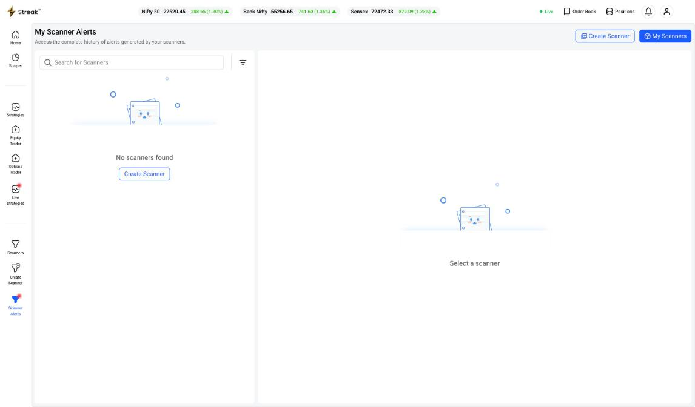

- Header: "My Scanner Alerts" + subtitle "Access the complete history of alerts generated by your scanners.";
  right: `Create Scanner` (outlined), `My Scanners` (primary).
- Left panel: search "Search for Scanners", filter icon → popover **"Filter options coming soon"**; list of the
  user's scanners. Empty state: illustration, "No scanners found", `Create Scanner` button.
- Right panel: empty state "Select a scanner" (master/detail; detail columns not observable with no data).
- Account has no saved/live scanners → list columns, statuses and per-alert actions could not be observed.

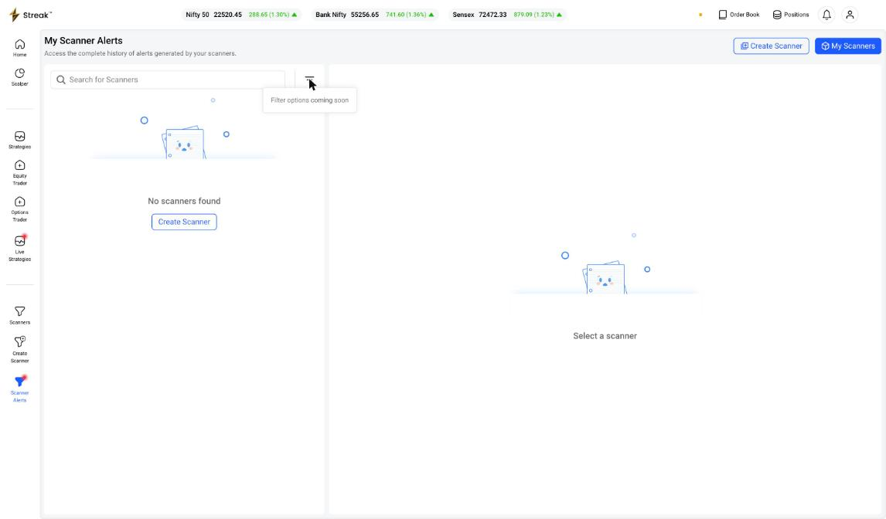

### Help-centre facts (help.streak.tech, read-only)
- Alert frequency = scanner (base) timeframe: conditions are evaluated at every candle close of that timeframe
  (5-min scanner → checks at 10:15, 10:20, …).
- Two modes: **Manual scan** (one-off on Run Scan, uses the current/forming candle) and **Live scanner**
  (runs during market hours, updates on candle close, generates alerts).
- MTF: base-timeframe condition uses the current candle; higher-timeframe conditions use the last *completed*
  candle of that timeframe. Weekly/Monthly allowed only as MTF conditions (never base).
- Limits: Basic create ≤ 5 conditions; Advance create ≤ 10 conditions, AND/OR, groups, math operators/functions,
  weekly/monthly, wider indicator set. Broadest stock universe = Nifty 500.
- Options scanner: strike selection ATM/ITM/OTM or range, CE/PE filter, Volume>0 filter, live alerts supported.

### Notifications page `/notifications` (bell icon) — where scanner alerts surface
- Title "Notifications" with back arrow; subtitle "View all alerts and updates generated by strategies and
  scanners in one place."
- Segmented filter: `All` | `Notification Based` | `Scanner`; Search box.
- Table columns: **Trade Type · Instrument · Strategy/Scanner · Time · Status**. Empty: "No notifications found".
- Channels: only the in-app notification centre was observable. No email/Telegram/WhatsApp/push settings were
  seen in the scanner screens (alert-config step not opened).

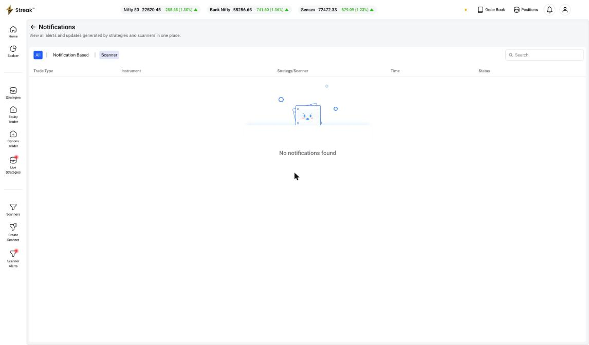

---

## 6. My Scanners — `/my-scanners`

**Feature description:** The user's own saved scanners (created or copied), browsable like the Discover list.

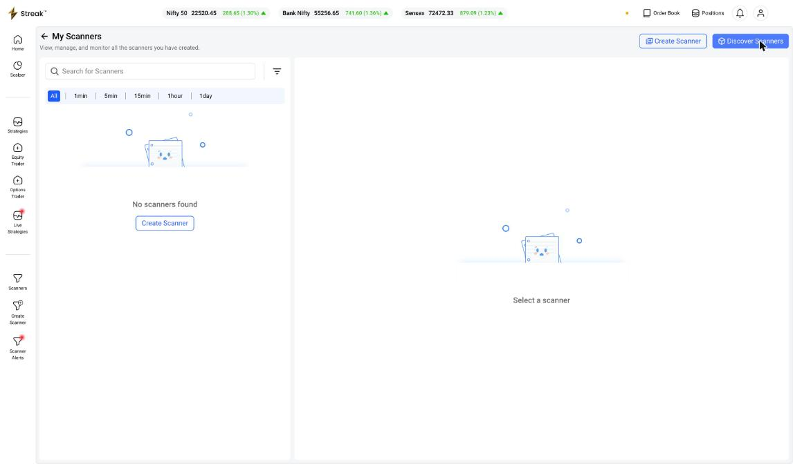

- Header "← My Scanners" (back arrow), subtitle "View, manage, and monitor all the scanners you have
  created."; right: `Create Scanner`, `Discover Scanners` (primary).
- Left: search, filter icon, timeframe chips All/1min/5min/15min/1hour/1day, list (empty: "No scanners found" +
  `Create Scanner`). Right: "Select a scanner".

---

## 7. Dashboard "Live Scanners" widget — `/dashboard`

**Feature description:** A compact live view of the prebuilt scanners on the home page so the user can glance
at matches for a chosen universe and jump to the full scanner.

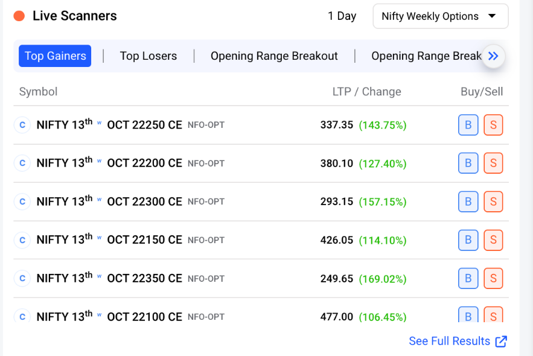

- Header: orange status dot + "Live Scanners"; read-only label of the selected scanner's timeframe
  (`1 Day` for Top Gainers, `5 Minutes` for Opening Range Breakout); universe dropdown.
- **Universe dropdown:** same 29 options as Discover. The widget and Discover share one persisted universe
  preference (Discover's Nifty Weekly Options selection showed up here, and vice-versa).
- **Tabs** (horizontal, « » scroll buttons, full names, first 20 prebuilt scanners): Top Gainers, Top Losers,
  Opening Range Breakout, Opening Range Breakdown, Higher high for 2 days, Lower Low for 2 days, Short Term
  Bullish, Short Term Bear, Momentum Surge, Momentum Fade, Bullish Engulfing, Bearish Engulfing, Volume Breakout,
  Volume Breakdown, RSI Entering Bullish Territory, Possible Downtrend, 52 Week High Breakout, Bullish Harami,
  Inverted Hammer, Hammer.
- Rows: Symbol (+ exchange / C-P badge for options), "LTP / Change" (LTP + coloured % in one column), B / S
  (no chart button, no volume). ~6 rows visible, scrollable.
- `See Full Results ↗` → navigates the same tab to `/scanner/<slug>` of the active tab (e.g.
  `/scanner/scanner-opening-range-breakout`), i.e. the prebuilt scanner view (§2).

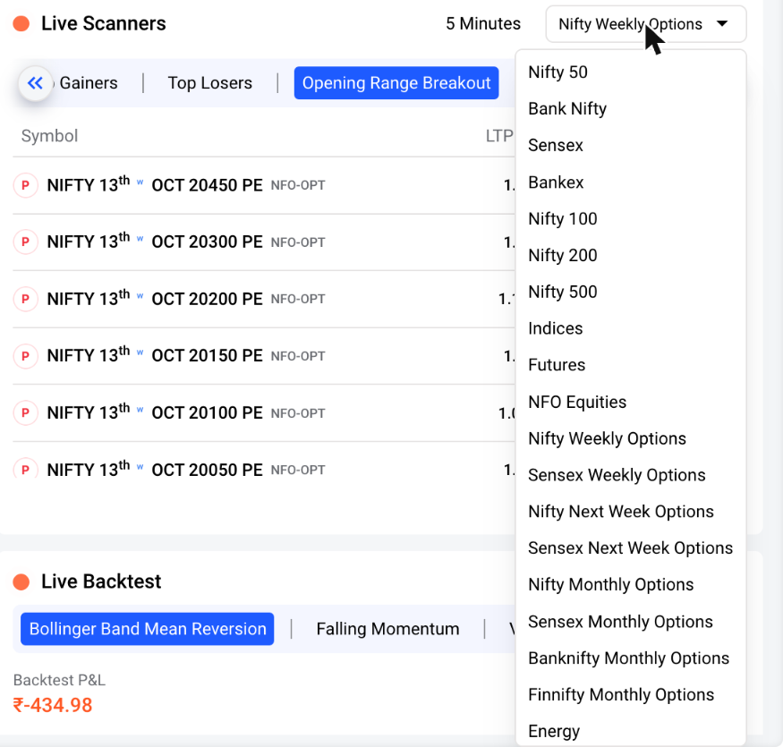
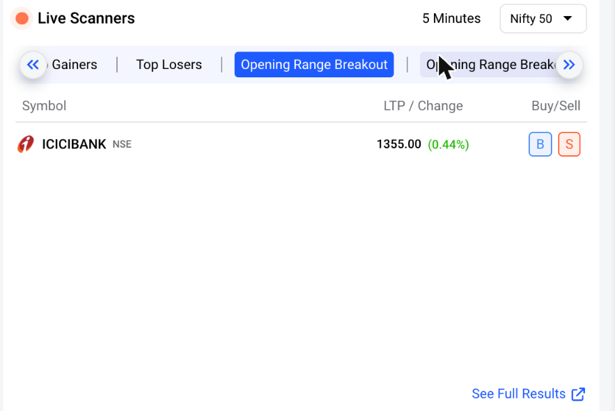
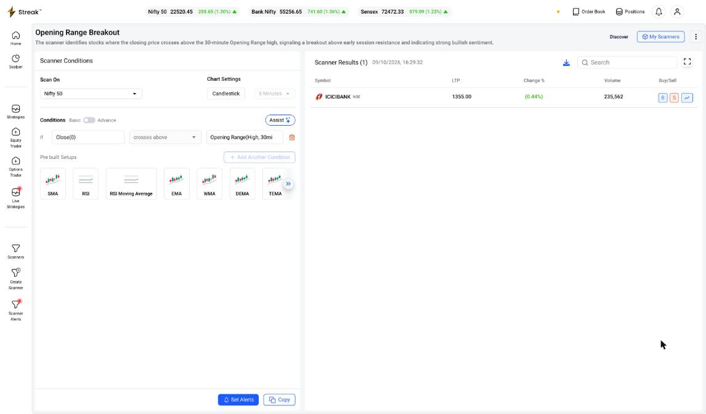

In the ORB scanner view the Basic condition renders as `If Close(0) crosses above Opening Range(High, 30mi…)`;
comparator and `+ Add Another Condition` are greyed (prebuilt locked), whereas on Top Gainers the comparator
cell was clickable.

---

## Cross-cutting UX observations
- Consistent master/detail layout (Discover, My Scanners, Scanner Alerts) with the same illustration-based empty
  states and "Create Scanner" CTA.
- Feedback via top-centre toasts with coloured left border: INFO (blue), SUCCESS (green), ERROR (red) + ×.
- Several "silent failure" spots worth improving in the rebuild: Run Scan doing nothing on the base-timeframe
  rule (only a ⚠ tooltip), timeframe filter ignoring unloaded pages, Esc not closing dialogs, truncated names.
- Two timestamp formats for "last scan".
- Persisted universe selection shared between Discover page and dashboard widget.
- I changed the shared universe preference to Nifty Weekly Options during research and set it back to Nifty 50
  (the original default) via the dashboard widget.

## Open questions / gaps
1. Alert configuration step after Copy (frequency/expiry, channels such as email/Telegram/push) — not
   reachable without saving.
2. Scanner Alerts list columns, statuses (active/paused/expired), per-alert menus — account has no scanners.
3. My Scanners row actions (edit/delete/duplicate/toggle live) — no data.
4. Full names for truncated prebuilt scanners 22, 31, 33, 34, 36 (likely "Price Near 200 SMA - Bearish/Bullish",
   "Supertrend Bearish/Bullish Crossover", "Range Breakout On 1 Hour").
5. Download/export format of results (not clicked — file download).
6. B/S order-ticket behaviour from scanner rows (not clicked — order placement).
7. Save dialog contents for a new scanner (not clicked).
