# Area 04 — Home Dashboard, Charting, Watchlists, Scalper

Observed read-only in the logged-in web app on 2026-10-11 (Sunday — market closed; data shows Friday 09 Oct close).
No orders, saves, deletes, watchlist changes or deploys were performed.

## 0. Dashboard layout overview (`/dashboard`)
Viewport ~1438x840. Three regions:
- **Left/centre column (~2/3 width)**: Holdings card + Live Strategy Overview card (one row), main chart card,
  bottom-tab analytics panel (Technicals / Option Chain / OI / PCR / Advance/Decline / ATM IV/Straddle) with Collapse.
- **Right column (~1/3)**: Watchlist panel (top), Live Scanners panel (middle), Live Backtest panel (bottom). Page scrolls.
- Global top bar + left icon sidebar (see inventory).

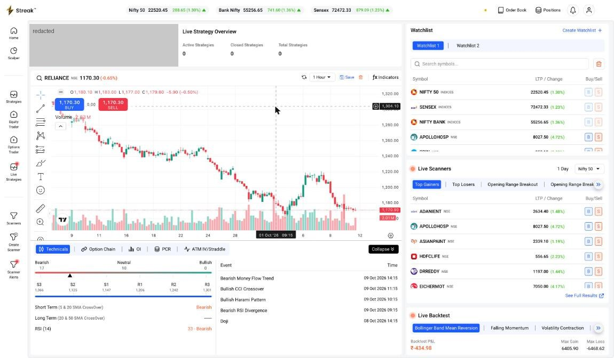

**Feature description:** The Home dashboard is a single-glance trading cockpit: portfolio/strategy summary, a full
interactive chart of the selected instrument with technical analysis beneath it, and side panels for watchlists,
live scanner hits and a prebuilt-strategy backtest teaser.

## 1. Global top bar
**Feature description:** Always-visible strip showing headline index levels and the real-time feed status, plus
shortcuts to Order Book / Positions / notifications / profile.

- **Index tickers**: three pills — `Nifty 50`, `Bank Nifty`, `Sensex`; each = name, LTP, `abs (pct%)` with green ▲ / red ▼.
  Implemented as plain non-interactive spans (`select-none`, no link). **Clicking a ticker does nothing** (verified: chart did not change).
  Hidden below the `lg` breakpoint.
- **Market/feed status pill**: small dot + label. Observed states:
  - green dot + "Live" (right after page load / when streaming);
  - amber/yellow dot with **no label** (observed persistently a minute after load on a Sunday, and in background tabs).
  - No tooltip / title / aria-label on hover (verified via DOM — none present). Colour transition 300 ms.
  - Interpretation (unverified): it reflects the ticker WebSocket state (green = connected/streaming, yellow = idle/reconnecting
    or no ticks). Not a market-hours indicator per se.
- Right side: `Order Book` (→ `/order-book`), `Positions` (→ `/positions`), bell (→ `/notifications`), profile avatar (menu).

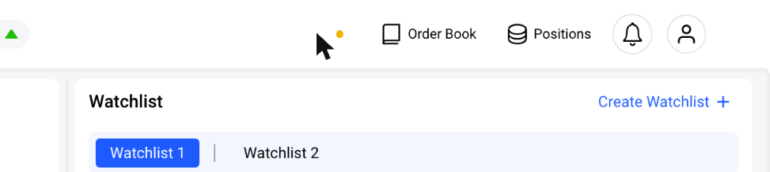

## 2. Holdings card & Live Strategy Overview (dashboard top row)
**Feature description:** Quick portfolio snapshot from the linked broker and a count of the user's deployed strategies.
- **Holdings**: `Current Value ₹x`, `Investment ₹x`, day P&L `abs +pct%` (green/red, ▲). Empty state for a user with no
  holdings: all `₹ 0.00`, `0.00 +0.00% ▲` (no "connect broker"/"no holdings" message).
- **Live Strategy Overview**: three counters `Active Strategies`, `Closed Strategies`, `Total Strategies` (0/0/0 here).
  Counters are not links (no click affordance observed).
- Open question: does clicking the Holdings card navigate to `/holdings`? (a `/holdings` route exists.)

## 3. Main chart widget
**Feature description:** A full TradingView Charting-Library chart for any NSE/BSE stock, index, future or option, with
timeframes, 100+ built-in indicators, drawing tools, and one-click Buy/Sell from the chart.

Embedded in a same-origin `blob:` iframe (TradingView Charting Library — TV logo bottom-left; `data-name` attributes such as
`linetool-group-*`, `legend-*`, `buy-order-button`, `sell-order-button`). Streak supplies its own header bar instead of TV's.

### 3.1 Header bar (Streak-owned)
| Control | Type | Detail |
|---|---|---|
| 🔍 + `SYMBOL` `EXCH` `LTP (pct%)` | button | Opens **symbol search modal** (below). Exchange tag e.g. `INDICES`, `NSE`. % coloured. |
| ⟳ | icon button | Tooltip "Refresh chart data". |
| `1 Hour ▾` | dropdown | Options: 1 Minute, 3 Minutes, 5 Minutes, 10 Minutes, 15 Minutes, 30 Minutes, 1 Hour, 1 Day. Default 1 Hour. |
| `💾 Save` | button (blue text) | Tooltip "Save Indicators and Drawings" — persists the chart layout server-side (NOT clicked). |
| 🗑 (orange) | icon button | Tooltip "Clear Indicators and Drawings" (NOT clicked). |
| `ƒx Indicators` | button | Opens TV Indicators dialog. |

- **No chart-type selector** is exposed (candles only on dashboard). TV settings → Symbol only offers candle colouring.
- Selected symbol **persists across reload** (reloaded after switching to RELIANCE; RELIANCE stayed). Unsaved indicators do
  **not** persist (RSI added, page reloaded → gone).

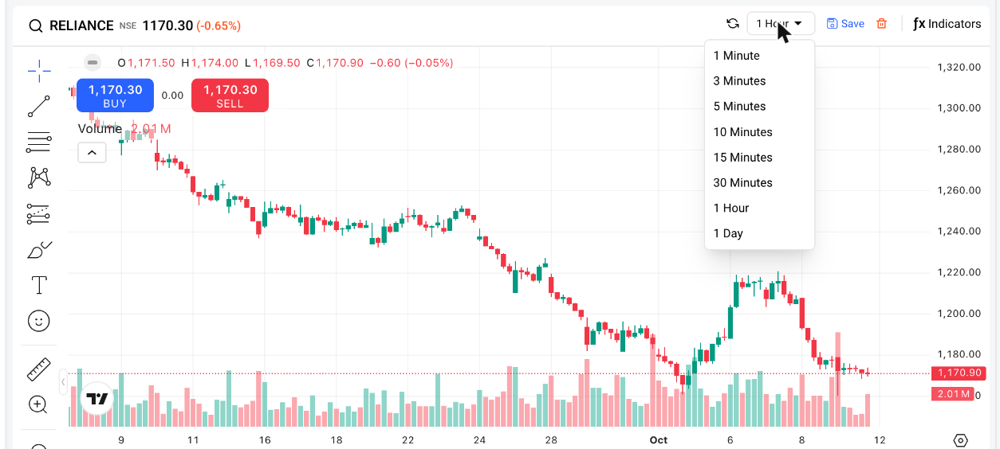

### 3.2 Symbol search modal ("Add Stocks")
- Title "Add Stocks" (same component as the strategy builder's instrument picker). Search input placeholder
  "Search eg: SBIN, TCS etc", auto-focused.
- Quick chips: `NIFTY 50`, `NIFTY BANK`, `SENSEX`, `BANKEX`.
- Columns: `Instrument` (logo + symbol + exchange tag) | `Company Name` (uppercase, right-aligned).
- Default list (empty query): NSE equities alphabetical (ADANIENT, ADANIPORTS, APOLLOHOSP, …).
- Results cover segments: `INDICES`, `NSE`, `BSE`, `NFO-FUT` (e.g. "RELIANCE OCT FUT", round "F" icon), `NFO-OPT`
  (e.g. "RELIANCE OCT 1290 CE" with "C" icon, "… PE" with red "P" icon). Query "BANKNIFTY" matched indices + bank ETFs
  (NIFTY BANK, NIFTY PSU BANK, BANKNIFTY1, SETFNIFBK …) — matching is fuzzy on symbol and name.
- Clicking a row switches the chart symbol and closes the modal; the bottom tabs re-load for that symbol.

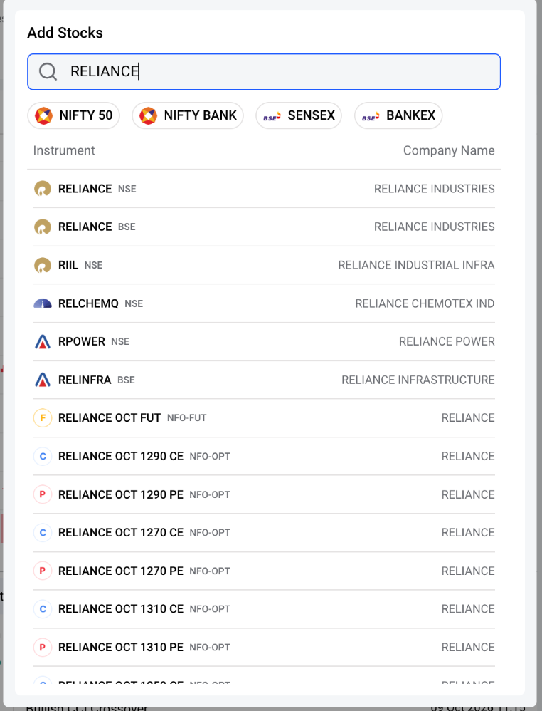

### 3.3 In-chart elements (TradingView)
- Legend row: collapse (–) button, `O H L C  change (pct%)` coloured by candle direction.
- **Buy/Sell quick-trade buttons** overlaid top-left: blue `<price> BUY`, a spread value between (`0.00`), red `<price> SELL`.
  These are TV's `buy-order-button`/`sell-order-button`; they open an order window (NOT clicked).
- `Volume` legend (value coloured) with ˄ collapse for the indicator list; volume histogram at bottom (green/red). For indices
  volume shows 0.
- Price scale right with last-price red/green label; crosshair with time label (`01 Oct '26 09:15`) and price label with ⊕
  (add alert/order on hover — TV standard). Bottom-right ⬡ gear = chart settings. Scroll/drag to pan, wheel to zoom.
- Hidden left **drawing toolbar** toggled by a small blue `›` tab on the left edge. Groups (`data-name`):
  cursors (Cross), trend-line (Trend Line ⌥T, Ray, Info Line, Extended Line, Trend Angle, Horizontal Line ⌥H, Horizontal Ray ⌥J,
  Vertical Line ⌥V, Cross Line ⌥C, …), gann-and-fibonacci (Fib Retracement…), patterns (XABCD Pattern…),
  prediction-and-measurement (Long Position / Short Position…), geometric-shapes (Brush…), annotation (Text),
  font-icons (emoji), Measure, Zoom In, Magnet, "stay in drawing mode", Lock all drawings, Hide all, Remove all drawings.
  Each group has a `›` flyout listing variants with keyboard shortcuts.

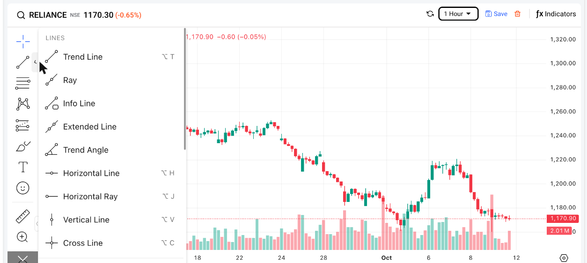

### 3.4 Indicators dialog (ƒx)
- Modal "Indicators" with ×, search box, single flat list under header **SCRIPT NAME** — **no categories/tabs**
  (no favourites, no "My scripts"). Search filters as you type and highlights the matched substring.
- 107 built-in TV studies: 52 Week High/Low, Accelerator Oscillator, Accumulation/Distribution, Accumulative Swing Index,
  Advance/Decline, Arnaud Legoux MA, Aroon, Average Directional Index, Average Price, Average True Range, Awesome Oscillator,
  Balance of Power, Bollinger Bands, Bollinger Bands %B, Bollinger Bands Width, Chaikin Money Flow, Chaikin Oscillator,
  Chaikin Volatility, Chande Kroll Stop, Chande Momentum Oscillator, Chop Zone, Choppiness Index, Commodity Channel Index,
  Connors RSI, Coppock Curve, Correlation - Log, Correlation Coefficient, Detrended Price Oscillator, Directional Movement,
  Donchian Channels, Double EMA, Ease Of Movement, Elder's Force Index, EMA Cross, Envelopes, Fisher Transform,
  Guppy Multiple MA, Historical Volatility, Hull MA, Ichimoku Cloud, Keltner Channels, Klinger Oscillator, Know Sure Thing,
  Least Squares MA, Linear Regression Curve, Linear Regression Slope, MA Cross, MA with EMA Cross, MACD, Majority Rule,
  Mass Index, McGinley Dynamic, Median Price, Momentum, Money Flow Index, Moving Average, MA Adaptive, MA Channel, MA Double,
  MA Exponential, MA Hamming, MA Multiple, MA Triple, MA Weighted, Net Volume, On Balance Volume, Parabolic SAR,
  Pivot Points Standard, Price Channel, Price Oscillator, Price Volume Trend, Rank Correlation Index, Rate Of Change, Ratio,
  Relative Strength Index, Relative Vigor Index, Relative Volatility Index, SMI Ergodic Indicator/Oscillator, Smoothed MA,
  Spread, Standard Deviation, Standard Error, Standard Error Bands, Stochastic, Stochastic RSI, SuperTrend,
  Trend Strength Index, Triple EMA, TRIX, True Strength Index, Typical Price, Ultimate Oscillator, Volatility Close-to-Close,
  Volatility Index, Volatility O-H-L-C, Volatility Zero Trend Close-to-Close, Volume, Volume Oscillator,
  Volume Profile Fixed Range, Volume Profile Visible Range, Vortex Indicator, VWAP, VWMA, Williams %R, Williams Alligator,
  Williams Fractal, Zig Zag.
  - Note: this charting list differs from the **strategy condition** indicator catalogue (inventory) — e.g. charting has
    Hull MA / Connors RSI; conditions have Central Pivot Range / Opening Range / Nth Candle.
- **Adding**: click a row → study is added immediately with defaults (dialog stays open for multi-add; close with ×).
  Oscillators get their own pane below price (RSI 14 shown with 30/70 band shading).
- **Configuring**: hover the study legend → icons: 👁 show/hide, ⚙ settings, 🗑 remove, ⋯ more. Settings dialog
  (e.g. "RSI") has tabs **Inputs / Style / Visibility**; Inputs for RSI = Length 14, Smoothing Line [SMA ▾], Smoothing Length 14;
  footer `Defaults ▾`, Cancel, Ok. Pane has its own ↓ / collapse / maximise buttons.
- Note: Escape does not close TV dialogs (focus stays in iframe); must click ×.

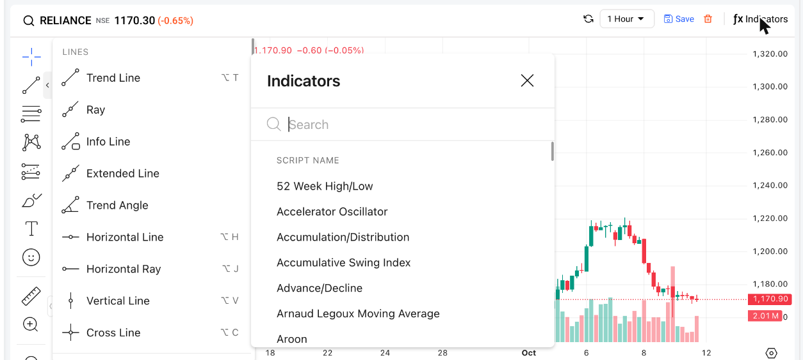
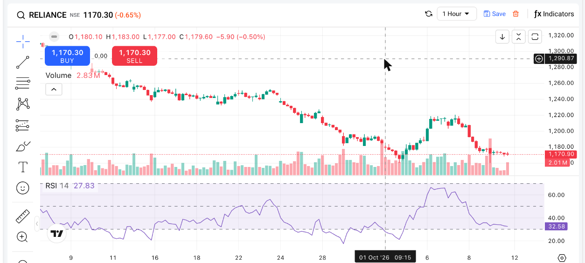
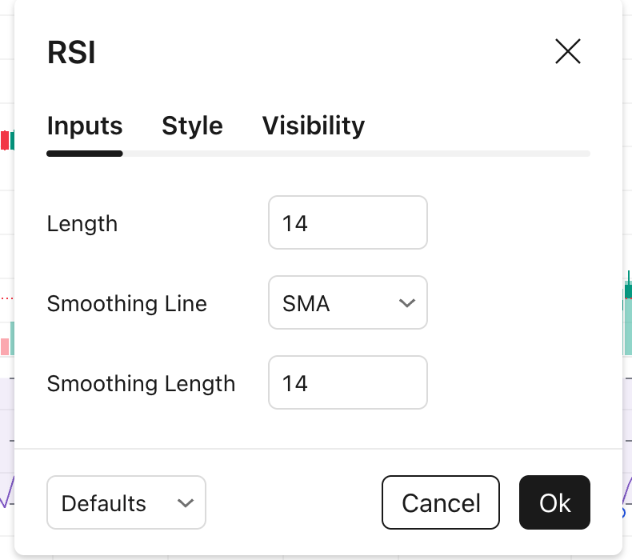

### 3.5 Chart context menu & settings
- Right-click on chart: `Copy price 1,249.30`, `Paste ⌘V`, `Trade ›`, `Lock vertical cursor line by time`,
  `Remove N indicators`, `Hide marks on bars`, `⚙ Settings…`.
- `Trade ›` submenu (TV trading terminal integration — NOT clicked): `Sell 1 NSE_RELIANCE @ <price> limit`,
  `Buy 1 NSE_RELIANCE @ <price> stop`, `Buy 1 … stop <price> limit`, `Create new order… ⇧T`, `Trading settings…`.
  → Broker symbol format is `EXCHANGE_SYMBOL` (e.g. `NSE_RELIANCE`); default qty 1.
- Settings dialog (TV): left tabs **Symbol, Status line, Scales and lines, Canvas, Trading**. Symbol tab: CANDLES
  (Color bars based on previous close ☐; Body ☑ green/red; Borders ☑; Wick ☑), DATA MODIFICATION (Precision: Default),
  Timezone `(UTC+5:30) Kolkata`. Footer: Template ▾, Cancel, Ok.

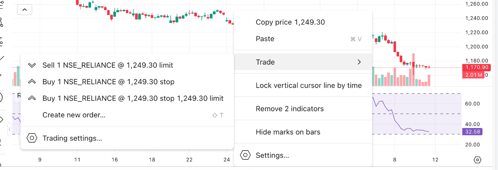
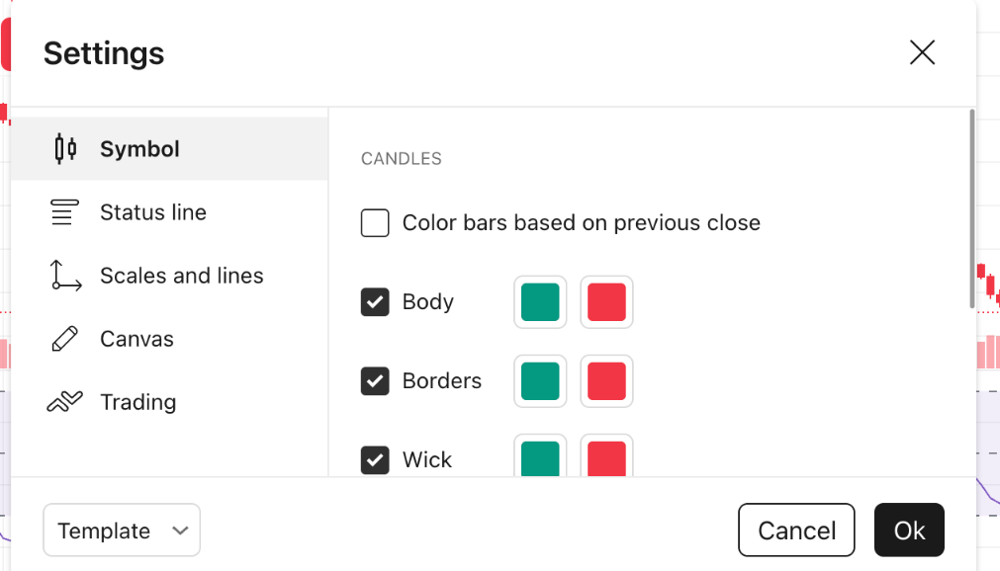

**Open questions (chart):** whether Save stores one layout per symbol or global; where Buy/Sell buttons route (Streak order
window vs TV order panel); whether a chart-type switch (Heikin Ashi/line) exists anywhere (not on dashboard).

## 4. Bottom analytics panel (under the chart)
**Feature description:** Context analytics for the charted symbol — a technical summary, and for F&O underlyings the
option chain, open-interest distribution, put-call ratio, market breadth and ATM IV/straddle history — without leaving Home.

- Segmented tab bar (icon + label, active = filled blue pill): `Technicals`, `Option Chain`, `OI`, `PCR`,
  `Advance/Decline`, `ATM IV/Straddle`. Right: black `Collapse ⌄⌄` button.
- **Tab set depends on symbol**: for NIFTY 50 (index) all six; for RELIANCE (stock) `Advance/Decline` is **absent**
  (Technicals, Option Chain, OI, PCR, ATM IV/Straddle). Presumably non-F&O stocks show only Technicals (not verified).
- **Collapse**: hides panel content; chart grows to fill; the tab bar stays docked at the bottom with an `Expand ⌃` button.
  TV chart then shows `A` (auto-scale) / `L` (log-scale) toggles bottom-right.
- Panel has fixed height (~270 px); content scrolls inside (option chain).

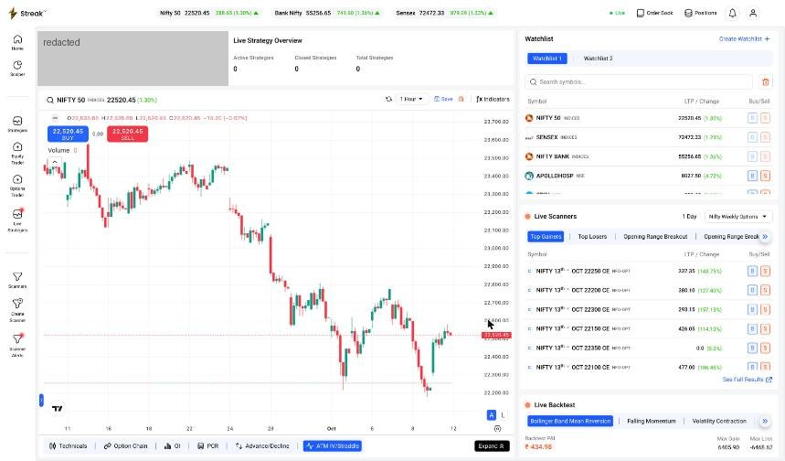

### 4.1 Technicals
- **Left half**
  - Sentiment gauge: horizontal gradient bar red→grey→green labelled `Bearish N` / `Neutral N` / `Bullish N` with a black ▲
    pointer positioned by the balance. Counts sum to 27 (e.g. 9/9/9 on 1h; 13/12/2 on 1d) → 27 indicator votes.
  - Pivot ruler: blue line with ticks `S3 S2 S1 R1 R2 R3` and values (classic pivots; on 1h NIFTY: 20,847 / 21,710 / 22,066 /
    22,929 / 23,436 / 24,299). No pivot P shown.
  - Verdict rows: `Short Term (5 & 20 SMA CrossOver)` → Bullish (green) / Bearish (orange) / `------` (none);
    `Long Term (20 & 50 SMA CrossOver)`; `RSI (14)` → `51 - Neutral`, `33 - Bearish`, `37 - Bearish`.
- **Right half**: `Event | Time` table of recently detected candle patterns/indicator events, newest first, ~5 rows:
  e.g. Heikin Ashi Bearish/Bullish Reversal, Bullish/Bearish Engulfing Pattern, Bullish CCI Crossover, Bullish Inside bar,
  Bearish Money Flow Trend, Bullish Harami Pattern, Bearish/Bullish RSI Divergence, Doji, Volatility Expansion,
  Three Black Crows. Time format `09 Oct 2026 15:15`.
- **Follows the chart timeframe** (verified: 1 Hour → hourly event times; 1 Day → daily events and different pivots/counts).
- No tooltips on gauge/pivots; rows not clickable (no markers drawn on chart).

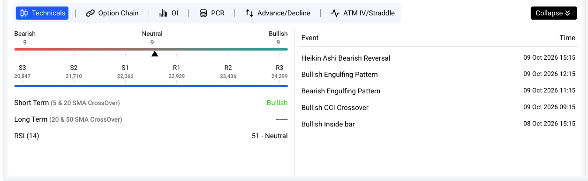
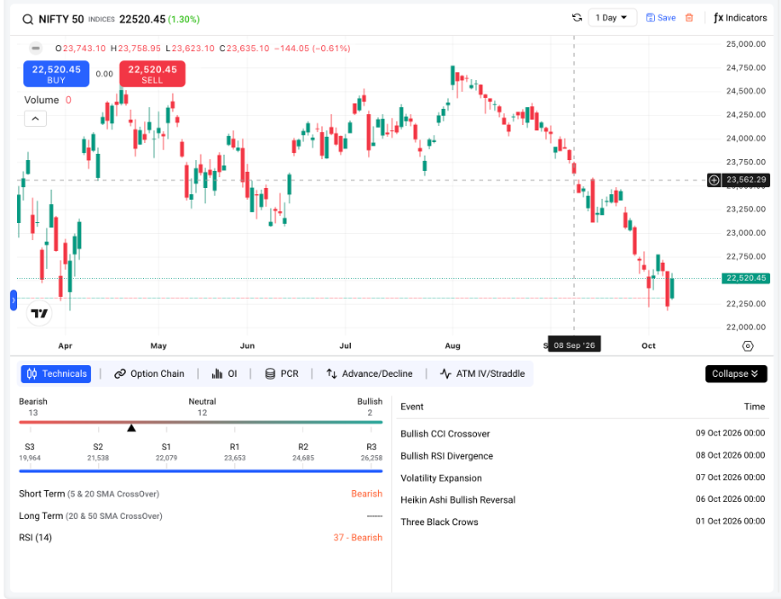

### 4.2 Option Chain
- Columns: `Call OI (Lakh)` [value with (OI change %) to its left], `Call LTP` [with (LTP change %)], `Strike` (centre),
  `Put LTP` [with (chg %)], `Put OI (Lakh)` [with (chg %)]. Percentages green/red in small type.
- **No greeks, no IV, no volume, no bid/ask** columns.
- ATM strike in **bold**; ITM side shaded light blue (calls below spot, puts above spot).
- Thin horizontal OI bars under each row: red bar growing leftward from strike for call OI, teal bar growing right for put OI
  (length ∝ OI).
- Expiry dropdown (right of header), default nearest: `13 Oct, 19 Oct, 27 Oct, 03 Nov, 09 Nov, 23 Nov, 29 Dec`
  (weekly + monthly).
- Strike range: wide (22350…24050+ seen for NIFTY; 50-pt steps), vertically scrollable; opens scrolled around ATM.
- **Row hover**: reveals small `S` `B` buttons next to the strike on the call side and `B` `S` on the put side → one-click
  order window for that option (NOT clicked).
- Market closed: data are last session values (no "market closed" banner).

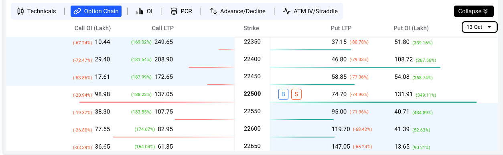
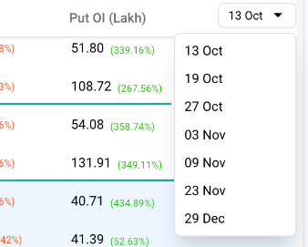

### 4.3 OI
- Two side-by-side bar charts, each with its own expiry dropdown (`13 Oct 26 ▾`):
  - **Open Interest**: grouped bars per strike, `Call OI` red, `Put OI` teal; x-axis strikes (22100…22900, ~±8 strikes around ATM).
  - **Open Interest Change**: same layout, bars = change in OI (positive up; negatives not observed).
- Hover tooltip: `Strike: 22500` / `Put OI: 1.32Cr` (units Cr/L auto-scaled) or `Put OI Change: 1.03Cr`.
- Legend dots (clickable toggle not verified).

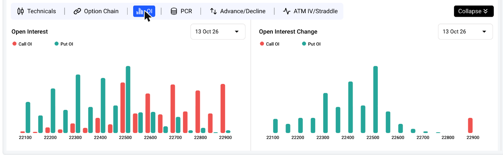
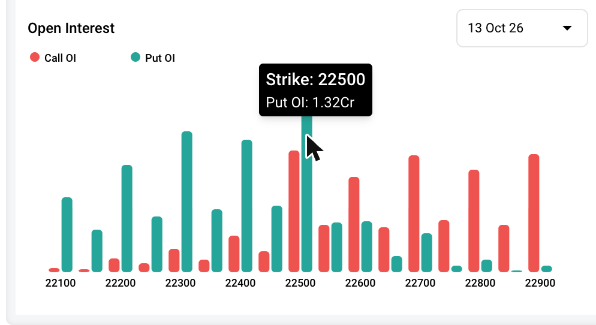

### 4.4 PCR
- Dual-axis line chart: `Price` (blue, left axis) vs `PCR` (orange, right axis), legend top-left, `Expiry 13 Oct` label top-right
  (nearest expiry; no selector). X-axis intraday timestamps over ~5 sessions (05 Oct 09:14 … 09 Oct 15:29), minute resolution.
- Crosshair tooltip: `07 Oct 14:04` / `Price: 22,569.9` / `PCR: 0.8444`.

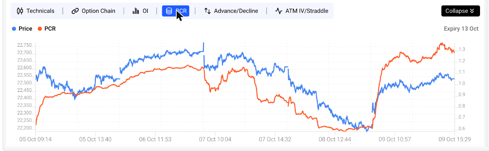
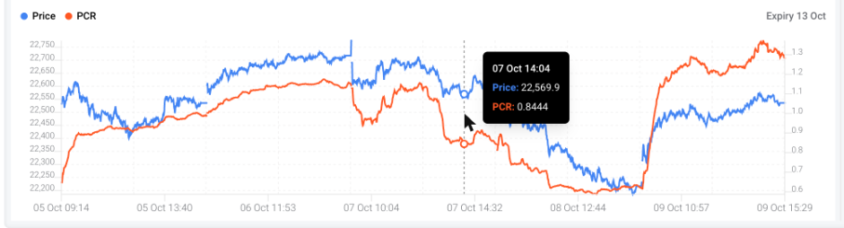

### 4.5 Advance/Decline (index only)
- Two-line chart `Advance` (teal) vs `Decline` (red) counts of index constituents (0–50 for Nifty), last 2 sessions intraday;
  "as of" timestamp top-right (`09 Oct 15:29`).
- Tooltip: `09 Oct 09:57` / `Advance Count: 48` / `Decline Count: 2`.

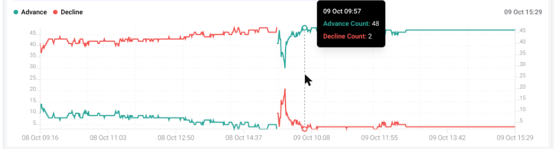

### 4.6 ATM IV/Straddle
- Dual-axis line chart: `IV` (blue, left axis, %) and `Straddle` (red, right axis, premium ₹ of ATM CE+PE), ~1–2 sessions,
  timestamp top-right.
- Tooltip: `09 Oct 12:38` / `IV: 12.78` / `Straddle: 242.80`.

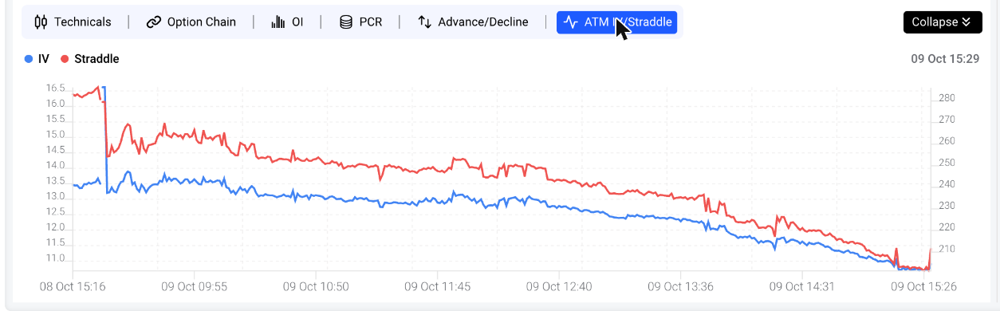
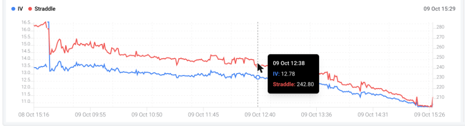

**Open questions (bottom panel):** how the 27 gauge votes are composed; pivot type (classic assumed) and which period it uses
per timeframe; whether option-chain B/S opens the same order window as watchlist B/S; refresh cadence during market hours.

## 5. Right column (independently scrollable)
The right column scrolls on its own (page body does not scroll at 1432x840); Watchlist, Live Scanners and Live Backtest
are stacked white cards.

### 5.1 Watchlist panel
**Feature description:** Named lists of instruments with live prices; click to chart, one-click Buy/Sell, add via inline search.

- Header: `Watchlist` + blue link `Create Watchlist +` (NOT clicked — may create immediately).
- Watchlist tabs as a segmented control: `Watchlist 1 | Watchlist 2` (active = blue pill). Tabs presumably scroll if many.
- Search input "Search symbols..." + orange-bordered 🗑 button (tooltip **"Delete Watchlist 1"** — deletes the whole active list).
- Search dropdown (inline, under input): rows `logo SYMBOL EXCH ……… COMPANY NAME`; hovering a row shows a blue `+` (add to
  current watchlist). Same instrument universe as chart search.
- Table headers `Symbol | LTP / Change | Buy/Sell` — **not sortable** (plain text).
- Row: logo, symbol, exchange tag (INDICES/NSE/NFO-OPT…), LTP, (pct%) coloured, `B` (blue outline) `S` (red outline).
  For **indices B/S are rendered disabled** (faded) — not tradable.
- **Row hover**: row highlights and reveals `📈` (load in main chart) and `🗑` (remove from watchlist) before B/S.
- **Row click** (on symbol) also loads it into the main chart; selected row stays highlighted.
- Contents observed: Watchlist 1 = NIFTY 50, SENSEX, NIFTY BANK, APOLLOHOSP, SBIN, TCS, RELIANCE, INFY, ASIANPAINT (9);
  Watchlist 2 = AXISBANK, BHARTIARTL, TITAN, ULTRACEMCO, TATACHEM, …
- Max size: not shown in UI (strategy picker caps instruments at 50; watchlist cap unverified). No drag-reorder affordance seen.
- Watchlists are reused elsewhere: chips "Watchlist 1/2" in the Add Instruments dialog (strategy builder).

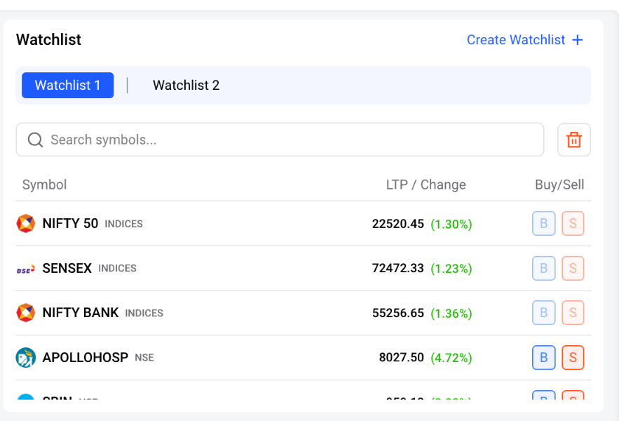
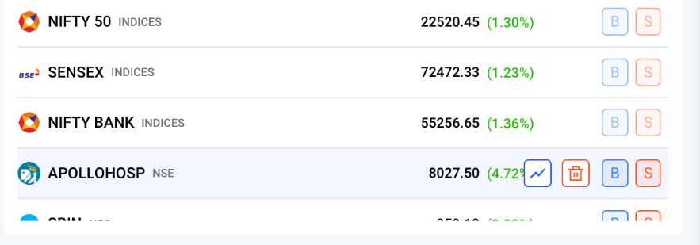
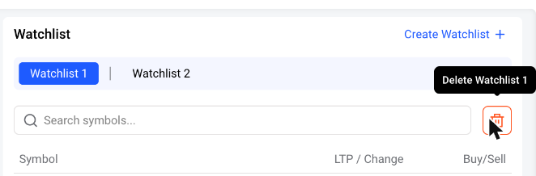
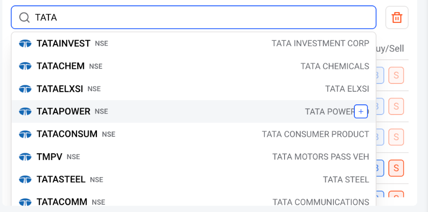
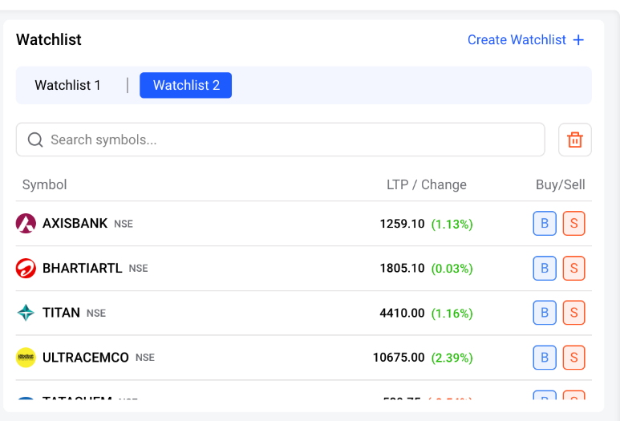

### 5.2 Live Scanners widget (brief — scanners covered by another area)
**Feature description:** Prebuilt real-time scans (gainers, breakouts, patterns) over a chosen universe, with one-click chart/trade.
- Header: orange pulsing dot + `Live Scanners`; static label `1 Day` (not a control); universe dropdown.
- Universe options: Nifty 50, Bank Nifty, Sensex, Bankex, Nifty 100, Nifty 200, Nifty 500, Indices, Futures, NFO Equities,
  Nifty Weekly Options, Sensex Weekly Options, Nifty Next Week Options, Sensex Next Week Options, Nifty Monthly Options,
  Sensex Monthly Options, Banknifty Monthly Options, Finnifty Monthly Options, and sectors Energy, Communication Services,
  Materials, Consumer Discretionary, Consumer Staples, Industrials, Healthcare, Information Technology, Financials,
  Utilities, Real Estate. (Default was Nifty 50 on first load; later showed "Nifty Weekly Options" — selection appears to
  persist per account.)
- Scanner tabs (horizontal scroll with `»` button): Top Gainers, Top Losers, Opening Range Breakout, Opening Range Breakdown,
  Higher high for 2 days, Lower Low for 2 days, Short Term Bullish, Short Term Bear, Momentum Surge, Momentum Fade,
  Bullish Engulfing, Bearish Engulfing, Volume Breakout, Volume Breakdown, RSI Entering Bullish Territory, Possible Downtrend,
  52 Week High Breakout, Bullish Harami, Inverted Hammer, Hammer.
- Rows like watchlist (Symbol | LTP / Change | Buy/Sell); option symbols rendered as `NIFTY 13ᵗʰ ʷ OCT 22250 CE NFO-OPT`
  (superscript ordinal + "w" = weekly). Row hover shows 📈 (loads into main chart — verified). `See Full Results ↗`.
- Charting an option shows only the `Technicals` bottom tab.

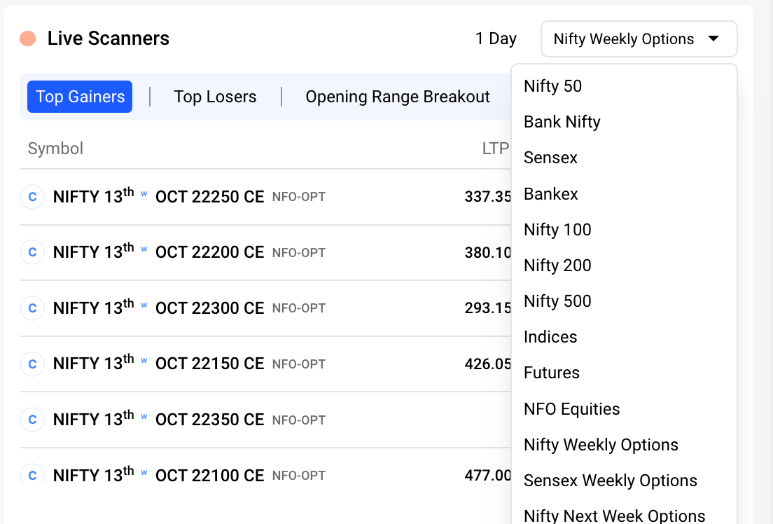

### 5.3 Live Backtest widget
**Feature description:** Rotating showcase of prebuilt strategies with their recent (≈3-month) backtest result, as a hook into
Discover Strategies.
- Header: orange dot + `Live Backtest`. Strategy tabs (scrollable with `«`/`»`): Bollinger Band Mean Reversion, Falling Momentum,
  Volatility Contraction, Volatility Expansion, Strong Breakout Continuation, Vwap Mean Reversion, Volatility burst,
  TEMA Momentum Shift, RSI Trend Momentum Breakout, Volatility Expansion Trend Breakout.
- Metrics: `Backtest P&L` (₹, red/green, e.g. ₹-434.98 / ₹22,336.70), `Max Gain`, `Max Loss`, `Win vs Loss` progress bar
  (green fill = win share) with `142 W` / `129 L`, `Trades`, `Capital Used`.
- Calendar heatmap: one mini-grid per month (Jul–Oct 2026), cells = days (weekday columns), green/red shades by daily %,
  grey = no trade/holiday. Hover tooltip `13 Jul, 2026: -1.48%`.
- `See Full Results ↗` (button, opens full backtest — not followed).

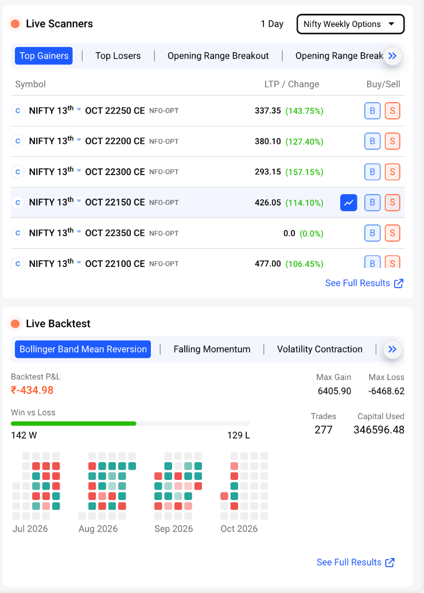
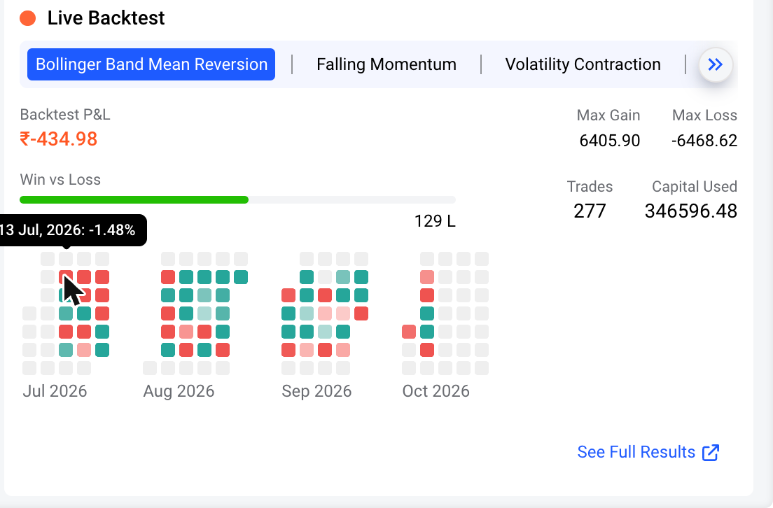

**Open questions (right column):** watchlist max size and max number of watchlists; whether Create Watchlist prompts for a
name; whether watchlist order can be changed; whether Live Backtest metrics are aggregated over all instruments of the
strategy (Capital Used ≈ 3.46 L suggests yes).

## 6. Scalper (`/markets`)
**Feature description:** An options-scalping workspace: the underlying and its options charted side by side (optionally a
third chart for CE + PE), a slide-out option chain that builds multi-leg basket orders with payoff analysis, a slide-out
watchlist, and live positions/orders — all on one screen so the trader never navigates away.

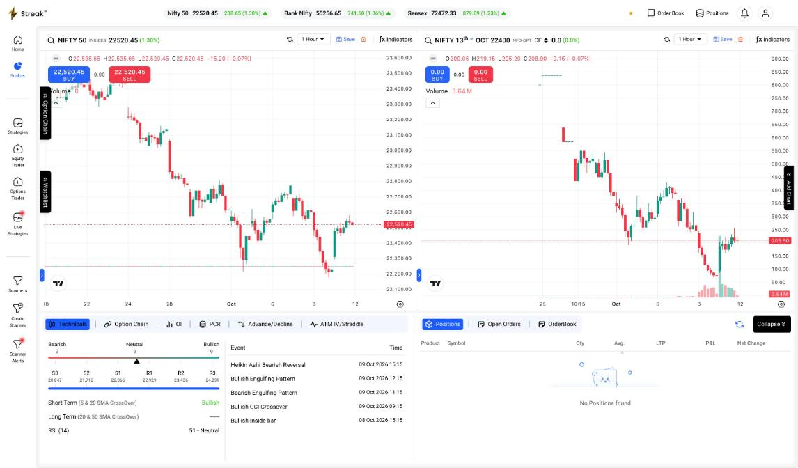

### 6.1 Layout
- Full-width page (no right column). Top half: **two TradingView charts side by side** — left = underlying
  (default `NIFTY 50 INDICES`), right = **ATM option** of nearest weekly expiry (default `NIFTY 13ᵗʰ ʷ OCT 22500 NFO-OPT CE`).
- Each chart header: 🔍 symbol button (tooltip "Search Symbols"), for options a **`CE ⇕` / `PE ⇕` toggle** to flip call/put at the
  same strike, LTP (pct%), ⟳ refresh, timeframe dropdown (same 8 options, default 1 Hour), Save, 🗑, ƒx Indicators
  (Indicators label hidden when 3 charts are shown). Each chart has its own Buy/Sell overlay buttons and drawing toolbar.
- Left-edge vertical tabs: `» Option Chain` and `» Watchlist` (open drawers). Right-edge vertical tab: `« Add Chart` /
  `» Hide Chart`.
- Bottom half split in two:
  - **Left**: the same analytics tabs as Home (Technicals, Option Chain, OI, PCR, Advance/Decline, ATM IV/Straddle) for the left chart's symbol.
  - **Right**: `Positions | Open Orders | OrderBook` tabs + ⟳ refresh + `Collapse ⌄⌄`.
- `Collapse` collapses **both** bottom panels (tab bars docked at bottom, `Expand ⌃`), charts take full height.
- Onboarding tour (4 steps): 1 Option Chain, 2 Watchlist, 3 Third Chart, 4 Positions & Orderbook – Quick access
  (Next / Back / Done / ×).

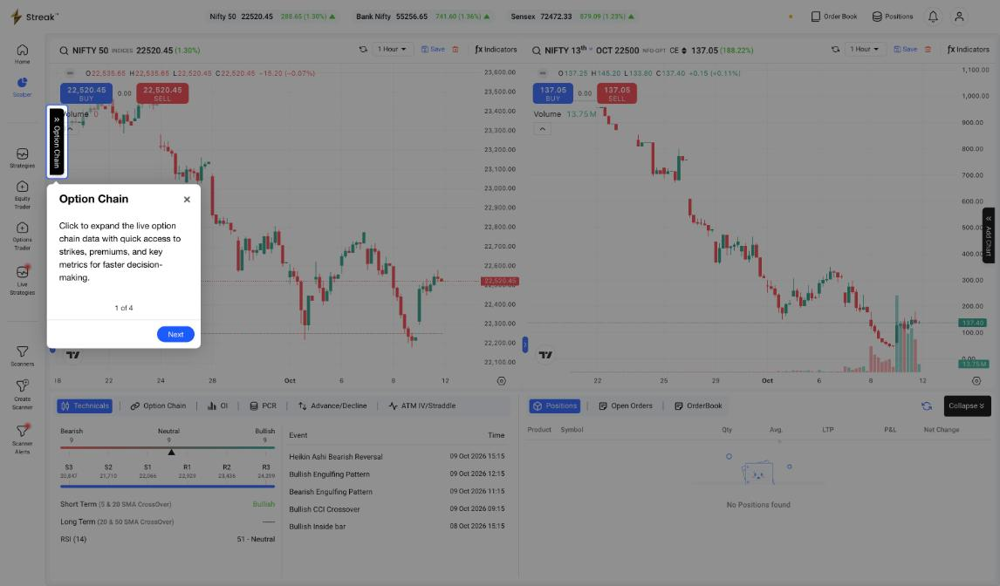
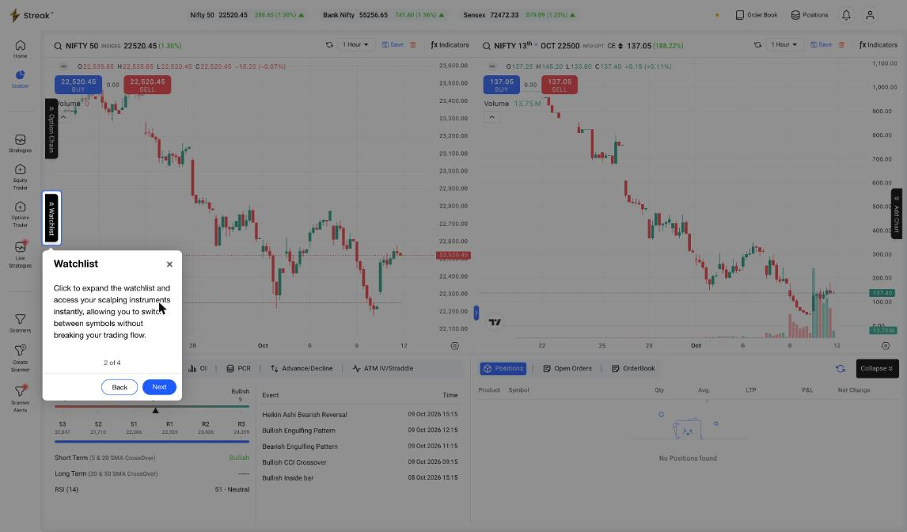
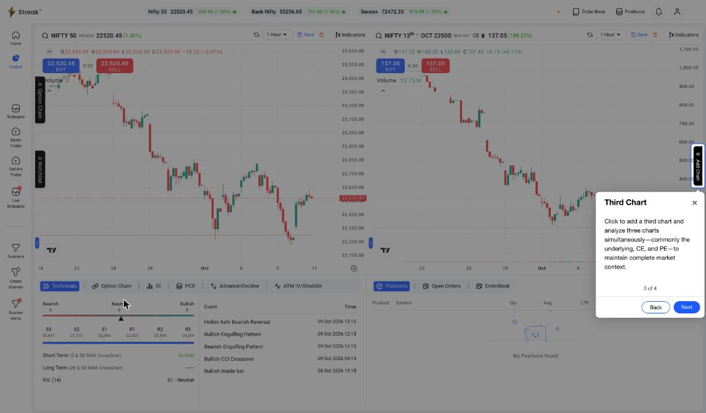
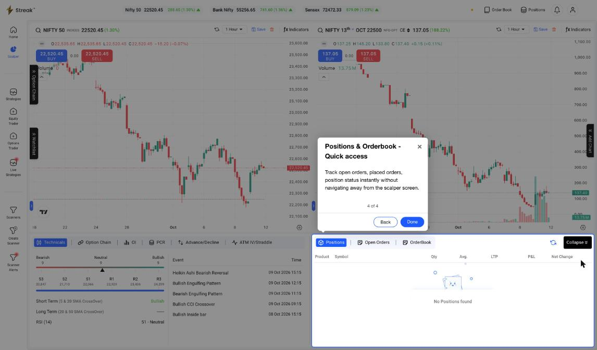
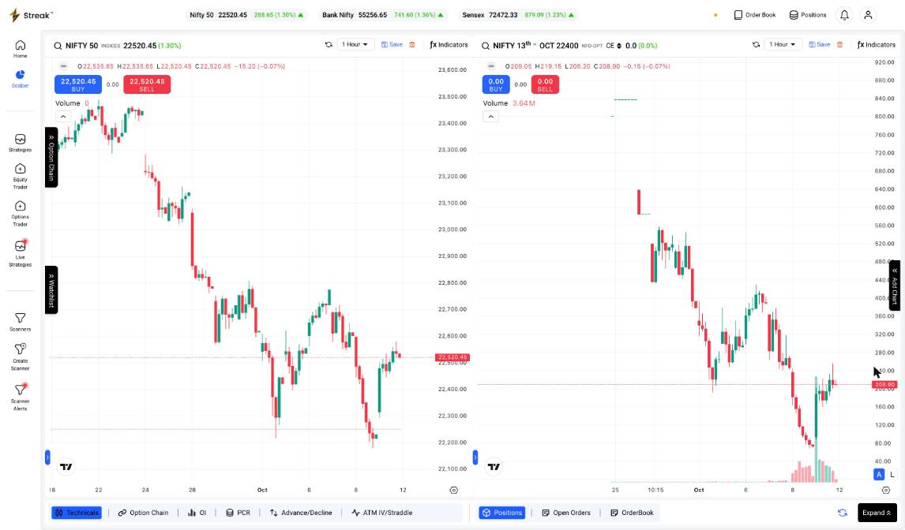

### 6.2 Third chart ("Add Chart")
- Click `« Add Chart` → a third chart is inserted on the right showing the **ATM PE** (`NIFTY 13ᵗʰ OCT 22500 PE`) — the
  "underlying + CE + PE" layout the tour describes. Tab changes to `» Hide Chart` (removes it).

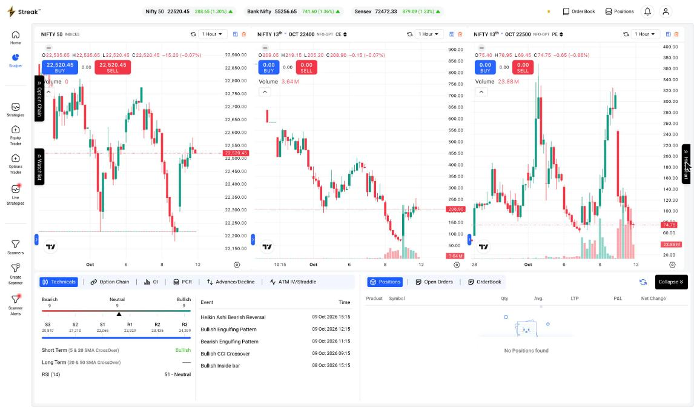

### 6.3 Option Chain drawer (left slide-over)
- Overlay drawer (page dimmed; click outside to close). Header: symbol search box (`NIFTY 50`), `Expiry [13 October 2026 ▾]`
  (13 Oct, 19 Oct, 27 Oct, 03 Nov, 09 Nov, 23 Nov, 29 Dec 2026), checkboxes **☑ OI** and **☐ Greeks**.
- Default columns: Call OI (Lakh) (chg%), Call LTP (chg%), Strike, Put LTP (chg%), Put OI (Lakh) (chg%), with ITM shading,
  bold ATM and OI bars like the Home option chain. Strike list ~21900…23100+ (scrollable).
- **Greeks ☑** widens the drawer and adds per side: Gamma, Vega, Theta, Delta, IV (calls: `Call Gamma | Call Vega |
  Call Theta | Call Delta | Call IV | Call OI | Call LTP`; puts mirrored). E.g. ATM 22500: Call Δ 0.60, IV 10.96, Θ −12.52,
  Vega 9.13, Γ 0.0015.
- **Row hover**: `📈` (load that option in the right chart — verified: 22400 CE replaced the right chart) plus `S` and `B`.
  The ATM call row shows `B` pre-selected (filled blue) on open → B/S here **toggle legs in a basket**, not instant orders
  (inferred: the basket already contained "B NIFTY 22500 CE"; B/S not clicked).
- `» Expand` tab on the drawer edge opens the **Place Basket Order** panel to the right of the chain; `« Collapse` hides it.

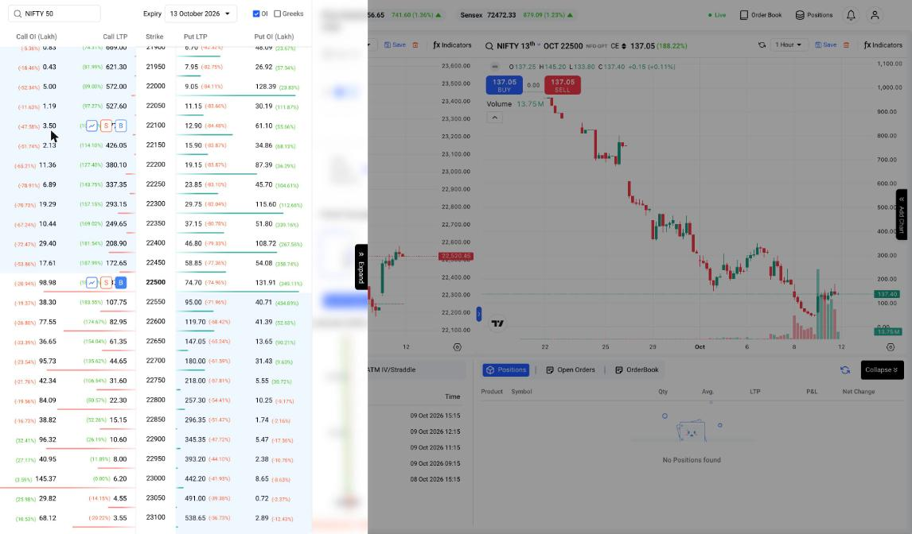
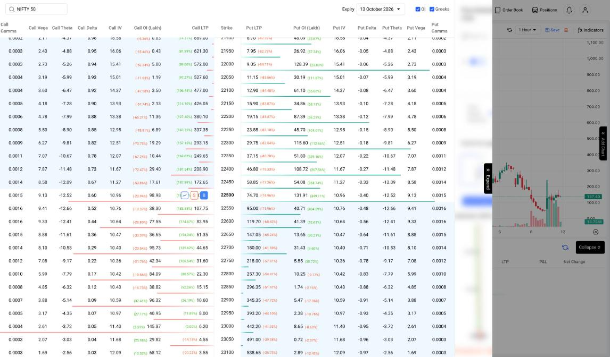

### 6.4 Place Basket Order panel (READ ONLY — "Place Basket Order" and "Done" were NOT clicked)
- Leg table: columns `☐(select all) | Type | Instruments | LTP | Holding | Market/Limit | Qty | Req. Margin | Status`.
  Row: drag handle ≡, checkbox ☑, `B`/`S` badge, instrument (`C NIFTY 13ᵗʰ ʷ OCT 225…`), LTP 137.05, product toggle
  `MIS ⇕` (vs NRML presumably), order type toggle `Market ⇕` (vs Limit), Qty spinner `65` (= 1 lot, lot-stepped), Req. Margin
  8908.25, Status `---`.
- Footer: `Total Margin Required: 8908.25`, `Margin Blocked After Execution: 8908.25` with ⟳ recalc, orange outlined
  `Place Basket Order 🛒` button.
- **Prebuilt Strategies** with filter `All | Bearish | Bullish | Neutral` and scrollable cards (mini payoff icon + name):
  Buy Call, Sell Put, Bull Call Spread, Bull Put Spread, Call Ratio Back Spread, Bull Condor, Bull Butterfly, Range Forward,
  Long Synthetic Futures, Buy Put, Sell Call, Bear Call Spread, Bear Put Spread, Put Ratio Back Spread, Bear Condor,
  Bear Butterfly, Risk Reversal, Short Synthetic Future, Short Straddle, Iron Butterfly, Short Strangle, Short Iron Condor,
  Batman, Double Plateau, Jade Lizard, Reverse Jade Lizard, Call Ratio Spread, Put Ratio Spread, Long Straddle,
  Long Iron Butterfly, Long Strangle, Long Iron Condor, Strap, Strip. (Selecting one presumably fills legs — not tried.)
- Payoff: `Pay-off Graph | Pay-off Table` toggle; legend `Target Date` (blue) / `Expiry` (green). Graph: x = underlying
  price (20270…24770), y = P&L, vertical marker "Current price: 22520.45", red loss zone/green profit zone, label
  "Projected loss: -3336 (-37.45%)". Table: `Target | On Expiry` in 10-pt steps (21530 → -8,908.25 …).
- `Done` (bottom-right).

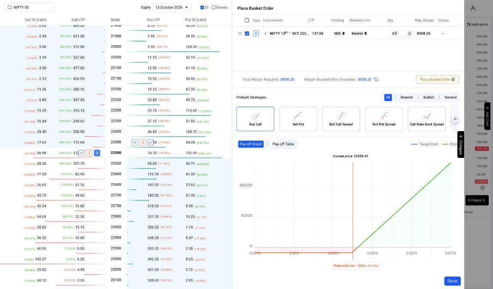
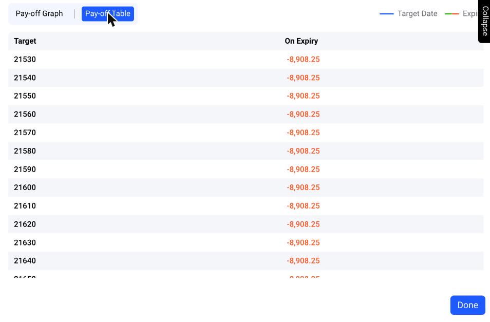

### 6.5 Watchlist drawer
- Docked panel (pushes the charts narrower, not an overlay) with the same Watchlist component as Home (tabs, Create Watchlist,
  search, delete, rows with B/S). `« Collapse` tab on its right edge closes it. Purpose per tour: switch symbols without
  breaking flow.

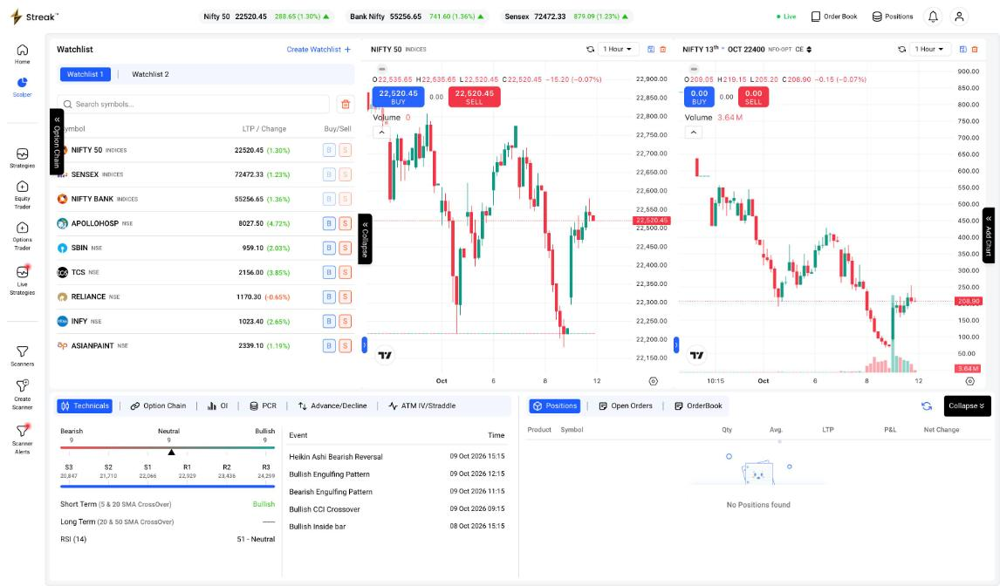

### 6.6 Positions / Open Orders / OrderBook
- **Positions** columns: Product, Symbol, Qty, Avg., LTP, P&L, Net Change. Empty state: illustration + "No Positions found".
- **Open Orders** columns: Time, Type, Symbol, Qty, LTP, Price, Status. Empty: "No orders found".
- **OrderBook** columns: Time, Type, Symbol, Qty, LTP, Avg. Price, Status. Empty: "No orders found".
- ⟳ refresh (blue) next to Collapse. Row actions (exit/modify/cancel) not observable (no data).

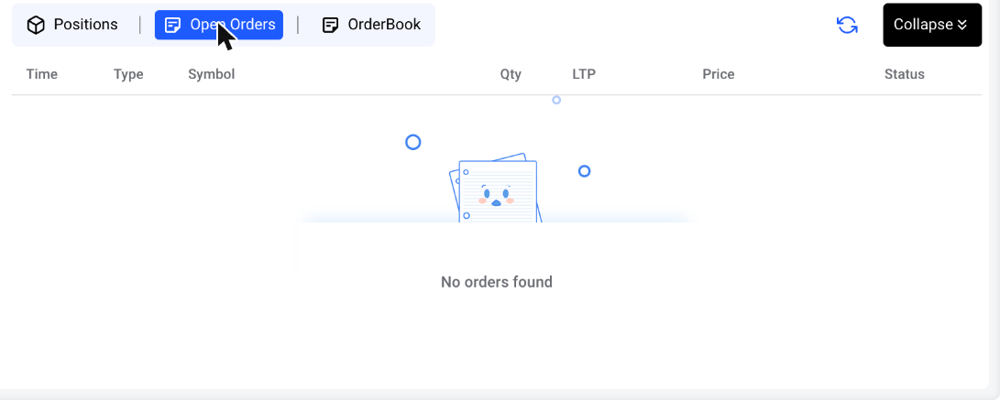
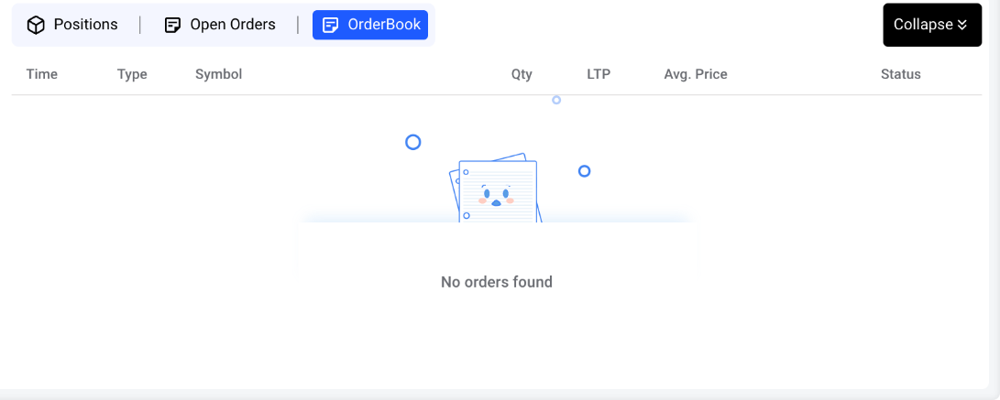

### 6.7 What the Scalper does NOT have (observed)
- **No market depth / DOM ladder**, no bid/ask quantity view.
- **No visible hotkey legend** or keyboard-shortcut settings (DOM text search for hotkey/shortcut/one-click found nothing);
  TV drawing shortcuts (⌥T, ⌥H…) and the TV `Create new order… ⇧T` context item are the only shortcuts seen.
- **No quantity presets** in the UI; TV's hidden `qtyEl` (title "Quantity") holds `1`, and basket qty defaults to one lot (65).
- Chart Buy/Sell overlay on options shows `0.00` prices when market is closed (no quotes).

**Open questions (Scalper):** whether chart Buy/Sell is one-click instant or opens an order window (not tested for safety);
the order window's fields (product, order type, SL/target, qty); whether selecting a prebuilt strategy rebuilds the basket around
ATM; whether MIS/NRML and Market/Limit toggles cycle other values (SL, SL-M); Positions row actions (Exit/Add) during market hours;
whether layout (charts/symbols) is persisted server-side (right chart kept 22400 CE after navigation within session).

## 7. Cross-cutting UX observations
- One consistent "instrument row" pattern everywhere (logo, symbol, exchange chip, LTP, coloured % change, B/S outline
  buttons, hover → chart icon / delete).
- Heavy reliance on hover-only affordances (row actions, option-chain B/S, indicator legend icons) — needs keyboard
  alternatives in a desktop rebuild.
- Escape does not close TradingView-iframe dialogs nor the Add Stocks modal; × or outside click required.
- Disabled B/S for non-tradable instruments (indices) rendered as faded buttons.
- Empty states: friendly illustration + one-line message (positions/orders); holdings simply show zeros.
- Live data indicator: small dot; no explicit "market closed" banner anywhere on Sunday.
- Symbol-dependent tab sets (index: 6 tabs; F&O stock: 5; option: Technicals only).
- Number formats: Indian grouping on chart axes (22,520.45), OI in Lakh/Crore, ₹ prefix; dates `09 Oct 2026 15:15`.

## 8. Gaps / not covered
- Order windows (Buy/Sell) — deliberately not opened. Create/Delete Watchlist dialogs — not opened.
- Live-market behaviour (tick updates, status dot during hours, refresh cadence) — observed only on a Sunday.
- Save chart layout semantics; `/chartiq?seg_sym=NSE_X&timeframe=day` full-page chart route was seen in another tab
  (likely from scanner results) but not explored here.
